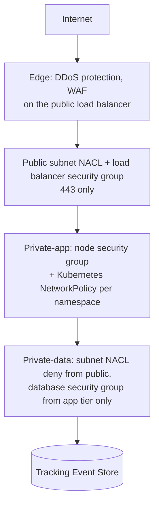
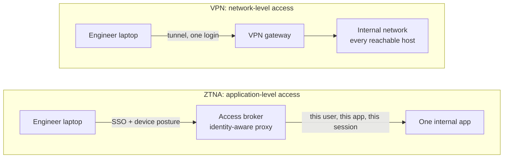
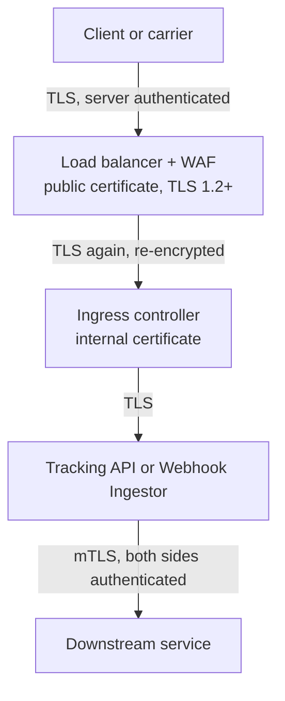
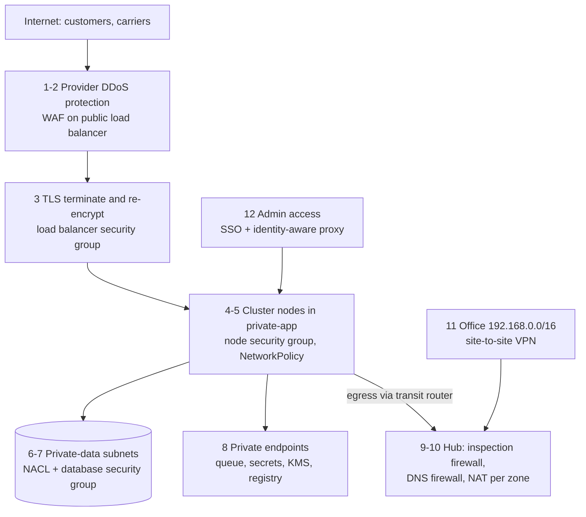

# Network security architecture

> Every network control sees only part of a request: addresses and ports, or HTTP, or an identity.
> Network security architecture is choosing which control sits at which hop, so that together they
> stop what matters, and knowing exactly what each one cannot see.

!!! abstract "Page facts"
    **Level:** Intermediate (control types and segmentation are Level 1-2; control placement, TLS
    termination choices, and the move to Zero Trust networking are Level 3) · **Status:** Draft ·
    **Time:** 60-90 minutes · **Last verified:** 2026-11-21

## Learning objectives

After this page you should be able to:

- Explain segmentation and microsegmentation, and the difference between stateful security groups
  and stateless network ACLs, including why ACLs need ephemeral-port rules.
- Say what a firewall, a web application firewall (WAF), DDoS protection, and an intrusion detection
  or prevention system (IDS/IPS) each inspect, and name one attack each cannot stop.
- Compare a VPN with zero trust network access (ZTNA), and explain network access control (NAC),
  private connectivity, and egress filtering.
- Choose where to terminate TLS, when to use mTLS, and how to run certificate lifecycle without
  outages.
- Describe DNS security controls, including DNSSEC at definition level.
- Place controls hop by hop on a real request path and state, per control, what it stops and what it
  cannot stop.

## Prerequisites

- [Networking fundamentals: IP, CIDR, routing, and DNS](../networking/networking-fundamentals-ip-cidr-routing-and-dns.md)
  — the AtlasMart address plan and route tables this page secures.
- [Security principles and threat modeling](security-principles-and-threat-modeling.md) — defense in
  depth, Zero Trust, and the STRIDE findings that motivate the controls here.
- [Network security, load balancing, and traffic flow](../networking/network-security-load-balancing-and-traffic-flow.md)
  — how traffic moves through load balancers and gateways. This page does not repeat that; it focuses
  on which security control belongs at each point.

## The problem this solves

The classic network design was a hard shell around a soft centre: a firewall at the edge, and inside
it everything could talk to everything. That design fails in three ways. Once one host inside is
compromised, the attacker moves sideways to the database (**lateral movement**) because nothing
inside says no. Users, partners, and services are no longer inside one building, so "inside" stops
meaning "trusted". And cloud networks are software: a single changed rule can expose a database to
the internet in seconds.

Network security architecture answers three questions: how to divide the network so a compromise
stays small, which inspection and filtering to put on each path, and how identity replaces location
as the basis for trust, without pretending that any single control covers everything.

## What it is

**Network security architecture** is the placement of network-level controls (filters, inspection,
encryption, and access brokers) at points on the traffic path, chosen from a threat model and from
what each control can observe.

| Control | Sees | Typical placement | Stops | Cannot stop |
|---|---|---|---|---|
| Security group / stateful filter | Addresses, ports, connection state, sometimes workload identity | Every network interface | Unexpected connections between tiers | Malicious content on an allowed port |
| Network ACL / stateless filter | Addresses and ports, per packet | Subnet boundary | Whole ranges, as a coarse second layer | Anything on an allowed range and port |
| Network firewall (stateful, often "next-generation") | L3-L4, often L7 application identification, domain names | Hub, between zones, egress | Unapproved destinations, east-west between networks | Encrypted payloads unless it decrypts |
| WAF | HTTP requests | In front of web apps and APIs | Known injection patterns, abusive rates, malformed requests | Broken access control, valid-but-malicious business requests |
| DDoS protection | Traffic volume and patterns | Provider edge, anycast | Volumetric and protocol floods | Low-rate abuse that looks legitimate |
| IDS / IPS | Packets or flows against signatures and baselines | Inline (IPS) or on a copy (IDS) | Known attack traffic, scanning, command-and-control patterns | Novel attacks; encrypted content it cannot see |
| ZTNA / identity-aware proxy | User, device posture, application | In front of internal apps | Access by unauthenticated or unhealthy devices | Misuse by an authorized user |
| Egress filter and DNS filter | Destinations, domain names | Central egress, resolver | Calls to unapproved hosts, many exfiltration and callback paths | Exfiltration to an allowed destination |
| TLS and mTLS | Peer identity via certificates | Each hop or end to end | Eavesdropping, tampering, spoofed services | Anything the authenticated peer chooses to send |

## Mental model

Think of an airport. Landside (the public area) and airside are separated by security screening
(the WAF and edge filters). Airside, each gate checks your boarding pass for that flight only
(microsegmentation and per-application access). Staff doors need a badge and a working, registered
device (ZTNA with device posture). Customs checks what leaves the country (egress filtering), and
cameras record everything (flow logs and IDS).

**Where the analogy breaks:** at an airport the screener can open your bag; on a network most
traffic is encrypted, so many controls see only the envelope (addresses, ports, server name) unless
they decrypt. An IP address is a weak boarding pass: it is shared, reused, and says nothing about who
is behind it. And attackers can send millions of "passengers" per second, which is why availability
attacks (DDoS) need different controls from access attacks.

## Key terms

| Term | Meaning on this page |
|---|---|
| Segmentation | Dividing a network into zones with controlled paths between them, to limit blast radius |
| Microsegmentation | Segmentation down to individual workloads, with policy expressed by workload identity or labels rather than subnets |
| Security group | A stateful allow-list attached to a network interface; return traffic is allowed automatically |
| Network ACL | A stateless, ordered rule list (allow and deny) attached to a subnet; return traffic needs its own rule |
| Ephemeral port | The temporary source port a client picks for a connection; replies are addressed to it |
| WAF | Web application firewall: a filter that inspects HTTP requests and blocks or rate-limits by rule |
| IDS / IPS | Intrusion detection system (alerts) / intrusion prevention system (alerts and blocks inline) |
| ZTNA | Zero trust network access: per-application access brokered by identity and device posture instead of network membership |
| NAC | Network access control: admitting a device to a (usually physical or Wi-Fi) network only after authentication and a posture check |
| Egress filtering | Restricting which destinations workloads may reach outbound |
| Mutual TLS (mTLS) | TLS in which both sides present certificates, giving service-to-service authentication as well as encryption |
| DNSSEC | DNS Security Extensions: signatures on DNS records that let a validating resolver check origin and integrity |

## How it works

### Segmentation: tiers, subnets, and filters

**Segmentation** follows trust boundaries. In the AtlasMart address plan the boundaries are
already there: public subnets hold load balancers, private-app subnets hold workloads, and
private-data subnets hold databases and caches with no default route. Segmentation adds filters so
that each zone accepts only the flows the design needs.

Cloud networks offer two filter types with different semantics, both of which you will exercise in
[Lab 14](../labs/lab-14-network-segmentation.md):

| Property | Security group (stateful) | Network ACL (stateless) |
|---|---|---|
| Attached to | A network interface | A subnet |
| Rules | Allow only | Allow and deny, numbered, first match wins, final implicit deny |
| Return traffic | Allowed automatically for tracked connections | Must be allowed explicitly, to the client's ephemeral ports |
| Source can be | CIDR, or another security group | CIDR only |
| Evaluated for traffic within a subnet | Yes | No: only when traffic enters or leaves the subnet |
| Good for | The primary, precise control per workload | A coarse guard rail: "the public tier never talks to the data tier" |

The AWS documentation for [network ACLs](https://docs.aws.amazon.com/vpc/latest/userguide/vpc-network-acls.html)
and [security groups](https://docs.aws.amazon.com/vpc/latest/userguide/vpc-security-groups.html)
describes exactly this split. Other providers differ in detail; the equivalents worth knowing:

| Concept | AWS | Azure | Google Cloud |
|---|---|---|---|
| Stateful per-workload filter | [Security groups](https://docs.aws.amazon.com/vpc/latest/userguide/vpc-security-groups.html) | [Network security groups](https://learn.microsoft.com/en-us/azure/virtual-network/network-security-groups-overview) (can attach to a subnet or interface) | [VPC firewall rules](https://cloud.google.com/firewall/docs/firewalls) (Cloud NGFW) |
| Reference a group of workloads instead of addresses | Security group as source | Application security groups | Network tags or service accounts as targets and sources |
| Stateless subnet filter | [Network ACLs](https://docs.aws.amazon.com/vpc/latest/userguide/vpc-network-acls.html) | No direct equivalent; NSGs are stateful | No direct equivalent; firewall rules are stateful |
| Managed network firewall | [AWS Network Firewall](https://docs.aws.amazon.com/network-firewall/latest/developerguide/what-is-aws-network-firewall.html) | [Azure Firewall](https://learn.microsoft.com/en-us/azure/firewall/overview) | [Cloud NGFW](https://cloud.google.com/firewall/docs/about-firewalls) |

**Referencing groups rather than addresses** is the most useful single habit. A rule "the database
accepts 5432 from the app security group" stays correct when the app tier scales into a new subnet;
a rule "from 10.10.16.0/20" silently excludes the new subnet and silently includes every other
workload in the old one. Lab 14's experiment d shows both effects.

**Microsegmentation** carries the same idea to every workload. In Kubernetes, a
[NetworkPolicy](https://kubernetes.io/docs/concepts/services-networking/network-policies/) selects
pods by label and allows ingress and egress only from and to other labelled pods, namespaces, or
CIDRs; a "default deny" policy per namespace plus explicit allows is the common baseline (it takes
effect only if the cluster's network plugin enforces it). Service meshes add identity: the allow rule
names a workload's certificate identity instead of an address. Host firewalls do the same on virtual
machines.

**Figure 1 — Segmentation layers on AtlasMart's request path.** Each box is a filter; a request must
pass every one on its way to the data tier.

How to read it: top to bottom are successive layers of defense in depth. The upper layers filter by
address and protocol for everyone; the lower layers filter by workload, so a compromised component
higher up still cannot reach the database unless its own identity is allowed.

### Firewalls, WAF, and DDoS protection

A **packet filter** decides per packet on addresses, protocol, and ports. A **stateful firewall**
also tracks connections, so replies are matched to requests. A **next-generation firewall** adds
application identification, domain-name rules, intrusion prevention, and optionally TLS decryption.
NIST [SP 800-41](https://csrc.nist.gov/pubs/sp/800/41/r1/final) describes these types and the
policy that should drive them: deny by default, allow by documented need.

A **web application firewall (WAF)** sits in front of HTTP services. It applies managed rule sets
that match common attack patterns (injection, cross-site scripting, known scanner signatures), rate
rules per client, size and method limits, and bot or geography rules. It is a negative security
model (block what looks bad) unless you add positive rules (allow only the paths and methods the API
defines), which are stronger. A WAF cannot know that customer 123 should not see customer 456's
shipment; that broken access control check lives in the application
([application security](application-security.md)).

**DDoS** (distributed denial of service) attacks come in three kinds: volumetric (fill the pipe),
protocol (exhaust connection state in load balancers and firewalls), and application-layer (many
valid-looking expensive requests). Providers absorb the first two at their edge with anycast and
scrubbing, usually always-on at a basic level with paid tiers adding response teams and cost
protection; check your provider's documentation. Application-layer floods need WAF rate rules,
caching, autoscaling, and load shedding, because each request looks legitimate on its own.

| Concept | AWS | Azure | Google Cloud |
|---|---|---|---|
| WAF | [AWS WAF](https://docs.aws.amazon.com/waf/latest/developerguide/waf-chapter.html) | [Azure Web Application Firewall](https://learn.microsoft.com/en-us/azure/web-application-firewall/overview) | [Google Cloud Armor](https://cloud.google.com/armor/docs/cloud-armor-overview) |
| DDoS protection | [AWS Shield](https://docs.aws.amazon.com/waf/latest/developerguide/shield-chapter.html) | [Azure DDoS Protection](https://learn.microsoft.com/en-us/azure/ddos-protection/ddos-protection-overview) | Google Cloud Armor |
| Private access to provider and partner services | [AWS PrivateLink](https://docs.aws.amazon.com/vpc/latest/privatelink/what-is-privatelink.html) | [Azure Private Link](https://learn.microsoft.com/en-us/azure/private-link/private-link-overview) | [Private Service Connect](https://cloud.google.com/vpc/docs/private-service-connect) |

### IDS, IPS, and traffic inspection

An **IDS** watches a copy of traffic (or flow records) and alerts; an **IPS** sits inline and can
drop traffic. Both use signatures (known patterns) and anomaly detection (deviation from a learned
baseline); NIST [SP 800-94](https://csrc.nist.gov/pubs/sp/800/94/final) describes network-based,
host-based, and wireless variants. Inline means it can also break production: a false positive drops
real customers, and a saturated device becomes a bottleneck.

Most traffic is TLS-encrypted, so deep inspection requires **TLS interception**: the inspection
device terminates TLS with a certificate that clients trust, inspects, and re-encrypts. It adds an
internal certificate authority that every client must trust, sees all plaintext (a high-value target
and a privacy question), adds latency, and breaks certificate pinning and mTLS. Many architectures
therefore inspect where they already terminate TLS (the WAF at the edge) and rely on metadata
elsewhere: **flow logs** (who talked to whom, accepted or rejected), **DNS query logs** (what names
were resolved), and the server name visible in the TLS handshake. Cheap, broad metadata usually finds
more than expensive, narrow decryption.

### Remote access: VPN, ZTNA, and NAC

A **remote-access VPN** places the user's device on the network: after login, the device has an
address inside, and network rules decide what it can reach. That is convenient and coarse: a
compromised laptop on the VPN can scan everything its subnet can reach. A **site-to-site VPN**
connects networks; AtlasMart's office reaches the hub this way today
([hybrid connectivity and VPNs](../networking/hybrid-connectivity-and-vpns.md)).

**Zero trust network access (ZTNA)** inverts this. The user connects to a broker or identity-aware
proxy that authenticates the user through single sign-on, checks the device's posture, and then
connects that user to one application, never to the network. Applications are not reachable at all
without the broker, which is the enforcement point of the Zero Trust model in
[NIST SP 800-207](https://csrc.nist.gov/pubs/sp/800/207/final). Google's BeyondCorp work is the
best-known early example. Provider equivalents include
[AWS Verified Access](https://docs.aws.amazon.com/verified-access/latest/ug/what-is-verified-access.html),
[Microsoft Entra Private Access](https://learn.microsoft.com/en-us/entra/global-secure-access/concept-private-access),
and Google Cloud's [Identity-Aware Proxy](https://cloud.google.com/iap/docs/concepts-overview).

**Figure 2 — Remote access by VPN versus by ZTNA.** The VPN grants a network; ZTNA grants one
application per session.

How to read it: in the upper path, everything after the gateway is reachable unless separately
filtered. In the lower path the broker decides per request and per application, and the rest of the
network is invisible to the user.

**Network access control (NAC)** is the campus and office counterpart: a device plugging into a
switch port or joining Wi-Fi authenticates (commonly IEEE 802.1X) and is checked for posture before
being placed on a network segment, or quarantined. **Endpoint protection** (anti-malware and endpoint
detection and response, EDR) on laptops and servers supplies the device-health signal that NAC and
ZTNA decisions use, and detects compromise that network controls miss.

### Private connectivity and egress filtering

**Private connectivity** keeps traffic off the internet: private endpoints to provider services
(queue, secrets manager, key management service, container registry), peering or a transit router
between networks, and dedicated connections to data centres. Private endpoints also carry policies
("this endpoint may reach only this queue"), which closes a data exfiltration path: a compromised
workload cannot copy data to the attacker's own storage account through the provider's public
service front door.

**Egress filtering** controls where traffic may go out. It matters because almost every serious
attack needs an outbound connection: to fetch tools, to reach a command-and-control server, to send
stolen data, or to complete a server-side request forgery. NAT is not a filter; it only hides
addresses. Effective egress control is a central egress point (a firewall in a hub network) with an
allowlist by domain name (only the identity provider, the notification provider, and the carriers'
key endpoints, for example), plus DNS filtering so that names outside the allowlist do not resolve.
The residual risk is exfiltration to an allowed destination, which data controls and monitoring must
cover ([data security and privacy](data-security-and-privacy.md)).

### DNS security

DNS is both a dependency and an attack path. Controls:

- **DNS filtering** at the resolver blocks resolution of known-bad or unapproved domains and logs
  every query; examples are [Route 53 Resolver DNS Firewall](https://docs.aws.amazon.com/Route53/latest/DeveloperGuide/resolver-dns-firewall.html),
  [Azure DNS resolver policy](https://learn.microsoft.com/en-us/azure/dns/dns-security-policy), and
  [Cloud DNS response policies](https://cloud.google.com/dns/docs/zones/manage-response-policies).
  Query logs are among the best detection sources for compromised workloads.
- **DNSSEC** adds digital signatures to DNS records and a chain of trust from the root, so a
  validating resolver can verify that an answer came from the zone's owner and was not altered
  ([RFC 4033](https://www.rfc-editor.org/rfc/rfc4033)). It provides origin authentication and
  integrity, not confidentiality, and protects only clients whose resolvers validate. Encrypted DNS
  transports (DNS over TLS or HTTPS) address confidentiality separately.
- **Registrar and zone hygiene:** registrar locks and multi-factor authentication on the registrar
  account, and removal of records that point at deleted resources (a dangling record can let someone
  else claim the target and serve content under your name).

### TLS termination choices

Where TLS ends decides which components see plaintext, where a WAF can inspect, and who manages
certificates.

| Option | Plaintext visible at | WAF possible | Certificate work | Favor when |
|---|---|---|---|---|
| Terminate at the edge, plain HTTP inside | Edge and every internal hop | Yes, at edge | One public certificate | Never for personal data; only for isolated, low-value traffic |
| Terminate at edge, re-encrypt to backend | Edge and the backend | Yes, at edge | Public certificate plus internal certificates | The default for web APIs: inspection at the edge, encryption on every hop |
| TLS passthrough to the workload | Only the workload | No (L4 only) | Certificates on every workload | End-to-end requirements where the edge must not see content |
| mTLS between services (mesh or library) | Each service endpoint | At edge only | Automated internal CA, short-lived certificates | East-west traffic needing service identity and encryption |

**Figure 3 — The re-encrypt pattern with mTLS inside.** TLS terminates at the edge for inspection;
every later hop is encrypted again, and service-to-service hops authenticate both ends.

How to read it: plaintext exists inside the load balancer (where the WAF inspects) and inside each
service, never on a wire. The OWASP [Transport Layer Security Cheat Sheet](https://cheatsheetseries.owasp.org/cheatsheets/Transport_Layer_Security_Cheat_Sheet.html)
covers protocol versions and cipher choices.

### mTLS and certificate lifecycle

**mTLS** gives each service a certificate that names its identity, and each side verifies the other.
It replaces "trust the source address" with "trust the authenticated workload", which is what makes
microsegmentation by identity possible. Its cost is certificate lifecycle at scale:

1. **Issue** from an internal certificate authority (CA) to a workload identity, not to a host name
   typed by hand.
2. **Distribute** private keys only to the workload, generated where they are used when possible.
3. **Rotate** automatically and often; short-lived certificates (hours to days) make revocation less
   critical because a stolen one expires soon.
4. **Revoke** when compromised, and know how clients learn about it.
5. **Monitor** expiry: an expired certificate is one of the most common causes of self-inflicted
   outages.

For public certificates, the ACME protocol ([RFC 8555](https://www.rfc-editor.org/rfc/rfc8555))
automates issuance and renewal; managed certificate services at load balancers do the same. For
internal mTLS, a service mesh or a workload identity system issues and rotates certificates without
application code changes ([Kubernetes networking, storage, and service mesh](../containers-and-kubernetes/kubernetes-networking-storage-and-service-mesh.md)).

### How Zero Trust networking changes the perimeter

Zero Trust does not remove the network perimeter; it stops treating it as the decision point.
Three shifts follow:

- **From location to identity.** Rules name workloads, users, and devices, and are enforced close
  to the resource (proxy, sidecar, security group by reference), not only at the edge.
- **From one perimeter to many small ones.** Every application has its own enforcement point;
  segmentation remains, but as blast-radius control, not as the trust signal.
- **From allow once to check continuously.** Sessions are short, posture is re-evaluated, and
  logs feed policy.

What stays the same: DDoS protection and WAF at the internet edge, egress control, and network
filters as a second layer for when identity controls are misconfigured.

## Worked example: AtlasMart control placement

AtlasMart's platform (Phase 4 assumptions): one prod virtual network `10.10.0.0/16` attached to a
hub network `10.0.0.0/16` through a transit router; internet egress is centralized in the hub
(inspection firewall plus NAT), ingress stays in the workload network behind a public load balancer
with a WAF; the office `192.168.0.0/16` reaches the hub by site-to-site VPN with two tunnels; the
private zone `internal.atlasmart.example` resolves through the hub; flow logs and DNS logs go to the
log archive account. Order Tracking runs on the prod managed Kubernetes cluster; PostgreSQL and Redis
are managed services in the private-data subnets. New assumption for this page: to keep NFR-2's
zone independence, the hub runs one firewall endpoint and one NAT gateway per zone.

**Figure 4 — Where AtlasMart's network controls sit.** Numbers match the rows of the table below.

How to read it: the vertical chain is the customer and carrier request path; side arrows are the
workload's calls to provider services, its outbound internet traffic, and human access.

| # | Hop | Control | What it stops | What it cannot stop |
|---|---|---|---|---|
| 1 | Internet → public load balancer | Provider DDoS protection | Volumetric and protocol floods against `track` and `webhooks` | Low-rate requests that each look valid |
| 2 | Same | WAF: managed rule sets; positive rules on the webhook host (only `POST /v1/carrier-events`); per-source rate rules; 64 KB body limit | Injection patterns, scanners, oversized bodies, a single source flooding | Forged but well-formed webhooks (the HMAC check, STRIDE T1); one customer reading another's shipment (the API's owner check, NFR-5) |
| 3 | Load balancer → ingress | TLS 1.2+ at the edge, re-encrypted to the ingress controller; load balancer security group allows 443 in, and out only to the node group | Eavesdropping or tampering on any wire; direct internet access to nodes | A compromised pod reading the traffic it legitimately receives |
| 4 | Node to node, pod to pod | Node security group allows the load balancer and the cluster's own groups; default-deny NetworkPolicy per namespace with explicit allows | Lateral movement between namespaces; random pods calling the Ingestor | Abuse by a pod over a flow its policy allows |
| 5 | Pod → data tier | NetworkPolicy egress: only Tracking API and Event Processor pods to 5432 and 6379 | The Webhook Ingestor (STRIDE T6) reaching the database | A compromised Event Processor, which must reach the database (database grants limit what it can do) |
| 6 | Into private-data subnets | NACL: explicit deny from public subnets; allow 5432 and 6379 from the app subnets; outbound ephemeral ports back to them | A mis-edited security group exposing the data tier to the public tier | Anything from inside the app subnets |
| 7 | At the database | Database security group allows only the cluster node group (or per-pod groups where the provider supports them) | Every other workload in the network | Pods on those nodes that NetworkPolicy fails to restrict: nodes share one group, which is why row 5 exists |
| 8 | Workload → provider services | Private endpoints with endpoint policies (this queue, these secrets, this registry) | Traffic to provider services over the internet; copying data to another account's resources | Misuse of allowed resources by an allowed identity |
| 9 | Workload → internet | Hub inspection firewall with a domain allowlist (identity provider, notification provider, carrier key endpoints); IPS signatures on egress | Command-and-control callbacks, tool downloads, exfiltration to arbitrary hosts | Exfiltration to an allowed destination; content inside TLS (not decrypted) |
| 10 | All name resolution | Hub resolver with DNS firewall; query logs to the log archive | Resolution of unapproved and known-bad domains; DNS-based exfiltration to unapproved zones | Encrypted DNS sent directly to an outside resolver if egress allows it (row 9 must block it) |
| 11 | Office → hub | Site-to-site VPN, two tunnels; hub firewall allows the office only to named admin endpoints | Office traffic reaching workloads directly | A compromised office laptop using what the firewall allows |
| 12 | Engineers → cluster and consoles | SSO with permission sets; identity-aware proxy for the cluster API and admin tools; no bastion with shared SSH keys | Access from unmanaged devices or without MFA | An authorized engineer's mistake (needs change control and audit, NFR-5 logging) |
| 13 | Everywhere | Flow logs, DNS logs, load balancer and WAF logs to the log archive; SIEM alerts | Nothing directly: it detects | Attacks that leave no network trace, such as abuse through an allowed API |

Three observations a reviewer should take away. First, the table's last column is never empty:
each control has a gap that another row or another domain (identity, application, data) closes.
Second, rows 5 and 7 show a Kubernetes-specific trap: a database security group that trusts the
node group trusts every pod on those nodes, so the precise control is NetworkPolicy (or per-pod
groups). Third, the controls that stop the most important webhook threats are not network controls
at all: the HMAC check and the owner check are application controls, and the network can only narrow
who gets to try.

Capacity check, arithmetic from existing AtlasMart numbers: at the sale-day design peak, tracking
responses are 210 reads/s × 4 KB = 840 KB/s, about 6.7 Mbit/s, and webhooks are 70 events/s × 500 B
= 35 KB/s. Edge controls are not the bottleneck at this scale; what matters is their rule quality and
logging volume.

## Real-world architecture example

Most mid-size cloud estates converge on a similar pattern: a hub network per region with the
inspection firewall, central DNS resolvers, and the hybrid connections; spoke networks per workload
and environment; ingress handled in each spoke by the provider's load balancer and WAF so that each
team owns its own edge rules; and egress forced through the hub by route tables that send the
default route to the transit router. Identity-aware proxies have replaced most bastion hosts and much
of the remote-access VPN for administrators. Inside Kubernetes clusters, default-deny network policies
and a service mesh with mTLS are increasingly standard for production namespaces. The case study on
[zero-trust application architecture](../end-to-end-case-studies/cs-15-zero-trust-application-architecture.md)
develops this end to end.

## Design choices and trade-offs

| Choice | Favor when | Avoid when |
|---|---|---|
| Security groups referencing groups | Any autoscaling tier; rules that should follow workloads | Peers outside your network, which have only addresses |
| Stateless network ACLs as a second layer | Coarse tier rules that should survive a security group mistake | Fine-grained rules: they double the rule work and break on forgotten return rules |
| Central egress firewall in a hub | Many networks; a single place for allowlists, IPS, and logs | Very latency-sensitive or high-volume egress where the hub becomes a bottleneck and cost centre; use per-spoke egress with shared policy |
| Positive-model WAF rules | APIs with a small, known set of paths and methods (the webhook endpoint) | Large web applications with constantly changing paths; start with managed rules |
| TLS interception | Regulated environments that must inspect content in transit | Service-to-service mTLS, pinned clients, highly personal data where the decrypting device becomes the risk |
| ZTNA for workforce access | Contractors, remote work, many internal web apps | Legacy thick-client protocols the broker cannot carry; keep a narrow VPN for those |
| Service mesh mTLS | Many services, need for service identity and encrypted east-west | Few services; library-level TLS with workload identity may be simpler |
| DNSSEC signing of public zones | Your registrar and DNS provider support it with automated key rollover | Manual key management; a botched rollover makes the zone unresolvable for validating resolvers |

## Failure modes and anti-patterns

- **Hard shell, soft centre.** Strong edge, flat inside. Detect: any workload can reach the
  database on its port. Prevent: tier filters plus workload-level policy; test with Lab 14's
  experiment a versus b.
- **Forgotten ephemeral ports.** A new NACL breaks a flow, and the symptom is a timeout, not an
  error. Detect: flow logs show the request ACCEPT and the reply REJECT on the server's interface.
  Prevent: write rules in pairs; test each flow after change.
- **CIDR rules that drift.** Rules by address miss new subnets and include unintended neighbours.
  Prevent: reference groups or identities; review address-based rules when the address plan changes.
- **"Temporary" any-any rules.** Opened during an incident, never closed. Detect: posture
  management flags `0.0.0.0/0` on non-edge groups. Prevent: expiring exceptions with an owner.
- **WAF as access control.** Expecting the WAF to stop data leaks between customers. Prevent:
  authorization in the application; the WAF only reduces noise.
- **Egress open by default.** NAT taken for a filter. Detect: workloads resolving and reaching
  arbitrary domains in DNS and flow logs. Prevent: default route to an inspecting hub with an
  allowlist.
- **Expired certificates.** Outage at renewal time. Detect: expiry monitoring with alerts weeks
  ahead. Prevent: automated issuance and short-lived certificates.
- **Inline device as a single point of failure.** One firewall instance in one zone for all
  egress. Prevent: per-zone endpoints, as in the worked example, and tested failover.

## Security considerations

- **Inspection devices are crown jewels.** A firewall that decrypts TLS or a log pipeline that holds
  all DNS queries is a high-value target; restrict its administration and monitor it like a database.
- **Network logs contain personal data.** Client IP addresses in flow and WAF logs can be personal
  data under privacy law; set retention deliberately and restrict access (this is not legal advice;
  ask counsel).
- **Configuration is code.** Rules belong in infrastructure code with review and automated policy
  checks, because the most common network exposure is a configuration change, not an exploit.
- **Defense in depth needs independence.** If the same pipeline role can change the WAF, the
  security groups, and the NACLs, a single compromised credential removes every layer.

## Performance, reliability, and cost

- **Performance:** filters on interfaces add negligible latency; each inline device (WAF, firewall,
  IPS, TLS interception) adds processing and sometimes a network hop. Hairpinning east-west traffic
  through a hub firewall adds the most; keep zone-local paths where possible.
- **Reliability:** inline devices are dependencies. Deploy them per zone, decide fail-open or
  fail-closed per path, and test failover. WAF rule updates can block legitimate traffic; roll them
  out in count or log-only mode first.
- **Cost:** managed firewalls, NAT, WAF requests, and logs are billed by hour and by volume in most
  providers; check current pricing. Flow logs and DNS logs are often the surprise; sample or filter
  where full fidelity is not needed, and keep the security-relevant ones in full.

## Hands-on lab: network segmentation

The full lab is [Lab 14: network segmentation](../labs/lab-14-network-segmentation.md). It runs a
standard-library Python simulator of AtlasMart's zone a (public `10.10.0.0/22`, private-app
`10.10.16.0/20`, private-data `10.10.32.0/22`) with stateful security groups and stateless NACLs,
and prints flow-log-style lines that say which rule decided. In short:

1. Run the flat network: a compromised web host reaches the database.
2. Run the segmented network: security groups block web to database, while app to database works.
3. Add a data-subnet NACL that forgets the ephemeral-port return rule: the legitimate flow times
   out, and the flow log shows the request ACCEPT and the reply REJECT on the database interface.
4. Compare a database rule by CIDR with one by security group when the app tier scales into
   `10.10.48.0/20`.
5. Optionally, read (or run, if you have Docker) a two-network Compose file whose data network is
   `internal: true`.

??? question "Hint: why does the broken NACL cause a timeout and not an error?"
    The request is allowed and reaches the database, which replies. The reply is dropped silently at
    the subnet boundary, so the client hears nothing until its own timeout. Neither filter type sends
    a rejection message back.

## Knowledge check

1. Why does a stateless network ACL need an outbound rule for ports 1024-65535 when the database
   only listens on 5432?
2. Give one attack a WAF stops and one it cannot stop on AtlasMart's Tracking API.
3. What does DNSSEC protect, and what does it not protect?
4. How does ZTNA differ from a remote-access VPN in what a compromised laptop can reach?
5. Why does a database security group that allows "the cluster node group" not by itself keep the
   Webhook Ingestor away from the database?

??? success "Answers"
    1. Replies go to the client's ephemeral source port, not to 5432. A stateless filter evaluates
       each packet without connection state, so the reply needs its own allow rule for the port range
       clients use (AWS documents 1024-65535 as a range that covers common clients).
    2. Stops: a request with an SQL injection pattern, or one client flooding the endpoint. Cannot
       stop: a signed-in customer requesting another customer's shipment ID (broken access control);
       the API must check ownership (NFR-5).
    3. Origin authentication and integrity of DNS answers for validating resolvers. Not
       confidentiality of queries, not clients whose resolvers do not validate, and not a phishing
       domain that is itself correctly signed.
    4. A VPN puts the laptop on the network, so it can reach whatever network rules allow from its
       address. ZTNA connects the authenticated user on a healthy device to one application per
       session; nothing else is reachable.
    5. All pods on those nodes share the node group, so the network sees the Ingestor's traffic as
       coming from an allowed source. A NetworkPolicy egress rule (or per-pod security groups) is
       needed to distinguish workloads.

## Architecture discussion questions

1. AtlasMart's security team proposes TLS interception on the hub firewall for all egress. Which
   flows would it help, which would it break, and what would you propose instead?
2. Carriers ask AtlasMart to publish fixed source addresses they can allowlist for any callbacks
   AtlasMart makes to them. How does the hub egress design make this possible, and what new single
   point of failure must you avoid?
3. A team wants to replace security groups with only Kubernetes NetworkPolicy and a service mesh,
   "because Zero Trust". Argue for keeping both layers or for removing one.

## Summary

Network controls differ in what they can see: stateful security groups and stateless ACLs see
addresses and ports, firewalls add application and domain awareness, WAFs see HTTP, DDoS protection
sees volume, IDS and IPS match patterns, and ZTNA brokers see identity and device health. Segmentation
and microsegmentation limit blast radius, best expressed by group or identity rather than address.
Private endpoints and central egress filtering with DNS filtering close the outbound paths attackers
need. TLS should be re-encrypted on every hop, with mTLS for service identity and automated
certificate lifecycle. Zero Trust moves the decision from network location to identity without
removing the network layers, and a hop-by-hop placement table, with an honest "cannot stop" column,
shows where network controls end and application and identity controls must take over.

## Related topics

- **Before:** [Networking fundamentals](../networking/networking-fundamentals-ip-cidr-routing-and-dns.md);
  [Security principles and threat modeling](security-principles-and-threat-modeling.md).
- **Alongside:** [Network security, load balancing, and traffic flow](../networking/network-security-load-balancing-and-traffic-flow.md);
  [Hybrid connectivity and VPNs](../networking/hybrid-connectivity-and-vpns.md);
  [Identity and access management](identity-and-access-management.md);
  [Cloud building blocks and landing zones](../cloud-architecture/cloud-building-blocks-and-landing-zones.md);
  [Lab 14: network segmentation](../labs/lab-14-network-segmentation.md);
  [Multi-account landing zone and hub-and-spoke network case study](../end-to-end-case-studies/cs-08-multi-account-landing-zone-and-hub-and-spoke-network.md).
- **Planned:** observability for network signals (D15); policy as code for network rules in the
  delivery pipeline (D16); the dedicated connection to the distribution centre (case study 09).

## References

| Source | Type | Checked |
|---|---|---|
| [NIST SP 800-207: Zero Trust Architecture](https://csrc.nist.gov/pubs/sp/800/207/final) — NIST | Standard | 2026-11-21 |
| [NIST SP 800-41 Rev. 1: Guidelines on Firewalls and Firewall Policy](https://csrc.nist.gov/pubs/sp/800/41/r1/final) — NIST | Standard | 2026-11-21 |
| [NIST SP 800-94: Guide to Intrusion Detection and Prevention Systems](https://csrc.nist.gov/pubs/sp/800/94/final) — NIST | Standard | 2026-11-21 |
| [Control subnet traffic with network ACLs](https://docs.aws.amazon.com/vpc/latest/userguide/vpc-network-acls.html) and [security groups](https://docs.aws.amazon.com/vpc/latest/userguide/vpc-security-groups.html) — AWS | Official documentation (stateful versus stateless, rule evaluation) | 2026-11-21 |
| [Network security groups](https://learn.microsoft.com/en-us/azure/virtual-network/network-security-groups-overview) — Microsoft Learn; [VPC firewall rules](https://cloud.google.com/firewall/docs/firewalls) — Google Cloud | Official documentation (stateful filters, group references) | 2026-11-21 |
| [RFC 4033: DNS Security Introduction and Requirements](https://www.rfc-editor.org/rfc/rfc4033) and [RFC 8555: ACME](https://www.rfc-editor.org/rfc/rfc8555) | Standards | 2026-11-21 |
| [Transport Layer Security Cheat Sheet](https://cheatsheetseries.owasp.org/cheatsheets/Transport_Layer_Security_Cheat_Sheet.html) — OWASP | Guidance | 2026-11-21 |
| Rory Ward and Betsy Beyer, ["BeyondCorp: A New Approach to Enterprise Security"](https://research.google/pubs/beyondcorp-a-new-approach-to-enterprise-security/), ;login:, 2014 | Paper (early ZTNA practice) | 2026-11-21 |

## Review notes

- Canonical page for D12-T03. In depth: segmentation and microsegmentation, firewalls, WAF, egress
  filtering, TLS termination, mTLS and certificate lifecycle, ZTNA versus VPN, control placement.
  Defined at shorter depth: DDoS protection, IDS/IPS, NAC (IEEE 802.1X named only), private
  connectivity (details in D09-T04 and D10-T02), DNS security (DNSSEC at definition depth only),
  endpoint protection (EDR named; host and container runtime detail in D12-T06), traffic inspection.
- Load balancing mechanics are deliberately left to D09-T03 (written in parallel); check the two
  pages do not contradict each other on TLS termination wording.
- Provider product names and the "no direct stateless equivalent" statements for Azure and Google
  Cloud were checked against the linked pages on 2026-11-21 (Azure NSGs and Google Cloud VPC firewall
  rules are documented as stateful). "Azure DNS resolver policy" is the current page title (it was
  earlier called DNS security policy). Inline product links all returned 200.
- The Kubernetes NetworkPolicy enforcement caveat and the "node security group trusts every pod"
  point are generic; some providers offer per-pod security groups: a reviewer may add a link.
- New AtlasMart assumptions introduced here: one hub firewall endpoint and one NAT gateway per zone;
  default-deny NetworkPolicy per namespace; the egress domain allowlist contents; WAF positive rule
  for `POST /v1/carrier-events`. The 840 KB/s and 35 KB/s figures are arithmetic from existing
  numbers. BeyondCorp year and venue are from the publication page.
- Mermaid: Figure 2 uses `~~~` to stack its two subgraphs; Figure 4 has 9 nodes with side branches.
