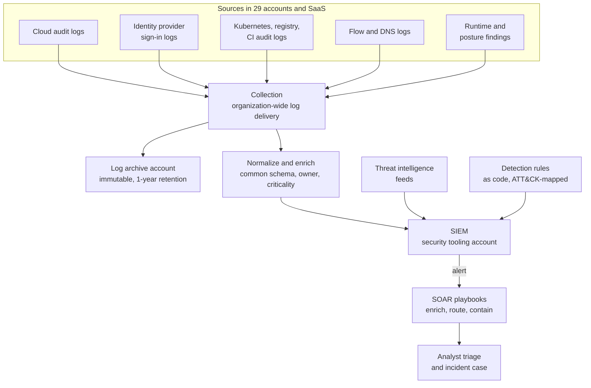
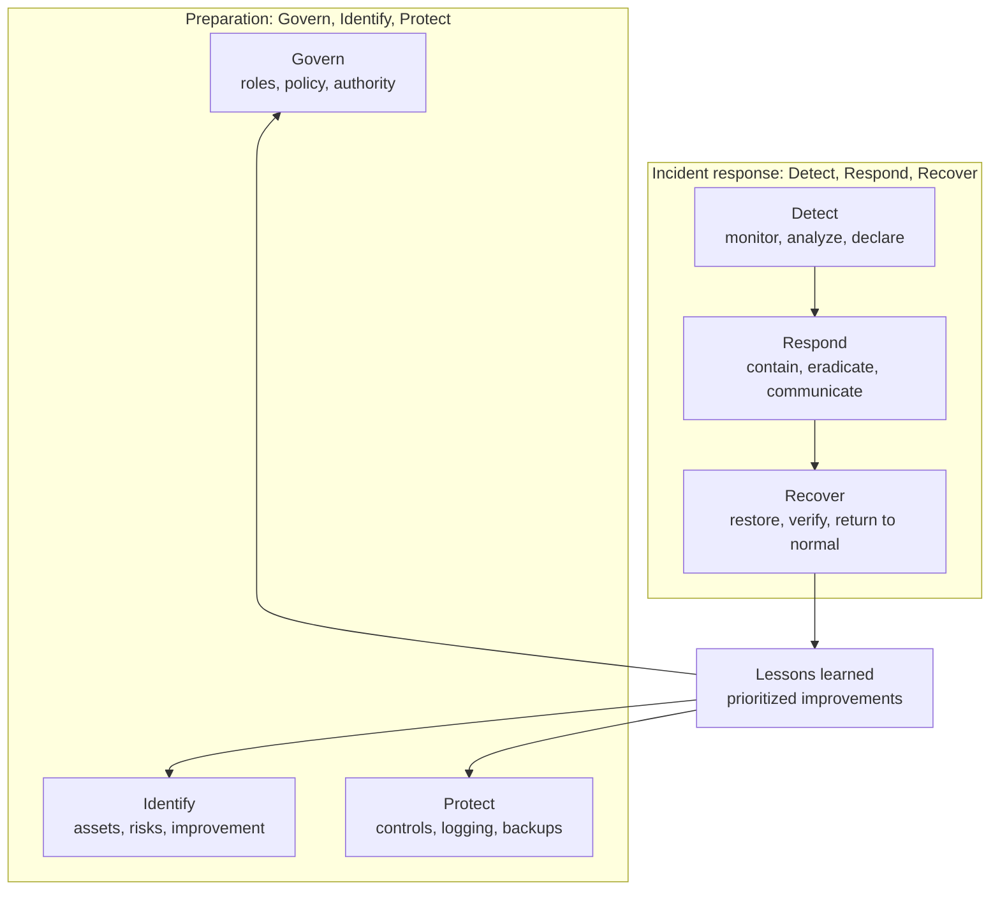
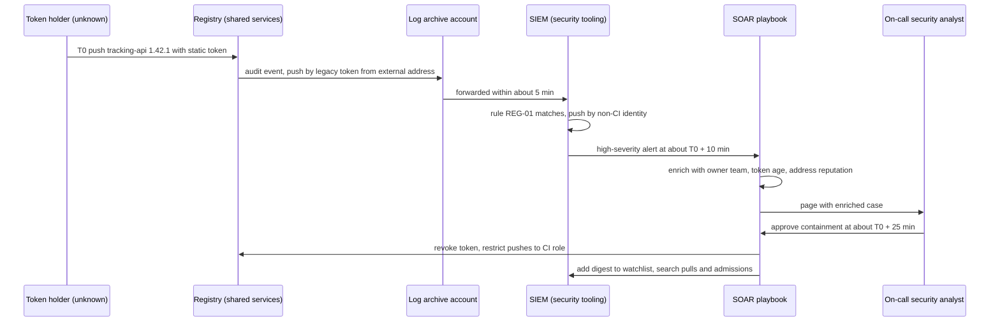

# Security operations

> Security operations is the part of security that assumes prevention will sometimes fail. It turns
> logs into detections, detections into decisions, and decisions into contained, recovered, and
> understood incidents. The architect's contribution is to make sure the right logs exist, land where
> an attacker cannot erase them, and reach people who have practiced what to do.

!!! abstract "Page facts"
    **Level:** Intermediate (SIEM, SOAR, and the incident lifecycle are Level 1-2; designing the
    detection pipeline, alert economics, and ransomware-ready recovery are Level 3) ·
    **Status:** Draft · **Time:** 60-90 minutes · **Last verified:** 2026-11-21

## Learning objectives

After this page you should be able to:

- List the log sources a cloud workload needs for security detection and design a pipeline that
  collects, normalizes, stores, and analyzes them without letting an attacker erase the evidence.
- Distinguish a SIEM from a SOAR platform, and threat intelligence from detection.
- Explain detection engineering as a software discipline: rules as code, mapped to attacker
  techniques, tested, owned, and measured.
- Walk an incident through detection, containment, eradication, recovery, and post-incident review
  using NIST SP 800-61 Rev. 3, and preserve evidence with a chain of custody.
- Reason about alert fatigue with arithmetic, and about ransomware recovery as a security property of
  backups, not only a reliability one.

## Prerequisites

- [Security principles and threat modeling](security-principles-and-threat-modeling.md) — modeled
  threats become detections.
- [Infrastructure and supply-chain security](infrastructure-and-supply-chain-security.md) — posture,
  vulnerability, and runtime findings are inputs here; the worked example continues its pipeline.
- [Identity and access management](identity-and-access-management.md) — most cloud incidents start
  with a misused identity, and sign-in logs are a primary source.

## The problem this solves

AtlasMart runs 29 cloud accounts (an assumption from the platform design), a Kubernetes cluster per
environment, a CI system, an identity provider, and dozens of managed services. Every one of them can
record who did what, but by default those records stay in the place they were produced, expire after
a short time, and can be deleted by whoever compromised that place. Nobody reads them until something
is visibly broken, by which time the attacker has had days or weeks.

Without security operations, a breach is discovered by a customer, a partner, or a regulator; the
team improvises containment at 3 a.m.; evidence is overwritten while people argue about who owns the
problem; and the same weakness is exploited again next quarter. Security operations replaces that with
a designed pipeline, rehearsed procedures, and a feedback loop.

## What it is

**Security operations (SecOps)** is the continuous function that collects security telemetry, detects
and investigates suspicious activity, responds to incidents, and checks that security controls keep
working. It is usually staffed by a security operations centre (SOC), in-house, outsourced, or mixed.
Its parts, each a step below, are logging and monitoring, a SIEM for analysis, SOAR for automated
response, detection engineering, threat intelligence, incident response, forensics, and continuous
posture and compliance assessment.

This page covers security incidents. Service-reliability incident management (on-call, paging,
error budgets, postmortems for outages) is a related discipline in the SRE domain (D15); the two share
tooling and habits but differ in one important way: in a security incident there is an adversary who
reacts to what you do.

## Mental model

Picture the security desk of a large office building. Cameras and door-badge readers are the **log
sources**; the recording room in a locked basement that no tenant can enter is the **log archive**; the
monitor wall with motion-detection rules is the **SIEM**; the guard's binder of "if this alarm, do
that" is the **playbook**, and the automatic door-locking system is **SOAR**. Bulletins from the police
about a gang targeting buildings in the area are **threat intelligence**. When a break-in happens, the
guards follow a procedure, seal the scene, bag evidence with a signed log of who handled it, and
afterwards fix the broken lock.

**Where the analogy breaks:** in a building, an alarm usually means something odd; in a cloud estate,
almost every event that looks suspicious is an administrator doing their job, so tuning is most of the
work. Digital evidence can be altered without a trace unless it was protected when written. And an
attacker can study your rules and avoid them, so detections must target behaviors that are hard to
avoid, not one-off indicators.

## Key terms

| Term | Meaning on this page |
|---|---|
| SIEM | Security information and event management: central store and analytics for security events, producing alerts |
| SOAR | Security orchestration, automation, and response: workflow automation that runs playbooks on alerts |
| Detection rule | A versioned query or analytic that turns matching events into an alert with a severity and an owner |
| Playbook | A documented, often partly automated, sequence of response steps for one alert or incident type |
| Indicator of compromise (IOC) | An observable artifact (address, domain, file hash) associated with malicious activity |
| TTP | Tactics, techniques, and procedures: how an adversary operates, as catalogued for example in MITRE ATT&CK |
| Threat intelligence | Evidence-based knowledge about threats, from strategic trends to tactical indicators, used to inform decisions |
| True / false positive | An alert that does / does not correspond to the behavior the rule was meant to detect |
| Chain of custody | A record of who collected, handled, and stored each piece of evidence, when, and how its integrity was protected |
| Tabletop exercise | A discussion-based rehearsal in which a team walks through a scenario without touching real systems |
| Immutable backup | A backup that cannot be changed or deleted before its retention period ends, even by an administrator |
| Continuous compliance | Automated, ongoing evaluation of controls against a framework, with evidence collected as a by-product |

## How it works

### Step 1 — Log sources and the detection pipeline

Detection is only as good as its inputs. For a cloud-native workload, the sources that matter most are:

| Source | What it shows | AtlasMart location |
|---|---|---|
| Cloud audit logs (control-plane API calls) | Who created, changed, or deleted which resource, from where | Every account, delivered to the log archive account |
| Identity provider sign-in logs | Sign-ins, MFA challenges, token issuance, unusual locations | Corporate and customer identity providers |
| Kubernetes audit logs | API requests to the cluster, including admission decisions | Each managed cluster |
| Registry and CI audit logs | Image pushes and pulls, pipeline runs, secret access | Shared services account and the CI system |
| Network flow and DNS logs | Connections and name lookups, including egress through the hub | Every VPC and the network hub |
| WAF and load-balancer logs | Requests blocked or allowed at ingress | Each workload VPC |
| Runtime sensor and posture findings | Process, file, and network behavior; CSPM, CWPP, CIEM findings | Nodes and the security tooling account |
| Application security events | Authentication failures, authorization denials, webhook signature failures | Tracking API, Webhook Ingestor |

A good **audit log** records who (the principal, not just an address), what (action and target),
when (synchronized clock, with time zone), where (source address, account, region), and the outcome. It
must be written somewhere the actor cannot change: that is the purpose of a separate log archive
account with immutable storage, which even an administrator of a workload account cannot reach.

**Figure 1 — AtlasMart's security log and detection pipeline.** Logs from all accounts flow to the log
archive (system of record) and to the SIEM in the security tooling account (analysis).



How to read it: every source feeds one collection layer. The archive branch keeps raw logs for
investigations and compliance; the SIEM branch keeps a normalized, searchable subset for detection.
Rules and threat intelligence are inputs to the SIEM, versioned like code.

Two design decisions follow. First, **normalize to a common schema** (the open-source Open
Cybersecurity Schema Framework, OCSF, is one option) so one rule can match "a principal created an
access key" whichever provider or product logged it. Second, **split hot and cold**: the SIEM holds
the subset and the time window detections need, which is where most of its cost lies; the archive keeps
everything for the full retention period and can be queried or re-ingested during an investigation.

### Step 2 — SIEM and SOAR

| Aspect | SIEM | SOAR |
|---|---|---|
| Core job | Store, search, correlate events; raise alerts | Act on alerts: enrich, decide, route, and execute steps |
| Input | Logs and findings | Alerts and cases from the SIEM and other tools |
| Output | Alerts, dashboards, investigation queries | Tickets, notifications, containment actions, case records |
| Typical automation | Correlation rules, anomaly models | Look up asset owner, check threat intelligence, revoke a token, isolate a host |
| Main risk | Alert volume nobody can handle | Automated actions that cause an outage, or that an attacker can trigger deliberately |

Many products now combine both. The rule is the same either way: **automate enrichment
freely, automate containment carefully**. Enrichment (owner, criticality, related alerts, reputation)
is safe and saves most of an analyst's time; destructive actions (disable a role, isolate a node)
should require human approval until the playbook has proven itself, because an attacker who can trigger
a playbook can use it to cause denial of service.

### Step 3 — Detection engineering

**Detection engineering** treats detections as software:

1. **Start from a threat.** Pick an adversary technique from the threat model or from MITRE ATT&CK,
   a public knowledge base of adversary tactics and techniques observed in real attacks.
2. **Find the evidence.** Decide which log source shows it and what normal looks like there.
3. **Write the rule as code.** Store it in version control, ideally in a portable format such as Sigma
   (an open, generic signature format for log events that converts to many SIEM query languages).
4. **Test it.** Replay sample logs containing the behavior (true positive) and a day of normal logs
   (false-positive rate). Run tests in CI, like any other code.
5. **Ship it with a playbook, a severity, and an owner.** An alert without a next step is noise.
6. **Measure and tune.** Track precision (true positives ÷ all alerts) per rule; retire or rewrite rules
   that nobody acts on.

Prefer behaviors over indicators. An IP address used in an attack is trivially changed; "an image was
pushed to a production repository by an identity that is not the CI role" stays true whatever address
the attacker uses. Coverage is measured as the share of relevant ATT&CK techniques with at least one
tested detection, not as the number of rules.

### Step 4 — Threat intelligence

**Threat intelligence** is analyzed, evidence-based knowledge about adversaries: who targets
organizations like yours (strategic), what campaigns and techniques are active (operational), and
which concrete indicators (addresses, domains, file hashes) are associated with them (tactical). It is
exchanged in standard formats (for example STIX for content and TAXII for transport, both OASIS
standards). For an architect the questions are: which sources, how they are matched (enrichment at
ingest, or retrospective search over the archive), and when indicators expire, because stale ones
produce false positives for years.

### Step 5 — Alert prioritization and fatigue

**Alert fatigue** is what happens when analysts receive more alerts than they can investigate: they
start closing them unread, and the real one is missed. It is an arithmetic problem before it is a
human one. Suppose (an AtlasMart assumption) the first, untuned rule set raises 300 alerts per day
across 29 accounts and triage takes 8 minutes per alert:

- Untuned: 300 × 8 = 2,400 minutes = 40 hours of triage per day, five analysts doing nothing else for
  a full 8-hour shift.
- Tuned to 30 alerts per day (suppress known-benign automation such as the CI role's own actions, group
  repeats per principal and hour, drop rules with near-zero precision): 30 × 8 = 240 minutes = 4 hours,
  which one analyst can handle alongside other work.

Prioritize each alert by **likelihood** (rule precision, threat-intelligence match, corroborating
alerts) times **impact** (asset criticality, data classification, internet exposure, privilege of the
identity involved). The same rule firing on the prod Tracking API's role and on a sandbox account
should not get the same severity. Suppressions need an owner and an expiry date, or they become blind
spots.

### Step 6 — The incident response lifecycle

**NIST SP 800-61 Rev. 3** (April 2025), titled as a CSF 2.0 Community Profile, supersedes Rev. 2 (2012).
Rev. 2 described a four-phase cycle: preparation; detection and analysis; containment, eradication,
and recovery; post-incident activity. Rev. 3 instead places incident response inside the six functions
of the NIST Cybersecurity Framework 2.0: Govern, Identify, and Protect cover preparation; Detect,
Respond, and Recover are the incident response activities; and lessons learned from all of them feed
continuous improvement.

**Figure 2 — Incident response in NIST SP 800-61 Rev. 3, as summarized for this page.** Preparation and
response are both part of risk management, joined by an improvement loop.



How to read it: the top band runs all the time; the bottom band runs during an incident. Lessons
learned is not a final step but an input to every preparation function. The phase words most teams use
day to day (containment, eradication, recovery) live inside Respond and Recover.

In practice, record each case's state changes with timestamps (triage, declared, contained,
eradicated, recovered, reviewed, closed) so that time to detect, contain, and recover can be measured.
Preserve evidence before containment destroys it; contain before eradicating, or the attacker moves.

### Step 7 — Forensics basics

**Digital forensics** in incident response means collecting and analyzing evidence so that the
conclusions (what happened, since when, what was accessed) are defensible to management, auditors,
insurers, and possibly courts. NIST SP 800-86 frames it as collection, examination, analysis, and
reporting. The principles an architect must design for:

- **Preserve before you change.** Capture volatile data first (memory, running processes, network
  connections), then disk snapshots, then logs. Terminating a compromised container or node destroys
  the most volatile evidence; prefer isolating it (cordon the node, apply a deny-all network policy,
  snapshot) and only then remove it.
- **Work on copies.** Analyze snapshots and exported logs, never the originals.
- **Prove integrity.** Record a cryptographic hash of each evidence item at collection and verify it
  before analysis.
- **Keep a chain of custody.** For each item: what it is, who collected it, when, from where, its hash,
  where it is stored, and every later transfer or access.
- **Store evidence where the attacker cannot reach.** A dedicated evidence store in the security tooling
  account with immutability locks, separate from the compromised accounts.
- **Involve counsel early** when an incident may lead to legal action, regulatory reporting, or
  insurance claims; they decide on legal holds. This page is not legal advice.

### Step 8 — Continuous compliance and posture assessment

**Continuous compliance** replaces the annual scramble for audit evidence with automated checks:
each control (for example "audit logging enabled in every account", "storage encrypted with a managed
key") is expressed as a rule, evaluated continuously by posture management, mapped to the frameworks
the organization reports against, and stored with timestamps as evidence. The frameworks themselves
are covered in [Compliance and regulatory frameworks](compliance-and-regulatory-frameworks.md).

**Posture assessment** asks a broader question: how exposed are we right now? Inputs include CSPM,
CWPP, and CIEM findings (see [Infrastructure and supply-chain security](infrastructure-and-supply-chain-security.md)),
attack-path analysis, vulnerability exposure by tier, detection coverage against ATT&CK, and the results
of human testing: penetration tests, red-team exercises (a team emulating a realistic adversary end to
end), purple-team exercises (attackers and defenders working together to tune detections), and
tabletops. A posture report is useful only if each gap has an owner and a date.

### Step 9 — Breach response

A **breach** is an incident in which data was, or may have been, accessed or disclosed without
authorization. It adds obligations beyond technical response: deciding whether personal data was
involved, notifications where rules require them, public communication, and insurers. Whether any law
(for example the GDPR) applies depends on facts; ask counsel. Architecturally, it depends on answering
"which records did this identity read?", which needs data-access logging decided long before.

### Step 10 — BCP and DR testing from a security angle

**Business continuity planning (BCP)** keeps essential business functions running during a disruption;
**disaster recovery (DR)** restores the technology. Ransomware changes DR assumptions in three ways:

1. **The attacker targets backups.** An identity that can delete production data often can delete its
   backups too. Backups must be **immutable** (write-once retention locks that even administrators
   cannot shorten) and **logically separated** (another account, other credentials, ideally another
   administrative domain).
2. **The latest backup may not be clean.** A recovery point objective of minutes assumes the newest copy
   is good. If the attacker had access for days, recovery must go back to the last known-clean point,
   and the data after it must be rebuilt from other sources or accepted as lost. That clean point is
   found by investigation, not by the backup schedule.
3. **The recovery tools may be compromised.** If the identity provider, CI system, or management
   account is affected, the runbook needs break-glass identities and a recovery environment that does
   not depend on them.

Security DR tests therefore restore into an **isolated recovery environment**, scan restored systems
before reconnecting them, and check that production admin roles cannot delete or shorten backup
retention. DR strategies themselves belong to D13-T03.

## Worked example: AtlasMart tabletop — a leaked CI token used to push an image

A tabletop exercise is a guided discussion. The facilitator reveals the scenario in stages; the team
says what it would see, decide, and do. All times below are assumptions for the exercise.

### Scenario and starting facts

- One team's legacy release job still uses a **static registry push token** stored as a CI secret
  variable (an assumption for the exercise; it contradicts the platform rule of workload identity and
  was on the migration backlog, flagged weeks earlier by CIEM as a long-lived credential).
- The token was exposed and is now held by an unknown party (how it leaked is unknown at the start).
- At 02:10 (T0) someone uses it to push an image tagged `tracking-api:1.42.1` to the production
  repository in the shared services account.
- Production deploys through the platform pipeline by digest, and the prod cluster's admission policy
  admits only images signed by the CI workflow identity (from
  [Infrastructure and supply-chain security](infrastructure-and-supply-chain-security.md)).

### Detection: which log, which rule

**Figure 3 — Detection and first containment in the tabletop.** Times are exercise assumptions.



How to read it: the registry's own audit log is the evidence, copied to the log archive where the token
holder cannot touch it. Enrichment is automatic; the destructive action (revoking a credential the
owning team may depend on) waits for a human decision.

The detection that fires is a behavioral rule written in advance (shown in Sigma-like pseudocode,
not tied to one provider's field names):

```yaml
title: Image push to production repository by non-CI identity    # rule REG-01
logsource: { product: container_registry, service: audit }
detection:
  push:
    action: image.push
    repository|startswith: "prod/"
  ci_role:
    principal: "ci-workload-role"
  condition: push and not ci_role
level: high
tags: [attack.persistence, attack.initial_access]
```

A second, independent signal would appear if anyone tried to deploy the image: the prod cluster's
admission policy denies it (no signature from the CI identity), and the Kubernetes audit log records
the denial. At AtlasMart nothing deploys by tag, so that signal stays silent; the team notes that the
denial rule is still worth having in case of a manual deployment attempt.

Timing: about 5 minutes for log delivery plus a 5-minute rule schedule gives MTTD of about 10 minutes
for this scenario (both assumptions; check the provider's documentation for actual audit-log delivery
latency). The 15-minute acknowledgment target for a high-severity page gives containment approval by
about T0 + 25 minutes.

### Containment

1. **Revoke the token** and set the production repository's push permission to the CI workload role
   only.
2. **Quarantine, do not delete, the image.** Copy it by digest to an evidence repository in the security
   tooling account, then block pulls of that digest from every cluster with a deny-list entry in the
   admission policy.
3. **Scope the exposure.** Search the archive for every use of this token in the last 90 days (all
   pushes, all source addresses), and search registry pull logs and Kubernetes audit logs for the
   digest in every environment. In the tabletop: one earlier test push from the same address three days
   ago, no pulls, no admissions.
4. **Preserve evidence.** Export the relevant log ranges from the log archive (already immutable),
   record their hashes, and open a chain-of-custody entry for the logs and the quarantined image.

### Eradication

- Find the leak path: review where the token was readable (CI variables, build logs, developer
  machines). In the tabletop, the facilitator reveals that a failed build printed environment
  variables to a log visible to the whole organization.
- Remove the root cause, not just the token: delete the legacy job, move the release to the standard
  pipeline with workload identity, purge the exposed build logs, and rotate every other static secret
  that the same logs could have exposed.
- Add secret scanning to CI log output and a rule that fails builds which print secret variables.

### Recovery

- Verify that every running Pod in every environment uses a digest with a valid signature and provenance
  from the expected CI identity (a query over the cluster inventory and attestations).
- Compare all production-repository pushes in the last 90 days against the transparency-log signing
  entries: any push without a matching CI signature is investigated.
- Return to normal operation once both checks are clean, and keep the REG-01 watchlist for the
  quarantined digest for 30 days (an assumption).

### Post-incident actions

| Finding | Action | Owner |
|---|---|---|
| CIEM had flagged the long-lived token weeks earlier and nobody acted | Long-lived credential findings get a 14-day fix deadline and escalate to the platform lead | Platform team |
| Admission policy and digest-based deployment prevented any impact | Keep; add a test that an unsigned image is denied in every cluster | Platform team |
| REG-01 fired; there was no rule for "static token used from outside CI address ranges" | Add the rule; extend to all long-lived credentials | Detection engineering |
| Containment approval took 15 minutes | Pre-approve token revocation for tokens not used by CI in 24 hours | SOC lead |
| No personal data was accessed (the token had registry rights only) | Record the breach assessment and the reasoning, reviewed with the privacy officer and counsel | Incident lead |

The review is blameless: the question is why the system allowed a static token to survive, not who
printed it.

### The same scenario as a ransomware variant

What if the token had been a cloud administrator key, and the attacker encrypted the Tracking Event
Store and deleted its automated backups? NFR-7 (RPO 5 minutes, RTO 1 hour) assumes point-in-time
recovery survives. Assume AtlasMart copies daily database backups to an immutable vault in the log
archive account (an assumption; a dedicated backup account is the common alternative, D13-T03).
Recovery restores the last clean copy, up to a day old, into an isolated sandbox account, checks it,
then reconnects. The gap between 5 minutes and up to a day is the finding: it goes in the risk register
with a decision on whether more frequent immutable copies are worth their cost.

## Real-world architecture example

Mature cloud organizations converge on Figure 1: an organization-wide audit trail into a locked log
account; a security tooling account with delegated read access that workload teams cannot disable;
detections as code; SOAR playbooks for frequent alerts; rotating tabletop scenarios. Smaller ones buy a
managed SOC but keep ownership of the log architecture, playbook decisions, and raw logs.

## Design choices and trade-offs

| Choice | Favor when | Avoid when |
|---|---|---|
| Send everything to the SIEM | Small estates, or SIEM pricing not tied to volume | Volume-priced SIEM and verbose sources (flow logs): send to the archive, ingest a subset |
| Archive plus selective SIEM ingest | Large estates; long retention needed for investigations | The team cannot query the archive quickly during an incident |
| Automated containment in SOAR | Action is reversible and low-impact (revoke an unused token) | Action can cause an outage or be triggered by an attacker deliberately |
| In-house SOC | 24-hour coverage is affordable; deep context on own systems | Small team; a managed provider gives coverage you cannot staff |
| Managed SOC or MDR service | Need around-the-clock monitoring quickly | You cannot give the provider good context or keep ownership of raw logs |
| Behavioral rules over indicator lists | Long-lived detections, cloud control-plane activity | Fast-moving campaigns where a fresh indicator is the only signal |

## Failure modes and anti-patterns

- **Logs in the blast radius.** Audit logs stored in the same account the attacker controls. Detect:
  any account where an administrator can stop or delete its own audit trail. Prevent: organization-
  level trails into a locked archive account.
- **Alert flood.** Hundreds of unreviewed alerts per day. Detect: median alert age, share closed without
  notes. Prevent: precision per rule, suppression with expiry, enrichment before paging.
- **Detections without tests.** A field name changes in a log format and a rule silently stops matching.
  Detect: a heartbeat test that replays a known-bad sample daily. Prevent: rules as code with CI tests.
- **Destroying evidence while containing.** Terminating instances or deleting images first. Prevent:
  playbooks that snapshot and quarantine before removal.
- **Backups deletable by production admins.** Detect: a DR test that tries to delete a backup with a
  production role. Prevent: immutability locks and separate accounts.
- **Tabletops that never change anything.** Detect: action items without owners or dates. Prevent: track
  them like any other backlog and review them at the next exercise.

## Security considerations

- **The security tooling account is a high-value target.** It can read every account; restrict human
  access to a few roles with MFA and just-in-time elevation, and send its own audit log to the archive.
- **Logs contain personal data** (addresses, user identifiers, sometimes request contents). Minimize what
  is logged, protect access, and apply retention rules; see
  [Data security and privacy](data-security-and-privacy.md).
- **SOAR credentials are powerful.** A playbook that can revoke any credential can be abused; scope its
  roles to the actions it performs and log every action.
- **Communication channels may be compromised.** Agree out-of-band channels for incidents that involve
  corporate identity or email.

## Performance, reliability, and cost

- **Performance:** detection latency is the sum of log delivery, ingestion, and rule schedule; measure it
  per source with synthetic test events, because MTTD cannot be shorter than it.
- **Reliability:** the pipeline needs its own monitoring: a source that stops sending is a blind spot,
  not silence. Alert on missing data per source and account.
- **Cost:** drivers are ingested volume and retention in the SIEM, archive storage, query and re-ingest
  for investigations, analyst time (the arithmetic in Step 5), and managed-service fees. Check the
  provider's or vendor's current pricing documentation; the usual saving is routing high-volume,
  low-value sources to the archive only.

## Hands-on lab: write and test a detection rule

Local, free, Python standard library only.

1. Create `events.jsonl` with 200 synthetic registry audit events (one JSON object per line), with
   fields `time`, `action`, `repository`, `principal`, and `source_ip`. Make 195 of them pushes by
   `ci-workload-role` from addresses in `10.0.0.0/16` (the AtlasMart hub, where CI egress is assumed to
   originate) and 5 suspicious: pushes by another principal or from outside that range. Use a fixed
   random seed.
2. Write `detect.py` implementing rule REG-01 from the worked example, plus a second condition for
   "source address outside CI ranges" using the `ipaddress` module. Print each alert.
3. Write `test_detect.py` with `unittest`: assert exactly the 5 suspicious events alert and none of the
   195 benign ones do.
4. Rename the field `principal` to `actor` in a copy of the data and rerun: notice the rule silently
   matches nothing. Add a check that fails loudly when expected fields are missing.
5. Compare REG-01's precision with a noisy variant such as "any push outside business hours".

??? question "Hint: why does step 4 matter in production?"
    Log formats change when providers add fields, rename them, or when a collector is reconfigured. A
    rule that matches nothing looks exactly like a quiet day. Daily replay of a known-bad sample (a
    detection heartbeat) and schema checks at ingestion are how teams notice.

## Knowledge check

1. What does a SIEM do that a SOAR platform does not, and the other way round?
2. Why is the log archive in a separate account with immutable storage, rather than in each workload
   account?
3. NIST SP 800-61 Rev. 3 reorganized incident response. Into what framework, and where do the familiar
   containment, eradication, and recovery activities sit now?
4. During containment, why might you isolate a compromised node rather than terminate it?
5. A team's RPO is 5 minutes and its database has point-in-time recovery. Why can ransomware still
   force a recovery point days old?

??? success "Answers"
    1. A SIEM stores, searches, and correlates events and raises alerts; SOAR acts on alerts by running
       playbooks that enrich, route, and execute response steps. Many products now do both.
    2. An attacker who controls a workload account could otherwise delete or alter the evidence of what
       they did. A separate, locked account keeps logs out of the blast radius of any one account.
    3. Into the six functions of NIST CSF 2.0. Govern, Identify, and Protect cover preparation; the
       incident response activities sit in Detect, Respond (containment, eradication, communication),
       and Recover, with lessons learned feeding improvement.
    4. Termination destroys volatile evidence (memory, processes, connections) and sometimes disks.
       Isolation stops the harm while evidence is captured; removal follows.
    5. If the attacker can delete backups, point-in-time recovery may be gone; and if they had access for
       days, recent backups may contain their changes. Recovery must use the last known-clean, protected
       copy, which may be much older than the RPO assumes.

## Architecture discussion questions

1. AtlasMart's SIEM costs grow with ingested volume. Which of the eight log sources in Step 1 would you
   ingest fully, which partially, and which only into the archive? Justify each with a detection it
   enables or does not.
2. Should the REG-01 playbook revoke the token automatically, without a human? Argue both sides and
   state the conditions under which you would allow it.
3. Design the isolated recovery environment for a ransomware scenario: which account, which identities,
   what is scanned before reconnecting, and how often it is tested.

## Summary

Security operations assumes prevention will fail. Logs from audit trails, identity providers,
Kubernetes, registries, networks, and runtime sensors flow into an immutable log archive and, normalized
and enriched, into a SIEM. Detections are behavior-focused, tested code mapped to ATT&CK; SOAR enriches
freely and contains carefully; alert fatigue is managed with arithmetic and per-rule precision. NIST SP
800-61 Rev. 3 places incident response inside the CSF 2.0 functions. Forensics preserves evidence with
hashes and a chain of custody, and ransomware makes immutable, separated backups and clean restore
points security requirements. AtlasMart's tabletop shows a registry audit log, rule REG-01, and
admission policy turning a leaked token into a contained, low-impact incident.

## Related topics

- **Before:** [Security principles and threat modeling](security-principles-and-threat-modeling.md);
  [Infrastructure and supply-chain security](infrastructure-and-supply-chain-security.md);
  [Identity and access management](identity-and-access-management.md).
- **Alongside:** [Network security architecture](network-security-architecture.md) (flow and DNS logs,
  egress inspection); [Data security and privacy](data-security-and-privacy.md);
  [Compliance and regulatory frameworks](compliance-and-regulatory-frameworks.md);
  [Multi-account strategy and infrastructure automation](../cloud-architecture/multi-account-strategy-and-infrastructure-automation.md)
  (log archive and security tooling accounts).
- **Planned:** observability and SRE incident management (D15); disaster recovery strategies (D13-T03);
  Lab 11 on tracing and logging (batch 4B).

## References

| Source | Type | Checked |
|---|---|---|
| [NIST SP 800-61 Rev. 3, Incident Response Recommendations and Considerations for Cybersecurity Risk Management: A CSF 2.0 Community Profile](https://csrc.nist.gov/pubs/sp/800/61/r3/final) — NIST, April 2025 | Government guidance | 2026-11-21 |
| [NIST Cybersecurity Framework](https://www.nist.gov/cyberframework) — NIST | Framework (CSF 2.0 functions) | 2026-11-21 |
| [NIST SP 800-86, Guide to Integrating Forensic Techniques into Incident Response](https://csrc.nist.gov/pubs/sp/800/86/final) — NIST, 2006 | Government guidance | 2026-11-21 |
| [NIST SP 800-92, Guide to Computer Security Log Management](https://csrc.nist.gov/pubs/sp/800/92/final) — NIST, 2006 | Government guidance | 2026-11-21 |
| [MITRE ATT&CK](https://attack.mitre.org/) — MITRE | Knowledge base (adversary tactics and techniques) | 2026-11-21 |
| [Sigma](https://sigmahq.io/) — SigmaHQ project | Open detection-rule format | 2026-11-21 |
| [Open Cybersecurity Schema Framework](https://schema.ocsf.io/) — OCSF project | Open schema for security events | 2026-11-21 |
| [#StopRansomware Guide](https://www.cisa.gov/stopransomware/ransomware-guide) — CISA | Government guidance (backups, response checklist) | 2026-11-21 |

## Review notes

- Canonical page for D12-T07. In depth: log pipeline, audit logs, SIEM versus SOAR, detection
  engineering, alert fatigue, incident lifecycle, forensics, ransomware-aware DR testing. Only defined or
  brief: threat intelligence (STIX/TAXII named without a reference), continuous compliance, posture
  assessment, breach response (legal duties deliberately unspecified), BCP. SRE incident work is D15.
- Verified 2026-11-21: SP 800-61 Rev. 3 is final (April 2025) and supersedes Rev. 2 per the CSRC page.
  The Rev. 3 model in Figure 2 comes from NIST's announcement and secondary summaries, not the full
  PDF; check it against the publication's figure. SP 800-86's phase names are from memory of the
  document, not the abstract page.
- No provider equivalence table (vendor-neutral by design); a reviewer may add one with current names.
- The REG-01 rule is Sigma-like pseudocode with invented field names, not a validated Sigma rule.
- New AtlasMart assumptions: a legacy static registry push token (exercise only); about 5 minutes
  audit-log delivery and a 5-minute rule schedule (MTTD about 10 minutes); 15-minute acknowledgment for
  high severity; 300 untuned versus 30 tuned alerts per day at 8 minutes each (40 h versus 4 h); CI
  egress originating in the hub range 10.0.0.0/16 (lab); daily immutable database backup copies in the
  log archive account; 30-day watchlist; 90-day search window; 14-day deadline for long-lived credential
  findings.
- Figure 2 stacks two subgraphs with `~~~` and links from the lower one back to the upper one; check
  it renders legibly.
