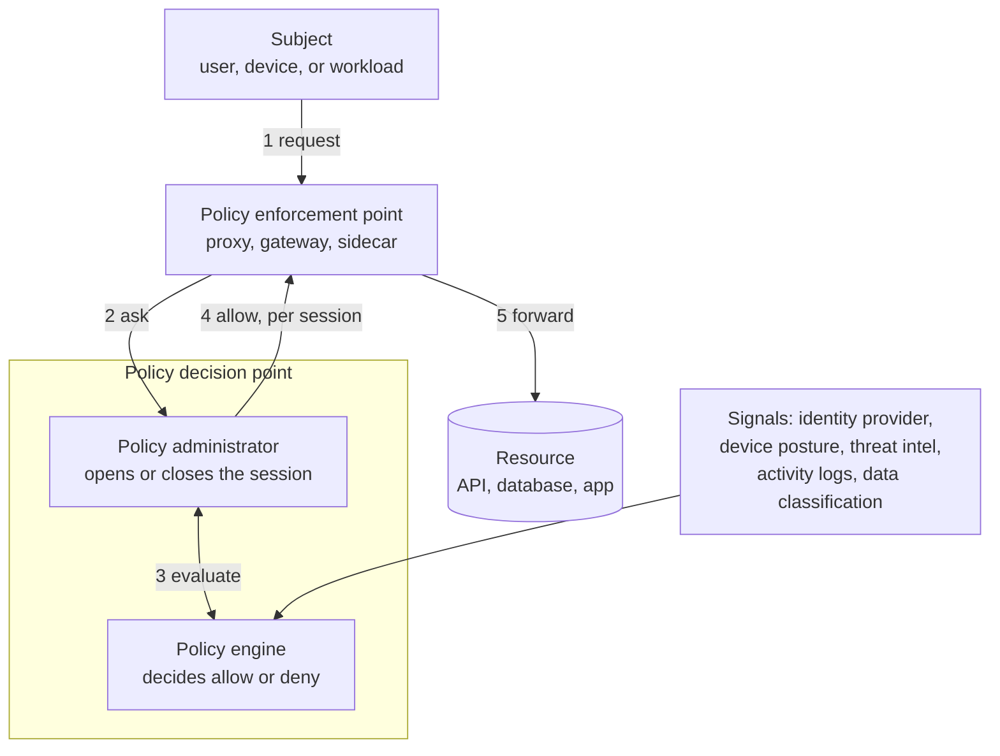
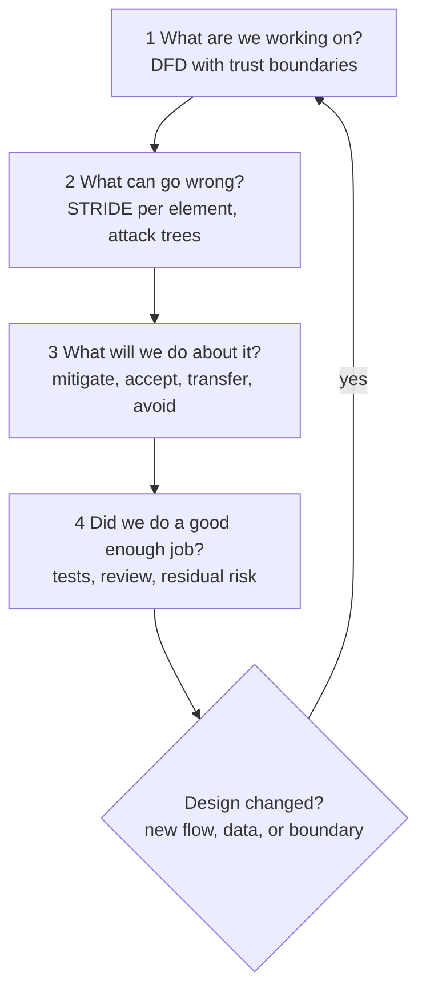
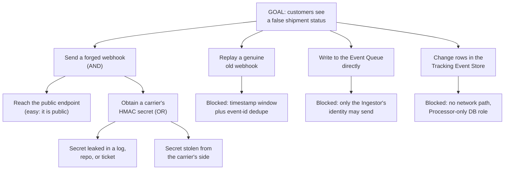
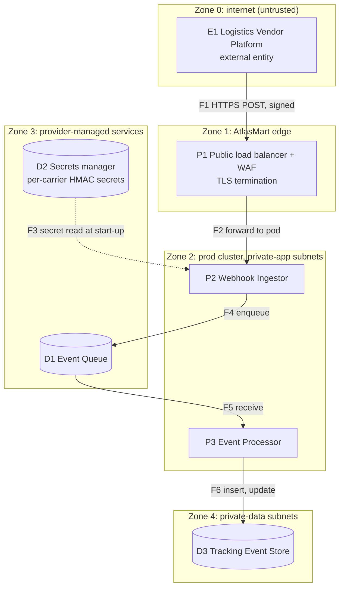

# Security principles and threat modeling

> Security architecture is the practice of deciding, before anything is built, what could go wrong at
> each place where trust changes, and which control will stop it, notice it, or recover from it.
> A handful of principles tell you where to look; threat modeling tells you what you found.

!!! abstract "Page facts"
    **Level:** Intermediate (the principles and STRIDE are Level 1-2; risk rating, Zero Trust
    architecture, and running a threat model for a real system are Level 3) · **Status:** Draft ·
    **Time:** 60-90 minutes · **Last verified:** 2026-11-21

## Learning objectives

After this page you should be able to:

- Explain the CIA triad, defense in depth, least privilege, secure by design and by default, and
  attack surface, and recognize each one being applied or violated in a design.
- State what Zero Trust means in NIST SP 800-207 terms, including its tenets and its policy
  decision and enforcement components, and say what it does not mean.
- Read a shared responsibility model and say who owns a given control for IaaS, PaaS, and SaaS.
- Draw a data-flow diagram with trust boundaries and run a STRIDE pass over it, element by element.
- Build a small attack tree, rate threats by likelihood and impact, and explain why many teams
  abandoned DREAD.
- Classify controls as preventive, detective, or corrective, and describe how security posture
  management keeps a design's controls true after go-live.

## Prerequisites

- [C4 model: how to communicate software architecture](../architecture-fundamentals/c4-model.md) —
  the container and deployment views are where trust boundaries are drawn.
- [Functional vs non-functional requirements](../architecture-fundamentals/functional-vs-non-functional-requirements.md)
  — NFR-5 (owner-only access, signed webhooks) and NFR-6 (no delivery addresses stored) are the
  security requirements this page's worked example satisfies.
- [Constraints, assumptions, dependencies, risks, and scope](../architecture-fundamentals/constraints-assumptions-dependencies-risks-and-scope.md)
  — the risk cycle and response vocabulary (avoid, reduce, transfer, accept, escalate) used below.

## The problem this solves

Security reviews that start from a checklist ("is TLS on? are passwords hashed?") find the problems
someone has already thought of, in the places someone already looked. They miss the design-level
flaws: an internal service that trusts anything on the network, a queue any workload can write to, a
webhook that is parsed before it is authenticated, a log that quietly stores personal data. Those
flaws are cheap to fix on a whiteboard and expensive to fix after launch, when data has leaked or
customers depend on the insecure behaviour.

Two things are needed. First, principles that bias every design towards safety without anyone
having to remember a list. Second, a repeatable method that walks a specific design, finds the
threats that matter for it, and records a decision for each: mitigate, accept, transfer, or avoid.
The principles are the first half of this page; threat modeling is the second.

## What it is

**Security architecture** is the set of decisions about where controls sit in a system, which
threats each one addresses, and how they fail. **Threat modeling** is the structured activity that
produces those decisions for a particular design: describe the system, find what can go wrong, decide
what to do about each finding, and check the work.

| Idea | One-line meaning | Where it shows up |
|---|---|---|
| CIA triad | The three properties security protects: confidentiality, integrity, availability | The goals every threat is measured against |
| Defense in depth | Several independent controls, so one failure is not a breach | Layers at the edge, network, workload, and data |
| Least privilege | Every identity gets only the access its task needs, for as long as it needs it | IAM policies, database grants, network rules |
| Zero Trust | No implicit trust from network location; every request is authenticated and authorized | Identity-aware proxies, mTLS, per-request policy |
| Secure by design and by default | Security is a design requirement, and the shipped configuration is the safe one | Defaults, templates, platform guardrails |
| Shared responsibility | The cloud provider and the customer each own some controls | Contracts, landing zones, audit evidence |

## Mental model

Think of a company office building. Reception checks who you are at the front door (authentication
at the perimeter). Your badge opens only your floor (least privilege). Server rooms have their own
locks, cabinets their own keys, and cameras watch the corridors (defense in depth: preventive and
detective controls). A fire drill and a spare key in the safe are corrective controls. Before the
building opens, someone walks the floor plan asking "how would a stranger get into the server
room?": that walk is a threat model, and the floor plan with its locked doors is a data-flow diagram
with trust boundaries.

**Where the analogy breaks:** attackers on a network are not physically present, can try a million
doors a second, and copy what they steal without removing it. A badge in software (a token or a key)
can be stolen remotely and reused from anywhere, which is why Zero Trust checks every request, not
just the front door. And in a building, being inside means you passed reception; on a network, being
"inside" often means only that something else was compromised first.

## Key terms

| Term | Meaning on this page |
|---|---|
| Confidentiality, integrity, availability (CIA) | Data is seen only by those allowed; data and behaviour are changed only in allowed ways; the system works when needed |
| Threat | Something that could go wrong: an actor or event that could harm an asset by exploiting a weakness |
| Vulnerability | A weakness in design, code, or configuration that a threat could exploit |
| Risk | A threat rated by its likelihood and its impact, with an owner and a decision |
| Control | A safeguard that prevents, detects, or corrects a threat; also called a countermeasure or mitigation |
| Attack surface | The sum of entry points, exposed services, credentials, and dependencies an attacker can reach |
| Trust boundary | A line in a diagram across which the level of trust changes; controls belong at trust boundaries |
| Threat model | A structured analysis, per trust boundary, of how an attacker could compromise a system and which control mitigates each threat |
| Data-flow diagram (DFD) | A diagram of external entities, processes, data stores, and data flows, with trust boundaries drawn across flows |
| STRIDE | A checklist of six threat types: spoofing, tampering, repudiation, information disclosure, denial of service, elevation of privilege |
| Attack tree | A goal-rooted tree of the ways an attacker could reach that goal, with AND and OR branches |
| Security posture | The current, measured state of an estate's security controls against an agreed baseline |

## How it works

### Step 1 — Goals: confidentiality, integrity, availability

Every security requirement protects one of three properties. **Confidentiality** means information
is disclosed only to those authorized. **Integrity** means information and system behaviour change
only in authorized ways, and unauthorized changes are detected. **Availability** means the system and
its data are usable when needed. Two more properties are often added because STRIDE needs them:
**authenticity** (a party is who it claims to be) and **non-repudiation** (a party cannot credibly
deny an action it took, because there is evidence).

The properties trade against each other. Encrypting everything with a single key held in one place
helps confidentiality and hurts availability if that key service fails. Failing closed when the
authorization service is unreachable protects integrity and costs availability. A security design
states which property wins for each data set and each failure, the same way a consistency model
states which reads may be stale.

### Step 2 — Design principles

The principles below go back to Saltzer and Schroeder's
[1975 paper on protection](https://web.mit.edu/Saltzer/www/publications/protection/) and remain the
best short checklist for a design review:

- **Least privilege.** Grant each user, workload, and component the minimum access needed for its
  task, scoped in what (actions), where (resources), and when (time-bound where possible). It limits
  the **blast radius** of a compromise: a stolen credential can do only what that credential could do.
  Privileges drift upwards over time, so least privilege needs periodic review, not a one-time grant.
- **Defense in depth.** Layer controls so that each covers the failure of another: a web application
  firewall in front of input validation in front of parameterized queries in front of a database user
  that cannot drop tables. Layers must be independent; two layers that share one credential or one
  configuration file fail together.
- **Fail-safe defaults.** Access is denied unless explicitly granted; when a control breaks, the safe
  outcome is "no access". Where availability must win, say so in a decision record.
- **Complete mediation.** Check authorization on every access, not once per session or once at the
  edge. This is the root of Zero Trust.
- **Economy of mechanism.** Small, simple controls are easier to review and harder to bypass. A
  custom cryptographic scheme fails this test; a standard library call passes it.
- **Separation of duties.** No single person or identity can complete a sensitive action alone, for
  example deploying code and approving the same change.
- **Attack surface reduction.** Every endpoint, open port, installed package, and long-lived
  credential is something to defend. Remove what is not needed before hardening what remains.

**Secure by design** means security is a requirement in the first design, with owners and tests,
not a review bolted on before launch. **Secure by default** means the configuration a team gets
without doing anything is the safe one: private storage buckets, encryption on, logging on, no
default passwords, administrative interfaces off. The US cybersecurity agency CISA's
[Secure by Design](https://www.cisa.gov/securebydesign) initiative asks software makers to own both;
an internal platform team can apply the same idea to its own templates and pipelines.

### Step 3 — Zero Trust

**Zero Trust** is an approach in which no implicit trust is granted to a request because of where
it comes from on the network. NIST SP 800-207 describes it as moving defenses from static network
perimeters to users, assets, and resources. Its tenets, paraphrased:

1. Every data source and computing service is a resource to protect, including devices and SaaS.
2. All communication is secured the same way whether it comes from inside or outside the network.
3. Access to each resource is granted per session, with the least privilege needed.
4. Access is decided by dynamic policy using the identity of the requester, the application, the
   state of the requesting device, and other behavioural and environmental signals.
5. The organization monitors the integrity and security posture of every asset it owns or uses.
6. Authentication and authorization are dynamic and strictly enforced before each access.
7. The organization collects information about assets, network, and communications and uses it to
   improve its policy.

**Figure 1 — Zero Trust logical components (after NIST SP 800-207).** A request reaches a resource
only through an enforcement point that asks a policy decision point.

How to read it: the subject never talks to the resource directly. The engine decides from current
signals, the administrator tells the enforcement point to open or close that one session, and the
decision is revisited when signals change. In practice the enforcement point is an identity-aware
proxy for people and an mTLS-authenticating sidecar or gateway for services.

What Zero Trust is not: a product, the absence of network controls (segmentation remains useful as
one more layer), or a project with an end date. It is a direction, usually reached in stages; CISA's
[Zero Trust Maturity Model](https://www.cisa.gov/zero-trust-maturity-model) describes those stages
per pillar (identity, devices, networks, applications, data). The
[network security architecture](network-security-architecture.md) page shows what it changes at the
network layer, and [identity and access management](identity-and-access-management.md) covers the
identity side.

### Step 4 — Shared responsibility

In the cloud, the provider secures the infrastructure it runs and the customer secures what it puts
on it and how it configures it. Where the line sits depends on the service model, as both
[AWS](https://aws.amazon.com/compliance/shared-responsibility-model/) and
[Microsoft Azure](https://learn.microsoft.com/en-us/azure/security/fundamentals/shared-responsibility)
document for their platforms:

| Control | IaaS (virtual machines) | PaaS (managed database, managed Kubernetes control plane) | SaaS |
|---|---|---|---|
| Physical data centre, hardware, hypervisor | Provider | Provider | Provider |
| Operating system patching | Customer | Provider | Provider |
| Network rules around the workload | Customer | Customer (provider for its own plane) | Provider |
| Application code and dependencies | Customer | Customer | Provider |
| Identities, access policies, keys | Customer | Customer | Customer |
| Data classification and what data is stored | Customer | Customer | Customer |

The bottom rows never move: whatever the service model, the customer owns who has access and what
data goes in. Most cloud breaches are on the customer side of the line: a public storage bucket, an
over-privileged role, a leaked key. AtlasMart uses managed PostgreSQL and Redis, so it does not patch
their operating systems, but it still owns their network exposure, credentials, encryption key
policy, and backup retention.

### Step 5 — Attack surface and trust boundaries

Before finding threats, describe what you are protecting with a **data-flow diagram**: external
entities (people and systems you do not control), processes (your code), data stores, and data flows
between them. Then draw **trust boundaries** across the flows where the level of trust changes:
internet to edge, edge to workload, workload to managed service, workload to data tier, one tenant to
another, one privilege level to another.

Every flow that crosses a boundary is part of the attack surface and needs an answer to four
questions: who is on the other side (authentication), what may they do (authorization), what are they
sending (validation), and what evidence will remain (logging). Flows that stay inside one boundary
still matter, but they inherit the boundary's controls.

### Step 6 — The threat modeling process

The [Threat Modeling Manifesto](https://www.threatmodelingmanifesto.org/), written by a group of
practitioners, frames threat modeling as four questions. They work for a whiteboard session of an
hour as well as for a formal review:

1. **What are we working on?** A data-flow diagram, scoped to the change: one feature, one
   integration, one new service.
2. **What can go wrong?** Walk the diagram with a structure (STRIDE per element, attack trees, abuse
   cases) so the search is systematic rather than whatever the room remembers.
3. **What are we going to do about it?** For each threat: mitigate with a named control, accept with
   an owner, transfer, or avoid by changing the design. Record decisions where the team works: tickets,
   ADRs, the risk register.
4. **Did we do a good enough job?** Check that each mitigation was built and tested, that the
   diagram still matches the system, and that the model is revisited when the design changes.

**Figure 2 — Threat modeling as a loop.** The model is redone when the system changes, not filed.

How to read it: the output of step 3 is backlog items and decisions, not a document. The loop runs
again whenever a change adds a flow, a data store, a boundary, or a new kind of data.

Good participants are the people who know the design (developers, the architect), someone who
thinks like an attacker (often security), and someone who knows the data and the business impact.
The [OWASP Threat Modeling Cheat Sheet](https://cheatsheetseries.owasp.org/cheatsheets/Threat_Modeling_Cheat_Sheet.html)
gives a practical version of the same process.

### Step 7 — STRIDE, worked properly

**STRIDE** was developed at Microsoft as a mnemonic for six threat types. Each is the violation of
one security property, which is what makes it useful: if you know which property a threat breaks,
you know which family of control fixes it.

| Threat | Property violated | Question to ask at each element | Typical controls |
|---|---|---|---|
| **S**poofing | Authenticity | Can someone pretend to be this user, service, or system? | Authentication: signatures, mTLS, tokens, MFA |
| **T**ampering | Integrity | Can data in transit or at rest be changed without detection? | TLS, signatures, checksums, write permissions, validation |
| **R**epudiation | Non-repudiation | Could an actor deny an action and we could not prove otherwise? | Tamper-evident audit logs with identity and time |
| **I**nformation disclosure | Confidentiality | Can data be read by someone not allowed to? | Encryption, access control, data minimization, redaction |
| **D**enial of service | Availability | Can someone make this slow or unavailable? | Rate limits, quotas, size limits, autoscaling, queues |
| **E**levation of privilege | Authorization | Can someone do more than they were granted? | Least privilege, input validation, sandboxing, isolation |

Applying all six to every element produces noise. **STRIDE per element** narrows it: each element
type is exposed to some threats and not others, as Microsoft's
[threat modeling tool documentation](https://learn.microsoft.com/en-us/azure/security/develop/threat-modeling-tool-threats)
illustrates by category:

| DFD element | S | T | R | I | D | E |
|---|---|---|---|---|---|---|
| External entity (carrier, customer) | ✓ | | ✓ | | | |
| Process (your service) | ✓ | ✓ | ✓ | ✓ | ✓ | ✓ |
| Data store (queue, database, log) | | ✓ | ✓ (if it is a log) | ✓ | ✓ | |
| Data flow (a request, a message) | | ✓ | | ✓ | ✓ | |

How to use the table: list every element of the diagram with its number, read across its row, and
for each tick write either a concrete threat with a control, or "not applicable because ...". The
written "not applicable" is what makes the pass reviewable. A variant, **STRIDE per interaction**,
walks each flow across a boundary and considers the threats to both ends; it produces fewer, more
specific findings and suits teams that already know the method.

### Step 8 — Attack trees

An **attack tree**, described by Bruce Schneier in
[1999](https://www.schneier.com/academic/archives/1999/12/attack_trees.html), starts from one
attacker goal at the root and breaks it into the ways to achieve it. Children of an OR node are
alternatives; children of an AND node must all succeed. Leaves can be annotated with cost, skill, or
whether a control already blocks them, and the cheapest unblocked path is where to spend next.
STRIDE finds threats bottom-up from the diagram; attack trees reason top-down from what an attacker
wants, and they are good at showing that a single strong control (here, the HMAC secret) carries
most of the defense.

**Figure 3 — Attack tree: make customers see a false shipment status.** Leaves marked "blocked"
already have a control on AtlasMart's design.

How to read it: the root is satisfied if any child is (OR), except "send a forged webhook", which
needs both its children (AND). Reaching the endpoint is free, so the whole branch rests on the secret;
the tree therefore argues for secret hygiene (never logged, rotated, per carrier) and for detecting
misuse (a carrier's event rate or source changing suddenly), not for more edge filtering.

### Step 9 — Rating threats: DREAD, and what replaced it

Not every threat deserves the same effort, so threats are rated. **DREAD**, also from Microsoft,
scored each threat on Damage, Reproducibility, Exploitability, Affected users, and Discoverability,
typically 1-10 each, and averaged the scores. Many teams dropped it, including, by several
practitioners' accounts, Microsoft itself, for reasons worth knowing:

- **Scores were not repeatable.** Two reviewers rated the same threat very differently, and the
  average hid the disagreement. OWASP's
  [threat modeling process](https://owasp.org/www-community/Threat_Modeling_Process) notes that
  qualitative ratings avoid the over-subjectivity of numeric schemes like DREAD.
- **Discoverability rewarded obscurity.** A threat rated "hard to discover" scored lower, which
  encouraged relying on attackers not finding a flaw.
- **Averaging mixed unlike things.** A catastrophic but hard threat and a trivial but easy one could
  get the same number.

What most teams use instead is the qualitative **likelihood × impact** rating that
[NIST SP 800-30](https://csrc.nist.gov/pubs/sp/800/30/r1/final) describes for risk assessment, on a
small scale (low, medium, high, or 1-5) applied consistently, with the ranking and the discussion
mattering more than the number. Ratings feed a **risk register**: an entry per risk with ID,
description, likelihood, impact, owner, response (avoid, reduce, transfer, accept, escalate), due
date, and status. Accepted risks need a named owner with the authority to accept them and a trigger
for revisiting. Vulnerability scores such as CVSS rate known flaws in shipped software; they are not a
substitute for rating design threats.

### Step 10 — Controls and posture

Controls are classified by **when** they act:

| Type | Acts | Examples |
|---|---|---|
| Preventive | Before the harm | Authentication, authorization, network rules, input validation, encryption |
| Detective | During or after, so someone knows | Audit logs, alerts on anomalies, integrity checks, flow logs |
| Corrective | After, to restore | Key rotation, restoring from backup, revoking a session, redeploying a clean image |
| Deterrent and compensating | Discourage, or stand in when the ideal control is impossible | Warning banners; extra monitoring on a legacy system that cannot be patched |

and by **what** they are: technical (configuration and code), administrative (policies, reviews,
training), and physical. A sound design has at least one preventive and one detective control for
every high-rated threat: prevention fails eventually, and an undetected failure is the expensive kind.

**Security posture management** is the continuous comparison of what is deployed against what was
designed: storage that became public, a security group opened "temporarily", logging switched off,
a role that gained permissions. Cloud security posture management (CSPM) tools scan provider
configuration against a baseline and report drift; the same idea applies to Kubernetes and to
identity. Posture is how question 4 ("did we do a good enough job?") is answered after go-live; it is
covered with tooling in [infrastructure and supply-chain security](infrastructure-and-supply-chain-security.md)
and [security operations](security-operations.md).

## Worked example: a STRIDE pass over AtlasMart's carrier webhook path

AtlasMart's carriers report scan events through the Logistics Vendor Platform, which calls a webhook.
The path is the most exposed part of the Order Tracking System: it accepts unauthenticated internet
traffic by design and writes to the store every customer reads. The scope is the flow from the
Logistics Vendor Platform to the Tracking Event Store; the customer read path is a separate model.

### Step 1 — What are we working on?

Known facts: the Webhook Ingestor (3 replicas in the prod Kubernetes cluster) verifies an HMAC
signature computed with a per-carrier shared secret, enqueues to the managed Event Queue
(at-least-once), and returns `202 Accepted`; the Event Processor (2 replicas) deduplicates on the
carrier event id and writes to the Tracking Event Store (PostgreSQL). Secrets live in the provider's
secrets manager. Ingress is a public load balancer with a WAF. An existing assumption from the
[application design patterns](../software-architecture/application-design-patterns.md) page caps
request bodies at 64 KB. New assumption for this page: the replay window for the signed timestamp is
300 s.

**Figure 4 — Data-flow diagram of the carrier webhook path with trust boundaries.** Each subgraph is
a trust zone; every arrow that leaves a subgraph crosses a trust boundary.

How to read it: E is an external entity, P a process, D a data store, F a data flow. Boundaries are
crossed at F1 (internet to edge), F2 (edge to workload), F3 and F4 (workload to managed service), F5
(managed service to workload), and F6 (workload to data tier). The Event Processor also writes an
audit log, omitted from the figure for readability and treated as part of D3 below.

### Step 2 — What can go wrong? (STRIDE per element)

Following the per-element table, the pass covers E1 (S, R), P1 and P2 (all six), D1 and D3 (T, I,
D, plus R where they act as logs), the flows (T, I, D), and P3 (all six). Findings, with
mitigations mapped to the NFRs:

| ID | Element | STRIDE | Threat | Mitigation (control type) | NFR |
|---|---|---|---|---|---|
| T1 | E1 → P2 | S | Anyone on the internet posts events claiming to be a carrier | HMAC over timestamp plus raw body with a per-carrier secret, verified before parsing, constant-time comparison (preventive) | NFR-5 |
| T2 | F1 | T | A captured genuine request is replayed or altered | TLS on F1; signature covers the body; timestamp older than 300 s rejected; dedupe on carrier event id (preventive) | NFR-5 |
| T3 | E1 | R | A carrier disputes having sent a "delivered" event | Record carrier id, event id, receipt time, signature result, and a hash of the raw body for every request (detective) | NFR-5 |
| T4 | P2, D1, D3 | I | Carrier payload contains recipient name or delivery address, which then sits in the queue, store, and logs | Schema allowlist in the Ingestor keeps only the fields the contract defines; address fields dropped before enqueue; log redaction (preventive) | NFR-6 |
| T5 | P1, P2 | D | Flood of junk or oversized requests exhausts the Ingestor | WAF rate rules per source; 64 KB body limit; cheap checks first; the queue decouples ingest from processing (preventive) | NFR-4 |
| T6 | P2 | E | A parser bug lets an attacker run code in the Ingestor and pivot | The Ingestor's workload identity can only send to D1 and read its own secrets; no network path to D3 (shown in Lab 14); non-root, read-only container (preventive) | NFR-5 |
| T7 | D1 | T | A workload other than the Ingestor injects messages, bypassing verification | Queue policy allows send only from the Ingestor's identity; Processor validates the message schema (preventive) | NFR-5 |
| T8 | D1, D3 | I | Queue or database contents read by an unauthorized identity or from a stolen backup | Encryption at rest with KMS keys; key policy limited to the two services and backup role (preventive) | NFR-5, NFR-6 |
| T9 | D1 → P3 | D | A poison message blocks or slows processing | Maximum receive count and dead-letter queue (Lab 03); per-carrier lag alert (detective) | NFR-1, NFR-8 |
| T10 | P3 → D3 | T, E | Event text fields carry SQL that the Processor executes | Parameterized queries only; database role with insert and update on tracking tables, no DDL (preventive) | NFR-5 |
| T11 | D2, F3 | I, S | A carrier secret leaks (logs, repository, ticket) and enables T1 | Secrets only in the secrets manager, never logged; rotation with an overlap period where two secrets are valid; alert on a carrier's event rate or source changing (preventive, detective, corrective) | NFR-5 |

Rows considered and written down as not applicable: repudiation at D1 (the queue is not the system
of record; T3's log is), and elevation of privilege at P1 (the load balancer runs no AtlasMart code;
its configuration is covered by posture management).

### Step 3 — What are we going to do about it? (rating and decisions)

The team rated each threat low, medium, or high for likelihood and impact. Excerpt of the resulting
risk register:

| Risk | Likelihood | Impact | Response | Owner | Trigger to revisit |
|---|---|---|---|---|---|
| T11 secret leak enabling forgery | Medium | High | Reduce: secrets manager, no logging, rotation runbook, rate-change alert | Tracking tech lead | Any secret seen outside the secrets manager |
| T4 address data in payloads | High (carriers send extra fields) | High (breaks NFR-6) | Reduce: allowlist parsing plus a test with a payload containing address fields | Tracking tech lead | New carrier onboarded |
| T5 flood | Medium | Medium | Reduce: WAF rules and body limit; accept residual for very large attacks, covered by the provider's DDoS service | Platform team | Sale-day load test |
| T3 carrier dispute | Low | Low | Accept: evidence log is enough; no signed receipts | Product owner | First real dispute |

### Step 4 — Did we do a good enough job?

The check is concrete: a contract test sends an unsigned request, a stale timestamp, a replayed event
id, and a payload with an address field, and expects 401, 401, one stored event, and no address in
the store. Lab 14 demonstrates T6's network half (the Ingestor cannot reach the database). The model
is reopened when a carrier is added with a different signing scheme, when the Processor gains a new
data store, or when the Notification Worker's flow is brought into scope.

What the model changed in the design: the allowlist parsing for NFR-6 (before, the Ingestor passed
the payload through), the queue send policy (before, any workload in the account could send), and
the rate-change alert on each carrier (a detective control for the one threat that prevention alone
cannot cover).

## Real-world architecture example

Teams that threat model well run short, scoped sessions per change in design review (a new
integration, data store, or kind of data) with the diagram stored next to the code. Findings become
backlog items and tests, accepted risks go into the risk register, and significant decisions become
ADRs. A platform team then turns repeated mitigations into defaults (an ingress that already
validates tokens, a queue module with a scoped send policy, a pipeline that fails on a public
bucket), which is secure by default applied internally.

## Design choices and trade-offs

| Choice | Favor when | Avoid when |
|---|---|---|
| STRIDE per element | New system or team new to threat modeling; you want completeness | Very large diagrams; scope the model to the change instead |
| STRIDE per interaction | Experienced team reviewing changes at specific boundaries | The diagram is not yet agreed |
| Attack trees | A high-value goal (fraud, data theft) where you want the cheapest path | Broad discovery of unknown threats; STRIDE is better there |
| Qualitative likelihood × impact | Ranking design threats with a mixed team | You need a monetary figure for insurance or budgeting; use a quantitative method with real data |
| DREAD | Rarely; only if a client mandates it, with documented scoring guidance | Default choice; scores are inconsistent between people |
| Per-request Zero Trust checks | Users and workloads in many places, contractors, SaaS, high-value data | Legacy systems that cannot authenticate; wrap them with a proxy instead of waiting |
| Perimeter-heavy design | Short-lived prototypes on isolated networks | Anything that holds customer data or connects to partners |
| Fail closed | Integrity-critical paths: payments, access decisions, webhooks | Read paths where a stale or degraded answer is acceptable; decide explicitly |

## Failure modes and anti-patterns

- **Threat model as shelfware.** A document produced for a gate and never reopened. Detect: the
  diagram does not match the deployed system. Prevent: keep it in the repository and reopen it on
  any change that adds a flow, store, or boundary.
- **Boiling the ocean.** Modelling the whole estate at once, never finishing. Prevent: scope to one
  change or one path, as in the worked example.
- **Scoring theatre.** Long arguments over whether a threat is a 6 or a 7. Prevent: a three-level
  scale and a time box; spend the time on mitigations.
- **Trusting the internal network.** Services accept any call from inside the virtual network.
  Detect: a service with no authentication on internal endpoints. Prevent: workload identity and mTLS
  or signed tokens between services; segmentation as a second layer.
- **Privilege creep.** Roles gain permissions for incidents and keep them. Detect: compare granted
  with used permissions. Prevent: time-bound elevation and periodic access review.
- **Misread shared responsibility.** "The provider handles security" while the customer leaves a
  database public. Prevent: list customer-owned controls per service in the landing zone design.
- **Obscurity and unwatched logs.** An undocumented endpoint as the only control, or logs nobody
  alerts on. Prevent: assume the attacker knows the design; every detective control names who
  receives its alert.

## Security considerations

- **Threat models are sensitive.** They list weaknesses and accepted risks. Store them with the same
  access control as the code, not on a public wiki.
- **Include the people and the pipeline.** Insiders, CI/CD credentials, and third-party dependencies
  are attack paths; a model of runtime flows alone misses the supply chain
  ([infrastructure and supply-chain security](infrastructure-and-supply-chain-security.md)).
- **Model the security controls themselves.** The identity provider, the secrets manager, and the
  logging pipeline are high-value targets and single points of failure.
- **Write threats as conditions, not recipes.** "A captured request can be replayed" is enough to
  design a control; the model does not need working attack steps.

## Performance, reliability, and cost

- **Performance:** most controls add little latency when placed well (signature checks and token
  validation are local computations), but each network hop to a policy service adds a round trip.
  Cache decisions for their validity period and validate tokens locally where the protocol allows.
- **Reliability:** every security control is also a dependency. If the identity provider or the
  secrets manager is down, fail-closed paths stop. Decide per path, load secrets at start-up with a
  refresh, and include security services in availability planning.
- **Cost:** WAF rules, log storage, posture tools, and key operations are billed by most providers by
  volume; check current pricing. The larger cost is people's time, which is why scoped models and
  secure defaults pay off.

## Hands-on lab: STRIDE a flow you know

No tools are needed beyond a text editor; [Lab 14](../labs/lab-14-network-segmentation.md) then lets
you test one of the resulting network controls.

1. Pick one flow in a system you know: a login, a file upload, or an inbound webhook.
2. Draw its data-flow diagram in Mermaid with numbered elements and subgraphs for trust zones, as in
   Figure 4.
3. Fill in the STRIDE per element table for every element: a threat with a control, or "not
   applicable because ...".
4. Rate each threat low, medium, or high for likelihood and impact, and choose a response for the top
   three with an owner.
5. Write one test or alert that would show each top-three mitigation is working.

??? question "Hint: no threats found for a data store?"
    Ask three questions: who can read it besides the service (I), who can write to it besides the
    service (T), and what happens when it is full or slow (D). Backups, replicas, and analytics
    exports are part of the data store and often have looser access than the primary.

## Knowledge check

1. Which STRIDE threat does an HMAC signature on a webhook address, and which does it not address
   on its own?
2. Why do STRIDE per element tables leave most cells empty for external entities?
3. Name three reasons teams moved from DREAD to qualitative likelihood × impact ratings.
4. In NIST SP 800-207, what are the roles of the policy engine, policy administrator, and policy
   enforcement point?
5. AtlasMart uses a managed PostgreSQL service. Give two controls the provider owns and two that
   AtlasMart still owns.

??? success "Answers"
    1. Spoofing (only someone with the secret can produce a valid signature) and tampering of the
       signed content. On its own it does not stop replay of a genuine request (needs a timestamp
       window and deduplication), information disclosure (needs TLS), or denial of service.
    2. External entities are outside your control: you cannot fix their tampering, disclosure, or
       availability. What you can address is someone spoofing them and them denying their actions,
       so only S and R apply.
    3. Scores varied between reviewers; Discoverability rewarded obscurity; averaging hid severe but
       difficult threats among trivial easy ones. Qualitative scales are faster and more consistent.
    4. The engine decides whether to allow access from policy and signals; the administrator acts on
       that decision by establishing or closing the session (for example issuing a session
       credential); the enforcement point sits in the path and allows or blocks the traffic.
    5. Provider: physical security and hardware; operating system and database engine patching.
       AtlasMart: network exposure and security rules; database users and their grants (also key
       policy for encryption, backup retention, and what data is stored).

## Architecture discussion questions

1. AtlasMart wants a second carrier integration that sends events by SFTP file drop instead of a
   webhook. Redraw Figure 4 for it. Which STRIDE findings change, and which control replaces the HMAC
   signature?
2. A security lead proposes failing closed on the Tracking API when the customer Identity Provider
   is unreachable. Argue for and against using NFR-2 (99.9%) and NFR-5, and propose a middle path.
3. Your organization wants to "adopt Zero Trust this year". What would you deliver in the first
   90 days for a system like AtlasMart's, and how would you show progress without buying a product?

## Summary

Security protects confidentiality, integrity, and availability, and good designs follow a few old
principles: least privilege, defense in depth, fail-safe defaults, complete mediation, and a small
attack surface, made routine by being secure by design and by default. Zero Trust, as NIST SP 800-207
describes it, removes trust based on network location and checks every request against dynamic
policy. In the cloud, the provider and customer share the controls, but identity, access, and data
always stay with the customer. Threat modeling answers four questions over a data-flow diagram with
trust boundaries; STRIDE per element finds threats systematically, attack trees show the cheapest
attacker path, and qualitative likelihood × impact ratings feed a risk register. Each threat gets a
preventive and a detective control, and posture management checks that they stay in place.

## Related topics

- **Before:** [C4 model](../architecture-fundamentals/c4-model.md);
  [Functional vs non-functional requirements](../architecture-fundamentals/functional-vs-non-functional-requirements.md);
  [Constraints, assumptions, dependencies, risks, and scope](../architecture-fundamentals/constraints-assumptions-dependencies-risks-and-scope.md).
- **Alongside:** [Network security architecture](network-security-architecture.md);
  [Identity and access management](identity-and-access-management.md);
  [Application security](application-security.md); [Data security and privacy](data-security-and-privacy.md);
  [Lab 14: network segmentation](../labs/lab-14-network-segmentation.md);
  [Zero-trust enterprise exercise](../system-design-exercises/zero-trust-enterprise.md).
- **Planned:** reliability engineering and the availability side of fail-closed decisions (D13-T02);
  DevSecOps and threat modeling in the delivery pipeline (D16).

## References

| Source | Type | Checked |
|---|---|---|
| [NIST SP 800-207: Zero Trust Architecture](https://csrc.nist.gov/pubs/sp/800/207/final) — NIST, 2020 | Standard (tenets and logical components) | 2026-11-21 |
| [Threat Modeling Manifesto](https://www.threatmodelingmanifesto.org/) | Practitioner statement (the four questions) | 2026-11-21 |
| [Threat Modeling Cheat Sheet](https://cheatsheetseries.owasp.org/cheatsheets/Threat_Modeling_Cheat_Sheet.html) and [Threat Modeling Process](https://owasp.org/www-community/Threat_Modeling_Process) — OWASP | Guidance (process; qualitative versus DREAD ratings) | 2026-11-21 |
| [Microsoft Threat Modeling Tool threats](https://learn.microsoft.com/en-us/azure/security/develop/threat-modeling-tool-threats) — Microsoft Learn | Official documentation (STRIDE categories) | 2026-11-21 |
| [NIST SP 800-30 Rev. 1: Guide for Conducting Risk Assessments](https://csrc.nist.gov/pubs/sp/800/30/r1/final) — NIST | Standard (likelihood and impact) | 2026-11-21 |
| [Secure by Design](https://www.cisa.gov/securebydesign) — CISA | Government guidance | 2026-11-21 |
| Bruce Schneier, ["Attack Trees"](https://www.schneier.com/academic/archives/1999/12/attack_trees.html), Dr. Dobb's Journal, 1999 | Article (author's archive) | 2026-11-21 |
| Adam Shostack, *Threat Modeling: Designing for Security* (Wiley, 2014) | Book (STRIDE per element, DREAD history) | 2026-11-21 |

## Review notes

- Canonical page for D12-T01. In depth: CIA triad, defense in depth, least privilege, Zero Trust
  (NIST SP 800-207 tenets paraphrased, not quoted), threat modeling process, STRIDE (per element and
  per interaction), attack trees, risk assessment and the risk register, controls, trust boundaries.
  Defined at shorter depth: secure by design and by default, shared responsibility (table is a
  generalization; each provider's own page is authoritative), attack surface, posture management
  (tooling deferred to D12-T06 and D12-T07), DREAD, CVSS (named only).
- The statement that Microsoft itself moved away from DREAD rests on practitioner accounts,
  including Shostack's book; it is worded as such. A reviewer may want a primary Microsoft source.
- The STRIDE per element table follows the widely published Microsoft chart; the "R for data stores
  that are logs" cell is a convention, not a rule.
- Inline links used outside the References table (all returned 200 on 2026-11-21): Saltzer and
  Schroeder at MIT, CISA Zero Trust Maturity Model, AWS and Azure shared responsibility pages.
- New AtlasMart assumption introduced here: a 300 s replay window for the signed webhook timestamp.
  The 64 KB body limit comes from the application design patterns page. Risk ratings are the
  fictional team's judgement.
- Mermaid: Figure 4 has five subgraphs linked by edges (TB); verify it stacks vertically and the
  dashed F3 arrow is legible. Figure 3 has 12 nodes and may render wide.
