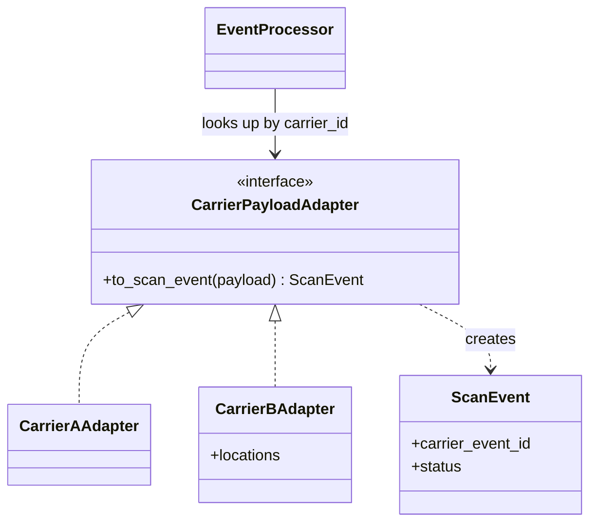
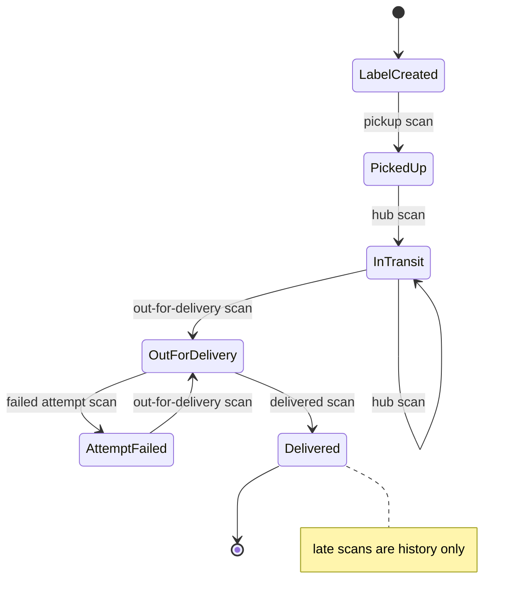
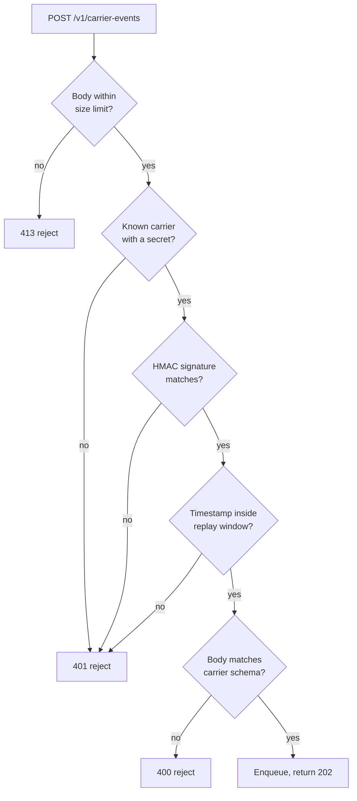

# Application design patterns

> A design pattern is a named, proven way to arrange a few objects or functions so that one kind of
> change becomes cheap. The architect's reason to know them is that most distributed patterns are the
> same ideas drawn at a larger scale, with a network in the middle.

!!! abstract "Page facts"
    **Level:** Intermediate (the catalogue is Level 1; applying patterns in service code is Level 2;
    the architectural echoes are Level 3) · **Status:** Draft · **Time:** 60-90 minutes ·
    **Last verified:** 2026-11-20

## Learning objectives

After this page you should be able to:

- Name the intent of each of the 23 patterns in the catalogue and say when each one hurts.
- Apply Adapter, Strategy, State, Chain of Responsibility, Repository, Unit of Work, Decorator, and
  Dependency Injection in Python service code without ceremony the language does not need.
- Explain why Singleton is usually a hidden global and never a cluster-wide guarantee.
- Recognize the distributed pattern each object-level pattern echoes (Adapter and the anti-corruption
  layer, Observer and publish-subscribe, Proxy and the sidecar) and reason with that echo.
- Decide when *not* to use a pattern because a plain function or a table is clearer.

## Prerequisites

- [Software design principles and clean code](../foundations/software-design-principles-and-clean-code.md)
  — coupling, cohesion, and the SOLID principles are the forces these patterns balance.
- [Programming paradigms and concurrency](../foundations/programming-paradigms-and-concurrency.md)
  — first-class functions replace several patterns in Python.
- [The C4 model](../architecture-fundamentals/c4-model.md) — the patterns here live at the component
  and code levels of the AtlasMart containers.

## The problem this solves

Service code changes in predictable directions: a new carrier with its own payload format, SMS as
well as email, a new legal status transition, tests that must run without a database. If each change
means editing a long function full of `if carrier == ...` branches, every change is risky. Design
patterns are the accumulated answers to "how do I arrange this so that *this kind* of change touches
one small place?", and a shared vocabulary: "an adapter per carrier behind one interface" is a whole
design conversation in eight words. The opposite failure is as common: factories that build one
thing and strategies with one implementation. A pattern earns its indirection only when the change
it absorbs is likely.

## What it is

A **design pattern** is a reusable arrangement of classes, objects, or functions with a name, an
intent, a structure, and known consequences. The best-known catalogue (Gamma, Helm, Johnson, and
Vlissides, 1994) groups patterns by purpose; enterprise-application authors later added data access
and user interface patterns. This page uses six groups, each answering one question:

| Group | Question it answers |
|---|---|
| UI | How do I separate what is shown from the data and the input handling? |
| Data access | How does domain code read and write storage without knowing the database? |
| Creational | Who decides which concrete class to create, and how? |
| Structural | How do I combine objects so interfaces fit and responsibilities stay separate? |
| Behavioural | How do objects divide an algorithm or react to each other? |
| Wiring | How do objects get their collaborators? |

Python changes the cost of several patterns: functions are objects (a Strategy or Command can be a
function), a module is already a single instance, `typing.Protocol` gives interfaces without
inheritance, and `@decorator` syntax is a function-level Decorator. The *intent* still matters when
the class diagram collapses to three lines.

## Mental model

Patterns are like joinery in carpentry: a dovetail or a mortise and tenon is a named, proven way to
join two pieces against one particular force (pulling apart, twisting). A carpenter picks the joint
for the force, and a table with dovetails everywhere is slower to build and no stronger. In code the
forces are the expected changes: new formats, channels, states, storage.

**Where the analogy breaks:** wood does not change its requirements after it is cut. Software does,
so a pattern chosen for a force that never arrives is pure cost, while a force that arrives later
can be absorbed by refactoring towards the pattern then. And patterns are not purely local: each has
a larger-scale echo, which is the part of this page an architect uses most.

## Key terms

| Term | Meaning on this page |
|---|---|
| Design pattern | A named arrangement of code elements with an intent and known trade-offs |
| Interface (protocol) | The set of operations a caller relies on; in Python, often a `typing.Protocol` |
| Composition | Building behaviour by holding and delegating to other objects instead of inheriting |
| Dependency injection | Passing an object its collaborators from outside instead of letting it create them |
| Composition root | The one place, near program start, where concrete objects are created and wired |
| Domain model | The classes and rules that express the business (shipments, scans, statuses) |
| Anti-corruption layer | A translation boundary that keeps another system's model from leaking into yours |
| Architectural echo | This page's name for the distributed pattern that repeats an object-level pattern's idea |

## How it works

### Step 1 — Know the whole catalogue

Every pattern in the inventory appears below, in the six groups, with its intent, when it helps,
when it hurts, and its architectural echo. Patterns marked **(deep)** are developed in Step 2.

| Group | Pattern | Intent | Use when | Hurts when | Architectural echo |
|---|---|---|---|---|---|
| UI | MVC (Model-View-Controller) | Model holds data and rules, view renders, controller turns input into model calls | Server-rendered pages; frameworks that already impose it | Controllers grow into the place where all logic lives | Separating a backend's domain from its delivery channels |
| UI | MVP (Model-View-Presenter) | A passive view; the presenter holds all presentation logic and is unit-testable | Presentation logic is complex and must be tested without a UI | Simple screens; the view interface becomes boilerplate | Backend for frontend: presentation shaping moved out of the client |
| UI | MVVM (Model-View-ViewModel) | The view binds declaratively to a view model's observable state | Reactive UI frameworks with data binding | Binding magic hides update loops and performance problems | Streaming state to clients that render whatever they are sent |
| Data access | Repository **(deep)** | A collection-like interface for loading and saving domain objects | Domain logic should be testable without the database | It becomes a leaky pass-through of every query the ORM offers | A service that owns its data and exposes it only through its API |
| Data access | Unit of Work **(deep)** | Track changes in one business operation and commit them together | Several writes must succeed or fail as one | Held open across network calls, it becomes a long transaction | A local transaction; the reason a transactional outbox works and a distributed one needs a saga |
| Data access | Specification | A business rule as a composable predicate object (`and`, `or`, `not`) | The same rule filters queries and checks objects in memory | Rules are simple; translating specifications to SQL gets clever | Subscription filters and policy rules evaluated by infrastructure |
| Creational | Factory (factory method or function) | One place decides which concrete class to create | Choice depends on data (carrier id, configuration) | There is only one product; it is indirection for its own sake | A plugin registry or service discovery choosing an implementation |
| Creational | Abstract Factory | Create a *family* of related objects that must match | Per-carrier or per-provider kits whose parts must not be mixed | Families are not real; every new product type changes every factory | Provisioning a matched set of resources per tenant or per cell |
| Creational | Builder | Build a complex object step by step and validate it at the end | Many optional parts; readable test data | A dataclass with defaults would do | Assembling and validating a deployment manifest before applying it |
| Creational | Singleton | Guarantee one instance with a global access point | Rarely: a truly process-wide resource such as a connection pool, and even then injected | Almost always: it is a hidden global that couples tests and hides dependencies | Leader election, the only way to get "exactly one" across a cluster |
| Structural | Adapter **(deep)** | Convert one interface or data shape into the one your code expects | Integrating a library or partner you do not control | Adapters start holding business rules | **Anti-corruption layer** |
| Structural | Bridge | Separate an abstraction from its implementation so both vary independently | Two independent dimensions (message kind × channel) would multiply subclasses | Only one dimension actually varies | Ports and adapters: the domain defines ports, infrastructure implements them |
| Structural | Composite | Treat a tree of objects and a single object uniformly | Part-whole hierarchies (a check made of checks, a shipment of parcels) | The tree is shallow and fixed | An aggregated health endpoint built from dependency checks |
| Structural | Decorator **(deep)** | Wrap an object to add behaviour while keeping its interface | Cross-cutting concerns (retries, metrics, caching, logging) | Deep stacks whose order matters but is invisible | Middleware and interceptor chains; mesh policies around a service |
| Structural | Facade | One simple interface over a complicated subsystem | Callers need a few operations from many collaborators | It becomes a god object that knows everything | API gateway or backend for frontend in front of many services |
| Structural | Proxy **(deep)** | A stand-in with the same interface that controls access to the real object | Lazy loading, caching, access checks, remote calls | It hides a network call behind something that looks local | **Sidecar** and ambassador processes |
| Behavioural | Strategy **(deep)** | Make an algorithm swappable behind one interface | Several interchangeable ways to do one thing (channels, pricing, routing) | One implementation exists "just in case" | Routing, feature flags, and multi-provider failover |
| Behavioural | Observer **(deep)** | Subjects notify registered observers of changes | Several independent reactions to one event, inside one process | Observers fail, block, or depend on order invisibly | **Publish-subscribe** |
| Behavioural | Command | Turn a request into an object that can be queued, logged, retried, or undone | Work is deferred, audited, or replayed | Simple direct calls with no queueing or undo | A command message on a queue; compensation as distributed undo |
| Behavioural | State **(deep)** | An object changes behaviour when its internal state changes | Behaviour differs per state and transitions have rules | Two states and one flag; a transition table is clearer | Workflow engines and saga state machines |
| Behavioural | Template Method | A base class fixes an algorithm's steps; subclasses fill in hooks | Many variants share a rigid skeleton (per-carrier file import) | Inheritance chains; variants need to change the skeleton | Frameworks and workflow skeletons that call your code (inversion of control) |
| Behavioural | Chain of Responsibility **(deep)** | Pass a request along handlers until one handles or rejects it | Ordered, independent checks or filters | Order dependencies are implicit; nobody handles the request | API gateway filter chains and ingress rule sets |
| Wiring | Dependency Injection **(deep)** | Give objects their collaborators from outside, wired in one composition root | Almost always in service code; it is what makes the other patterns testable | A container framework adds magic that a few constructor calls would replace | Platform-injected configuration and service discovery; the deployment descriptor as composition root |

### Step 2 — Use the core patterns in service code

The examples share one domain type: AtlasMart's own `ScanEvent`. Snippets are illustrative, not a
complete service.

#### Adapter: one per carrier payload format

Carriers post to AtlasMart's webhook contract, but each carrier's body uses its own event codes and
location fields (the proof of concept found one carrier sending location codes that need a lookup
table). An adapter per carrier converts the foreign shape into `ScanEvent`, so nothing past the
adapter knows carrier vocabulary.

```python
from dataclasses import dataclass
from datetime import datetime, timezone
from typing import Protocol

@dataclass(frozen=True)
class ScanEvent:                         # AtlasMart's model: the only shape downstream code sees
    carrier_event_id: str
    shipment_ref: str
    status: str                          # AtlasMart status code, never a carrier code
    occurred_at: datetime
    location: str

class CarrierPayloadAdapter(Protocol):
    def to_scan_event(self, payload: dict) -> ScanEvent: ...

class CarrierAAdapter:                   # nested JSON, ISO timestamps, text locations
    CODES = {"PU": "picked_up", "HUB": "in_transit", "OFD": "out_for_delivery", "DLV": "delivered"}
    def to_scan_event(self, payload: dict) -> ScanEvent:
        ev = payload["event"]
        return ScanEvent(ev["id"], payload["shipment"]["ref"], self.CODES[ev["code"]],
                         datetime.fromisoformat(ev["time"]), ev["place"])

class CarrierBAdapter:                   # flat JSON, epoch seconds, location codes via a lookup table
    def __init__(self, codes: dict[str, str], locations: dict[str, str]):
        self.codes, self.locations = codes, locations
    def to_scan_event(self, p: dict) -> ScanEvent:
        return ScanEvent(p["eventId"], p["ref"], self.codes[p["status"]],
                         datetime.fromtimestamp(p["epoch"], tz=timezone.utc), self.locations[p["loc"]])
```

**Figure 1 — Carrier adapters.** The Event Processor depends only on the adapter interface and on
AtlasMart's `ScanEvent`; each carrier's shape is confined to one class.



How to read it: dotted arrows with hollow heads mean "implements"; the solid arrow is the processor's
only dependency on carrier code. Adding a carrier adds one class and one registry entry.

**Architectural echo:** an **anti-corruption layer** in miniature; at system scale it is a
translation service that owns and versions the mapping tables. An unknown code should raise (and
dead-letter), never map to a default and silently become a wrong status.

#### Strategy and Decorator: notification channels with retries and metrics

FR-3 sends a notification on out-for-delivery and delivered. Customers choose a channel; the worker
should not care which. Each channel is a **Strategy** behind one interface; retries and metrics are
**Decorators** that wrap any channel without changing it.

```python
import random, time

class NotificationChannel(Protocol):
    def send(self, msg: "Notification") -> None: ...

class EmailChannel:
    def send(self, msg): ...             # calls the Notification Provider's email API (SmsChannel alike)

class RetryingChannel:                   # Decorator: same interface, adds retries with jitter
    def __init__(self, inner: NotificationChannel, attempts: int = 3):
        self.inner, self.attempts = inner, attempts
    def send(self, msg):
        for attempt in range(1, self.attempts + 1):
            try:
                return self.inner.send(msg)          # msg.idempotency_key makes a repeat harmless
            except TransientError:
                if attempt == self.attempts:
                    raise
                time.sleep(random.uniform(0, 0.2 * 2 ** attempt))

class MeteredChannel:                    # Decorator: records outcome and duration
    def __init__(self, inner: NotificationChannel, metrics):
        self.inner, self.metrics = inner, metrics
    def send(self, msg):
        start = time.monotonic()
        try:
            self.inner.send(msg)
        finally:
            self.metrics.observe("notify.seconds", time.monotonic() - start, channel=msg.channel)
```

The order of decorators is a design decision: `MeteredChannel(RetryingChannel(sms))` measures the
whole retried call; `RetryingChannel(MeteredChannel(sms))` measures each attempt. Write the order down
where the objects are wired. The retry count of 3 and the 0.2 s base delay are illustrative
assumptions; the [resilience mechanics page](../distributed-systems/resilience-mechanics-timeouts-retries-and-backpressure.md)
covers how to choose them. Retrying a send is only safe because each notification carries an
idempotency key derived from shipment and transition.

**Architectural echoes:** Strategy at system scale is routing between interchangeable providers
(failing over from one SMS provider to another). Decorator at system scale is a middleware chain or a
service mesh's retry and telemetry policies wrapped around a service that does not know they exist.

#### State: shipment status

A late or duplicate scan must never move a delivered shipment backwards. The **State** pattern gives
each status its own behaviour; in Python a transition table plus small state classes is usually
clearer than the textbook version where each class holds its own transitions.

```python
class Status:
    can_reschedule = False               # FR-4 allowed in this state?
    notify_on_entry = False              # FR-3 notification when entering this state?
    def next(self, scan: str) -> "Status":
        target = TRANSITIONS.get((type(self), scan))
        return target() if target else self          # illegal or late scan: keep state, record history

class LabelCreated(Status):    can_reschedule = True
class PickedUp(Status):        can_reschedule = True
class InTransit(Status):       pass
class OutForDelivery(Status):  notify_on_entry = True
class AttemptFailed(Status):   pass
class Delivered(Status):       notify_on_entry = True

TRANSITIONS = {
    (LabelCreated, "picked_up"): PickedUp, (PickedUp, "in_transit"): InTransit,
    (InTransit, "in_transit"): InTransit, (InTransit, "out_for_delivery"): OutForDelivery,
    (OutForDelivery, "attempt_failed"): AttemptFailed, (AttemptFailed, "out_for_delivery"): OutForDelivery,
    (OutForDelivery, "delivered"): Delivered}
```

**Figure 2 — Shipment status state machine.** Only listed transitions change status; every other
scan is stored in the timeline without changing it.



How to read it: start at the filled circle; each arrow is a legal transition labelled with the scan
that causes it. FR-4 rescheduling is allowed only in the first two states (before hub departure);
FR-3 notifications fire on entry to OutForDelivery and Delivered.

**Architectural echo:** a workflow engine or saga orchestrator is this state machine made durable,
with timers and compensations on transitions. It also makes the ordering design on the
[distributed systems fundamentals page](../distributed-systems/distributed-systems-fundamentals-time-and-coordination.md)
work: order comes from legal transitions, not timestamps.

#### Chain of Responsibility: webhook validation

The Webhook Ingestor must reject bad requests cheaply and in a fixed order: nothing is parsed before
the signature is verified (NFR-5). Each check is a handler that either passes the request on or
rejects it. In Python the chain is a list of callables, the same shape as web framework middleware.

```python
import hashlib, hmac
from typing import Callable, Optional

Check = Callable[["WebhookRequest"], Optional[int]]   # None = pass on, int = HTTP status to reject
def run_chain(req: "WebhookRequest", checks: list[Check]) -> int:
    for check in checks:
        rejected = check(req)
        if rejected is not None:
            return rejected
    return 202                                          # caller enqueues, then acknowledges
def signature_valid(req) -> Optional[int]:
    secret = CARRIER_SECRETS.get(req.carrier_id)        # loaded from the secret store at start-up
    if secret is None:
        return 401
    expected = hmac.new(secret, req.timestamp.encode() + req.body, hashlib.sha256).hexdigest()
    return None if hmac.compare_digest(expected, req.signature) else 401
CHECKS = [body_within_limit, carrier_known, signature_valid, timestamp_fresh, schema_valid]
```

**Figure 3 — Webhook validation chain.** Cheap checks first; any handler can stop the chain.



How to read it: top to bottom is the order handlers run; the first "no" ends the request. The size
limit is an AtlasMart assumption of 64 KB, far above the 500 B average event, so it only stops abuse.

**Architectural echo:** an API gateway's filter chain and a web application firewall's rules are
chains of responsibility run by infrastructure; which checks live there and which in the service is
the same ordering question at a larger scale.

#### Repository and Unit of Work around the event store

The Event Processor must store the event, update status, and record an outbox row for notifications
in one transaction (NFR-7: no acknowledged event lost). **Repositories** give domain code
collection-like access; the **Unit of Work** owns the transaction they share.

```python
class ScanEventRepository:
    def __init__(self, conn):
        self.conn = conn
    def add(self, ev: ScanEvent) -> bool:
        cur = self.conn.execute(
            "INSERT INTO scan_events (carrier_event_id, shipment_ref, status, occurred_at, location)"
            " VALUES (%s, %s, %s, %s, %s) ON CONFLICT (carrier_event_id) DO NOTHING",
            (ev.carrier_event_id, ev.shipment_ref, ev.status, ev.occurred_at, ev.location))
        return cur.rowcount == 1                       # False: duplicate delivery (FR-2)

class UnitOfWork:
    def __init__(self, connect):
        self.connect = connect
    def __enter__(self):
        self.conn = self.connect()
        self.events, self.statuses, self.outbox = (ScanEventRepository(self.conn),
            ShipmentStatusRepository(self.conn), OutboxRepository(self.conn))
        return self
    def __exit__(self, exc_type, exc, tb):
        self.conn.commit() if exc_type is None else self.conn.rollback()
        self.conn.close()
```

A handler then reads as the business rule: `with uow: if uow.events.add(ev): ...update status...
uow.outbox.add(...)`. Tests substitute in-memory repositories and a fake unit of work, so the state
machine and dedupe rules run in milliseconds without PostgreSQL.

**Architectural echo:** the Unit of Work is exactly as big as one database transaction, which is
why the [transactional outbox](../distributed-systems/transactions-sagas-and-delivery-guarantees.md)
works (event and state change share a commit) and why a business operation spanning two services
cannot have one; it needs a saga. A repository is the seam along which a service boundary is later
cut: if only the repository touches the table, only one service needs to own it.

#### Observer and Proxy: in-process versions of distributed patterns

**Observer.** After the unit of work commits, the processor raises a `StatusChanged` event to
in-process observers: one invalidates the Status Cache key, one records metrics. Observers run in the
same process, synchronously, with no durability: if the process dies between commit and the cache
observer, the cache stays stale until its 30 s TTL expires. Acceptable for a cache; not for
notifications, which go through the outbox and queue instead. That move is the echo: **Observer is
publish-subscribe in miniature**, promoted to a real subscriber when a reaction must survive
crashes, scale separately, or belong to another team.

**Proxy.** The Tracking API checks order ownership with the Order Management System (NFR-5). An
`OrderLookup` interface has a remote implementation and a `CachingOrderLookup` proxy with the same
interface that answers repeated lookups from a short cache. Proxy and Decorator have the same shape;
the intent differs (Proxy controls access to a subject, Decorator adds behaviour). **Proxy is a
sidecar in miniature:** a sidecar process sits beside the service and intercepts its traffic to add
mutual TLS, retries, or metrics, exactly as the proxy object intercepts method calls. The danger is
shared too: both make a network call look local, so timeouts must be explicit.

#### Dependency Injection, and why not Singleton

Every pattern above becomes testable only if objects receive their collaborators instead of reaching
for them. **Dependency injection** in Python needs no framework: constructors take collaborators,
and one **composition root** builds the graph at start-up (shown in the worked example).

**Singleton** is the opposite: one instance behind a global accessor. Dependencies become invisible
(no signature says a function uses the database client), tests share state and start depending on
execution order, and substituting a fake means patching a global. The guarantee is also weaker than
it looks: a "singleton" scheduler in the Notification Worker is one per *process*, and AtlasMart runs
two worker instances, so there are two. Exactly-one across a cluster needs a lease and fencing token through
[leader election](../distributed-systems/distributed-systems-fundamentals-time-and-coordination.md),
not a class. When one instance per process is genuinely right (a connection pool), create it once in
the composition root and inject it.

## Worked example: one AtlasMart scan event through the patterns

One carrier scan meets these patterns, in order:

1. **Chain of Responsibility** in the Webhook Ingestor; a pass enqueues the raw body and returns `202`.
2. A **Factory** (registry keyed by carrier id) in the Event Processor picks the **Adapter**.
3. A **Unit of Work** opens a transaction; the **Repository** inserts the event (a duplicate stops
   here); the **State** machine computes the next status; an outbox row is added if the new state
   has `notify_on_entry`; commit.
4. **Observers** after commit: delete the Status Cache key; record lag for NFR-8.
5. The outbox relay publishes; the Notification Worker picks a **Strategy** channel from the
   customer's preference, wrapped in metrics and retry **Decorators**.
6. A customer reads status through the Tracking API, whose service layer is a small **Facade** over
   cache, store, and the **Proxy** for order lookups.

The composition root makes the wiring visible in one place:

```python
def build_processor(settings, metrics) -> "EventProcessor":
    pool = create_pool(settings.database_url)             # one per process, injected, not a Singleton
    adapters = {"carrier-a": CarrierAAdapter(),
                "carrier-b": CarrierBAdapter(load_codes("b"), load_locations("b"))}
    return EventProcessor(adapters=adapters,
                          uow_factory=lambda: UnitOfWork(pool.connection),
                          observers=[CacheInvalidator(settings.redis_url), LagRecorder(metrics)])
```

What each choice bought and cost:

| Pattern | Bought | Cost |
|---|---|---|
| Adapter per carrier | A new carrier is one class and one registry line; no carrier code in status logic | One class per carrier; mapping tables to maintain |
| State machine | Late scans cannot regress status; FR-3 and FR-4 rules sit on the states | A transition table someone must keep complete |
| Chain of Responsibility | Fixed, reviewable order of security checks | Ordering bugs are possible if someone appends a check before the signature |
| Repository + Unit of Work | Fast tests; one commit for event, status, and outbox | Two abstractions over the database that must not leak SQL into domain code |
| Observer for cache invalidation | Processor does not know about Redis | Lost invalidation on crash, bounded by the 30 s TTL |

Deliberately **not** used: Abstract Factory (revisit if each carrier gets its own signature scheme
and file parser), Singleton, Template Method (per-carrier file import uses adapters, not
inheritance), and MVVM (the Tracking Web UI is a few server-rendered pages in the account site's MVC).

## Real-world architecture example

Most service code meets these patterns through its framework: web frameworks implement Chain of
Responsibility as middleware, MVC as routing plus templates, and dependency injection through
request-scoped providers; ORMs ship a Unit of Work (the session); HTTP clients expose hooks for
retries and metrics. Integration teams build one adapter per partner format and version the mapping
tables as tested configuration. The architectural decisions sit one level up: a translation library
in each service or a dedicated anti-corruption service; an in-process observer or a broker
subscriber; retries in code decorators or in a platform sidecar (never both).

## Design choices and trade-offs

| Choice | Favor when | Avoid when |
|---|---|---|
| Plain function instead of a Strategy or Command class | The variant has no state and one operation | Variants carry configuration or need several operations |
| Transition table instead of State classes | Behaviour per state is small; transitions are the main content | States have substantial, different behaviour |
| Adapter inside the service | One service consumes the partner format | Several services consume it; then a shared anti-corruption service or library |
| In-process Observer | Reactions are cheap, local, and loss-tolerant | A reaction must survive a crash or belongs to another deployable |
| Decorator in code for retries | The service owns its retry policy and knows which calls are idempotent | The platform already retries in a sidecar (pick one place) |
| Repository per aggregate | Domain rules need fast tests and the storage may change | The service is a thin CRUD wrapper; use the query layer directly |

## Failure modes and anti-patterns

- **Pattern for its own sake.** An interface with one implementation and a factory that builds one
  class. Detect: abstractions with a single user and no test double. Prevent: wait for the second
  case; refactor towards a pattern when the change arrives.
- **Business rules in adapters.** An adapter starts deciding status, or maps unknown codes to a
  silent default. Detect: domain logic in per-carrier classes; status counts that disagree with
  carrier reports. Prevent: adapters map vocabulary only and raise on unknown codes (dead-letter).
- **Hidden Singleton.** Module-level clients used deep inside functions. Detect: tests that pass
  alone and fail together. Prevent: inject from the composition root.
- **Unit of Work across the network.** A transaction held open while calling the Notification
  Provider. Detect: long transactions, lock waits. Prevent: commit, then side effects via the outbox.
- **Observer for critical work.** In-process observers lose notifications on crash. Detect: missing
  notifications after deployments. Prevent: outbox and queue.
- **Doubled retries.** Retries in a decorator, in the HTTP client, and in the sidecar: 3 × 3 × 3 = 27
  attempts per call. Detect: downstream load multiplying during incidents. Prevent: one owner for
  retries per hop.

## Security considerations

- The webhook chain's order is a security property: signature verification must precede parsing, and
  a code review rule (or a test that asserts the order of `CHECKS`) should protect it.
- Use constant-time comparison (`hmac.compare_digest`) for signatures; a plain `==` leaks timing.
- Adapters are the trust boundary for partner data: validate types and lengths there and never pass
  raw partner strings into queries or templates.
- Caching proxies must key on the caller's identity when the answer depends on it; a cache keyed only
  by order id would let one customer see another's ownership result (NFR-5).

## Performance, reliability, and cost

- **Performance:** a layer of indirection costs an extra function call, negligible next to
  AtlasMart's 50 ms average API latency; the expensive mistake is hidden I/O (a proxy or repository
  issuing one query per item in a loop).
- **Reliability:** Decorators centralize retry policy, which is good, and multiply attempts when
  stacked, which is bad. Observers inside the process share its failure domain. The state machine is
  a reliability feature: it makes duplicate and out-of-order events harmless.
- **Cost:** patterns cost reading time; a visible composition root and a short "how this is wired"
  note in the repository reduce it.

## Hands-on lab: a state machine and a validation chain

Local, free, about 30 minutes; Python 3.10 or later, standard library only.

1. Copy the `Status` classes and `TRANSITIONS` table into a file and write a function that folds a
   list of scan strings into a final status. Feed it `["picked_up", "in_transit", "out_for_delivery",
   "delivered", "in_transit"]` and confirm the late `in_transit` scan leaves it `Delivered`.
2. Write `run_chain` with five checks as plain functions. Build a request object with a body, a
   timestamp, a carrier id, and an HMAC computed with a test secret you generate in the script.
3. Write tests that tamper with the body, the timestamp, and the carrier id in turn, and assert the
   expected status codes (401, 401, 401) and that `schema_valid` is never called for a bad signature.
4. Reorder `CHECKS` so `schema_valid` runs first and show which test catches it.
5. Stretch: wrap a fake channel in `MeteredChannel(RetryingChannel(...))` and in the reverse order,
   make the fake fail twice, and compare what the metrics record.

??? question "Hint: proving the schema check did not run"
    Replace `schema_valid` with `unittest.mock.Mock(return_value=None)` and assert its `call_count`
    is zero after a request with a bad signature.

## Knowledge check

1. A colleague proposes a factory and an abstract base class for the only channel. What instead, and when?
2. Why can a late hub scan not change a delivered shipment in Figure 2, and what problem does that solve?
3. Name the architectural echo of Adapter, Observer, and Proxy, and one risk each shares with its echo.
4. Why does a `Scheduler` Singleton in the Notification Worker not guarantee one digest run per day?
5. `RetryingChannel` and the sidecar both retry three times. What happens in a provider outage?

??? success "Answers"
    1. A plain class behind a `Protocol`, no factory; add the registry when SMS arrives and the
       change it absorbs is real.
    2. Only listed transitions change state, and none leaves `Delivered`. It solves out-of-order
       delivery: the order of arrival or of carrier timestamps no longer decides status.
    3. Adapter: anti-corruption layer; both drift into holding business rules. Observer:
       publish-subscribe; both hide who depends on an event and make failures of reactions invisible.
       Proxy: sidecar; both make a remote call look local, so timeouts and failures are easy to forget.
    4. Two worker processes each have their own instance. A lease with a fencing token (leader
       election), plus idempotent sends, provides exactly-one behaviour across the cluster.
    5. Each logical send makes up to 3 × 3 = 9 attempts, multiplying load on a struggling provider.
       Keep retries in one layer per hop, preferably the one that knows the call is idempotent.

## Architecture discussion questions

1. A returns team also needs carrier data. Should the adapters become a shared library, a shared
   anti-corruption service, or stay duplicated? Argue with coupling, release cadence, and ownership.
2. The platform team offers a service mesh with retries, timeouts, and metrics. Which of this page's
   decorators would you delete, which would you keep, and why?
3. When would you turn the in-process `StatusChanged` observer into a published event on the broker,
   and what new guarantees and costs would that bring?

## Summary

Design patterns are named arrangements of code that make one kind of change cheap, at the price of
indirection. The catalogue has 23 patterns in six groups; in service code a small core matters most:
Adapter for partner formats, Strategy and Decorator for interchangeable and wrapped behaviour, State
for lifecycles, Chain of Responsibility for ordered checks, Repository and Unit of Work for storage
and transactions, and Dependency Injection to make them all testable. Singleton is usually a hidden
global and never a cluster-wide guarantee. Each pattern has an architectural echo (Adapter: the
anti-corruption layer; Observer: publish-subscribe; Proxy: the sidecar; Unit of Work: the local
transaction behind the outbox), and the echo tells you when a pattern has outgrown its process.

## Related topics

- **Before:** [Software design principles and clean code](../foundations/software-design-principles-and-clean-code.md);
  [Programming paradigms and concurrency](../foundations/programming-paradigms-and-concurrency.md)
- **Alongside:** [Distributed system patterns](distributed-system-patterns.md) (the system-scale
  echoes); [Architecture styles](architecture-styles.md) (ports and adapters);
  [Integration architecture](../application-and-api-architecture/integration-architecture.md);
  [Transactions, sagas, and delivery guarantees](../distributed-systems/transactions-sagas-and-delivery-guarantees.md)
  (the outbox the Unit of Work enables).
- **Next:** [Microservices architecture](microservices-architecture.md) — bounded contexts decide
  where repositories and adapters become service boundaries.
- **Planned:** event-driven architecture (D08-T02), where observers become subscribers; Kubernetes
  networking, storage, and service mesh (D11-T03), where proxies and decorators become sidecars.

## References

| Source | Type | Checked |
|---|---|---|
| Erich Gamma, Richard Helm, Ralph Johnson, and John Vlissides, *Design Patterns: Elements of Reusable Object-Oriented Software* (Addison-Wesley, 1994) | Book | 2026-11-20 |
| Martin Fowler, *Patterns of Enterprise Application Architecture* (Addison-Wesley, 2002); catalogue entries [Repository](https://martinfowler.com/eaaCatalog/repository.html) and [Unit of Work](https://martinfowler.com/eaaCatalog/unitOfWork.html) | Book and catalogue | 2026-11-20 |
| Martin Fowler, ["Inversion of Control Containers and the Dependency Injection pattern"](https://martinfowler.com/articles/injection.html), 2004 | Article | 2026-11-20 |
| Martin Fowler, ["GUI Architectures"](https://martinfowler.com/eaaDev/uiArchs.html), 2006 | Article (MVC, MVP, and related) | 2026-11-20 |
| Eric Evans and Martin Fowler, ["Specifications"](https://martinfowler.com/apsupp/spec.pdf) | Paper | 2026-11-20 |
| [Anti-corruption Layer pattern](https://learn.microsoft.com/en-us/azure/architecture/patterns/anti-corruption-layer) — Microsoft Azure Architecture Center | Pattern catalogue (cloud-neutral concept) | 2026-11-20 |
| [typing — Support for type hints (Protocol)](https://docs.python.org/3/library/typing.html) — Python documentation | Official docs | 2026-11-20 |
| [functools — wraps and higher-order functions](https://docs.python.org/3/library/functools.html) — Python documentation | Official docs | 2026-11-20 |

## Review notes

- Canonical page for D03-T03. All 23 inventory patterns have a catalogue row. In depth with code or
  figures: Adapter, Strategy, Decorator, State, Chain of Responsibility, Repository, Unit of Work,
  Dependency Injection, Singleton (as a warning); Observer, Proxy, Facade, Factory in prose and the
  worked example. **Only defined:** MVC, MVP, MVVM, Specification, Abstract Factory, Builder, Bridge,
  Composite, Command, Template Method.
- Snippets are illustrative, not executed (ADR-0006); helper names (`TransientError`, `Notification`,
  `WebhookRequest`, the other repositories and checks) are not defined. SQL uses psycopg placeholders.
- New AtlasMart assumptions: webhook body size limit 64 KB; notification retry policy of 3 attempts
  with a 0.2 s jittered exponential base (illustrative); carrier names "Carrier A" and "Carrier B";
  the six-state status machine including `AttemptFailed`; the Tracking Web UI using the account
  site's MVC framework. The location-code lookup reuses the gap-analysis page's PoC finding.
- Check in the browser: the stateDiagram `note right of` line, the classDiagram `<<interface>>`
  annotation and the member-less `EventProcessor` class. The 9 and 27 attempt counts are arithmetic
  from the illustrative retry count of 3.
