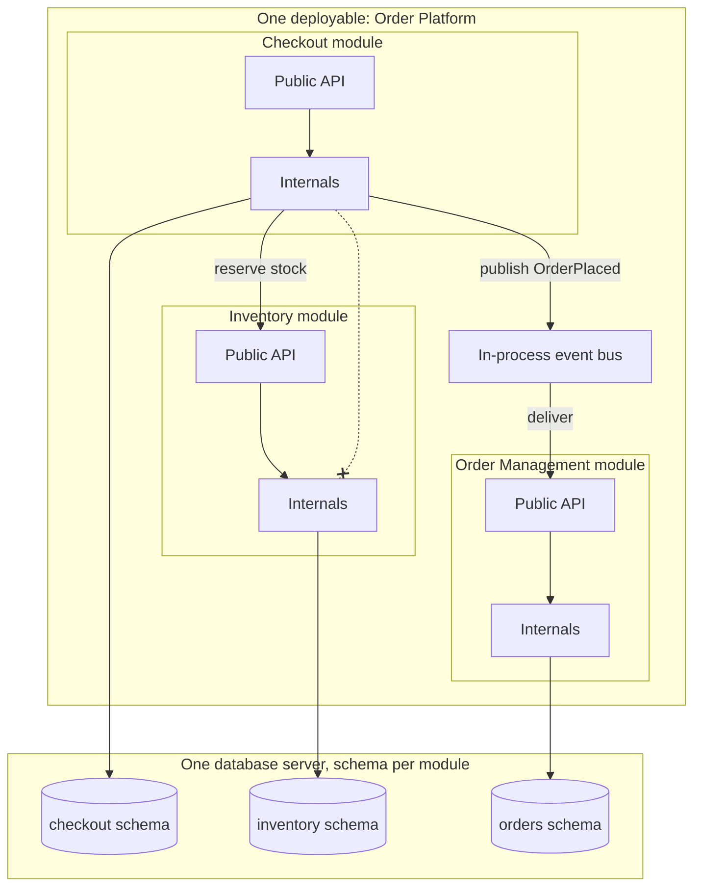
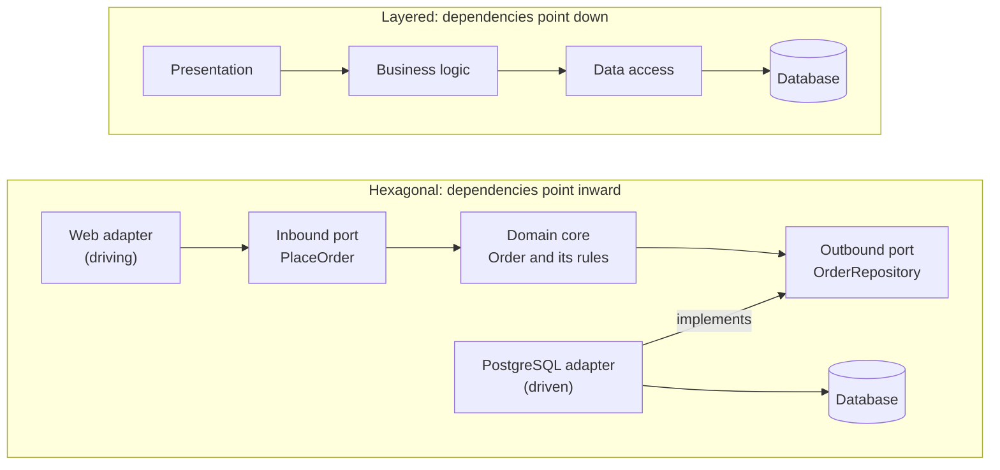
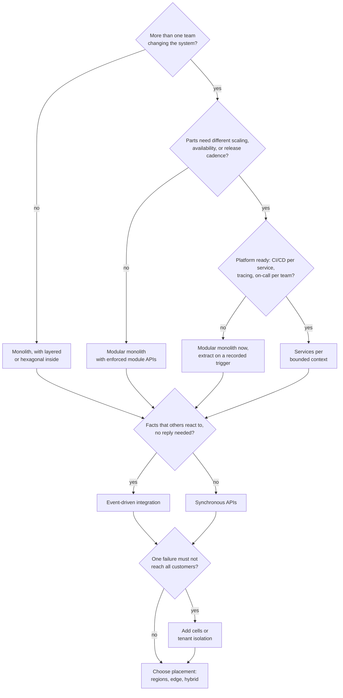

# Architecture styles

> An architecture style is a named, reusable shape for a whole system: how it is divided, how the
> parts talk, and where it runs. Choosing one is choosing which problems you would rather have.

!!! abstract "Page facts"
    **Level:** Mixed (the catalogue is Level 1; the deep dives are Level 2; the selection method and
    worked decision are Level 3) · **Status:** Draft · **Time:** 60-90 minutes ·
    **Last verified:** 2026-11-20

## Learning objectives

After this page you should be able to:

- Place each catalogued style on its dimension (code organization, deployment, interaction, or
  placement) and explain why real systems combine one from each.
- Compare monolith, modular monolith, and microservices on team autonomy, fault isolation, latency,
  consistency, and operating cost.
- Explain the dependency rule shared by hexagonal, clean, and onion, how it differs from layering,
  and how Domain-Driven Design relates to styles without being one.
- Say when event-driven, serverless, microkernel, pipe-and-filter, space-based, and cell-based styles
  fit, and when each is a trap.
- Run a weighted style comparison and record the outcome as an ADR.

## Prerequisites

- [Architecture quality attributes and trade-offs](../architecture-fundamentals/quality-attributes-and-trade-offs.md)
  — every style is a bundle of quality-attribute trade-offs.
- [The C4 model](../architecture-fundamentals/c4-model.md) — styles show up as the shape of the
  container diagram.
- [Trade-offs, principles, ADRs, and architecture governance](../architecture-fundamentals/trade-offs-principles-adrs-and-architecture-governance.md)
  — the worked example ends in an ADR and fitness functions.

## The problem this solves

Every non-trivial system must answer the same questions: how is the code split, how many things are
deployed, how do they talk, and where do they run. Answered one at a time under deadline, they
produce an accidental architecture whose trade-offs nobody chose. Named styles
give you pre-packaged answers whose consequences are known: a modular monolith keeps calls in-process
and consistency simple but couples releases; microservices decouple releases but add network failure
and operational cost; event-driven designs decouple producers from consumers but make "what happens
next" harder to see. Knowing the catalogue lets you choose deliberately, explain the choice, and spot
when a team has picked a style for fashion rather than fit.

## What it is

An **architecture style** is a recurring structure for a whole system, defined by its kinds of
components, the connectors between them, and the constraints on how they combine. A **design
pattern** is smaller: a reusable solution inside one part (covered on the
[application design patterns page](application-design-patterns.md)). Styles are not mutually
exclusive because they answer different questions. A useful split is four dimensions:

| Dimension | Question it answers | Examples |
|---|---|---|
| Code organization | How is the code inside one deployable arranged? | Layered, hexagonal, clean, onion, microkernel, pipe-and-filter, component-based |
| Deployment topology | How many independently deployed units, and how are they tiered? | Monolith, modular monolith, client-server, three-tier, N-tier, SOA, microservices, serverless, space-based |
| Interaction | How do the parts communicate? | Event-driven, broker, peer-to-peer |
| Placement and tenancy | Where does it run, and who shares it? | Distributed, cloud-native, multi-tenant, cell-based, multi-region, edge, hybrid cloud |

A real system picks from each row: for example, "a modular monolith, hexagonal inside each module,
event-driven between modules, deployed as a multi-tenant service in one region".

### The style catalogue

Every style in the curriculum inventory, grouped by dimension. "Favor" and "avoid" are starting
positions, not rules.

**Code organization**

| Style | What it is | Favor when | Avoid when | Main trade-off |
|---|---|---|---|---|
| Layered | Horizontal layers (presentation, business, data) where each depends only on the one below | Small to medium apps, CRUD-heavy domains, teams new to the codebase | Rich domain logic that leaks into every layer; change usually cuts across all layers | Easy to start; domain becomes coupled to persistence |
| Component-based | System built from replaceable components with explicit interfaces, assembled at build or run time | Reuse across products; UI frameworks; vendor-supplied parts | Components are so fine that wiring dominates | Reuse and substitution versus interface overhead |
| Hexagonal (ports and adapters) | Domain core defines ports; adapters for web, database, and messaging plug into them | Domain logic worth protecting; many I/O channels; testability matters | Thin CRUD over a table; a two-week prototype | Isolation and testability versus more interfaces and mapping |
| Clean | Concentric rings (entities, use cases, interface adapters, frameworks) with dependencies pointing inward | Long-lived systems where frameworks will change | Small services where the rings outnumber the classes | Framework independence versus ceremony |
| Onion | Domain model at the center, domain services and application services around it, infrastructure outside | Same as hexagonal; teams used to layered thinking | Same as hexagonal | Same as hexagonal, expressed as layers |
| Microkernel (plug-in) | A minimal core plus plug-ins that add features through a defined extension contract | Products customized per customer or region; IDEs, rule engines, tax and shipping calculators | Plug-ins need to change the core contract often | Extensibility versus a hard-to-evolve plug-in contract |
| Pipe-and-filter | Independent filters each transform data and pass it through pipes to the next | Data processing, ETL, media pipelines, compilers, log processing | Interactive request-response with branching logic | Composability versus per-hop overhead and poor error context |
| DDD (Domain-Driven Design) | Not a style: a design approach for finding boundaries and modelling inside them; see [Where DDD fits](#where-ddd-fits) | Complex domains whose language matters | Simple CRUD domains | Better boundaries versus modelling effort |

**Deployment topology**

| Style | What it is | Favor when | Avoid when | Main trade-off |
|---|---|---|---|---|
| Monolith | One deployable containing all features, usually one database | One team, a new product, an unproven domain | Many teams blocked on one release train; parts need very different scaling | Simplicity and in-process speed versus coupled releases |
| Modular monolith | One deployable split into modules with enforced public APIs and owned data | Several teams, one product, domain boundaries still settling | Parts need independent scaling, runtime, or availability targets | Most of the modularity of services without the network |
| Client-server | Clients request; a server holds shared state and logic | Almost every networked application | Peers must work without any central party | Central control versus a central bottleneck |
| Three-tier | Presentation, application, and data tiers on separate machines | Classic web and enterprise apps | Rarely wrong as a starting point; it is a deployment shape, not a design | Independent scaling of tiers versus extra hops |
| N-tier | Three-tier with further tiers (caching, integration, API) | Enterprise systems with clear tier responsibilities | Tiers added for symmetry rather than need | Separation versus latency per tier |
| SOA (service-oriented architecture) | Enterprise-wide services integrated through shared contracts, often via an enterprise service bus | Integrating many existing enterprise applications | The bus becomes a central, logic-holding bottleneck | Enterprise reuse versus central coupling |
| Microservices | Small, independently deployable services, each owning one bounded context and its data | Several autonomous teams, different scaling or release needs, mature delivery platform | One team, unclear domain, no automation or observability | Team autonomy versus distributed-system cost |
| Serverless | Functions and managed services run on demand; the provider manages servers and scaling | Spiky or idle workloads, event handlers, glue code | Steady high load, long-running work, strict latency tails | No servers to run versus provider limits and cold starts |
| Space-based | Processing units hold data in replicated in-memory grids; a database is written asynchronously | Extreme, bursty concurrency (ticketing, auctions, flash sales) | Large datasets that cannot sit in memory; strict consistency | Elastic throughput versus complexity and data-loss windows |

**Interaction**

| Style | What it is | Favor when | Avoid when | Main trade-off |
|---|---|---|---|---|
| Event-driven | Components publish facts (events); others react without the publisher knowing them | Many consumers of the same fact; spikes to absorb; loose coupling | The caller needs an answer now; the flow must be easy to trace | Decoupling versus visibility and eventual consistency |
| Broker | A mediator routes messages between components that do not address each other directly | Heterogeneous systems; routing and transformation needs | The broker accumulates business logic | Location transparency versus a central dependency |
| Peer-to-peer | Every node is both client and server; no central coordinator | File distribution, blockchain-style ledgers, local-first sync | You need central control, auditing, or simple consistency | No central bottleneck versus hard coordination and trust |

**Placement and tenancy**

| Style | What it is | Favor when | Avoid when | Main trade-off |
|---|---|---|---|---|
| Distributed | Any system whose parts run on separate machines and talk over a network | Load, data, or availability exceeds one machine | One machine would do | Scale and fault tolerance versus partial failure |
| Cloud-native | Built for elastic, managed, automated cloud platforms: containers, declarative config, managed services | Teams that can automate delivery and operations | Fixed, steady workloads on owned hardware | Elasticity and speed versus platform complexity and lock-in |
| Multi-tenant | One deployment serves many customers (tenants) with logical isolation | SaaS products; cost efficiency at many small tenants | Tenants with regulatory or performance isolation needs | Shared cost versus noisy neighbors and isolation risk |
| Cell-based | Customers partitioned across independent full-stack copies (cells) behind a thin router | A whole-system outage is unacceptable; blast radius must be bounded | Small systems; heavy cross-customer queries | Bounded blast radius versus duplicated infrastructure |
| Multi-region | The system runs in more than one region, active-active or active-passive | Region-level disaster recovery; users on several continents | The data cannot be replicated asynchronously without breaking correctness | Region resilience versus cost and consistency |
| Edge | Logic and data placed close to users or devices (CDN points, stores, factories) | Latency to users dominates; intermittent connectivity | Logic needs strong consistency with central data | Latency versus distributed state and harder deploys |
| Hybrid cloud | Parts on premises and parts in one or more public clouds, operated as one system | Data residency, legacy systems, or migration in progress | Run as two unrelated estates with no common identity or tooling | Flexibility versus two operating models |

## Mental model

Think of a city. Code organization is how each building is laid out inside (open-plan, or rooms
with doors). Deployment topology is how many buildings there are and whether they share a foundation.
Interaction is the road network versus the postal service: drive over and ask (synchronous), or drop
a letter and carry on (events). Placement is zoning: one district, several identical districts so a
fire stays local (cells), or branch offices near customers (edge). A good city mixes these; nobody
argues that "postal service" competes with "open-plan".

**Where the analogy breaks:** buildings rarely change shape once built, while a modular monolith can
become microservices one module at a time; and a city never keeps two copies of a building consistent.

## Key terms

| Term | Meaning on this page |
|---|---|
| Architecture style | A named structure for a whole system: component kinds, connectors, constraints |
| Deployable unit | Something released on its own (a process, container image, or function) |
| Module | A unit of code with a public interface and hidden internals, inside one deployable |
| Coupling | How much one part must change, or fail, when another does |
| Cohesion | How strongly the contents of one part belong together |
| Dependency rule | Source-code dependencies point toward the domain, never from the domain to frameworks |
| Port / adapter | A port is an interface the domain owns; an adapter connects a technology to it |
| Bounded context | A part of the domain within which one model and vocabulary are consistent |
| Blast radius | The share of users or functions affected by one failure |
| Cell-based architecture | Customers partitioned across independent full-stack copies (cells) behind a thin router |
| Architecture Decision Record (ADR) | A short document recording one decision, its context, options, and consequences |
| Fitness function | An automated check that the architecture still has a required property |

## How it works

### Monolith, modular monolith, and microservices

These three are points on one spectrum: how many deployable units, and how strongly the boundaries
inside are enforced.

- A **monolith** is one deployable, typically one database: function calls, no partial failure, one
  transaction across everything. Its problem is not size but that nothing stops any code calling any
  other code or reading any table, so boundaries erode and every team shares one release train.
- A **modular monolith** keeps one deployable but enforces module boundaries: each module exposes a
  public API, hides its internals, and owns its tables (often a schema per module). Cross-module
  reads go through the API, not the tables. Enforcement is mechanical, by build rules or
  import-dependency tests (fitness functions), because conventions alone erode. Modules can still
  share one transaction when they must, and an in-process event bus can decouple them in time.
- **Microservices** make each boundary a network boundary: separate deployables, separate data,
  communication by API or events. Teams release independently and parts scale and fail
  independently, at the price of every distributed-systems problem: timeouts, retries, partial
  failure, eventual consistency, versioned contracts, and a platform to run it all. The
  [microservices page](microservices-architecture.md) covers this in depth.

| Property | Monolith | Modular monolith | Microservices |
|---|---|---|---|
| Deployables | 1 | 1 | One or more per bounded context |
| Cross-part call | Function call | Function call through a module API | Network call or event |
| Data | Shared schema | Schema per module, one server | Database per service |
| Consistency across parts | One ACID transaction | One transaction possible, discouraged across modules | Sagas and eventual consistency |
| Release coupling | Total | Total (one artifact), but fewer merge conflicts | Independent |
| Fault isolation | None | Weak (same process); bulkheads help | Strong per service, if calls degrade |
| Operating cost | Lowest | Low | Highest: discovery, tracing, pipelines, on-call per service |

**Figure 1 — Module boundaries in a modular monolith.** One deployable, three modules, one database
server with a schema per module. Modules talk only through public APIs or the in-process bus.

How to read it: solid arrows are allowed dependencies; the crossed dashed link (Checkout internals
to Inventory internals) is what an import-dependency test must forbid. Each schema has one writer, so
extracting a module later means swapping its API for a network client and its schema for a database.

### Layered and N-tier

A **layered** architecture stacks presentation, business logic, and data access, each depending on
the layer below; it is the default because frameworks are organized that way. Two failure tendencies: the **sinkhole**, where most requests pass through layers that add
nothing, and **domain-on-the-database**, where business rules shape themselves around tables because
the data layer sits at the bottom of every dependency chain.

Layers are logical; **tiers** are physical. **Three-tier** puts presentation (browser or web
server), application (API servers), and data (database) on separate machines so each scales on its
own. **N-tier** adds tiers such as a cache, a message tier, or an integration tier. Each tier is a
network hop, so add one for a measured reason (separate scaling, a security zone), not for
symmetry. **Client-server** is the general form underneath all of these.

### Hexagonal, clean, and onion: one idea, three drawings

Hexagonal architecture (ports and adapters), clean architecture, and onion architecture differ in
vocabulary and drawing, not in principle. All three apply **dependency inversion** to the whole
application: the domain defines the interfaces it needs (a repository, a payment gateway, a
notifier), and the infrastructure implements them. Source-code dependencies therefore point inward,
toward the domain, while calls at run time still flow outward to the database.

- **Hexagonal** names the interfaces **ports** and the implementations **adapters**, and
  distinguishes driving adapters (web controller, CLI, test harness, which call the domain) from
  driven adapters (database, queue, external API, which the domain calls through a port).
- **Clean** draws concentric rings (entities, use cases, interface adapters, frameworks and drivers)
  and states the dependency rule explicitly: nothing in an inner ring names anything in an outer one.
- **Onion** draws the domain model at the center with domain services, application services, and
  infrastructure as outer layers; it reads like a layered architecture turned inside out.

**Figure 2 — Dependency direction: layered versus hexagonal.** In the layered design the business
logic depends on data access; in the hexagonal design the database adapter depends on a port the
domain owns.

How to read it: arrows are source-code dependencies. At the top, data-access changes can force
business-logic changes. At the bottom, the adapter points at the port, so the core compiles and tests
without a database; an in-memory fake is just another adapter.

The payoff is testability and replaceable infrastructure; the cost is more interfaces, mapping
between domain and persistence objects, and ports for things that never change. Use it where the
domain logic is the valuable part, not for services that copy rows between an API and a table.

### Event-driven

In an **event-driven** style, components announce that something happened (an event such as
`OrderPlaced`) and other components react. The publisher does not know or wait for its consumers, so
new consumers can be added without changing it, and a slow consumer does not slow the publisher.
Four uses of the word are worth separating: **event notification** (a thin "something changed, ask
me for details"), **event-carried state transfer** (the event carries the data so consumers keep a
local copy), **event sourcing** (the event log is the system of record), and **CQRS** (separate
models for writes and reads, often fed by events). The last two are patterns covered on the
[distributed system patterns page](distributed-system-patterns.md). Topologies range from a
**broker** topology (events flow through a broker with no central coordinator, also called
choreography) to a **mediator** topology (an orchestrator directs the steps).

The costs: the end-to-end flow is visible nowhere, consumers see the world eventually, and duplicates
and reordering must be handled (see
[message queues and brokers](../messaging-and-streaming/message-queues-and-brokers.md)).

### Serverless

**Serverless** means the unit of deployment is a function or a fully managed service, billed per use,
with the provider handling servers, scaling, and patching. It is excellent for event handlers, glue
between managed services, scheduled jobs, and workloads that are idle most of the time. Its
constraints are structural: per-invocation time and memory limits, cold starts that lengthen the
latency tail after idle periods, connection management to databases that expect long-lived pools,
and a cost curve that can cross that of always-on containers under steady load (check the provider's
current documentation for limits and prices). It pairs well with event-driven interaction.

### Microkernel (plug-in)

A **microkernel** style has a small, stable core (load plug-ins, route work, hold shared state) and
plug-ins that add capability through a defined contract: IDEs, rules engines, or a shipping
calculator with one plug-in per country. The design work is the plug-in contract; once others depend
on it, changing it is expensive, so version it from day one. In-process plug-ins share the core's
fate and privileges; isolate untrusted ones.

### Pipe-and-filter

**Pipe-and-filter** chains independent **filters**, each transforming input and writing to a
**pipe** that feeds the next. Filters do not know their neighbours, so they can be reordered,
reused, tested alone, and scaled independently: the natural style for ETL, media transcoding, log
processing, and shell pipelines. It fits badly with branching, interactive logic, and errors are hard
to explain unless each record carries its context through the pipeline.

### Space-based

**Space-based** architecture removes the database from the request path: processing units hold
working data in a replicated in-memory grid, and data writers persist it asynchronously. Units can be
added elastically for extreme bursts such as ticket or flash sales. The costs are complexity, a
data-loss window between memory and database, and conflicts between replicas. Consider it only after
caching and partitioning are exhausted.

### Cell-based

**Cell-based** architecture runs several complete, independent copies of the system (cells), each
serving a subset of customers, behind a thin **cell router** that maps a customer to a cell. A bad
deploy, a poison request, or a runaway tenant takes down one cell, not everyone: the blast radius is
roughly one cell's share of customers, and cell-by-cell deploys make the first cell a canary. Costs:
duplicated infrastructure, a router that must be simpler and more reliable than anything behind it,
a separate path for cross-cell queries, and rebalancing. Each cell can itself be a modular monolith
or a set of microservices.

### Where DDD fits

**Domain-Driven Design (DDD)** is a design approach, not a style. It provides strategic tools for
finding boundaries (**bounded contexts**, a **ubiquitous language** per context, and **context
maps** that describe how contexts relate, including anti-corruption layers) and tactical tools for
modelling inside a boundary (entities, value objects, aggregates, domain events, repositories).
Styles consume these results: bounded contexts become modules or services; aggregates and
repositories sit inside a hexagonal core; domain events feed event-driven styles. DDD does not
require microservices, and microservices without DDD-style boundary work usually become a
distributed monolith.

### Choosing a style

Choose per dimension, starting from team structure and quality attributes, not technology. Conway's
law (systems mirror the communication structure of the organizations that build them) is the
strongest input: one team rarely benefits from many deployables, and many teams rarely thrive in one
tangled codebase.

**Figure 3 — A style-selection decision flow.** A starting point for discussion, not an algorithm;
each "yes" should be backed by a requirement or a measurement.

How to read it: the first three questions settle deployment topology; the fourth settles
interaction; the fifth and the final node settle placement. Code organization (layered or
hexagonal) is chosen inside each deployable and is not on the chart.

## Worked example: AtlasMart chooses a style for the order domain

All details are assumptions for a fictional company, consistent with the other AtlasMart pages.

### Context and assumptions

- **Scope and teams (assumption).** Checkout, Payments, Inventory, Order Management, and Order
  Tracking, built by four teams of 6-8 engineers (about 28 of AtlasMart's roughly 40): Checkout and
  Payments, Inventory, Order Management, and Order Tracking.
- **Existing system (assumption).** The Order Management System is a monolith on one PostgreSQL
  database containing checkout, payment orchestration (an external payment provider handles cards;
  AtlasMart stores only provider tokens), inventory reservations, and the order lifecycle, on a
  two-weekly release train shared by three teams. The Order Tracking System is already separate and
  event-driven ([C4 page](../architecture-fundamentals/c4-model.md)).
- **Pain (assumption).** Release coordination costs about two days per release; last year a slow
  inventory batch job exhausted the shared connection pool and took checkout down during a sale.
- **Load.** 60,000 orders/day ÷ 86,400 s ≈ 0.69 orders/s on average. Sale-day peak (assumption, same
  ratio as tracking reads, 210 ÷ 13.9 ≈ 15): 0.69 × 15 ≈ 10.4 orders/s. This is small; scaling is
  not the reason to split anything.
- **NFRs.** Checkout availability 99.95% monthly (assumption; the example used on the requirements
  page), which allows 43,800 min × 0.0005 ≈ 21.9 minutes of downtime per month. Checkout "place
  order" latency: NFR-3's p95 300 ms / p99 800 ms applied to the place-order call (assumption).
  Tracking keeps NFR-1 to NFR-8.

### Options

- **A. Keep the monolith** and tidy it up (connection-pool bulkheads, a faster release process).
- **B. Modular monolith:** enforce Checkout, Payments, Inventory, and Order Management as modules
  with schema-per-module, one deployable; Tracking stays separate.
- **C. Team-aligned services:** one service per bounded context (Checkout, Payments, Inventory, Order
  Management, plus the existing Tracking), five services for four teams.
- **D. Fine-grained microservices:** 12-15 services (cart, pricing snapshot, payment authorization,
  refunds, stock levels, reservations, and so on). Serverless was kept for payment-provider
  callbacks only; as the main style it fails the steady-traffic and latency-tail criteria.

### Weighted comparison

Weights were agreed in writing before scoring. Scores are 1-5, multiplied by the weight.

| Criterion (weight) | A. Monolith | B. Modular monolith | C. Team-aligned services | D. Fine-grained |
|---|---|---|---|---|
| Independent delivery for four teams (20) | 1 → 20 | 3 → 60 | 5 → 100 | 4 → 80 |
| Fault isolation for checkout (20) | 1 → 20 | 2 → 40 | 4 → 80 | 4 → 80 |
| Place-order latency within NFR-3 (15) | 5 → 75 | 5 → 75 | 4 → 60 | 2 → 30 |
| Consistency of order, payment, and stock (15) | 5 → 75 | 4 → 60 | 3 → 45 | 2 → 30 |
| Operating load on a 40-engineer organization (20) | 5 → 100 | 4 → 80 | 3 → 60 | 1 → 20 |
| Migration risk from today's system (10) | 5 → 50 | 4 → 40 | 3 → 30 | 1 → 10 |
| **Total (100)** | **340** | **355** | **375** | **250** |

Score notes: D gets 4 on delivery because features would span several services of one team. B gets
2 on isolation because a module can still exhaust the shared process's memory or threads. C loses a
latency point for added synchronous hops (quantified on the [microservices page](microservices-architecture.md)).

**Sensitivity.** The result depends on the weights. Moving 10 points from independent delivery to
operating load (10 and 30) gives A 380, B 365, C 355: the monolith wins. That is the honest
conclusion: C is preferred only because AtlasMart has judged release coupling and checkout isolation
worth paying for, and the margin over B is small. The ADR therefore records B as the migration path
to C, so the organization gains most of the benefit early and stops if extraction proves too costly.

### The decision record

**ADR-OD-001: Organize the order domain as team-aligned services, reached through a modular
monolith**

**Status:** Proposed · **Date:** 2026-11-20 · **Deciders:** the four team leads, Solutions
Architect, platform team representative

**Context.** Three teams share one release train; a shared connection pool let an inventory batch
job take checkout down; load (about 10.4 orders/s at peak) is not a driver. Checkout must meet
99.95% and p95 300 ms.

**Decision.** Target Option C: Checkout, Payments, Inventory, and Order Management each become a
service with its own database; Order Tracking remains a separate service. Get there by first
restructuring the monolith into enforced modules (Option B), with per-module connection pools and an
import-dependency fitness function, then extract Payments first (smallest, clearest contract, and it
shrinks the payment-data trust boundary), then Checkout, then Inventory. Order Management remains the
residual module and becomes the last service.

**Consequences.** Positive: independent releases; Inventory's batch work cannot take checkout's
process down; payment code isolated. Negative: two service-to-service hops (three with a new BFF)
added to place-order; one transaction becomes a saga with compensations; platform work for
discovery, tracing, and a pipeline per deployable; each synchronous hop needs better than the path's
99.95%, or a degraded mode.

**Triggers and fitness functions.** Stop after the modular step if release coordination falls below
half a day and no isolation incident recurs for two quarters; revisit if place-order p95 exceeds
250 ms after the Payments extraction. CI checks module import rules; the pre-release load test checks
p95 under 300 ms above 10.4 orders/s; one database credential per service.

## Real-world architecture example

A mid-sized insurer (fictionalized) shows the usual shape of a mature estate: a layered policy
administration monolith; SOA-era claims and billing services behind an integration bus; a customer
portal built as a few microservices with a backend for each frontend; event-driven integration for
"policy issued" and "claim filed" facts; serverless document processing; and hybrid placement because
the policy database stays on premises for data residency. Nobody chose "the" style. The architecture
team's work is keeping the seams (contracts, identity, observability) consistent, and the lesson is
to choose per dimension and per bounded context, and to write down why.

## Design choices and trade-offs

| Choice | Favor when | Avoid when |
|---|---|---|
| Start as a monolith | One team, new product, domain still being discovered | Several teams already block each other |
| Modular monolith | Several teams, boundaries becoming clear, platform not ready for many services | Parts need separate scaling, runtimes, or availability targets |
| Microservices | Autonomous teams, independent release or scaling needs, mature automation | The main motive is fashion or a résumé, or the domain is unclear |
| Hexagonal, clean, or onion inside a deployable | Valuable domain logic, many integrations, heavy testing needs | Thin data-in, data-out services |
| Event-driven integration | Many consumers per fact; producers must not wait on consumers | The caller needs the result to continue |
| Serverless | Spiky, idle, or event-triggered work; small teams with no platform | Steady high load, long jobs, tight tail-latency targets |
| Cell-based placement | Whole-system outages are unacceptable and customers partition cleanly | Workloads dominated by cross-customer queries |
| Multi-region | Region-level recovery objectives or global users justify the cost | Single-region availability meets the SLO |

## Failure modes and anti-patterns

- **Big ball of mud.** A monolith with no enforced boundaries. Detect: any change touches many
  packages; cyclic dependencies in a dependency graph tool. Prevent: modules with public APIs and
  import-rule fitness functions.
- **Distributed monolith.** Services that must deploy together and call each other synchronously
  for every request. Detect: coordinated releases, shared databases, long synchronous chains.
  Prevent: boundaries from bounded contexts, data ownership, asynchronous integration; see the
  [microservices page](microservices-architecture.md).
- **Architecture by fashion.** A style chosen because a famous company uses it. Detect: the ADR's
  drivers omit your own requirements. Prevent: a weighted comparison, weights agreed first.
- **Event soup.** Events used for commands and queries until nobody can trace a flow. Detect:
  incident reviews cannot reconstruct what happened. Prevent: events for facts only, correlation IDs,
  an event catalogue with owners.
- **Smart broker.** Business logic migrates into the bus or broker. Detect: routing rules encode
  pricing or eligibility. Prevent: keep brokers dumb; logic lives in services.
- **Shared-fate cells.** Cells that share a database or a deploy pipeline step. Detect: a single
  failure affected several cells. Prevent: audit every shared dependency against the cell boundary.

## Security considerations

- Every network boundary a style adds is a trust boundary: service-to-service authentication (for
  example, mutual TLS) and authorization become necessary where a function call needed neither.
- Tiers can be bypassed if the data tier accepts connections from anywhere but the application tier.
- Plug-ins and serverless functions run with the platform's privileges: least privilege per unit,
  sandboxes for untrusted plug-ins.
- Multi-tenant and cell-based designs need tenant isolation tested, not assumed.
- Extracting a sensitive capability (payments in the worked example) shrinks the scope of compliance
  audits and the set of people who can deploy that code.
- Edge and hybrid placements put code and data in less controlled locations; plan keys and patching.

## Performance, reliability, and cost

- **Performance:** in-process calls cost nanoseconds; network calls cost at least a round trip plus
  serialization. Every tier, service hop, or broker adds latency, and fan-out makes the slowest
  dependency set the response time. Measure hop costs before splitting a latency-critical path.
- **Reliability:** a synchronous chain is only as available as the product of its parts; three
  services at 99.95% in series give about 99.85%. Distribution improves availability only when calls
  degrade gracefully or move off the critical path (events, caches, cells).
- **Cost:** distributed styles add platform cost (pipelines, discovery, tracing, gateways) and people
  cost (on-call per service). Cells and regions multiply infrastructure. Serverless trades idle
  capacity for per-use billing; compare using the provider's current pricing.

## Hands-on lab: enforce a hexagonal boundary with a fitness function

A local, standard-library-only exercise (Python 3.10 or later).

1. Create a package `orders/` with `domain.py` (`Order` and a `PlaceOrder` use case), `ports.py`
   (an `OrderRepository` abstract base class), and `adapters/` with an in-memory and a SQLite adapter.
2. Inject the repository into `PlaceOrder` through its constructor. Test the use case once with the
   in-memory adapter and once with the SQLite adapter on a temporary file.
3. Write a fitness-function test that parses `domain.py` and `ports.py` with the `ast` module and
   fails if either imports anything from `orders.adapters` or `sqlite3`.
4. Import `sqlite3` in `domain.py` on purpose, confirm the fitness test fails, then revert.
5. Stretch: add an `inventory/` module and a rule that `orders` may import `inventory.api` but never
   `inventory.internal`.

??? question "Hint: finding imports with ast"
    Walk `ast.walk(ast.parse(source))`, collecting `alias.name` from `ast.Import` nodes and
    `node.module` from `ast.ImportFrom` nodes, and compare each with a list of forbidden prefixes.

## Knowledge check

1. Why is it a category error to ask "should we use hexagonal or microservices?"
2. Name two concrete mechanisms that make a modular monolith different from a monolith.
3. In a hexagonal design, which way does the source-code dependency point between the domain core
   and the database adapter, and why does that help testing?
4. A cell-based system has 8 equal cells. Roughly what share of customers does a bad deploy to one
   cell affect, and what makes the router a risk?
5. Is DDD an architecture style? Explain how its output is used by styles.

??? success "Answers"
    1. They answer different questions: hexagonal is code organization inside a deployable;
       microservices is deployment topology. A system can be both (hexagonal inside each service).
    2. Enforced public module APIs (for example, import rules checked in CI) and data ownership (a
       schema per module, no cross-module table access). An in-process event bus is a common third.
    3. From the adapter toward the domain: the adapter implements a port the domain owns. The domain
       compiles and runs with a fake adapter, so its logic is tested without a database.
    4. About one eighth (12.5%) if customers are spread evenly. The router sits in front of every cell,
       so it must be simpler and more reliable than the cells, or it becomes the shared failure the
       cells were meant to remove.
    5. No. DDD is a design approach; its bounded contexts become modules or services, its aggregates
       and repositories live inside hexagonal cores, and its domain events feed event-driven styles.

## Architecture discussion questions

1. Re-run the AtlasMart comparison assuming the order domain has two teams instead of four. Which
   criteria change score, and does the decision change?
2. Payments was extracted first in ADR-OD-001. Argue for extracting Inventory first instead, using
   last year's incident as evidence, and say what you would measure to settle it.
3. AtlasMart's sale day grows to 20 times today's peak. Which styles from the catalogue become
   candidates for the checkout path, and which would you still reject?

## Summary

Styles answer four questions: how code is organized, how the system is deployed, how parts interact,
and where it runs; real systems combine one answer from each. Monolith, modular monolith, and
microservices form a spectrum of boundary enforcement, with the modular monolith the most under-used
point. Hexagonal, clean, and onion share one rule: dependencies point toward the domain. The other
styles each fit specific forces and fail outside them. DDD finds the boundaries that styles enforce.
AtlasMart chose team-aligned services reached through a modular monolith, recording the weighting's
sensitivity in the ADR.

## Related topics

- **Before:** [Architecture quality attributes and trade-offs](../architecture-fundamentals/quality-attributes-and-trade-offs.md);
  [Trade-offs, principles, ADRs, and architecture governance](../architecture-fundamentals/trade-offs-principles-adrs-and-architecture-governance.md)
- **Alongside:** [Microservices architecture](microservices-architecture.md);
  [Application design patterns](application-design-patterns.md);
  [Distributed system patterns](distributed-system-patterns.md);
  [Message queues and brokers](../messaging-and-streaming/message-queues-and-brokers.md);
  [High availability design](../reliability-and-disaster-recovery/high-availability-design.md)
- **Planned:** legacy modernization and migration (D18-T03); e-commerce industry architecture
  (D26-T01).

## References

| Source | Type | Checked |
|---|---|---|
| Mark Richards and Neal Ford, *Fundamentals of Software Architecture* (O'Reilly, 2020), part II "Architecture Styles" | Book | 2026-11-20 |
| Alistair Cockburn, ["Hexagonal architecture"](https://alistair.cockburn.us/hexagonal-architecture/) | Article (original ports and adapters description) | 2026-11-20 |
| Robert C. Martin, ["The Clean Architecture"](https://blog.cleancoder.com/uncle-bob/2012/08/13/the-clean-architecture.html), 2012 | Article | 2026-11-20 |
| Jeffrey Palermo, ["The Onion Architecture: part 1"](https://jeffreypalermo.com/2008/07/the-onion-architecture-part-1/), 2008 | Article | 2026-11-20 |
| Martin Fowler, ["Monolith First"](https://martinfowler.com/bliki/MonolithFirst.html) | Article | 2026-11-20 |
| Martin Fowler, ["What do you mean by 'Event-Driven'?"](https://martinfowler.com/articles/201701-event-driven.html), 2017 | Article | 2026-11-20 |
| [Architecture styles](https://learn.microsoft.com/en-us/azure/architecture/guide/architecture-styles/) — Azure Architecture Center | Vendor guide (cloud-neutral concepts) | 2026-11-20 |
| [Reducing the scope of impact with cell-based architecture](https://docs.aws.amazon.com/wellarchitected/latest/reducing-scope-of-impact-with-cell-based-architecture/reducing-scope-of-impact-with-cell-based-architecture.html) — AWS Well-Architected | Vendor whitepaper (cloud-neutral concepts) | 2026-11-20 |

## Review notes

- Canonical page for D03-T01. All 27 inventory items have a catalogue row. Deep: monolith, modular
  monolith, microservices (depth on D03-T02), layered, three-tier, N-tier, hexagonal, clean, onion,
  event-driven, serverless, microkernel, pipe-and-filter, space-based, cell-based, DDD. Only defined:
  client-server, peer-to-peer, SOA, cloud-native, distributed, component-based, broker,
  multi-tenant, multi-region, edge, hybrid cloud.
- New AtlasMart assumptions: four order-domain teams of 6-8 (about 28 of roughly 40 engineers); the
  Order Management System as a monolith with checkout, payment orchestration, and inventory inside;
  two days of release coordination; the inventory batch-job incident; sale-day order peak 10.4/s
  (15 × 0.69/s); checkout 99.95% monthly (≈ 21.9 min); NFR-3 applied to place-order; ADR-OD-001.
- The weighted scores are illustrative; the sensitivity paragraph is the point. A reviewer should
  check the arithmetic (A 340, B 355, C 375, D 250; reweighted A 380, B 365, C 355).
- Figure 1 uses a `-.-x` link and nested subgraphs; Figure 2 stacks subgraphs with `~~~`; Figure 3
  uses the `A & B --> C` shorthand. Verify all three render. Each reference URL returned HTTP 200 on
  2026-11-20.
