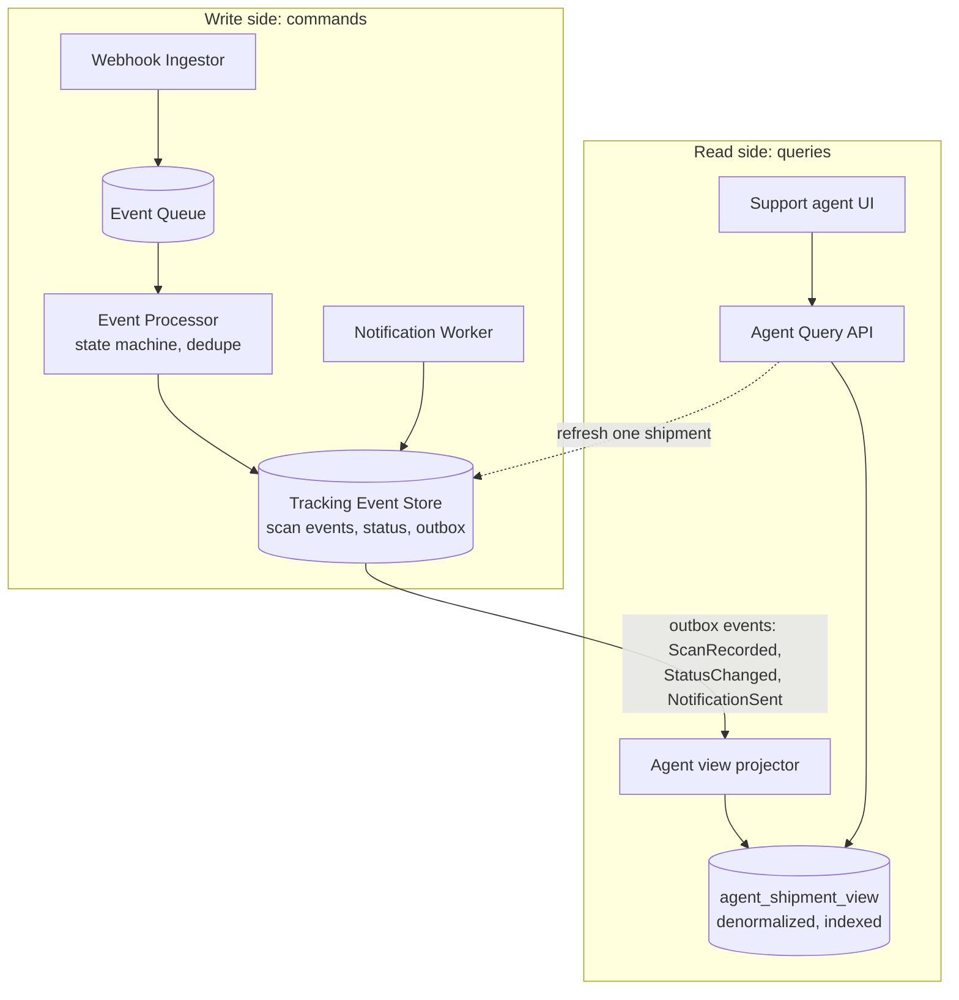
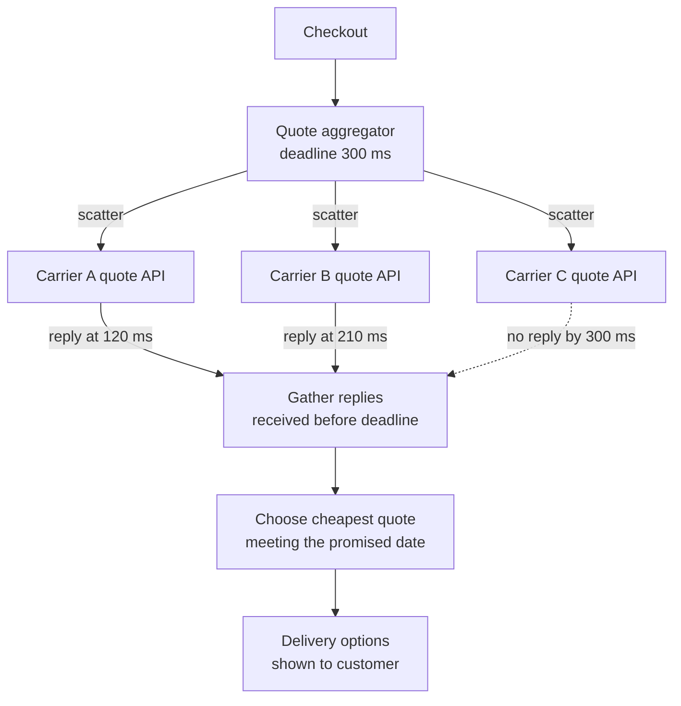
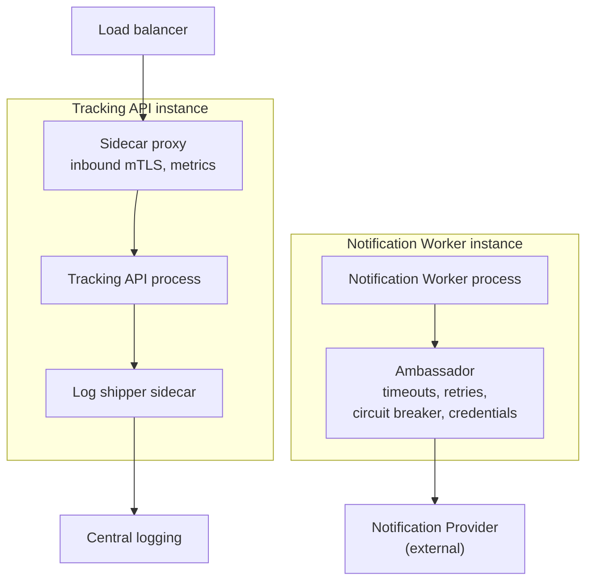
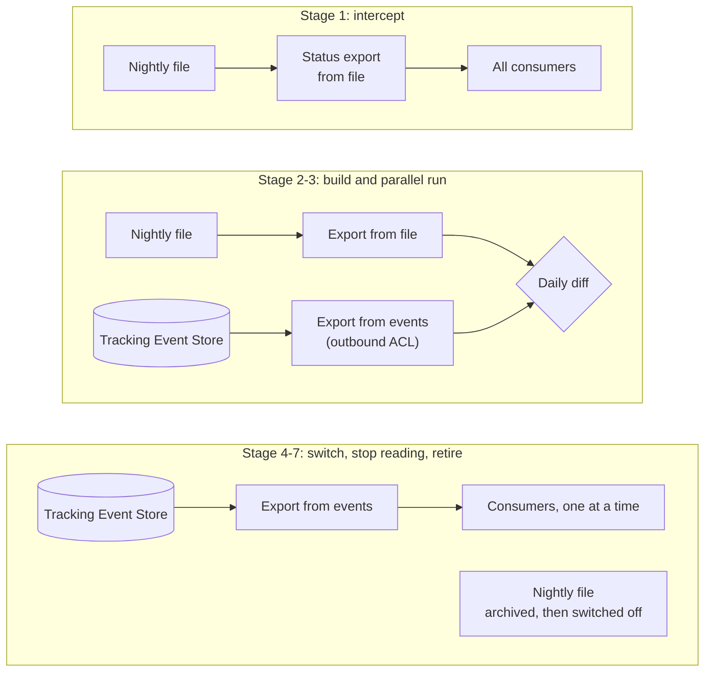

# Distributed system patterns

> Distributed patterns are named answers to problems that only exist because work is spread over
> processes that fail independently and talk over a network. Each one buys a capability (a separate
> read path, an incremental migration, a parallel query) and pays for it in consistency, latency,
> or operational load.

!!! abstract "Page facts"
    **Level:** Mixed (the catalogue is Level 1; composition and messaging patterns are Level 2; CQRS,
    event sourcing, and strangler fig migrations are Level 3) · **Status:** Draft ·
    **Time:** 75-100 minutes · **Last verified:** 2026-11-20

## Learning objectives

After this page you should be able to:

- State the problem, solution, and cost of each of the 28 patterns in the catalogue and find where
  each is covered in depth.
- Explain the difference between CQRS and event sourcing, why they are often confused, and when each
  is worth its cost.
- Plan a strangler fig migration with explicit exit criteria and a rollback point at every step.
- Choose between API composition, an aggregator, and scatter-gather for a query that needs several
  sources.
- Place sidecars, ambassadors, health endpoints, and a scheduler-agent-supervisor in a deployment
  and say what each one costs to run.

## Prerequisites

- [Application design patterns](application-design-patterns.md) — Adapter, Observer, and Proxy are
  the in-process versions of the anti-corruption layer, publish-subscribe, and the sidecar.
- [Message queues and brokers](../messaging-and-streaming/message-queues-and-brokers.md) — queues,
  acknowledgements, and redelivery underlie half of this catalogue.
- [Integration architecture](../application-and-api-architecture/integration-architecture.md) — the
  carrier integration and nightly file that the worked example migrates.

## The problem this solves

Once a system is more than one process, familiar problems change shape. A query that used to be a
SQL join now spans services owned by different teams. A transaction that used to commit atomically
now touches two databases. A replacement that used to be a release now has to happen while the old
system keeps running. A cross-cutting concern such as mutual TLS used to be a library; now it must
work the same way in services written in four languages. Teams that meet these problems without a
vocabulary reinvent the solutions badly: dual writes instead of an outbox, big-bang cutovers instead
of a strangler fig, a synchronous call chain instead of a read model. The patterns on this page are
the vocabulary, and each comes with a known price that belongs in the design review.

## What it is

A **distributed system pattern** is a reusable structure for a recurring problem in systems whose
parts communicate over a network. The 28 patterns in this topic fall into eight families:

| Family | Patterns |
|---|---|
| Data and state | CQRS, Event Sourcing, Saga, Outbox, Inbox |
| Migration and boundaries | Strangler Fig, Anti-Corruption Layer |
| Query composition | API Composition, Aggregator, Scatter-Gather |
| Messaging | Publish-Subscribe, Competing Consumers, Claim Check, Priority Queue |
| Deployment and runtime | Sidecar, Ambassador, Health Endpoint Monitoring, Scheduler-Agent-Supervisor |
| Resilience | Retry, Circuit Breaker, Bulkhead |
| Caching | Cache-Aside, Read-Through, Write-Through, Write-Behind |
| Coordination and scale | Leader Election, Sharded Services, Multi-Region Replication |

Several families have their own pages in this batch; this page gives them a catalogue row and links.

## Mental model

Think of a growing restaurant. At first one cook takes orders, cooks, and answers "where is my
food?". Then the kitchen splits: orders go on a ticket rail (a queue) that several cooks pull from
(competing consumers); a board by the door shows order status, updated from the kitchen but never
consulted by the cooks (a read model, CQRS); a new kitchen is built next door and takes over one
dish at a time while the old one keeps serving (strangler fig); a runner stands beside each station
handling deliveries so cooks do not leave the stove (sidecar). Every arrangement makes the restaurant
bigger and more resilient, and every one adds a way to be wrong: the status board can lag, the
ticket can be taken twice, the two kitchens can disagree on a recipe.

**Where the analogy breaks:** in a restaurant you can walk over and look. In a distributed system
you only learn about another part by messages that may be late, lost, or duplicated, so every
pattern here must state what happens when a message does not arrive.

## Key terms

| Term | Meaning on this page |
|---|---|
| Command | A request to change state, which may be rejected |
| Query | A request to read state, with no side effects |
| Read model (projection) | A copy of data shaped for one set of queries, built from the write side's changes |
| Event log | An append-only, ordered record of events |
| Projector | A consumer that turns events into read-model rows |
| Interception point | The place in a strangler fig where traffic can be routed to old or new |
| Rollback point | A step after which you can still return to the previous state cheaply |
| Point of no return | The step after which going back needs significant work or another party |
| Anti-corruption layer | A translation boundary that keeps another system's model from leaking into yours |
| Sidecar | A helper process deployed beside an application process, sharing its lifecycle |

## How it works

### Step 1 — The catalogue

Patterns marked **(deep)** are developed below on this page; the rest link to their canonical page.

| Pattern | Problem | Solution | Cost | Covered in depth |
|---|---|---|---|---|
| CQRS | One model cannot serve both consistent writes and very different queries well | Separate the write model from one or more read models | Read lag; two models to keep in sync | **(deep)** Step 2, worked example |
| Event Sourcing | Current-state rows lose history and the reasons for change | Store the events as the source of truth; derive state by replay | Schema evolution of events; replay time; harder queries | **(deep)** Step 2 |
| Saga | A business operation spans services and cannot use one transaction | A sequence of local transactions with compensations | Intermediate states are visible; compensation logic | [Transactions and sagas](../distributed-systems/transactions-sagas-and-delivery-guarantees.md) |
| Strangler Fig | Replacing a legacy system in one cutover is too risky | Intercept, then move capabilities one at a time | Running two systems; an interception layer | **(deep)** Step 3, worked example |
| Anti-Corruption Layer | A foreign model leaks into yours through an integration | A translation boundary owned by your side | One more component; mappings to maintain | **(deep)** Step 3; [Integration](../application-and-api-architecture/integration-architecture.md) |
| API Composition | A query needs data owned by several services | A composer calls each and joins in memory | Latency of the slowest call; partial failure | **(deep)** Step 4 |
| Aggregator | Related messages arrive separately over time | A stateful component collects them until a completion rule fires | State to persist; timeouts for incomplete sets | **(deep)** Step 4 |
| Scatter-Gather | The best answer needs asking several equivalent providers | Broadcast, gather within a deadline, combine | Load on every provider; deadline tuning | **(deep)** Step 4 |
| Publish-Subscribe | Many consumers need the same event without the producer knowing them | Topics with independent subscriptions | Invisible coupling to event schemas | [Message queues and brokers](../messaging-and-streaming/message-queues-and-brokers.md) |
| Competing Consumers | One consumer cannot keep up | Several consumers share one queue | Ordering across consumers is lost unless partitioned | **(deep)** Step 5; Lab 03 |
| Claim Check | Payloads too large or sensitive for the broker | Store the payload, send a reference | A second store; orphaned payloads | **(deep)** Step 5 |
| Outbox | Writing to a database and publishing a message cannot be atomic | Write the message to a table in the same transaction; relay it | A relay process; at-least-once delivery | [Transactions and sagas](../distributed-systems/transactions-sagas-and-delivery-guarantees.md) |
| Inbox | Redelivered messages cause duplicate effects | Record processed message ids in the consumer's transaction | A table that grows; retention policy | [Transactions and sagas](../distributed-systems/transactions-sagas-and-delivery-guarantees.md); Lab 04 |
| Sidecar | Cross-cutting concerns duplicated in every service and language | A helper process beside each instance | Extra process per instance; another hop | **(deep)** Step 6 |
| Ambassador | Outbound calls need retries, routing, and credentials consistently | A client-side proxy sidecar for outbound traffic | Hidden retries; debugging through a proxy | **(deep)** Step 6 |
| Retry | Transient failures fail requests that would succeed a moment later | Repeat with backoff and jitter, within a budget | Load amplification; duplicates if not idempotent | [Resilience mechanics](../distributed-systems/resilience-mechanics-timeouts-retries-and-backpressure.md) |
| Circuit Breaker | Calls to a failing dependency waste resources and time | Stop calling for a period after repeated failures | Tuning thresholds; fallback behaviour | [Resilience mechanics](../distributed-systems/resilience-mechanics-timeouts-retries-and-backpressure.md) |
| Bulkhead | One slow dependency exhausts shared threads or connections | Separate pools per dependency or tenant | Lower utilization; pool sizing | [Resilience mechanics](../distributed-systems/resilience-mechanics-timeouts-retries-and-backpressure.md) |
| Cache-Aside | Repeated reads of slow data | Application reads cache, fills on miss | Staleness; stampedes | [Caching architecture](../databases-and-storage/caching-architecture.md) |
| Read-Through | Every caller repeats cache-loading logic | The cache loads from the store on a miss | Cache becomes a critical dependency | [Caching architecture](../databases-and-storage/caching-architecture.md) |
| Write-Through | Cache and store drift after writes | Write to cache and store together | Write latency; caching data never read | [Caching architecture](../databases-and-storage/caching-architecture.md) |
| Write-Behind | Write latency or write volume to the store is too high | Write to cache; flush to the store later | Data loss window if the cache fails | [Caching architecture](../databases-and-storage/caching-architecture.md) |
| Leader Election | Exactly one instance must do some work | Instances compete for a lease; the holder acts | Failover delay; fencing needed | [Distributed systems fundamentals](../distributed-systems/distributed-systems-fundamentals-time-and-coordination.md) |
| Health Endpoint Monitoring | Load balancers and operators cannot tell whether an instance works | Expose liveness and readiness endpoints; probe them | False positives; cascading removal | **(deep)** Step 6 |
| Priority Queue | Urgent work waits behind bulk work | Separate queues or priorities with weighted consumers | Starvation of low priority | **(deep)** Step 5 |
| Scheduler-Agent-Supervisor | A multi-step remote workflow can stall or fail midway | Scheduler drives steps, agents do them, supervisor recovers | A durable state store; three roles to run | **(deep)** Step 6 |
| Sharded Services | One instance or database cannot hold the data or load | Partition by key across independent shards | Hot shards; cross-shard queries; resharding | [Scaling, partitioning, and replication](../distributed-systems/scaling-partitioning-and-replication.md) |
| Multi-Region Replication | One region is a single point of failure or too far from users | Replicate data and services across regions | Replication lag; conflict handling; cost | [Scaling, partitioning, and replication](../distributed-systems/scaling-partitioning-and-replication.md) |

### Step 2 — CQRS and event sourcing, and why they get confused

**CQRS (Command Query Responsibility Segregation)** separates the code and data that *change* state
from the code and data that *read* it. The write model enforces invariants (legal transitions, no
duplicates) and is normalized for correctness. Read models are denormalized for specific queries and
updated from the write side's changes, usually asynchronously, so they lag. CQRS does not require a
second database: a read model can be a materialized view or a table in a separate schema. What it
does require is accepting that a query may not yet reflect a just-accepted command.

**Event sourcing** changes what the write side *stores*: instead of current-state rows, it stores
every state-changing event in an append-only log, and the current state of an entity is computed by
replaying (folding) its events, with snapshots to keep replay short. The log is the source of truth;
everything else is derived and can be rebuilt.

They are confused because they appear together. An event-sourced write side is hard to query (there
is no "current status" column to filter on), so it almost always needs projections, which is CQRS.
The converse does not hold: CQRS works perfectly well with a conventional current-state write model
whose changes reach read models through an outbox or change data capture. A useful test: *can you
delete the current-state tables and rebuild them from the log?* If yes, you are event sourcing. If
the current state is authoritative and events are notifications about it, you are not, whatever the
tables are called.

AtlasMart's **Tracking Event Store** is a useful case. It stores every scan event append-only, but
the shipment status row is updated in the same transaction and is authoritative; scan events are
facts reported by carriers, not AtlasMart's own decisions. That is an event log plus current state,
not event sourcing in the strict sense, and it does not need to be. Full event sourcing earns its
cost where the history of *your own decisions* is the product (ledgers, audit-heavy workflows) and
where rebuilding new views from history is a recurring need.

**Figure 1 — CQRS read/write split for the support-agent view.** The write side is the existing
tracking pipeline; the read side is a projection built for agents (the worked example sizes it).

How to read it: solid arrows are the normal flow; commands never touch the read model, and agents
never query the write tables except through the dashed single-shipment refresh.

### Step 3 — Strangler fig and the anti-corruption layer

A **strangler fig** migration replaces a legacy system gradually. You place an **interception
point** in front of the legacy capability (a proxy, a gateway route, a façade, or for batch flows a
single export that all consumers read), move one capability or consumer at a time to the new
implementation behind it, and retire the legacy part only when nothing routes to it. Its value is
that each step is small, observable, and reversible; its cost is running both systems, keeping
them consistent, and the discipline to actually finish. A migration that stalls at 80% leaves you
operating two systems indefinitely.

The **anti-corruption layer** (ACL) is the strangler's natural companion. New code should speak the
new model; legacy consumers still expect the old one. An ACL translates at the boundary, and it can
face either way: protecting the new system from the legacy model (inbound), or producing the legacy
format from the new model so unchanged consumers keep working (outbound). It is the system-scale
version of the Adapter on the [application design patterns page](application-design-patterns.md).
The worked example uses both directions.

### Step 4 — Composing answers from several sources

Three patterns build one answer from several sources and are often mixed up:

| | API Composition | Aggregator | Scatter-Gather |
|---|---|---|---|
| Trigger | A query that needs data owned by several services | Related messages that arrive separately | A request several equivalent providers can answer |
| Timing | Synchronous, within one request | Asynchronous, over seconds to days | Synchronous or asynchronous, bounded by a deadline |
| State | None beyond the request | Persistent, keyed by a correlation id | Per-request, until the deadline |
| Completion | All required calls returned | A completion rule (all parts, or a timeout) | Deadline reached or enough replies |
| Partial failure | Fail, or return partial data clearly marked | Time out and emit incomplete, or alert | Use the replies that arrived |
| AtlasMart example | Order page: order from Order Management, status from Tracking | "Order delivered" once every shipment of a split order is delivered | Shipping quotes from several carriers at checkout |

**API composition** is the default for low-volume cross-service reads and the thing CQRS replaces
when composition gets too slow or too fragile: its availability is the product of every called
service's availability, and its latency is the slowest call. The **aggregator** (in the
enterprise-integration sense) needs a durable store for partial sets and an answer for "the third
shipment never reports delivered". **Scatter-gather** trades provider load for answer quality and
must treat a missing reply as normal.

**Figure 2 — Scatter-gather for checkout shipping quotes.** Three carriers and a 300 ms deadline are
AtlasMart assumptions for Checkout; the reply times shown are illustrative.

How to read it: the aggregator sends all three requests at once; whatever has arrived at 300 ms is
used, and Carrier C's late reply is discarded rather than delaying the page.

### Step 5 — Messaging patterns: competing consumers, claim check, priority queue

**Competing consumers.** Several instances read from one queue, and each message goes to one of
them; throughput scales with instances until the queue or the database saturates. The catch is
ordering: two consumers can process two events for the same shipment concurrently and out of order.
AtlasMart's two Event Processor workers therefore consume with a partition or message-group key of
shipment id, so one shipment's events go to one consumer at a time while different shipments
proceed in parallel; the state machine still guards against the reordering that redelivery causes.
[Lab 03](../labs/lab-03-queue-retries-and-dead-letter.md) runs multiple consumers with retries and a
dead-letter queue.

**Claim check.** Brokers are built for small messages and have payload limits (check your
provider's current documentation). When a payload is large or sensitive, store it in object storage
and send a message that carries only a reference (the claim check). AtlasMart's 500 B scan events do
not need it; proof-of-delivery images, if a carrier sends them (an assumption), do. Costs: a second
store on the critical path, access control on the reference (never a guessable public URL), and a
lifecycle rule that deletes payloads whose messages were never processed.

**Priority queue.** When urgent and bulk work share a queue, urgent work waits behind the bulk.
After a carrier outage, the redelivered backlog (the 50,000-event burst on the
[capacity page](../performance-and-scalability/capacity-estimation.md)) and the nightly
reconciliation inserts should not delay live scans that drive out-for-delivery notifications.
AtlasMart uses two queues, live and backfill, with consumers that always drain live first and give
backfill a guaranteed minimum share so it cannot starve. Separate queues are simpler to observe than
broker-level message priorities, and the lag dashboard (NFR-8) can show each.

### Step 6 — Runtime patterns: sidecar, ambassador, health endpoints, scheduler-agent-supervisor

**Sidecar and ambassador.** A **sidecar** is a helper process deployed beside each application
instance, sharing its host or pod and lifecycle: an inbound proxy that terminates mutual TLS and
records metrics, a log shipper, a configuration reloader. An **ambassador** is a sidecar specialized
for *outbound* calls: the application calls a local endpoint and the ambassador handles retries,
timeouts, circuit breaking, routing, and credentials towards a remote service. Both move
cross-cutting concerns out of application code so they are uniform across languages, which is the
Proxy pattern at process scale. Costs: an extra process per instance (memory, CPU, start-up order),
an extra hop, and retries that application developers cannot see, which is how retry amplification
starts.

**Figure 3 — Sidecar and ambassador placement.** Assumes AtlasMart runs these services as containers
grouped per instance; the pattern is the same on virtual machines.

How to read it: everything inside a box is deployed, scaled, and restarted together; the sidecar
handles traffic coming *in*, the ambassador handles traffic going *out*.

**Health endpoint monitoring.** Each instance exposes endpoints that tools probe. A **liveness**
endpoint answers "is this process able to run at all?" (restart it if not). A **readiness** endpoint
answers "should this instance receive traffic now?" (remove it from the load balancer if not).
External **synthetic checks** call real user paths from outside the region. The classic mistake is
a readiness check that fails when a *shared* dependency fails: if the Tracking Event Store is down,
all three Tracking API instances go unready at once and the load balancer removes every instance,
turning "cache hits still work" into a total outage. AtlasMart's readiness therefore checks local
health and the Status Cache connection with short timeouts, reports the database as a degraded
dependency in the response body for operators, and leaves failing over to the database layer. The
health detail endpoint is internal only and never includes secrets or connection strings.

**Scheduler-agent-supervisor.** For a workflow with several remote steps that can each stall, three
roles cooperate: a **scheduler** records the workflow and its steps in a durable state store and
dispatches each step; **agents** perform steps against remote services (each step idempotent with a
deadline); a **supervisor** periodically scans the state store for steps past their deadline and
retries, compensates, or escalates. AtlasMart's FR-4 reschedule fits: the scheduler records the
request, an agent calls the carrier's reschedule API, and the supervisor finds requests with no
carrier confirmation by their deadline and either retries or tells the customer it failed. Only one
supervisor may act at a time, so it holds a lease ([leader election](../distributed-systems/distributed-systems-fundamentals-time-and-coordination.md)).
Workflow engines package these three roles; the pattern explains what they are doing for you.

## Worked example: AtlasMart agent read model and retiring the nightly file

### CQRS for the support-agent view (FR-5)

FR-5 gives support agents the customer's timeline. Agents ask different questions from customers:
search by order or carrier reference, list "shipments with no scan for 48 hours", and see which
notifications were sent. Serving those from the write tables means joins across scan events,
status, and notification records, plus filters the write schema was never indexed for, competing
with the Event Processor's writes on the primary.

Load is not the reason. Using the As-Is baseline of 9,000 order-status contacts per week as an upper
bound and assuming 3 agent queries per contact: 9,000 × 3 = 27,000 queries per week; 27,000 ÷ 7 ≈
3,857 per day; 3,857 ÷ 86,400 s ≈ 0.045 queries per second. The reasons are **query shape** and
**isolation**: the agent view needs its own indexes and must not slow the write path.

The design (Figure 1):

1. The write side is unchanged. The Event Processor already writes outbox rows; the Notification
   Worker records each send. Both now publish `ScanRecorded`, `StatusChanged`, and `NotificationSent`.
2. An **agent view projector** consumes these and upserts one row per shipment into
   `agent_shipment_view`: order id, carrier, carrier reference, current status, last scan time, time
   since last scan, and a list of notifications sent. It is idempotent on event id and ignores
   events older than the row's stored sequence number, so redelivery and reordering are harmless.
3. The read model starts as a separate schema in the same PostgreSQL cluster (cheapest), with a
   documented trigger to move it to its own store: if agent search needs full-text or the
   projector's writes measurably affect NFR-3.
4. Freshness target: 99% of events visible within 60 s, the same as NFR-1, measured as projector lag.
5. Consistency for the agent: every screen shows "as of" the row's last update, and a **refresh
   one shipment** action reads that shipment directly from the write store. That gives an agent on
   the phone read-your-latest for the one shipment that matters, without making the whole view strong.
6. Rebuild: because scan events and notification records are retained, the projector can rebuild
   the read model from scratch into a new table, then swap; this is also how a new agent field is
   added.
7. Privacy: the read model holds no delivery addresses (NFR-6); agent access is role-checked and
   every lookup is audit-logged.

### Strangler fig: retiring the nightly carrier batch file

The nightly status file predates the tracking system. After launch it still feeds the order status
report (and through it the warehouse exceptions list), the finance reconciliation job, and the
tracking reconciliation job; agents moved to FR-5 at launch. The goal of this later phase is to stop
receiving the file at all. Each step has an exit criterion and a rollback point; the parallel-run
criterion of 20 consecutive business days with zero unexplained differences is an AtlasMart
assumption.

| Step | What changes | Exit criterion | Rollback point |
|---|---|---|---|
| 1. Intercept | A **status export** service publishes a daily extract in the file's columns; at first it is produced *from the file* (pass-through). Consumers repoint from the SFTP drop to the export one at a time | Every consumer reads the export; outputs byte-identical to before | Repoint a consumer back to the SFTP drop |
| 2. Build the new source | An outbound ACL produces the same extract *from the Tracking Event Store*, mapping AtlasMart statuses back to the legacy codes | Export from events produced daily | Nothing to roll back; consumers still read the file-derived export |
| 3. Parallel run | Both exports generated nightly; a diff job classifies every difference | 20 consecutive business days, zero unexplained differences | Keep consumers on the file-derived export |
| 4. Switch consumers | One by one: warehouse list, order status report, finance reconciliation, each behind a per-consumer source flag | Each consumer's owner signs off after one month-end close (finance) or two weeks (others) | Flip that consumer's flag back to file-derived (the file still arrives) |
| 5. Replace tracking reconciliation | The reconciliation job compares against the vendor's event query API instead of the file (assumes the vendor offers one) | Discrepancy metric matches the file-based job for the parallel-run period | Re-enable the file-based reconciliation job |
| 6. Stop reading | File still delivered and archived, but no process reads it | One quarter with no flag flipped back | Re-enable reading: the files are archived |
| 7. Retire | Vendor stops sending; SFTP account and code removed | Contract change confirmed | **Point of no return**: going back needs the vendor to re-enable the feed |

**Figure 4 — Strangler fig migration stages.** Read top to bottom; each stage keeps the previous
path available until its exit criterion passes.

How to read it: the consumers never change what they read after Stage 1; only the export's source
changes, which is what makes each later step reversible with a flag.

Why the interception point is the export and not the file: consumers that read files directly cannot
be switched by AtlasMart without each team changing code at the same time. Repointing them once, to
an export AtlasMart controls, turns every later step into a configuration change.

## Real-world architecture example

The same set appears in most mid-size platforms. Customer-facing read paths use CQRS-style read
models (search indexes, denormalized tables, caches) fed by an outbox or change data capture, while
the transactional core stays current-state; event sourcing is reserved for ledger-like domains.
Modernization programmes use strangler fig migrations with a gateway or façade as the interception
point and an ACL per legacy system. Platform teams supply sidecars or a service mesh for mutual TLS,
telemetry, and outbound policies, and standard liveness and readiness probes. Long-running
integrations with partners run on a workflow engine, which implements scheduler-agent-supervisor.
The recurring architectural question is not which pattern exists, but which team owns each
pattern's moving parts: the projector, the interception layer, the mesh configuration, the
supervisor's alerts.

## Design choices and trade-offs

| Choice | Favor when | Avoid when |
|---|---|---|
| CQRS read model | Query shapes differ sharply from the write model, or reads must be isolated from writes | One model serves both well; users cannot tolerate any read lag |
| Event sourcing | History of your own decisions is the product; new views from history are frequent | CRUD domains; teams new to event schema evolution |
| Strangler fig | The legacy system is live and risky to replace at once | The legacy part is small enough to replace in one tested release |
| API composition | Low-volume reads across two or three services | High volume, many services, or tight latency budgets (build a read model) |
| Scatter-gather | Several equivalent providers; answer quality improves with more replies | Providers charge per call or cannot absorb the fan-out |
| Sidecar or ambassador | Many services, several languages, platform-owned policies | A few services in one language where a library is simpler |
| Separate priority queues | Bulk and urgent work share infrastructure | Volumes are low enough that one queue never builds a backlog |
| Scheduler-agent-supervisor (or a workflow engine) | Multi-step remote workflows with deadlines | One step, or steps that are all local and transactional |

## Failure modes and anti-patterns

- **CQRS everywhere.** Read models for screens a single query could serve. Detect: projectors with
  one consumer and no lag requirement. Prevent: require a query-shape or isolation reason.
- **Read-your-own-write surprise.** A user changes something and the read model does not show it.
  Detect: support tickets about "lost" changes. Prevent: "as of" labels; read the write side for the
  just-changed entity.
- **Event sourcing as a database.** Querying the event log directly for screens. Prevent: projections.
- **Stalled strangler.** Both systems run for years. Detect: no step completed in a quarter. Prevent:
  retirement as a funded milestone with a date.
- **Rollback that does not exist.** A step whose rollback was never tested. Prevent: rehearse each
  rollback once before relying on it.
- **Readiness cascade.** Readiness tied to a shared dependency removes every instance. Prevent:
  readiness reflects local health only.
- **Composition chains.** API composition calling services that themselves compose. Detect: fan-out
  and tail latency growth. Prevent: read models for hot queries.
- **Unbounded aggregator state.** Partial sets that never complete. Prevent: a completion timeout.

## Security considerations

- Read models copy data; every copy needs the same classification, access control, and retention as
  the source, and must respect NFR-6 (no delivery addresses).
- Claim-check references must be authorized, short-lived, and unguessable.
- Sidecars and ambassadors hold credentials and see plaintext after TLS termination; they are part of
  the trusted computing base and need the same patching as the application.
- Health detail endpoints are internal only; the public probe returns a status code, not a dependency
  inventory.
- During a strangler migration, the old path must keep its controls (SFTP keys rotated, access
  reviewed) until it is actually switched off.

## Performance, reliability, and cost

- **Performance:** read models move query cost from read time to write time (projection); API
  composition and scatter-gather pay the slowest participant's latency, bounded by a deadline.
- **Reliability:** every asynchronous pattern trades immediate consistency for availability and
  isolation; state the lag target (here 60 s) and monitor it. Sidecars add a process that can fail
  independently of the application.
- **Cost:** a read model adds storage and a consumer; a strangler fig doubles run cost for its
  duration, which is the strongest argument for finishing it; a sidecar per instance adds memory and
  CPU across the fleet; scatter-gather multiplies calls to providers.

## Hands-on lab: build a read model and break it

Local, free, about 40 minutes; Python 3.10 or later and SQLite from the standard library.

1. Create a `scan_events` table and an `outbox` table; write a function that inserts a scan event
   and an outbox row in one transaction.
2. Write a projector that reads unprocessed outbox rows and upserts an `agent_shipment_view` row per
   shipment, storing the highest sequence number applied.
3. Insert ten events for three shipments, run the projector, and query the view.
4. Deliver one outbox event twice and two events out of order; confirm the view is unchanged by the
   duplicate and ignores the older event.
5. Drop the view table and rebuild it by replaying all scan events; compare with the incremental
   result.

??? question "Hint: ignoring older events"
    Store `last_seq` per shipment in the view and make the upsert conditional:
    `... ON CONFLICT (shipment_ref) DO UPDATE SET ... WHERE excluded.last_seq > agent_shipment_view.last_seq`.

For competing consumers with retries and a dead-letter queue, see
[Lab 03](../labs/lab-03-queue-retries-and-dead-letter.md); for duplicate handling (the inbox),
[Lab 04](../labs/lab-04-idempotency-and-duplicates.md).

## Knowledge check

1. A team says "we use event sourcing" because they publish events after updating rows. Are they
   right? What test would you apply?
2. Why does the AtlasMart agent view need CQRS even though it receives about 0.045 queries per second?
3. In the strangler fig plan, which step is the point of no return, and why is Step 4 reversible?
4. Distinguish an aggregator from scatter-gather using one AtlasMart example of each.
5. Why should the Tracking API's readiness endpoint not fail when the Tracking Event Store is down?

??? success "Answers"
    1. No. That is a current-state model with notifications (fine for CQRS). The test: can the
       current-state tables be deleted and rebuilt from the event log? If not, it is not event sourcing.
    2. Query shape and isolation: agent searches need indexes and joins the write schema lacks, and
       they must not compete with the write path. Load is negligible.
    3. Step 7, when the vendor stops sending the file. Step 4 is reversible because the file still
       arrives and each consumer has a flag to switch back to the file-derived export.
    4. Aggregator: waiting for every shipment of a split order to be delivered before one "order
       delivered" event (stateful, over days). Scatter-gather: asking several carriers for quotes and
       using those that reply within 300 ms (one request, deadline-bound).
    5. All three instances would go unready at once and the load balancer would remove them all,
       turning a partial outage (cache hits still served) into a total one.

## Architecture discussion questions

1. AtlasMart's finance team wants a full audit trail of every status change and its cause. Would you
   move the tracking write side to event sourcing, or add an audit read model? Argue with cost,
   skills, and the "can you rebuild state from the log" test.
2. The vendor does not offer an event query API, so Step 5 of the strangler plan is blocked. What are
   your options, and which steps can still proceed?
3. The platform team proposes a service mesh for all AtlasMart services. Which application-level
   retry and health logic would you remove, and what would you need from the mesh before doing so?

## Summary

Distributed patterns name structural answers to problems created by the network: separate read
paths (CQRS), history as the source of truth (event sourcing), gradual replacement (strangler fig)
with translation at the boundary (anti-corruption layer), answers from several sources (API
composition, aggregator, scatter-gather), shared work and large or urgent messages (competing
consumers, claim check, priority queue), and process-level helpers (sidecar, ambassador, health
endpoints, scheduler-agent-supervisor). CQRS and event sourcing are separate decisions; the test for
event sourcing is whether state can be rebuilt from the log. A strangler fig is only safe when every
step has an exit criterion and a tested rollback point, and the point of no return is named in
advance. Every pattern's cost belongs in the design review next to its benefit.

## Related topics

- **Before:** [Application design patterns](application-design-patterns.md);
  [Message queues and brokers](../messaging-and-streaming/message-queues-and-brokers.md)
- **Alongside:** [Microservices architecture](microservices-architecture.md);
  [Transactions, sagas, and delivery guarantees](../distributed-systems/transactions-sagas-and-delivery-guarantees.md);
  [Resilience mechanics](../distributed-systems/resilience-mechanics-timeouts-retries-and-backpressure.md);
  [Scaling, partitioning, and replication](../distributed-systems/scaling-partitioning-and-replication.md);
  [Caching architecture](../databases-and-storage/caching-architecture.md)
- **Planned:** event-driven architecture (D08-T02); legacy modernization and migration (D18-T03);
  Kubernetes networking, storage, and service mesh (D11-T03); monitoring, alerting, and on-call
  (D15-T02).

## References

| Source | Type | Checked |
|---|---|---|
| Martin Fowler, ["CQRS"](https://martinfowler.com/bliki/CQRS.html), 2011 | Article | 2026-11-20 |
| Martin Fowler, ["Event Sourcing"](https://martinfowler.com/eaaDev/EventSourcing.html), 2005 | Article | 2026-11-20 |
| Martin Fowler, ["Strangler Fig Application"](https://martinfowler.com/bliki/StranglerFigApplication.html) | Article | 2026-11-20 |
| Chris Richardson, ["Pattern: API Composition"](https://microservices.io/patterns/data/api-composition.html) — microservices.io | Pattern catalogue | 2026-11-20 |
| Gregor Hohpe and Bobby Woolf, *Enterprise Integration Patterns* (Addison-Wesley, 2003); online entry ["Scatter-Gather"](https://www.enterpriseintegrationpatterns.com/patterns/messaging/BroadcastAggregate.html) | Book and catalogue | 2026-11-20 |
| Microsoft Azure Architecture Center, cloud design patterns: [Claim Check](https://learn.microsoft.com/en-us/azure/architecture/patterns/claim-check), [Sidecar](https://learn.microsoft.com/en-us/azure/architecture/patterns/sidecar), [Ambassador](https://learn.microsoft.com/en-us/azure/architecture/patterns/ambassador), [Priority Queue](https://learn.microsoft.com/en-us/azure/architecture/patterns/priority-queue), [Scheduler Agent Supervisor](https://learn.microsoft.com/en-us/azure/architecture/patterns/scheduler-agent-supervisor), [Health Endpoint Monitoring](https://learn.microsoft.com/en-us/azure/architecture/patterns/health-endpoint-monitoring) | Pattern catalogue (cloud-neutral concepts) | 2026-11-20 |
| Martin Kleppmann, *Designing Data-Intensive Applications* (O'Reilly, 2017), chapter 11 "Stream Processing" (event sourcing, derived data) | Book | 2026-11-20 |

## Review notes

- Canonical page for D03-T04. In depth: CQRS, Event Sourcing, Strangler Fig, Anti-Corruption Layer,
  API Composition, Aggregator, Scatter-Gather, Competing Consumers, Claim Check, Priority Queue,
  Sidecar, Ambassador, Health Endpoint Monitoring, Scheduler-Agent-Supervisor. **Only defined here
  (catalogue row plus link to the canonical page):** Saga, Outbox, Inbox, Publish-Subscribe, Retry,
  Circuit Breaker, Bulkhead, Cache-Aside, Read-Through, Write-Through, Write-Behind, Leader Election,
  Sharded Services, Multi-Region Replication.
- New AtlasMart assumptions: 3 agent queries per contact (giving ≈0.045 queries/s from the As-Is
  9,000 contacts/week); agent view freshness target equal to NFR-1; read model in a separate schema of
  the same cluster; 20 business days of zero unexplained differences as the parallel-run criterion;
  sign-off periods in Step 4; a vendor event query API (Step 5); three carriers and a 300 ms quote
  deadline at Checkout, with illustrative reply times; proof-of-delivery images; split orders with
  several shipments; live and backfill queues; containers for Figure 3.
- Consistency with other pages: the gap-analysis page keeps the nightly file for finance at launch
  and the integration page uses it for reconciliation; this page describes a later phase that
  retires it, so both earlier statements remain true for the launch architecture.
- Check in the browser: Figure 4 stacks three subgraphs with `~~~`; Figure 3 links into a subgraph
  from outside and uses `~~~` between subgraph ids.
