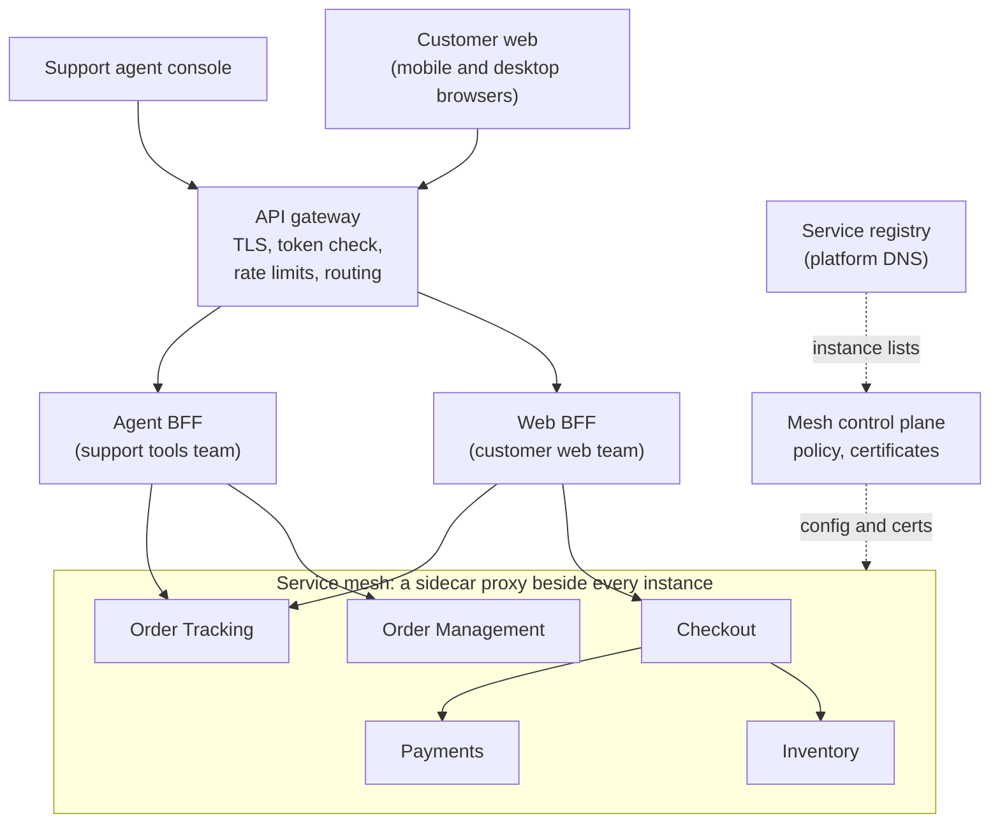
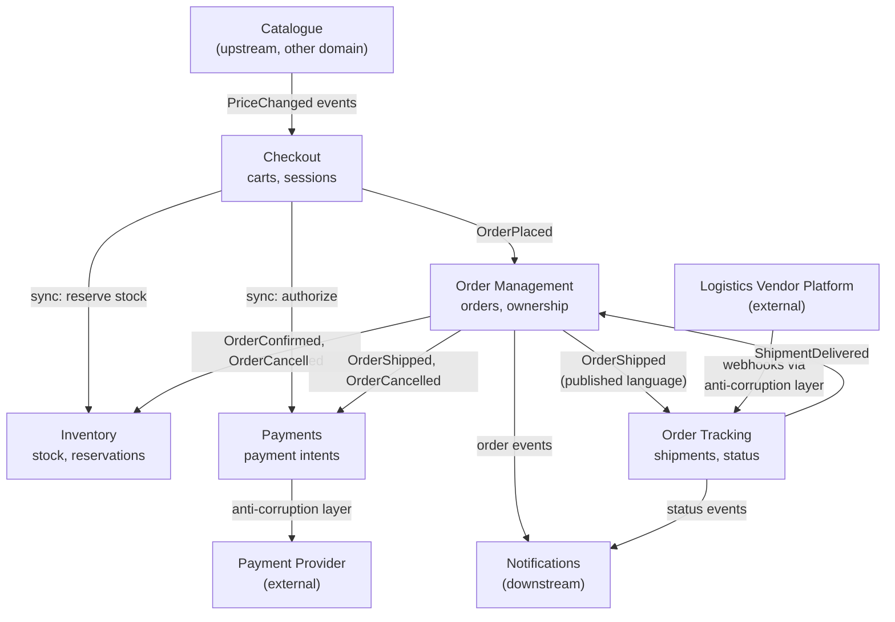
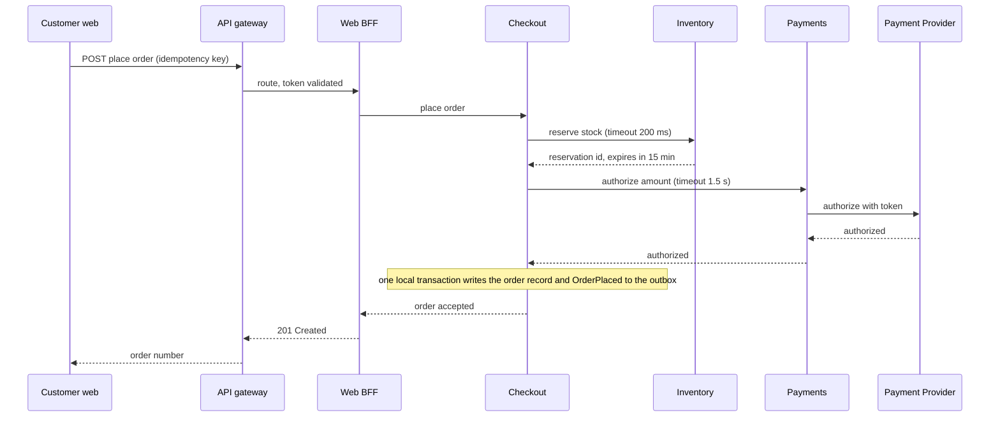
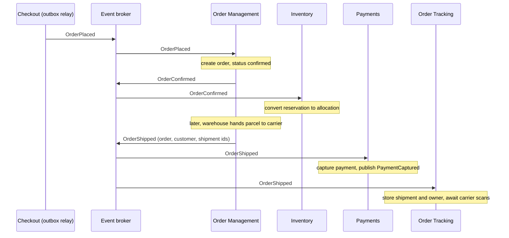

# Microservices architecture

> Microservices trade the problems of one large codebase for the problems of many small networked
> ones. The trade is worth it when team autonomy is the bottleneck, and ruinous when it is not.

!!! abstract "Page facts"
    **Level:** Mixed (definitions and communication styles are Level 1-2; decomposition, data
    ownership, platform choices, and the cost model are Level 3) · **Status:** Draft ·
    **Time:** 60-90 minutes · **Last verified:** 2026-11-20

## Learning objectives

After this page you should be able to:

- Decompose a domain into services along bounded contexts and justify each boundary by data
  ownership and team ownership.
- Choose between database per service and a shared database, and name what each costs.
- Decide which calls are synchronous and which are asynchronous, and quantify the temporal coupling
  and availability cost of synchronous chains.
- Place an API gateway, backends for frontends, and a service mesh, and explain what each one is for.
- Plan discovery, configuration, versioning, independent deployment, observability, testing, and
  security for a service estate.
- Detect a distributed monolith from concrete signals, and say clearly when not to use microservices.

## Prerequisites

- [Architecture styles](architecture-styles.md) — microservices are one point on the monolith to
  services spectrum; the AtlasMart decision to adopt them is made there.
- [API design: REST, GraphQL, gRPC, and async APIs](../application-and-api-architecture/api-design-rest-graphql-grpc-and-async-apis.md)
  — services are only as independent as their contracts.
- [Message queues and brokers](../messaging-and-streaming/message-queues-and-brokers.md) —
  asynchronous integration depends on delivery guarantees and duplicates.

## The problem this solves

When several teams work in one deployable, they share a release train, a build, a schema, and a
failure domain: one team's change waits for everyone's tests, and one feature's memory leak takes
down all of them. Microservices give each team's part its own deployable and data, so the team can
change, release, scale, and operate it without coordinating. The price is that every former function
call is now a network call or message that can be slow, fail, arrive twice, or arrive out of order.

## What it is

A **microservices architecture** is a system built as a set of small services, each of which:

- implements one **bounded context** (or a coherent part of one) of the business domain;
- is **independently deployable**: it can be released without releasing any other service;
- **owns its data**, which other services reach only through its API or its events;
- communicates over the network by **synchronous** requests (HTTP, gRPC) or **asynchronous**
  messages and events;
- is **owned by one team**, which builds it, runs it, and answers for its SLOs.

"Micro" means scope, not lines of code: one team can own it end to end; one per function or table is too small.

## Mental model

A monolith is one large restaurant kitchen: every cook can grab any ingredient. Microservices are a
food hall: each stall has its own kitchen, pantry, and staff, and stalls trade only through a hatch
with a written menu. A stall changes recipes without asking the others, and a fire in one stall does
not close the hall. But a dish needing three stalls needs three orders, the customer waits for the
slowest, and someone must run the hall's corridors and fire alarms.

**Where the analogy breaks:** food-hall stalls rarely depend on each other to serve a dish; services
often do, which is why synchronous chains between them are the central risk. And a stall's menu
changes on paper overnight, whereas a service's API change must keep every existing caller working.

## Key terms

| Term | Meaning on this page |
|---|---|
| Microservice | An independently deployable service owning one bounded context and its data |
| Bounded context | A part of the domain within which one model and vocabulary are consistent |
| Context map | A diagram of bounded contexts and the relationships between them |
| Database per service | Each service's data is private; others use its API or events |
| Temporal coupling | Two parts must both be available at the same moment for an operation to succeed |
| API gateway | A single entry point at the edge for routing, authentication, and rate limiting |
| Backend for frontend (BFF) | A server-side API tailored to one kind of client, owned with that client |
| Service mesh | Infrastructure (usually sidecar proxies plus a control plane) that handles service-to-service traffic |
| Service discovery | Resolving a service name to the network addresses of healthy instances |
| Consumer-driven contract | A test of a provider against the expectations its consumers have published |
| Transactional outbox | Writing an outgoing event in the same transaction as the state change, published afterwards |
| Anti-corruption layer | A translation boundary that keeps another system's model out of your own |
| Distributed monolith | Services that are deployed separately but must change, release, or fail together |

## How it works

### Decomposition by bounded context

Decomposition is the most consequential decision and the hardest to undo. Two complementary
techniques:

- **By business capability.** Start from what the business does (Checkout, Payments, Inventory,
  Shipment Tracking on AtlasMart's capability map); capabilities outlast processes and systems.
- **By subdomain and bounded context.** Within a capability, find where the meaning of words
  changes. An "order" in Checkout is a basket being paid for; in Order Management it is a commitment
  with a lifecycle; in Tracking it is only a reference that owns shipments. Each meaning is a
  **bounded context**, and each is a candidate service.

A boundary is probably right when most feature changes land inside one service, the service answers
its main requests from its own data, nobody else writes that data, one team can own and explain it,
and its contract (API and events) is much smaller than its implementation.

**Domain boundaries are also team boundaries.** **Ownership** means one team owns a service's code,
data, pipeline, on-call, and SLOs; a team may own several services, but a service never has two
owning teams. A **service catalogue** records owner, purpose, SLOs, dependencies, and runbook for
each service, and is the first defence against sprawl.

**Granularity.** Start coarse: one service per bounded context, often one per team. Split only for a
measurably different need (scaling, availability, release cadence, security scope); splitting late is
cheap if internal modules are clean, while merging services split too early is expensive.

### Data ownership: database per service or shared database

With **database per service**, each service's tables (or collections) are private. Other services
use its API for queries and its events for change notifications, and may keep a local, read-only
copy of what they need (event-carried state transfer). This is what makes independent deployment
real: a service can change its schema without breaking anyone.

A **shared database** lets several services read and write the same tables. It is fast to build and
keeps joins and transactions, but it couples every service to the schema: a column rename is a
coordinated release, and one service's heavy query slows the others.

| Option | Gains | Costs | Use when |
|---|---|---|---|
| Database per service (separate servers) | Schema and scaling independence; failure isolation | Most infrastructure; no cross-service joins or transactions | Services with different load, availability, or compliance needs |
| Schema per service on a shared server | Schema independence; fewer servers | Shared capacity and failure domain; noisy neighbours | Early stages; small services with similar needs |
| Shared tables, one writer per table | Simple reads for others | Readers break on schema changes | Transitional, with read-only views as the contract |
| Shared tables, many writers | Joins and transactions as in a monolith | Lockstep releases; unclear ownership | Avoid; this is the distributed-monolith core |

Without shared tables, an operation spanning services cannot be one ACID transaction; it becomes a
**saga** of local transactions with compensating actions, with events published through a
transactional outbox (see [transactions, sagas, and delivery guarantees](../distributed-systems/transactions-sagas-and-delivery-guarantees.md)).
Cross-service queries use **API composition** or an event-fed read model (CQRS), described on the
[distributed system patterns page](distributed-system-patterns.md).

### Synchronous and asynchronous communication

**Synchronous** communication (HTTP or gRPC request-response) is simple to reason about: the caller
gets an answer or an error. It creates **temporal coupling**: the callee must be up, and fast, at
the moment of the call. In a chain, latencies add and availabilities multiply. Three services in a
synchronous chain, each available 99.95% of the time, give about 0.9995³ ≈ 0.9985, or 99.85%, for
the operation, before counting the gateway.

**Asynchronous** communication (queues, topics) removes temporal coupling: the producer records the
message and carries on, and the consumer processes it when it can. It absorbs bursts and outages and
admits new consumers freely; the costs are eventual consistency, duplicates to handle idempotently,
possible reordering, and flows that are harder to trace.

Rules of thumb:

- Use **synchronous** calls only when the caller needs the answer to continue (authorize a payment
  before telling the customer "order placed"), and keep chains short: one or two hops below the edge.
- Use **events** for facts other contexts react to ("order placed", "order shipped"), and
  **commands on a queue** for work handed to a specific service that may be done later.
- Give every synchronous call a timeout, bounded retries with backoff, and a failure decision (see
  [resilience mechanics](../distributed-systems/resilience-mechanics-timeouts-retries-and-backpressure.md)).
- Keep event-fed local copies of slowly changing data (prices, ownership) instead of calling the
  owner on every request.

### API gateway, backend for frontend, and service mesh

All three sit in the request path, but they solve different problems:

- An **API gateway** is the single public entry point: TLS termination, access-token validation,
  rate and size limits, routing. Keep it thin; business logic there makes it a shared bottleneck.
- A **backend for frontend (BFF)** is an API for one kind of client (customer web, agent console,
  partner API), owned by that client's team. It aggregates calls and shapes responses for its
  screens, saving round trips over mobile networks. One BFF per client type, not per device size.
- A **service mesh** handles east-west (service-to-service) traffic. A **sidecar** proxy next to each
  instance applies mutual TLS, timeouts, retries, load balancing, and telemetry, configured
  centrally by a **control plane**. It moves cross-cutting network code out of every service, at the
  cost of an extra proxy hop on every call, more moving parts, and a component the platform team must
  operate. Libraries in each service are the alternative when the language mix is small.

**Figure 1 — Where the gateway, BFFs, and mesh sit.** North-south traffic enters through the gateway
and a BFF; east-west traffic between services passes through mesh sidecars.

How to read it: solid arrows are request paths, dashed arrows control traffic. The gateway is shared,
each BFF belongs to one client team, and the mesh covers only calls inside the platform; placing an
order crosses the gateway, the Web BFF, Checkout, then Inventory and Payments.

### Service discovery and registration

Instances come and go, so callers address services by name. **Registration** records live
instances: the platform registers them (an orchestrator gives each service a DNS name and tracks
healthy instances), or each instance registers itself with a **service registry** and renews
periodically. **Discovery** resolves the name:

- **Server-side discovery**: a stable name or load balancer picks an instance; one more hop.
- **Client-side discovery**: the caller (or its sidecar) fetches the instance list from the registry
  and balances across it. No extra hop; logic in every client or in the mesh.

Health checks remove failed instances and readiness checks hold back new ones until they can serve.
Callers cache resolved addresses briefly and tolerate a stale list, since the registry can fail too.

### Distributed configuration

Many services across several environments multiply endpoints, timeouts, flags, and limits. Treat
configuration as versioned, reviewed, audited change delivered like code; keep secrets in a secret
manager. Services should run on last-known-good configuration when the configuration service is down
(static stability); otherwise it is a hidden single point of failure.

### Independent deployment and versioning

Independent deployment is the defining benefit; versioning discipline is what preserves it.

- **Backward-compatible by default:** add fields and endpoints, never remove or rename in place;
  consumers are **tolerant readers** that ignore unknown fields.
- **Expand and contract** for breaking changes: add the new form, migrate consumers, remove the old
  form after a published deprecation date. A new major API version or event type is the last resort,
  with versions N and N-1 running side by side.
- **Event schemas** carry a version field and live in a catalogue consumers can test against.
- **Deployment safety:** canary or rolling releases per service, automated rollback on SLO breach,
  and database migrations compatible with both the old and new service version.
- **The test of independence:** the fraction of releases that needed another service released first
  or at the same time should be close to zero.

### Observability

A request crossing five services cannot be debugged from five log files. Each service needs:

- **Metrics** for its golden signals (traffic, errors, latency percentiles, saturation) and, for
  consumers, queue lag and dead-letter depth.
- **Structured logs and traces** sharing a trace ID propagated on every call and message (a standard
  trace-context header), so one search finds the whole request and the slow hop is visible.
- **SLOs per user journey** (place order, track order) measured at the edge, backed by per-service
  SLOs, with a dependency map generated from traces rather than drawn by hand.

### Testing across services

The goal is to release one service without a shared integration environment gating every release
(test types are covered on the [software testing page](../foundations/software-testing-types-and-strategies.md)).

- **Unit and component tests** in each service, dependencies replaced by fakes, on every build.
- **Consumer-driven contract tests:** each consumer publishes the requests, responses, or event shapes
  it relies on, and the provider's pipeline verifies all of them before release.
- **A few end-to-end journey tests** (place an order, track it), kept few because they are slow and
  flaky.
- **Testing in production:** canaries compared with the baseline, synthetic transactions, and feature
  flags that separate deploy from release.

### When not to use microservices

Do not adopt microservices when any of these is true:

- **One team**, or teams that release together anyway: there is no autonomy to gain.
- **The domain is still being discovered:** wrong boundaries cost far more across a network; start
  with a modular monolith and extract later.
- **No delivery platform:** no pipeline per service, no central logs, metrics, and traces.
- **Most operations need strong consistency across most data:** sagas everywhere cost more than the
  autonomy is worth.
- **The latency budget is already tight** and the main flows cross many contexts, or **nobody can
  staff on-call** for each owning team.

## Worked example: AtlasMart's order domain as services

The [architecture styles page](architecture-styles.md) recorded ADR-OD-001: team-aligned services for
the order domain, reached through a modular monolith. This example designs the target. All details
are assumptions for a fictional company.

### Bounded contexts and data ownership

| Bounded context (team) | Owns (system of record) | Sync API offered | Publishes | Consumes |
|---|---|---|---|---|
| Checkout (Checkout and Payments) | Carts, checkout sessions, price snapshot per placed order | Place order (to the Web BFF) | `OrderPlaced` | `PriceChanged` (local price copy) |
| Payments (Checkout and Payments) | Payment intents, provider tokens, authorization and capture status; never card numbers | Authorize payment | `PaymentCaptured`, `PaymentFailed` | `OrderShipped` (capture), `OrderCancelled` (void or refund) |
| Inventory (Inventory) | Stock per item per warehouse, reservations with expiry | Reserve and release stock | `StockLow` | `OrderConfirmed` (allocate), `OrderCancelled` (release) |
| Order Management (Order Management) | Orders, order lines, lifecycle status, order ownership (order ID → customer ID), shipment records | Order lookup (read-only, agent console) | `OrderConfirmed`, `OrderShipped`, `OrderCancelled` | `OrderPlaced`, `PaymentCaptured`, `ShipmentDelivered` |
| Order Tracking (Order Tracking) | Shipment events and current status; no delivery addresses (NFR-6) | Tracking API | `ShipmentDelivered` | `OrderShipped` (shipments and owner), carrier webhooks |

- **Order Tracking as one bounded context.** Its model is the shipment timeline; an order is only the
  owner of shipments. Today the Tracking API calls the Order Management System to check ownership
  (the As-Is/To-Be design). In the target, `OrderShipped` carries order, customer, and shipment IDs,
  Tracking keeps its own ownership table, and NFR-5 is checked locally, removing a synchronous
  dependency from the read path. Carriers stay behind an anti-corruption layer (Webhook Ingestor and
  Event Processor), so carrier vocabulary never reaches Order Management.
- **Payments as its own service** despite sharing a team with Checkout: its security scope and
  compensation logic differ, and extraction shrinks the code and people inside the payment trust
  boundary.

**Figure 2 — Bounded context map for the order domain.** Boxes are bounded contexts; labels name the
relationship or the event that crosses the boundary.

How to read it: arrows point from upstream to downstream. Only the two Checkout calls are
synchronous, because the customer waits for stock and payment; everything else is an event, so the
other contexts can be down for minutes without stopping customers from placing orders.

### Which calls are synchronous

**Figure 3 — Synchronous call chain for "place order".** The customer waits for every hop on this
path, so it is kept to the two calls that must answer before the order is accepted.

How to read it: each arrow pair is a network round trip that adds latency and a dependency. The
timeouts and the 15-minute reservation expiry are AtlasMart assumptions. The idempotency key lets the
customer's retry after a timeout return the same order instead of charging twice.

**Figure 4 — Event-driven flow after the order is accepted.** None of these steps holds up the
customer; each consumer works at its own pace and must handle duplicates.

How to read it: if Order Management is down for ten minutes, `OrderPlaced` events wait in the broker
and orders are still accepted; a synchronous design would lose checkout for those ten minutes.
Reservations expire after 15 minutes, so a longer outage needs a business decision in the saga
design (extend the expiry, or let Checkout confirm the reservation).

### The cost of the split

Compared with Option B (the modular monolith), the target adds the following. Per-hop cost is an
assumption to be replaced by measurement: **about 5 ms at p95 per internal synchronous hop**,
including two sidecar proxies, serialization, and the network within one region.

| Cost | Modular monolith | Services | Impact |
|---|---|---|---|
| Internal network hops on place-order | 0 (function calls) | 3 (gateway → BFF, Checkout → Inventory, Checkout → Payments) | ≈ 3 × 5 ms = 15 ms of p95 |
| Share of NFR-3 p95 budget (300 ms) | 0% | 15 ÷ 300 = 5% | Acceptable; the payment provider dominates |
| Composite availability of the sync chain (Checkout, Inventory, Payments) | One process at 99.95% | 0.9995³ ≈ 99.85% if each targets 99.95% | Each service must target 99.99% (0.9999³ ≈ 99.97%) or degrade |
| Tracking read path | 1 sync call to Order Management for ownership | 0 (local ownership copy from `OrderShipped`) | Removes up to 210 calls/s at the design peak and one dependency |
| Consistency of order, payment, stock | One transaction possible | Saga with compensations (release stock, void authorization) | New failure paths to design and test |
| Deployables in production (one instance per zone, 3 zones) | 1 deployable × 3 = 3 instances | 4 services + 2 BFFs = 6 deployables × 3 = 18 instances | More to patch, monitor, and pay for |
| Databases | 1 server, schema per module | 4 (Order Management keeps the existing one; Checkout, Payments, Inventory get new ones) | 3 new databases, each with a standby under principle 3 |
| New platform components | None | Mesh control plane (or mTLS library), service registry use, event topics on the managed broker, outbox relays (5), tracing back end, contract-test pipeline, 6 pipelines | Platform team effort before the first extraction |

**Latency budget for place-order at p95 300 ms (assumption).** Percentiles do not add exactly; summing
per-hop p95 values is a conservative approximation.

| Segment | Budget (ms) |
|---|---|
| API gateway (TLS, token validation, routing) | 15 |
| Web BFF (hop plus aggregation) | 10 |
| Checkout logic and local transaction including outbox write | 40 |
| Inventory reservation (hop plus logic and database) | 30 |
| Payments (hop plus own logic) | 15 |
| Payment Provider authorization (allowance; check the provider's measured latency) | 170 |
| Slack | 20 |
| **Total** | **300** |

The split costs about 15 ms of the 300 ms budget; the Payment Provider allowance is the number that
decides whether NFR-3 is met, and it is the same in both designs. Event volume is modest: about five
events per order (`OrderPlaced`, `OrderConfirmed`, `OrderShipped`, `PaymentCaptured`,
`ShipmentDelivered`) × 60,000 orders/day = 300,000 events/day ≈ 3.5 events/s on average.

## Real-world architecture example

A common trajectory at mid-sized retailers (fictionalized): early enthusiasm produced many more
services than teams, several sharing one database and calling each other in long synchronous chains;
releases needed a change calendar and incidents spread along the chains. The recovery kept services
but consolidated them along bounded contexts (one or two per team), gave each its own data, replaced
synchronous reads with event-fed local copies, used contract tests so shared staging stopped gating
releases, and gave every service an owner in a catalogue. The estate ended smaller and more
independent, the usual direction of a healthy microservices architecture after its first years.

## Design choices and trade-offs

| Choice | Favor when | Avoid when |
|---|---|---|
| Coarse services (one per bounded context or team) | Most organizations; boundaries still settling | One part has a measurably different scaling or security need |
| Fine-grained services | A part needs independent scaling, runtime, or compliance scope | The split only mirrors code structure, not ownership |
| Database per service | Independent schemas and failure isolation matter | A small estate on one team where a schema per service suffices |
| Synchronous call | The caller needs the result to continue; chain stays short | Fan-out across many services on the hot path |
| Events | Many consumers of a fact; outages and bursts must be absorbed | The user needs an immediate, consistent answer |
| API gateway | Any public API: one place for TLS, auth, limits | It starts holding business logic |
| BFF per client type | Clients with different needs and their own teams | One client; a BFF per screen or device size |
| Service mesh | Many services in several languages; mTLS and traffic policy everywhere | A handful of services in one language; no platform team |

## Failure modes and anti-patterns

- **Distributed monolith.** Services that are deployed separately but cannot change or run alone.
  Concrete detection signals:
    - more than a small fraction of releases involve two or more services in a coordinated window;
    - any table written by more than one service, or services reading each other's databases;
    - synchronous call chains deeper than two or three hops on a user-facing path;
    - version-control history shows the same pairs of repositories changing in the same week;
    - a shared library containing domain classes that forces simultaneous upgrades;
    - one service's outage takes down most user journeys;
    - releases are blocked on a shared end-to-end environment.

    Prevent: boundaries from bounded contexts, database per service, events for cross-context
    facts, contract tests, and a release-independence metric reviewed each quarter.

- **Service sprawl.** More services than the organization can own. Detect: services with no owner or
  runbook, no deploys for a year, or more services than engineers. Prevent: an owner and catalogue
  entry before creation; merge services that always change together.
- **Chatty synchronous chains.** A request fans out to many services in series. Detect: trace depth
  and span count per request. Prevent: event-fed local copies; BFF aggregation in parallel.
- **Shared database by the back door.** A reporting job or a "temporary" integration reads another
  service's tables. Detect: database credentials used by more than one service. Prevent: one
  credential per service; analytics fed by events or exports.
- **Retry storms.** Every layer retries a failing dependency. Detect: traffic to a failing service
  rises during its outage. Prevent: retry budgets, backoff with jitter, circuit breakers.
- **Logic in the gateway.** Business rules in gateway configuration. Detect: gateway changes in
  feature work. Prevent: gateway policy limited to routing, security, and limits.

## Security considerations

- **Trust between services:** the cluster network is not a trust boundary. Use service identities
  with mutual TLS and per-service rules about which service may call which endpoint.
- **User identity propagation:** the gateway validates the user's token; services receive a signed
  token and enforce authorization themselves (as Tracking does for NFR-5), never an unsigned user-ID
  header that any service could forge.
- **Least privilege:** one database credential and one set of secrets per service, rotated
  independently.
- **Attack surface:** scan each service's dependencies and images; keep internal endpoints off the
  public gateway.
- **Compliance scoping:** isolating payments shrinks payment-card audit scope; Tracking holds no
  personal addresses (NFR-6).

## Performance, reliability, and cost

- **Performance:** every synchronous hop adds latency and tail; fan-out lets the slowest dependency
  set the response time. Budget per hop and measure with traces.
- **Reliability:** synchronous availability multiplies; asynchronous designs degrade to delay, not
  failure. Each service needs an SLO, health checks, timeouts, and bulkheads.
- **Cost:** minimum footprint and people cost grow with the number of services. At AtlasMart's order
  rate the services design costs more than the modular monolith; it is justified by autonomy and
  isolation, not efficiency. Check the provider's current documentation for managed-component prices.

## Hands-on lab: measure temporal coupling

Standard-library Python 3.10 or later. Labs
[03 (queues, retries, and dead letters)](../labs/lab-03-queue-retries-and-dead-letter.md) and
[04 (idempotency and duplicates)](../labs/lab-04-idempotency-and-duplicates.md) go further.

1. Model three services as functions that each fail with probability 0.0005 (99.95%).
2. Simulate 1,000,000 "place order" requests calling all three in sequence; compare the success
   fraction with 0.9995³.
3. Make the third service fail every call for 10 simulated minutes of a 60-minute run at 10
   requests/s. Count lost orders.
4. Redesign: the first service records the order and enqueues a message on a `queue.Queue`; a
   consumer calls the third service and re-queues on failure. Re-run the outage; count orders
   accepted and completed after recovery.
5. Re-enqueue 1% of messages as duplicates and make the consumer idempotent with a set of order IDs.

??? question "Hint: counting completions after recovery"
    Keep the consumer running after the outage until the queue is empty and note when the last
    message completes. The lost orders you no longer see are the temporal coupling removed; the
    drain time is the eventual-consistency delay accepted instead.

## Knowledge check

1. What makes a service "independently deployable", and what is the simplest metric that shows
   whether you have it?
2. Why does database per service rule out a single ACID transaction across Checkout, Payments, and
   Inventory, and what replaces it?
3. Three services in a synchronous chain each have 99.9% availability. What is the chain's
   availability, and name two ways to improve it without making each service more reliable.
4. A team proposes putting discount rules in the API gateway "so every client gets them". What is
   wrong, and where should they go?
5. List three detection signals of a distributed monolith that you could compute from existing data.

??? success "Answers"
    1. It can be released without releasing or waiting for any other service: compatible contracts,
       private data. Metric: the fraction of releases needing a coordinated release (near zero).
    2. The data lives in different databases, so no transaction spans them. A saga of local
       transactions with compensations replaces it, with events sent through a transactional outbox.
    3. 0.999³ ≈ 0.997, or 99.7%. Improve it by moving steps off the synchronous path (events), or by
       degrading gracefully (cached or default answers, accepting the order and finishing later).
    4. The gateway becomes a shared bottleneck every team must change, and the rules escape the
       owning team's tests. They belong in the service that owns pricing, exposed through its API.
    5. Any of: share of releases involving several services; tables written by more than one service
       (from database audit logs or credentials); trace depth on user-facing paths; repositories
       that change together in version-control history; outage blast radius from incident records.

## Architecture discussion questions

1. Inventory's 15-minute reservation expiry interacts with Order Management outages (Figure 4).
   Propose two designs for an outage longer than 15 minutes and state which business risk each
   accepts (overselling or lost sales).
2. AtlasMart's platform team offers a service mesh. With six deployables and one language (Python),
   argue for or against adopting it now, using the cost-of-the-split table.
3. Should the Tracking API keep a fallback synchronous call to Order Management when its local
   ownership table has no row for a shipment (for example, an event delayed in the broker)? Weigh
   NFR-3, NFR-5, and the temporal coupling it reintroduces.

## Summary

Microservices are independently deployable services, each owning one bounded context and its data
and owned by one team. Decompose by capability and bounded context, start coarse, and split only for
measured differences. Database per service makes independence real and replaces cross-service
transactions with sagas. Synchronous calls create temporal coupling that multiplies along a chain;
keep them for answers needed now and use events for facts. The gateway guards the edge, BFFs serve
client teams, and a mesh handles service-to-service plumbing. AtlasMart's split costs about 15 ms of
a 300 ms budget and fifteen more instances, justified by autonomy and isolation, not scale. Without
autonomous teams and a delivery platform, choose a modular monolith.

## Related topics

- **Before:** [Architecture styles](architecture-styles.md);
  [API design: REST, GraphQL, gRPC, and async APIs](../application-and-api-architecture/api-design-rest-graphql-grpc-and-async-apis.md)
- **Alongside:** [Distributed system patterns](distributed-system-patterns.md);
  [Transactions, sagas, and delivery guarantees](../distributed-systems/transactions-sagas-and-delivery-guarantees.md);
  [Resilience mechanics: timeouts, retries, and backpressure](../distributed-systems/resilience-mechanics-timeouts-retries-and-backpressure.md);
  [Integration architecture](../application-and-api-architecture/integration-architecture.md);
  [SLAs, SLOs, SLIs, error budgets, and recovery objectives](../architecture-fundamentals/slas-slos-slis-error-budgets-and-recovery-objectives.md)
- **Planned:** legacy modernization and migration, including strangler extraction (D18-T03);
  e-commerce industry architecture (D26-T01).

## References

| Source | Type | Checked |
|---|---|---|
| Sam Newman, *Building Microservices*, 2nd edition (O'Reilly, 2021) | Book | 2026-11-20 |
| James Lewis and Martin Fowler, ["Microservices"](https://martinfowler.com/articles/microservices.html), 2014 | Article | 2026-11-20 |
| Martin Fowler, ["Microservice Premium"](https://martinfowler.com/bliki/MicroservicePremium.html) | Article (when not to use them) | 2026-11-20 |
| Martin Fowler, ["Bounded Context"](https://martinfowler.com/bliki/BoundedContext.html) | Article | 2026-11-20 |
| Chris Richardson, ["Pattern: Database per service"](https://microservices.io/patterns/data/database-per-service.html) — microservices.io | Pattern description | 2026-11-20 |
| Sam Newman, ["Backends For Frontends"](https://samnewman.io/patterns/architectural/bff/) | Pattern description | 2026-11-20 |
| Ian Robinson, ["Consumer-Driven Contracts: A Service Evolution Pattern"](https://martinfowler.com/articles/consumerDrivenContracts.html) | Article (contract testing and versioning) | 2026-11-20 |
| ["Monitoring Distributed Systems"](https://sre.google/sre-book/monitoring-distributed-systems/) — Google, *Site Reliability Engineering*, chapter 6 | Book chapter (golden signals) | 2026-11-20 |

## Review notes

- Canonical page for D03-T02. Deep: decomposition, bounded contexts, ownership, database per service
  vs shared database, sync vs async, gateway vs BFF vs mesh, discovery and registration, deployment
  and versioning, observability, testing, distributed monolith. Brief: distributed configuration,
  security, service sprawl. Sagas, outbox, CQRS, and API composition are only defined (D04-T03,
  D03-T04).
- New AtlasMart assumptions: 5 ms p95 per internal synchronous hop; the place-order latency budget
  (gateway 15, BFF 10, Checkout 40, Inventory 30, Payments 15, provider allowance 170, slack 20);
  reservation timeout 200 ms, payment timeout 1.5 s, reservation expiry 15 minutes; about five events
  per order (300,000/day ≈ 3.5/s); Web BFF and Agent BFF; 18 instances (6 deployables × 3 zones);
  three new databases; `OrderShipped` carrying customer ID so Tracking checks ownership locally.
- Arithmetic to check: 0.9995³ ≈ 0.9985; 0.9999³ ≈ 0.9997; 0.999³ ≈ 0.997; 15 ÷ 300 = 5%;
  300,000 ÷ 86,400 ≈ 3.5.
- Figure 1 links to a subgraph id (`MESH`) with dashed arrows; verify it renders. Figures 3 and 4 are
  sequence diagrams with no semicolons in messages or notes. Each reference URL returned HTTP 200 on
  2026-11-20.
