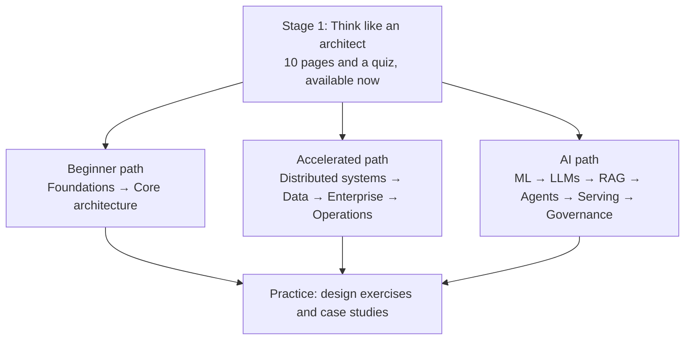

# Learning paths

Three paths, each a recommended order through the same material. Written pages are linked; planned
pages are named so you can see the whole journey. Each path ends with design exercises because
architecture is learned by deciding, not by reading.

## Where should I start? (beginner path)

You are new to architecture, possibly new to parts of software engineering, and want a solid base.

**Stage 1 — Think like an architect** (available now)

1. [What does a Solutions Architect do?](../architecture-fundamentals/what-does-a-solutions-architect-do.md)
2. [Functional vs non-functional requirements](../architecture-fundamentals/functional-vs-non-functional-requirements.md)
3. [Architecture quality attributes and trade-offs](../architecture-fundamentals/quality-attributes-and-trade-offs.md)
4. [The C4 model: how to communicate software architecture](../architecture-fundamentals/c4-model.md)
5. [How to estimate load, throughput, storage, and capacity](../performance-and-scalability/capacity-estimation.md)

**Stage 1b — From business problem to scope** (available now)

6. [Stakeholders, business capabilities, and success metrics](../architecture-fundamentals/stakeholders-business-capabilities-and-success-metrics.md)
7. [Constraints, assumptions, dependencies, risks, and scope](../architecture-fundamentals/constraints-assumptions-dependencies-risks-and-scope.md)
8. [As-Is and To-Be architecture, gap analysis, and build vs buy](../architecture-fundamentals/as-is-and-to-be-architecture-gap-analysis-and-build-vs-buy.md)
9. [SLAs, SLOs, SLIs, error budgets, and recovery objectives](../architecture-fundamentals/slas-slos-slis-error-budgets-and-recovery-objectives.md)
10. [Trade-offs, principles, ADRs, and architecture governance](../architecture-fundamentals/trade-offs-principles-adrs-and-architecture-governance.md)
11. [Quiz: Architecture fundamentals (D01)](../quizzes/d01-architecture-fundamentals.md)

**Stage 2 — Foundations** (partly available; see [Foundations](../foundations/index.md))

12. Computers, operating systems, and Linux for architects (planned)
13. Programming fundamentals, data structures, and algorithms (planned)
14. Programming paradigms and concurrency (planned)
15. [Networking fundamentals: IP, CIDR, routing, and DNS](../networking/networking-fundamentals-ip-cidr-routing-and-dns.md)
16. [Transport and application protocols](../networking/transport-and-application-protocols.md)
17. [Relational databases and SQL internals](../databases-and-storage/relational-databases-and-sql-internals.md)
18. [Performance fundamentals and Little's Law](../performance-and-scalability/performance-fundamentals-and-littles-law.md)
    with [Lab 01: latency and throughput](../labs/lab-01-latency-and-throughput.md)

**Stage 3 — Core application architecture** (mostly available)

19. Architecture styles (planned)
20. [API design: REST, GraphQL, gRPC, and async APIs](../application-and-api-architecture/api-design-rest-graphql-grpc-and-async-apis.md)
21. [Integration architecture](../application-and-api-architecture/integration-architecture.md)
22. [Caching architecture](../databases-and-storage/caching-architecture.md)
23. [Message queues and brokers](../messaging-and-streaming/message-queues-and-brokers.md)
24. [Distributed systems fundamentals, time, and coordination](../distributed-systems/distributed-systems-fundamentals-time-and-coordination.md)
25. Consistency models, CAP, and PACELC (planned)
26. [High availability design](../reliability-and-disaster-recovery/high-availability-design.md)
27. Security principles and threat modeling (planned)

**Stage 4 — Practice**

28. Design exercises: URL shortener, rate limiter, notification service (planned)
29. Case study 01: Highly available three-tier web application (planned)

## I already know cloud and DevOps (accelerated path)

You run AWS (or another cloud), Terraform, CI/CD, Docker, and Kubernetes. You want application,
distributed-systems, data, enterprise, and AI architecture depth, and the vocabulary to defend designs.

**Stage 1 — Sharpen the architect's toolkit** (available now, 3-4 hours)

Read the same five pages as the beginner path, but focus on the Level 3 sections, the trade-off
tables, and the discussion questions. Do the capacity-estimation lab with a system you operate. Then
read the governance pair:
[SLAs, SLOs, SLIs, and error budgets](../architecture-fundamentals/slas-slos-slis-error-budgets-and-recovery-objectives.md)
and [ADRs and architecture governance](../architecture-fundamentals/trade-offs-principles-adrs-and-architecture-governance.md).

**Stage 2 — Distributed systems and data** (partly available)

- [Distributed systems fundamentals, time, and coordination](../distributed-systems/distributed-systems-fundamentals-time-and-coordination.md)
  → Consistency models, CAP, and PACELC → Transactions, sagas, and delivery guarantees →
  Resilience mechanics → Scaling, partitioning, and replication (the last four planned)
- [Relational internals](../databases-and-storage/relational-databases-and-sql-internals.md) →
  NoSQL by access pattern → Advanced database architecture →
  [Caching](../databases-and-storage/caching-architecture.md)
- [Message queues and brokers](../messaging-and-streaming/message-queues-and-brokers.md) →
  Event-driven architecture → Event streaming → Messaging technologies compared

**Stage 3 — Application and enterprise** (partly available)

- Architecture styles → Microservices (and when not) → Distributed system patterns (planned)
- [API design](../application-and-api-architecture/api-design-rest-graphql-grpc-and-async-apis.md) →
  [Integration architecture](../application-and-api-architecture/integration-architecture.md)
- [Networking fundamentals](../networking/networking-fundamentals-ip-cidr-routing-and-dns.md) and
  [transport and application protocols](../networking/transport-and-application-protocols.md) as a
  refresher before hybrid connectivity
- Enterprise architecture practice → Legacy modernization → Hybrid and multi-cloud (planned)

**Stage 4 — Operate at scale** (partly available)

- [Performance fundamentals](../performance-and-scalability/performance-fundamentals-and-littles-law.md)
  (with [Lab 01](../labs/lab-01-latency-and-throughput.md)) →
  [High availability design](../reliability-and-disaster-recovery/high-availability-design.md) →
  Observability → Incident management and SRE → Disaster recovery strategies
- FinOps → Platform engineering (planned)

**Stage 5 — Practice**

- Design exercises: multi-region application, multi-tenant SaaS, landing zone, secure CI/CD
- Case studies 02, 03, 08, 10, 11

## AI architecture path

For engineers who need to design AI systems responsibly. Assumes the accelerated path's Stage 1.

1. AI, ML, and learning paradigms → Math for machine learning → Neural networks and transformers
2. ML lifecycle → MLOps
3. LLM fundamentals → LLM architecture decisions → Prompt and context engineering
4. RAG fundamentals → Ingestion and chunking → Embeddings and vector indexes → Retrieval and reranking → Advanced RAG
5. Agent fundamentals → Components and runtime → Patterns → Memory → Tools → MCP and A2A → Long-running agents
6. GPU infrastructure → Model serving and inference → AI platform and LLMOps
7. AI evaluation → AI observability → AI safety and security → NIST AI RMF and OWASP guidance
8. Design exercises: enterprise RAG, AI gateway, MCP server platform; case studies 16-25

All AI pages are planned; the sections exist with their topic lists:
[AI and ML foundations](../ai-ml-foundations/index.md),
[Generative AI and LLMs](../generative-ai-and-llms/index.md),
[RAG and vector search](../rag-and-vector-search/index.md),
[Agentic AI](../agentic-ai/index.md),
[AI infrastructure and LLMOps](../ai-infrastructure-and-llmops/index.md),
[AI evaluation, security, and governance](../ai-security-and-governance/index.md).

## How the paths map to the design method

Every path ends in the twelve-step [design method](../system-design-exercises/index.md). The
Stage 1 pages cover steps 1-3 (understand the problem, gather requirements, estimate load) and the
communication skill (C4) you need for every later step.

## Visual overview

**Figure 1 — The three paths share a common first stage and converge on practice.**

Read it top to bottom: everyone starts with the same first stage, branches by background, and ends by
designing systems and defending the decisions.
