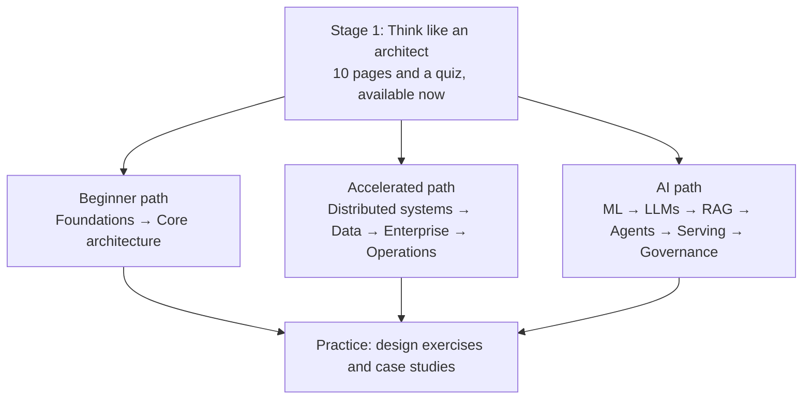

# Learning paths

Three paths, each a recommended order through the same material. Written pages are linked; planned
pages are named so you can see the whole journey. Each path ends with design exercises because
architecture is learned by deciding, not by reading.

## Where should I start? (beginner path)

You are new to architecture, possibly new to parts of software engineering, and want a solid base.

**Stage 1 — Think like an architect** (available now)

1. [What does a Solutions Architect do?](../architecture-fundamentals/what-does-a-solutions-architect-do.md)
2. [Functional vs non-functional requirements](../architecture-fundamentals/functional-vs-non-functional-requirements.md)
3. [Architecture quality attributes and trade-offs](../architecture-fundamentals/quality-attributes-and-trade-offs.md)
4. [The C4 model: how to communicate software architecture](../architecture-fundamentals/c4-model.md)
5. [How to estimate load, throughput, storage, and capacity](../performance-and-scalability/capacity-estimation.md)

**Stage 1b — From business problem to scope** (available now)

6. [Stakeholders, business capabilities, and success metrics](../architecture-fundamentals/stakeholders-business-capabilities-and-success-metrics.md)
7. [Constraints, assumptions, dependencies, risks, and scope](../architecture-fundamentals/constraints-assumptions-dependencies-risks-and-scope.md)
8. [As-Is and To-Be architecture, gap analysis, and build vs buy](../architecture-fundamentals/as-is-and-to-be-architecture-gap-analysis-and-build-vs-buy.md)
9. [SLAs, SLOs, SLIs, error budgets, and recovery objectives](../architecture-fundamentals/slas-slos-slis-error-budgets-and-recovery-objectives.md)
10. [Trade-offs, principles, ADRs, and architecture governance](../architecture-fundamentals/trade-offs-principles-adrs-and-architecture-governance.md)
11. [Quiz: Architecture fundamentals (D01)](../quizzes/d01-architecture-fundamentals.md)

**Stage 2 — Foundations** (available; see [Foundations](../foundations/index.md))

12. [Computers, operating systems, and Linux for architects](../foundations/computers-operating-systems-and-linux-for-architects.md)
13. [Programming fundamentals, data structures, and algorithms](../foundations/programming-fundamentals-data-structures-and-algorithms.md)
14. [Programming paradigms and concurrency](../foundations/programming-paradigms-and-concurrency.md)
    with [Lab 05: race condition](../labs/lab-05-race-condition.md); then
    [design principles and clean code](../foundations/software-design-principles-and-clean-code.md) and
    [testing types and strategies](../foundations/software-testing-types-and-strategies.md)
15. [Networking fundamentals: IP, CIDR, routing, and DNS](../networking/networking-fundamentals-ip-cidr-routing-and-dns.md)
16. [Transport and application protocols](../networking/transport-and-application-protocols.md)
17. [Relational databases and SQL internals](../databases-and-storage/relational-databases-and-sql-internals.md)
18. [Performance fundamentals and Little's Law](../performance-and-scalability/performance-fundamentals-and-littles-law.md)
    with [Lab 01: latency and throughput](../labs/lab-01-latency-and-throughput.md)

**Stage 3 — Core application architecture** (mostly available)

19. [Architecture styles](../software-architecture/architecture-styles.md), then
    [microservices architecture](../software-architecture/microservices-architecture.md) and
    [application design patterns](../software-architecture/application-design-patterns.md)
20. [API design: REST, GraphQL, gRPC, and async APIs](../application-and-api-architecture/api-design-rest-graphql-grpc-and-async-apis.md)
21. [Integration architecture](../application-and-api-architecture/integration-architecture.md)
22. [Caching architecture](../databases-and-storage/caching-architecture.md)
23. [Message queues and brokers](../messaging-and-streaming/message-queues-and-brokers.md)
24. [Distributed systems fundamentals, time, and coordination](../distributed-systems/distributed-systems-fundamentals-time-and-coordination.md)
25. [Consistency models, CAP, and PACELC](../distributed-systems/consistency-models-cap-and-pacelc.md)
    with [Lab 09: replication lag](../labs/lab-09-replication-lag.md)
26. [High availability design](../reliability-and-disaster-recovery/high-availability-design.md)
27. [Security principles and threat modeling](../security-architecture/security-principles-and-threat-modeling.md),
    then [identity and access management](../security-architecture/identity-and-access-management.md)
    with [Lab 10: REST API authentication and validation](../labs/lab-10-rest-api-auth-and-validation.md)
28. [Cloud service and deployment models](../cloud-architecture/cloud-service-and-deployment-models.md)
    and [containers and images](../containers-and-kubernetes/containers-and-images.md)

**Stage 4 — Practice**

29. Read [the architecture design method](../system-design-exercises/design-method.md), then attempt the
    [URL shortener](../system-design-exercises/url-shortener.md) and
    [rate limiter](../system-design-exercises/rate-limiter.md) exercises
30. [Case study 01: Highly available three-tier web application](../end-to-end-case-studies/cs-01-highly-available-three-tier-web-application.md)

## I already know cloud and DevOps (accelerated path)

You run AWS (or another cloud), Terraform, CI/CD, Docker, and Kubernetes. You want application,
distributed-systems, data, enterprise, and AI architecture depth, and the vocabulary to defend designs.

**Stage 1 — Sharpen the architect's toolkit** (available now, 3-4 hours)

Read the same five pages as the beginner path, but focus on the Level 3 sections, the trade-off
tables, and the discussion questions. Do the capacity-estimation lab with a system you operate. Then
read the governance pair:
[SLAs, SLOs, SLIs, and error budgets](../architecture-fundamentals/slas-slos-slis-error-budgets-and-recovery-objectives.md)
and [ADRs and architecture governance](../architecture-fundamentals/trade-offs-principles-adrs-and-architecture-governance.md).

**Stage 2 — Distributed systems and data** (mostly available)

- [Distributed systems fundamentals, time, and coordination](../distributed-systems/distributed-systems-fundamentals-time-and-coordination.md)
  → [Consistency models, CAP, and PACELC](../distributed-systems/consistency-models-cap-and-pacelc.md) →
  [Transactions, sagas, and delivery guarantees](../distributed-systems/transactions-sagas-and-delivery-guarantees.md) →
  [Resilience mechanics](../distributed-systems/resilience-mechanics-timeouts-retries-and-backpressure.md) →
  [Scaling, partitioning, and replication](../distributed-systems/scaling-partitioning-and-replication.md),
  with Labs [03](../labs/lab-03-queue-retries-and-dead-letter.md), [04](../labs/lab-04-idempotency-and-duplicates.md),
  [08](../labs/lab-08-sharding-and-consistent-hashing.md), and [09](../labs/lab-09-replication-lag.md)
- [Relational internals](../databases-and-storage/relational-databases-and-sql-internals.md)
  (with [Lab 06](../labs/lab-06-indexing-and-query-plans.md)) →
  [NoSQL databases](../databases-and-storage/nosql-databases.md)
  (with [Lab 07](../labs/lab-07-sql-vs-nosql-access-patterns.md)) →
  [Advanced database architecture](../databases-and-storage/advanced-database-architecture.md) →
  [Storage architecture](../databases-and-storage/storage-architecture.md) →
  [Caching](../databases-and-storage/caching-architecture.md) (with [Lab 02](../labs/lab-02-cache-hit-and-miss.md))
- [Message queues and brokers](../messaging-and-streaming/message-queues-and-brokers.md) →
  [Event-driven architecture](../messaging-and-streaming/event-driven-architecture.md)
  (with [Lab 16](../labs/lab-16-event-driven-workflow.md)) →
  [Event streaming](../messaging-and-streaming/event-streaming-and-log-based-architecture.md) →
  [Messaging technologies compared](../messaging-and-streaming/messaging-technologies-compared.md)
- [Data modeling and governance](../data-engineering-and-analytics/data-modeling-metadata-and-data-governance.md) →
  [Pipelines](../data-engineering-and-analytics/batch-streaming-etl-elt-and-pipelines.md) →
  [Warehouses, lakes, lakehouses, and data mesh](../data-engineering-and-analytics/warehouses-lakes-lakehouses-and-data-mesh.md) →
  [Processing engines and table formats](../data-engineering-and-analytics/big-data-processing-engines-and-table-formats.md) →
  [OLTP vs OLAP and BI](../data-engineering-and-analytics/oltp-vs-olap-dimensional-modeling-and-bi.md)

**Stage 3 — Application and enterprise** (partly available)

- [Architecture styles](../software-architecture/architecture-styles.md) →
  [Microservices (and when not)](../software-architecture/microservices-architecture.md) →
  [Distributed system patterns](../software-architecture/distributed-system-patterns.md)
- [API design](../application-and-api-architecture/api-design-rest-graphql-grpc-and-async-apis.md) →
  [Integration architecture](../application-and-api-architecture/integration-architecture.md)
- [Networking fundamentals](../networking/networking-fundamentals-ip-cidr-routing-and-dns.md) and
  [transport and application protocols](../networking/transport-and-application-protocols.md) as a
  refresher before hybrid connectivity
- [Enterprise architecture practice](../enterprise-architecture/enterprise-architecture-practice.md) →
  [Enterprise architecture frameworks](../enterprise-architecture/enterprise-architecture-frameworks.md) →
  [Legacy modernization and migration](../enterprise-architecture/legacy-modernization-and-migration.md) →
  [Hybrid and multi-cloud architecture](../enterprise-architecture/hybrid-and-multi-cloud-architecture.md)

**Stage 3b — Cloud, platform, and security** (available)

- [Cloud building blocks and landing zones](../cloud-architecture/cloud-building-blocks-and-landing-zones.md) →
  [Multi-account strategy and infrastructure automation](../cloud-architecture/multi-account-strategy-and-infrastructure-automation.md)
  (with [Lab 15](../labs/lab-15-infrastructure-module-and-static-checks.md)) →
  [Network security, load balancing, and traffic flow](../networking/network-security-load-balancing-and-traffic-flow.md)
  (with [Lab 14](../labs/lab-14-network-segmentation.md)) →
  [Hybrid connectivity and VPNs](../networking/hybrid-connectivity-and-vpns.md)
- [Kubernetes architecture and workloads](../containers-and-kubernetes/kubernetes-architecture-and-workloads.md) →
  [Kubernetes networking, storage, and service mesh](../containers-and-kubernetes/kubernetes-networking-storage-and-service-mesh.md)
  (with [Lab 12](../labs/lab-12-local-kubernetes-deployment.md)) →
  [Cloud-native ecosystem tools](../containers-and-kubernetes/cloud-native-ecosystem-tools.md)
- The [security architecture](../security-architecture/index.md) section in order: principles and threat
  modeling, IAM, network, application, data, supply chain, operations, compliance

**Stage 4 — Operate at scale** (available)

- [Performance fundamentals](../performance-and-scalability/performance-fundamentals-and-littles-law.md)
  (with [Lab 01](../labs/lab-01-latency-and-throughput.md)) →
  [High availability design](../reliability-and-disaster-recovery/high-availability-design.md) →
  [Reliability engineering](../reliability-and-disaster-recovery/reliability-engineering.md) →
  [Disaster recovery strategies](../reliability-and-disaster-recovery/disaster-recovery-strategies.md) →
  [Advanced resilience and failure containment](../reliability-and-disaster-recovery/advanced-resilience-and-failure-containment.md)
- [Observability fundamentals](../observability-and-sre/observability-fundamentals-logs-metrics-and-traces.md)
  (with [Lab 11](../labs/lab-11-tracing-and-structured-logging.md)) →
  [Monitoring, alerting, and on-call](../observability-and-sre/monitoring-alerting-and-on-call.md) →
  [Incident management and SRE practices](../observability-and-sre/incident-management-and-sre-practices.md)
- [DevOps lifecycle](../devops-and-platform-engineering/devops-lifecycle-and-source-control.md) →
  [CI/CD and deployment strategies](../devops-and-platform-engineering/ci-cd-pipeline-design-and-deployment-strategies.md) →
  [Infrastructure as Code](../devops-and-platform-engineering/infrastructure-as-code.md) →
  [DevSecOps](../devops-and-platform-engineering/devsecops-and-secure-delivery.md) →
  [Platform engineering](../devops-and-platform-engineering/platform-engineering.md)
  (with [Lab 13](../labs/lab-13-gitops-reconciliation.md))
- [Cloud cost models and FinOps](../finops-and-sustainability/cloud-cost-models-and-finops.md) and
  [sustainable architecture](../finops-and-sustainability/sustainable-and-carbon-aware-architecture.md);
  then review a system with the [Well-Architected frameworks](../cloud-architecture/well-architected-frameworks.md)

**Stage 5 — Practice**

- [Distributed cache](../system-design-exercises/distributed-cache.md) and
  [job scheduler](../system-design-exercises/job-scheduler.md) exercises, using the
  [design method](../system-design-exercises/design-method.md)
- [Multi-account landing zone](../system-design-exercises/multi-account-landing-zone.md) and
  [zero-trust enterprise](../system-design-exercises/zero-trust-enterprise.md) exercises; the other
  [cloud and enterprise platform exercises](../system-design-exercises/cloud-and-enterprise-platform-exercises.md)
  are briefs
- Case studies [08](../end-to-end-case-studies/cs-08-multi-account-landing-zone-and-hub-and-spoke-network.md),
  [09](../end-to-end-case-studies/cs-09-hybrid-migration-with-private-connectivity.md),
  [10](../end-to-end-case-studies/cs-10-multi-region-disaster-recovery.md),
  [11](../end-to-end-case-studies/cs-11-enterprise-kubernetes-platform-with-gitops.md), and
  [15](../end-to-end-case-studies/cs-15-zero-trust-application-architecture.md), and the
  [multi-region disaster recovery](../system-design-exercises/multi-region-disaster-recovery.md) exercise;
  02 and 03 are planned
- Data: case studies [12](../end-to-end-case-studies/cs-12-data-lakehouse-with-batch-and-streaming-ingestion.md)
  and [13](../end-to-end-case-studies/cs-13-real-time-fraud-detection-pipeline.md), and the
  [data lake](../system-design-exercises/data-lake.md), [CDC pipeline](../system-design-exercises/cdc-pipeline.md),
  and [real-time analytics](../system-design-exercises/real-time-analytics.md) exercises

## AI architecture path

For engineers who need to design AI systems responsibly. Assumes the accelerated path's Stage 1.

1. AI, ML, and learning paradigms → Math for machine learning → Neural networks and transformers
2. ML lifecycle → MLOps
3. LLM fundamentals → LLM architecture decisions → Prompt and context engineering
4. RAG fundamentals → Ingestion and chunking → Embeddings and vector indexes → Retrieval and reranking → Advanced RAG
5. Agent fundamentals → Components and runtime → Patterns → Memory → Tools → MCP and A2A → Long-running agents
6. GPU infrastructure → Model serving and inference → AI platform and LLMOps
7. AI evaluation → AI observability → AI safety and security → NIST AI RMF and OWASP guidance
8. Design exercises: enterprise RAG, AI gateway, MCP server platform; case studies 16-25

All AI pages are planned; the sections exist with their topic lists:
[AI and ML foundations](../ai-ml-foundations/index.md),
[Generative AI and LLMs](../generative-ai-and-llms/index.md),
[RAG and vector search](../rag-and-vector-search/index.md),
[Agentic AI](../agentic-ai/index.md),
[AI infrastructure and LLMOps](../ai-infrastructure-and-llmops/index.md),
[AI evaluation, security, and governance](../ai-security-and-governance/index.md).

## How the paths map to the design method

Every path ends in the twelve-step [design method](../system-design-exercises/design-method.md). The
Stage 1 pages cover steps 1-3 (understand the problem, gather requirements, estimate load) and the
communication skill (C4) you need for every later step.

## Visual overview

**Figure 1 — The three paths share a common first stage and converge on practice.**

Read it top to bottom: everyone starts with the same first stage, branches by background, and ends by
designing systems and defending the decisions.
