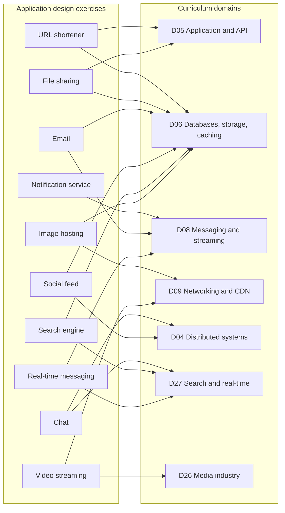

# Application design exercises

> These are the products people use every day: short links, shared files, notifications, chat,
> email, feeds, search, images, video, and live updates. Each one looks simple from the outside and
> hides two or three decisions that make or break it.

!!! abstract "Page facts"
    **Level:** Mixed (each brief is Level 2; the full exercises are Level 3) · **Status:** Outline ·
    **Time:** 15 minutes to read; 60-90 minutes per full exercise · **Last verified:** 2026-11-20

## How to use these exercises

Work every exercise with the [twelve-step design method](design-method.md): understand the problem,
write requirements, estimate, then design boundaries, contracts, data, style, deployment, security,
resilience, operations, and cost, recording trade-offs as you go.

- **Pick one, set a timer.** Spend 45-60 minutes on your own design before looking at any reference
  solution, then compare. Comparing your own attempt teaches more than reading a finished answer.
- **Use the stated scale.** Every number in a brief is a labelled assumption. Most come from the fictional
  AtlasMart retailer used across this site; a few exercises (the URL shortener, email) use their own
  fictional company because AtlasMart would not build that product. Do the estimate before any boxes and
  arrows; it decides which of the three decisions matters most.
- **Start from the three decisions.** Each brief names the decisions that dominate the design. A strong
  answer makes each one explicitly, names the rejected alternative, and says what would change the choice.
- **Read first.** The listed pages hold the concepts each exercise assumes. Pages named with a
  D-identifier are planned and not yet written.
- **Full exercises** contain a problem statement, requirements, scale arithmetic, progressive hints, a
  reference solution, alternatives, failure modes, and an evaluation rubric. The
  [URL shortener](url-shortener.md) is the first; the others are briefs only, with full exercises planned.
  For infrastructure building blocks (caches, rate limiters, schedulers), see the
  [infrastructure component exercises](infrastructure-component-exercises.md).

## Exercises

### URL shortener

- **Brief.** Design a service that turns long URLs into short codes, redirects anyone who opens a short
  link, and shows owners daily click statistics. The fictional company Quillo must also be able to disable
  a phishing link everywhere within a minute.
- **Scale to assume.** 10,000,000 new links per month and 100 redirects per link, so about 390 redirects
  per second on average and 3,500 per second at the campaign design peak; 600 million links over five
  years.
- **Decisions that dominate.** (1) Short-code generation: random codes with collision checks, a counter
  with encoding, or pre-allocated ranges, and how unpredictable the codes must be. (2) The redirect read
  path: cache placement, permanent versus temporary redirects, and how a disabled link is purged from
  caches. (3) Click analytics kept off the redirect path: an asynchronous event pipeline with aggregation.
- **Read first.** [Capacity estimation](../performance-and-scalability/capacity-estimation.md);
  [Caching architecture](../databases-and-storage/caching-architecture.md);
  [API design](../application-and-api-architecture/api-design-rest-graphql-grpc-and-async-apis.md);
  [Transport and application protocols](../networking/transport-and-application-protocols.md) (HTTP
  redirects and caching).
- **Status.** Full exercise: [Design a URL shortener](url-shortener.md).

### File sharing

- **Brief.** Design a file-sharing service for AtlasMart's business portal, where suppliers and business
  customers upload invoices, specification sheets, and product media and share them with named people or
  by expiring link. Files must be scanned for malware before anyone else can download them.
- **Scale to assume.** 20,000 business users, 50,000 uploads per day averaging 2 MB with a 2 GB maximum
  (assumptions): 50,000 × 2 MB = 100 GB per day, about 36.5 TB per year before versions and copies.
- **Decisions that dominate.** (1) Upload path: resumable, chunked uploads directly to object storage with
  short-lived signed URLs, keeping large bodies away from the application servers. (2) The sharing and
  permission model: owners, groups, expiring links, and how every download is authorized and audited.
  (3) Storage lifecycle: versioning, deduplication, quarantine until scanned, and tiering cold files.
- **Read first.** [API design](../application-and-api-architecture/api-design-rest-graphql-grpc-and-async-apis.md);
  [Relational databases and SQL internals](../databases-and-storage/relational-databases-and-sql-internals.md)
  (metadata); planned: storage architecture (D06-T04), data security and privacy (D12-T05).
- **Status.** Brief only, full exercise planned.

### Notification service

- **Brief.** Generalize AtlasMart's Notification Worker into a notification service every team can use
  for email, SMS, and mobile push, honoring customer preferences and quiet hours. Transactional messages
  ("your parcel is out for delivery") must never wait behind a marketing campaign.
- **Scale to assume.** 60,000 orders per day × about 4 transactional notifications = 240,000 per day; plus
  marketing campaigns of 2,000,000 recipients sent within an hour: 2,000,000 ÷ 3,600 ≈ 556 per second
  (assumptions).
- **Decisions that dominate.** (1) Separation of transactional and bulk traffic: separate queues, quotas,
  and provider capacity. (2) Channel abstraction with provider failover and per-provider rate limits.
  (3) Deduplication and idempotency (one message per event even with retries), plus preferences, opt-out,
  and quiet-hours rules applied before sending.
- **Read first.** [Message queues and brokers](../messaging-and-streaming/message-queues-and-brokers.md);
  [Transactions, sagas, and delivery guarantees](../distributed-systems/transactions-sagas-and-delivery-guarantees.md);
  [Integration architecture](../application-and-api-architecture/integration-architecture.md);
  [Lab 04: idempotency and duplicates](../labs/lab-04-idempotency-and-duplicates.md).
- **Status.** Brief only, full exercise planned.

### Chat

- **Brief.** Design customer-support chat for AtlasMart: a customer opens a conversation from the app,
  it is routed to an available agent, both see messages in order with delivery and read receipts, and the
  history is kept for later review. Agents handle several conversations at once.
- **Scale to assume.** 2% of 400,000 DAU start a chat each day: 8,000 conversations × 20 messages =
  160,000 messages per day; 300 agents online at peak; up to 10,000 concurrently connected customers
  (assumptions).
- **Decisions that dominate.** (1) Connection layer: persistent connections (WebSocket) through a
  connection gateway, and how a message reaches the gateway holding the recipient's connection.
  (2) Ordering and storage per conversation: a per-conversation sequence number and an append-only message
  store. (3) Offline delivery and resynchronization after reconnect, plus agent routing and assignment.
- **Read first.** [Transport and application protocols](../networking/transport-and-application-protocols.md);
  [Distributed systems fundamentals](../distributed-systems/distributed-systems-fundamentals-time-and-coordination.md)
  (ordering); [Message queues and brokers](../messaging-and-streaming/message-queues-and-brokers.md);
  planned: real-time systems (D27-T02).
- **Status.** Brief only, full exercise planned.

### Email

- **Brief.** Design a hosted email service for a fictional regional provider: receive mail for customer
  domains, store mailboxes, let users read and search them on the web and in mail clients, and send
  outbound mail that recipients' providers accept rather than mark as spam.
- **Scale to assume.** 1,000,000 mailboxes receiving 40 messages each per day: 40,000,000 ÷ 86,400 ≈ 463
  messages per second on average; 75 KB average message, so about 3 TB of new mail per day (exercise
  assumptions).
- **Decisions that dominate.** (1) Inbound pipeline: mail exchangers, spam and malware filtering, and
  queueing before delivery to mailboxes. (2) Mailbox storage: message metadata in a database partitioned by
  mailbox, bodies and attachments in object storage, and a per-user search index. (3) Outbound deliverability:
  sender authentication (SPF, DKIM, DMARC), reputation management, and retrying queues.
- **Read first.** [Networking fundamentals: IP, CIDR, routing, and DNS](../networking/networking-fundamentals-ip-cidr-routing-and-dns.md);
  [Message queues and brokers](../messaging-and-streaming/message-queues-and-brokers.md);
  [Scaling, partitioning, and replication](../distributed-systems/scaling-partitioning-and-replication.md);
  planned: storage architecture (D06-T04), application security (D12-T04).
- **Status.** Brief only, full exercise planned.

### Social feed

- **Brief.** AtlasMart adds a social shopping feed: customers follow sellers, creators, and friends and see
  their posts and reviews in a personalized feed. A handful of popular sellers have hundreds of thousands
  of followers.
- **Scale to assume.** 400,000 DAU opening the feed 5 times a day = 2,000,000 feed reads per day; 50,000
  posts per day; 200 followers on average and 500,000 for the most-followed accounts (assumptions). Fan-out
  on write: 50,000 × 200 = 10,000,000 feed inserts per day ≈ 116 per second.
- **Decisions that dominate.** (1) Fan-out on write versus fan-out on read, and the hybrid for accounts with
  huge followings. (2) Feed storage and caching per user: how many items, how long, and in what store.
  (3) Ranking: chronological versus scored, and where the ranking runs.
- **Read first.** [Caching architecture](../databases-and-storage/caching-architecture.md);
  [Capacity estimation](../performance-and-scalability/capacity-estimation.md);
  [Scaling, partitioning, and replication](../distributed-systems/scaling-partitioning-and-replication.md);
  planned: NoSQL databases (D06-T02).
- **Status.** Brief only, full exercise planned.

### Search engine

- **Brief.** Design AtlasMart's product search engine: customers type a query and get relevant,
  in-stock products in a fraction of a second, with filters and typo tolerance. Price and stock changes
  must appear in results within a minute. (A web-scale crawler and search engine is a stretch variant.)
- **Scale to assume.** 1,000,000 products; 400,000 DAU × 6 searches = 2,400,000 queries per day ≈ 28 per
  second on average, × 5 daily peak × 3 sale-day factor ≈ 420 per second; 50,000 product updates per day
  (assumptions, using the capacity page's peak factors).
- **Decisions that dominate.** (1) Index build and update path: full rebuilds plus near-real-time updates
  from catalogue change events. (2) Relevance: text matching, ranking signals, and how relevance is
  evaluated. (3) Index sharding and replication for query throughput and availability.
- **Read first.** [Relational databases and SQL internals](../databases-and-storage/relational-databases-and-sql-internals.md)
  (why the database is not the search engine); [Programming fundamentals, data structures, and algorithms](../foundations/programming-fundamentals-data-structures-and-algorithms.md);
  [Scaling, partitioning, and replication](../distributed-systems/scaling-partitioning-and-replication.md);
  planned: search architecture (D27-T03), event streaming and log-based architecture (D08-T03).
- **Status.** Brief only, full exercise planned.

### Image hosting

- **Brief.** Design how AtlasMart stores, processes, and serves product images uploaded by marketplace
  sellers: originals kept, several sizes and formats generated, and every product page loading images fast
  on mobile networks.
- **Scale to assume.** 200,000 new images per day at 3 MB each = 600 GB of originals per day; 5 renditions
  per image; 40,000,000 image views per day ≈ 463 per second, with 95% served from the CDN, so about 23
  per second reach the origin (assumptions).
- **Decisions that dominate.** (1) Processing pipeline: asynchronous resizing after upload versus
  on-the-fly transformation with caching. (2) Storage and delivery: object storage behind a CDN with
  immutable, versioned URLs so caches never need purging. (3) Upload safety: content-type validation,
  size limits, metadata stripping, and moderation.
- **Read first.** [Caching architecture](../databases-and-storage/caching-architecture.md) (CDN and HTTP
  caching); [Message queues and brokers](../messaging-and-streaming/message-queues-and-brokers.md);
  [Capacity estimation](../performance-and-scalability/capacity-estimation.md); planned: storage
  architecture (D06-T04), network security, load balancing, and traffic flow (D09-T03).
- **Status.** Brief only, full exercise planned.

### Video streaming

- **Brief.** Design video for AtlasMart: a library of on-demand product videos and live shopping events
  where a presenter demonstrates products to a large audience who can buy while watching.
- **Scale to assume.** 50,000 on-demand videos; a live event with 100,000 concurrent viewers at 3 Mbit/s
  average = 300 Gbit/s of delivery, which only a CDN can serve (assumptions).
- **Decisions that dominate.** (1) Transcoding and packaging: the bitrate ladder and adaptive streaming
  formats. (2) Delivery: CDN distribution, origin shielding, and what happens when a CDN edge fails mid-event.
  (3) Live latency target: a few seconds of delay with standard segments versus lower latency at higher cost,
  and how the purchase button stays in sync with the stream.
- **Read first.** [Transport and application protocols](../networking/transport-and-application-protocols.md);
  [Caching architecture](../databases-and-storage/caching-architecture.md);
  [Performance fundamentals and Little's Law](../performance-and-scalability/performance-fundamentals-and-littles-law.md);
  planned: media and streaming industry architecture (D26-T04), network security, load balancing, and
  traffic flow (D09-T03).
- **Status.** Brief only, full exercise planned.

### Real-time messaging

- **Brief.** Design the service that pushes live updates to connected browsers and apps: tracking status
  changes as they happen and flash-sale stock counters that tick down in front of shoppers. Unlike chat,
  this is one-to-many publish and subscribe, mostly server to client.
- **Scale to assume.** 100,000 concurrently connected clients at sale peak (assumption, 70% mobile web);
  70 tracking events per second at peak (NFR-4), each delivered to the few clients watching that shipment;
  a stock counter updated 10 times per second broadcast to all 100,000 clients = 1,000,000 messages per
  second.
- **Decisions that dominate.** (1) Protocol and connection gateway: WebSocket or server-sent events,
  connection limits per node, and reconnect storms after a deployment. (2) Publish-subscribe backbone and
  topic routing between producers and the gateways holding subscribers. (3) Delivery semantics: best effort
  with resynchronization on reconnect, coalescing updates (send only the latest counter), and backpressure
  for slow clients.
- **Read first.** [Transport and application protocols](../networking/transport-and-application-protocols.md);
  [Message queues and brokers](../messaging-and-streaming/message-queues-and-brokers.md);
  [Resilience mechanics: timeouts, retries, and backpressure](../distributed-systems/resilience-mechanics-timeouts-retries-and-backpressure.md);
  planned: real-time systems (D27-T02), event-driven architecture (D08-T02).
- **Status.** Brief only, full exercise planned.

## How the exercises map to the curriculum

**Figure 1 — Which domains each application exercise practises.** Each arrow points from an exercise to
a domain whose ideas it exercises most heavily.

How to read it: databases, storage, and caching (D06) receive the most arrows, because most consumer
products are read-heavy and their designs turn on where data lives and how it is cached; the D26 and D27
domains are planned, so read the linked foundation pages first.

| Exercise | Main domains | Secondary domains |
|---|---|---|
| URL shortener | D06 Databases, storage, caching; D05 Application and API | D14 Performance; D12 Security (abuse) |
| File sharing | D06 Storage; D05 Application and API | D12 Security (sharing, malware) |
| Notification service | D08 Messaging and streaming | D05 Integration; D04 Delivery guarantees |
| Chat | D27 Real-time systems; D04 Distributed systems (ordering) | D09 Networking |
| Email | D08 Messaging (queues and retries); D06 Storage | D09 Networking (DNS); D12 Security |
| Social feed | D06 Databases and caching; D04 Partitioning | D14 Performance |
| Search engine | D27 Search architecture; D06 Databases | D08 Change events; D07 Data |
| Image hosting | D09 Networking and CDN; D06 Storage | D08 Asynchronous processing |
| Video streaming | D26 Media and streaming; D09 CDN | D14 Performance; D17 Cost |
| Real-time messaging | D27 Real-time systems; D08 Publish and subscribe | D04 Backpressure; D09 Networking |

## Review notes

- Canonical page for D29-T01, status Outline: every inventory item has a brief, a stated scale, three
  dominating decisions, reading, and a status. Only the URL shortener has a full exercise.
- Collection pages have no knowledge check and no references table by design; sources live on the full
  exercise pages and the topic pages they link.
- Chat and real-time messaging are deliberately separated: chat is conversational, ordered, and stored;
  real-time messaging is one-to-many push of transient state. A reviewer should check the distinction is
  clear.
- The URL shortener scale is copied from its full exercise page (fictional company Quillo). Email also uses
  a fictional provider rather than AtlasMart.
- New AtlasMart assumptions introduced: business portal of 20,000 users and 50,000 uploads per day at 2 MB
  (2 GB maximum); about 4 transactional notifications per order and 2,000,000-recipient campaigns sent in an
  hour; 2% of DAU starting a support chat, 20 messages per conversation, 300 agents, 10,000 connected
  customers; a social feed with 5 opens per DAU, 50,000 posts per day, 200 average and 500,000 maximum
  followers; 1,000,000 products, 6 searches per DAU, 50,000 product updates per day; 200,000 images per day
  at 3 MB, 5 renditions, 40,000,000 views per day, 95% CDN hit rate; 50,000 on-demand videos and 100,000 live
  viewers at 3 Mbit/s; 100,000 connected clients and a 10-per-second stock counter. Email figures are
  exercise assumptions for a fictional provider.
- Figure 1 uses two stacked subgraphs linked with `~~~` and 19 links; check it renders legibly at phone
  width.
