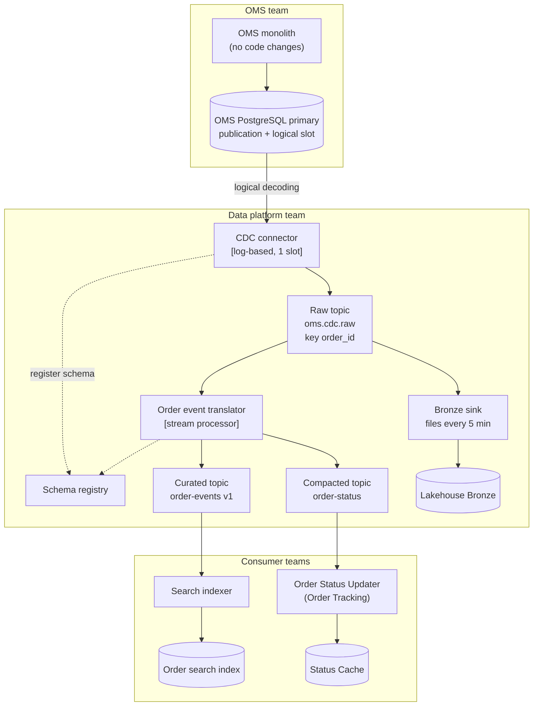
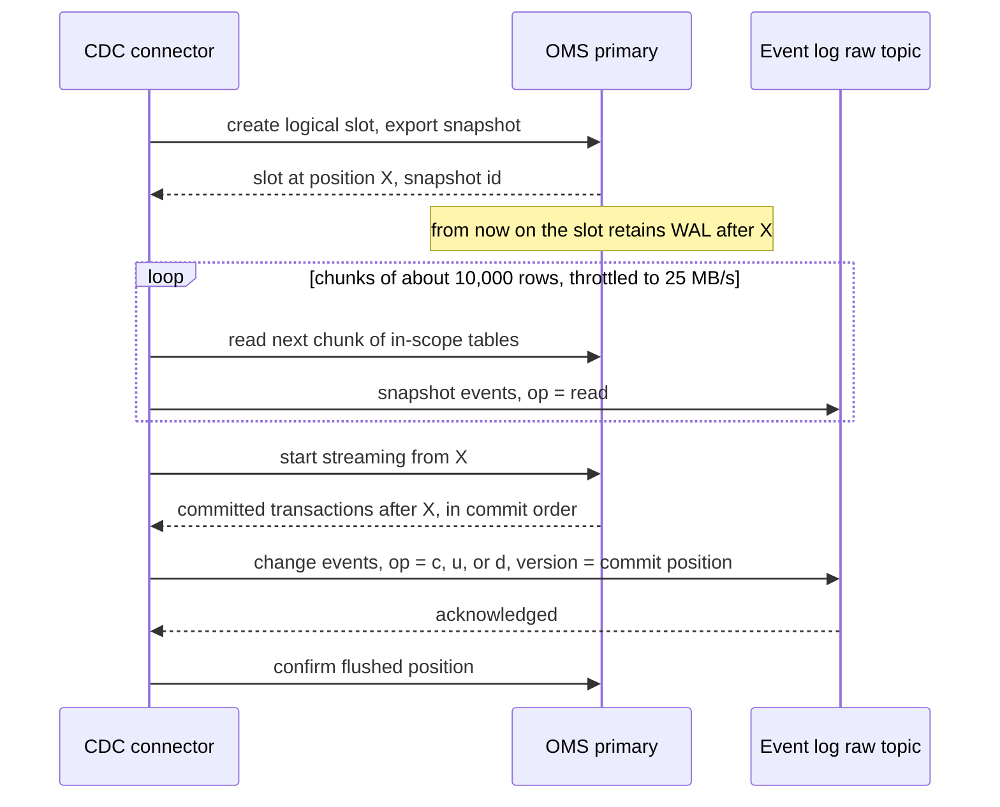
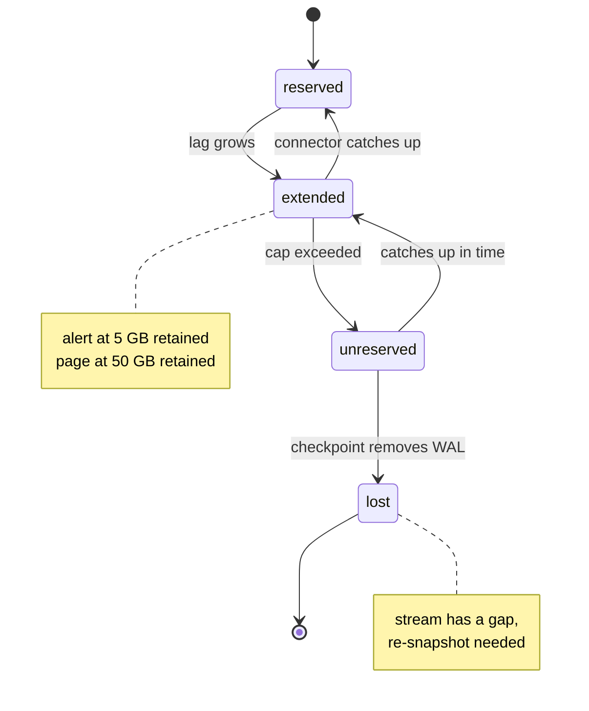
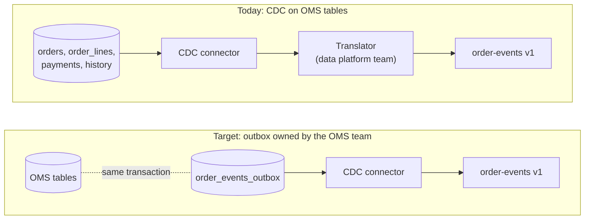

# Exercise: design a change data capture pipeline

> Change data capture lets you publish events from a database whose code you are not allowed to
> touch. That is its gift and its trap: the events you get are the other team's table layout,
> delivered at the database's pace, with the database's disk as your buffer. A good design takes the
> gift and puts a fence around each part of the trap.

!!! abstract "Page facts"
    **Level:** Advanced · **Status:** Draft · **Time:** 75-90 minutes (50 minutes to attempt, the
    rest to compare) · **Last verified:** 2026-11-27

## Problem statement

AtlasMart (fictional) is an online retailer: 400,000 daily active users, 60,000 orders a day with
three order lines each, 300,000 orders in transit, all in one EU cloud region with three
availability zones (EU customer data stays in the EU, constraint C-4). Its Order Management System
(OMS) is a 12-year-old monolith on PostgreSQL, owned and run by the OMS team. That team is busy with
a payment-provider migration and has said, firmly, that no OMS code will change this year.

Three other teams need to know when orders change:

1. **The data platform team** wants every order change in the lakehouse **Bronze** layer, so Silver
   and Gold can stop depending on a fragile nightly export.
2. **Customer service** wants a **search index** over orders (by order id, customer account, status,
   product, and date) that is current within a minute, so agents stop querying the OMS directly.
3. **The Order Tracking team** wants order-status changes (paid, packed, shipped, cancelled) to
   refresh its **order-status cache**, so the Tracking API stops calling the OMS on cache misses.

AtlasMart has a managed, Kafka-compatible **event log** (topics partitioned by key, 7-day retention).
Design change data capture (CDC) from the OMS database into the event log, and the path from there
to the three consumers. Every number not already listed above is a labelled assumption.

## How to use this exercise

1. **Attempt first.** Read the problem statement, requirements, and scale assumptions only.
2. **Time box.** 50 minutes, following the twelve steps of the [design method](design-method.md).
   Produce at least a container diagram, the change-rate and WAL-retention arithmetic, a
   snapshot-then-stream plan, an event contract with its key and version, a schema-change policy, a
   delete policy, and a failure-mode list.
3. **Use the hints only when stuck,** one at a time; each is stronger than the last.
4. **Then compare** with the reference solution and score yourself with the rubric. A different
   choice with a stated reason and an honest trade-off is a strong answer.

## Requirements

### Functional requirements

1. **FR-1 Capture.** Every committed insert, update, and delete on the in-scope OMS tables
   (`orders`, `order_lines`, `payments`, `order_status_history`) appears in the event log.
2. **FR-2 History once.** Consumers can start from a complete copy of current data (an initial
   snapshot) and then receive only changes, with no gap and no change missed between the two.
3. **FR-3 Bronze.** Raw change events land in the Bronze layer with their operation, commit time,
   and source position, so Silver can rebuild current state and history.
4. **FR-4 Search.** The customer-service search index reflects order changes, including deletions.
5. **FR-5 Status.** The Order Tracking system receives order-status changes and refreshes its
   order-status cache.
6. **FR-6 Replay.** A consumer can be rebuilt (new index mapping, bug fix) without asking the OMS
   team for a new export.

### Non-functional requirements

1. **NFR-C1 No OMS code changes.** Database-level configuration (a publication, a replication slot,
   a replica identity setting, a role) is negotiable with the OMS team; application changes are not.
2. **NFR-C2 Lag (assumption).** From OMS commit to the curated topic within **10 s** at p99; to the
   order-status cache within **30 s** (inside Order Tracking's 60 s freshness target, NFR-1); to the
   search index within **60 s**; to Bronze within **15 minutes**.
3. **NFR-C3 No harm to the OMS.** CDC must never fill the OMS disk, hold back vacuum for hours, or
   add more than about 5% CPU on the primary (assumption agreed with the OMS team).
4. **NFR-C4 Completeness.** No committed change is lost; duplicates are allowed but must have no
   second effect at any consumer.
5. **NFR-C5 Privacy.** Delivery addresses and payment details never leave the OMS (Order Tracking
   stores no delivery addresses, NFR-6); customer identifiers are pseudonymized before Silver; data
   stays in the EU region.
6. **NFR-C6 Ordering.** Each consumer sees the changes to one order in the order they committed.

### Clarifying questions a good candidate asks

- Which PostgreSQL major version does the OMS run, and is it self-managed or a managed service?
  (Here: a currently supported version on a managed service with a standby in another zone; slot
  failover features depend on the version, so check.)
- Is logical decoding already enabled? (Here: no. Changing `wal_level` needs a restart, so it goes
  into the OMS team's next maintenance window.)
- Do all in-scope tables have primary keys? (Here: yes, but `order_lines` is keyed by `line_id`
  alone, which matters for deletes.)
- Does the OMS ever hard-delete rows? (Here: yes. Lines removed from unpaid orders, and whole
  orders purged for erasure requests.)
- How often does the OMS schema change, and who hears about it first? (Here: a release every two
  weeks, with column changes about once a month.)
- Which columns are sensitive? (Here: `orders.delivery_address_*` and `payments.card_*`.)
- Do consumers need every intermediate state or only the latest? (Bronze wants every change;
  search and the cache want the latest per order.)

## Scale assumptions

### Stated assumptions

| Id | Assumption | Value |
|---|---|---|
| C1 | Orders per day; lines per order (existing AtlasMart facts) | 60,000; 3 (180,000 lines/day) |
| C2 | Status changes per order after creation (paid, allocated, picked, packed, shipped, delivered) | 6 |
| C3 | Updates per order line (allocated, shipped) | 2 |
| C4 | Other in-scope rows per order (one payment, one history row per status change) | 1 + 6 = 7 |
| C5 | Daily peak factor; sale-day factor on top (matching tracking's 70 ÷ 13.9 and 210 ÷ 70) | 5; 3 |
| C6 | Change event size on the log (key, after-image, metadata) | 1 KB |
| C7 | WAL generated by the whole OMS database (measured by the OMS team) | 25 GB/day; × 3 on a sale day |
| C8 | Free space on the OMS primary's WAL volume | 400 GB |
| C9 | Size of the in-scope tables (of a 700 GB database) | 180 GB |
| C10 | Snapshot read rate the OMS team allows, off-peak | 25 MB/s |
| C11 | Connector drain rate when catching up (illustrative; measure) | 2,000 events/s |
| C12 | Partitions per curated topic | 6 |

### The estimate

- **Row changes per order:** 1 order insert + 3 line inserts + 6 order updates (C2) + 3 × 2 line
  updates (C3) + 7 other rows (C4) = **23 row changes per order**.
- **Change rate:** 60,000 × 23 = **1,380,000 changes/day** ÷ 86,400 s ≈ **16 changes/s** average;
  × 5 ≈ **80/s** daily peak; × 3 ≈ **240/s** sale-day design peak. This is a small stream; the
  difficulty is correctness, not throughput.
- **Log volume:** 1,380,000 × 1 KB ≈ **1.4 GB/day**; at the design peak 240 × 1 KB ≈ 240 KB/s ≈
  **1.9 Mbit/s**. Seven days of retention ≈ 9.7 GB per copy, about **29 GB** with three replicas.
- **Per partition:** 240/s ÷ 6 partitions (C12) = **40 events/s per partition** at the design peak.
- **WAL is not the change stream.** The slot retains WAL for the whole database (25 GB/day, C7),
  not just the 1.4 GB of in-scope changes, because WAL is shared by every table. If the connector
  stops, retained WAL grows at about 25 GB/day, or 75 GB/day on a sale day (2.5 GB in the busiest
  hour normally, 7.5 GB on a sale day, assuming 10% of a day's WAL in its busiest hour).
- **Time to fill the disk:** 400 GB (C8) ÷ 25 GB/day = **16 days** normally; 400 ÷ 75 ≈ **5.3
  days** on a sale day. A cap of 150 GB on slot retention gives **6 days** normally and **2 days**
  on a sale day before the slot is sacrificed, and leaves 250 GB for everything else.
- **Initial snapshot:** 180 GB (C9) ÷ 25 MB/s (C10) = 7,200 s = **2 hours**, run overnight.
- **Catch-up after an outage:** a one-hour stop at the design peak leaves 240 × 3,600 = 864,000
  events. Draining at 2,000/s (C11) while 240/s keep arriving: 864,000 ÷ 1,760 ≈ **490 s ≈ 8
  minutes**.
- **Order-status topic size:** keys kept for 180 days after delivery (the tracking retention rule):
  60,000 × about 185 days ≈ 11 million keys × 200 B ≈ **2.2 GB** per copy when compacted.

## Hints

??? question "Hint 1: where do the changes come from if you cannot touch the code?"
    The database already writes every committed change to its write-ahead log for crash recovery
    and replication. What does PostgreSQL offer for reading that log as row changes, and what does
    it keep on the server so that a reader that falls behind does not lose its place? What happens
    to the server's disk while that reader is down?

??? question "Hint 2: three consumers, three different needs"
    Bronze wants every change, raw. Search and the cache want the latest state per order, in
    order, without addresses. Should all three read the same topic? Which key keeps one order's
    changes in order, and what does a delete event contain if the table's primary key is
    `line_id`?

??? question "Hint 3: the shape of a good answer"
    One publication and one logical slot, read by one log-based connector that takes a consistent
    snapshot and then streams from the slot's position. Raw events keyed by `order_id` go to one
    internal topic; a translator turns them into a versioned, curated `order-events` contract and a
    compacted `order-status` topic. Consumers apply events only if the version is newer. Slot
    retention is capped and alerted. The long-term fix is an outbox owned by the OMS team.

## Reference solution

### The twelve steps, briefly

| Step | Decision |
|---|---|
| 1 Problem | Three teams need order changes; the OMS team cannot change code and must not be harmed |
| 2 Requirements | FR-1 to FR-6; the driving NFRs are no code change (NFR-C1), no harm (NFR-C3), completeness (NFR-C4), and lag (NFR-C2) |
| 3 Estimate | 240 changes/s design peak, 1.4 GB/day on the log; but 25-75 GB/day of WAL retained if the reader stops; 2-hour snapshot |
| 4 Boundaries | OMS team owns the database and publication; data platform team owns connector, raw topic, translator, and contract; each consumer team owns its consumer |
| 5 Contracts | Internal raw topic (OMS table shapes); public `order-events` v1 and compacted `order-status`, schema-registered, keyed by `order_id`, versioned by commit position |
| 6 Data | Bronze append-only change table; search documents per order; Order Tracking's status projection plus its Status Cache |
| 7 Style | Log-based CDC feeding event-driven consumers; a translator as an anti-corruption layer |
| 8 Deployment | Connector and translator on the platform Kubernetes cluster in the same EU region; private connectivity to the OMS database |
| 9 Security | Dedicated replication role limited to the publication; column lists exclude addresses and card data; topic ACLs per consumer |
| 10 Resilience | Capped slot retention with alerts, idempotent consumers, re-snapshot runbook, slot failover where the version supports it |
| 11 Operations | SLIs for lag in seconds and retained WAL in bytes; schema-change contract checks; a replay procedure |
| 12 Decisions | ADRs for log-based CDC over polling and dual writes, for the translator contract, and for a later outbox |

### Containers

**Figure 1 — Container diagram for OMS change data capture.** Cylinders are data stores; the OMS
box is owned by another team and nothing inside it changes except database configuration.

How to read it: the only arrow into the OMS team's box is the connector reading the slot. Bronze
reads the raw topic (it wants the source exactly as it was); search and Order Tracking read only the
curated contract, so an OMS table change is absorbed by the translator instead of breaking them.

### Capture: publication, slot, and replica identity

The OMS team makes four database-level changes, none of them application code:

1. **Enable logical decoding** (`wal_level = logical`) in the next maintenance window, because the
   setting is read only at server start.
2. **Create a publication** for the four in-scope tables with **column lists** that leave out
   `delivery_address_*` and `card_*` columns, so sensitive data never enters the change stream at
   all (NFR-C5). Filtering in the connector would work too, but data that is never published cannot
   leak from the log, the registry, or a debugging session.
3. **Set a replica identity that contains `order_id`** on `order_lines`. With the default (the
   primary key, `line_id`), an update or delete event carries only `line_id` as its old key, so the
   pipeline cannot tell which order a deleted line belonged to. A unique index on
   `(order_id, line_id)` used as the replica identity fixes that cheaply; `REPLICA IDENTITY FULL`
   also works but writes the whole old row to WAL on every update and delete.
4. **Create a replication role** that can use the publication and read only those tables.

One logical slot, one connector. Every extra slot is another independent WAL anchor on the OMS
primary, so the three consumers must share one slot through the event log rather than each opening
their own.

A log-based connector (the open-source Debezium PostgreSQL connector is one example; managed cloud
CDC services are others, check each provider's current documentation) reads the slot with
PostgreSQL's built-in `pgoutput` plugin and writes to the raw topic.

### Initial snapshot plus streaming

The gap-free hand-over from "copy what exists" to "stream what changes" is the heart of FR-2.

**Figure 2 — Snapshot, then stream from the same point.** The slot's creation fixes a position X;
the snapshot shows the database exactly at X, and the stream starts after X.

How to read it: nothing committed after X is in the snapshot, and nothing at or before X is in the
stream, so together they are complete with no overlap. The connector confirms a position to the
slot only after the log has acknowledged the events, which is what lets the OMS discard WAL safely.

Two refinements matter at AtlasMart's size:

- **Do not hold one transaction open for two hours.** Reading 180 GB inside one exported snapshot
  keeps an old transaction open on the OMS primary for the whole snapshot, which holds back vacuum
  (NFR-C3). Prefer a **chunked, interleaved snapshot**: read the table in primary-key chunks while
  streaming continues, and resolve each chunk against changes seen in the stream during its read.
  The DBLog paper (Andreakis and Papapanagiotou) describes the watermark technique for this; Debezium calls its version an
  incremental snapshot.
- **Snapshot only what each consumer needs.** Bronze needs all history once; search needs two years;
  the status updater needs only orders not yet 180 days past delivery. Snapshot events are flagged
  so consumers can skip what they do not need.

### Ordering per key

PostgreSQL logical decoding sends each transaction when it commits, in commit order. The pipeline
must not lose that order for any one order:

- **Key by the aggregate, not the row.** All four tables carry `order_id`, so the connector keys
  every event by `order_id` and routes all four tables to one raw topic. An order's line, payment,
  and status changes then share one partition and stay in commit order. Keying each table by its own
  primary key into per-table topics would keep each row ordered but lose the order between an
  order's status change and its lines.
- **Do not let retries reorder.** The producer uses the event log's idempotent delivery option so a
  retried batch cannot land after a later one.
- **Carry a version.** Each event carries its transaction's commit position (log sequence number)
  plus its index within the transaction. Consumers store the last version applied per `order_id`
  and ignore anything not newer. This is what makes duplicates and replays harmless (NFR-C4).

At 240 events/s across 6 partitions, a hot order (one with dozens of rapid changes) cannot overload a
partition; parallelism comes from many orders, not from splitting one.

### The curated contract and the translator

The raw topic is the OMS team's table layout: column names from 2014, status codes such as `S3`,
internal flags. Exposing it would make every OMS migration a breaking change for three teams. The
**order event translator** (a small stream processor) reads the raw topic and writes:

| Topic | Key | Content | Retention | Consumers |
|---|---|---|---|---|
| `oms.cdc.raw` (internal) | `order_id` | Row changes as captured, with operation, commit time, version | 7 days | Bronze sink, translator |
| `order-events` v1 | `order_id` | `OrderPlaced`, `OrderStatusChanged`, `OrderLineChanged`, `OrderRemoved`, with stable names and decoded statuses | 7 days | Search indexer, future consumers |
| `order-status` (compacted) | `order_id` | Latest status, version, and status time only; a tombstone when the order is removed or 180 days after delivery | Compacted | Order Status Updater |

The translator is an **anti-corruption layer** owned by the data platform team. It is also the
honest cost of NFR-C1: someone other than the OMS team now maintains knowledge of OMS internals.

### Schema change handling

Logical replication does not carry DDL. When the OMS adds or drops a column, the decoded rows simply
change shape. The policy:

1. **Register every schema** (raw and curated) in a schema registry with a backward-compatibility
   rule: new optional fields are allowed; removing or retyping a field is not.
2. **Raw side fails closed.** If a raw change is incompatible, the connector stops rather than
   publishing it. Slot lag then rises, which pages the data platform on-call (see failure modes); the
   2-day sale-day headroom is the time budget to fix the mapping.
3. **Curated side absorbs.** The translator maps the new raw shape onto the unchanged `order-events`
   v1. A genuinely new meaning (a new status) is a new optional field or a new event type; a
   breaking change becomes `order-events` v2 published alongside v1 until consumers move.
4. **Find out before production.** The OMS team agrees (a process change, not a code change) to run
   a contract check in its release pipeline: apply the migration to a copy, decode a sample with the
   publication, and validate against the registry.

### Deletes and tombstones

- A delete on the OMS becomes a raw event with operation `d`, the replica identity columns (now
  including `order_id`), and no after-image.
- Bronze stores it as a row with operation `d`; Silver applies it in its merge.
- The translator emits `OrderRemoved` (or `OrderLineChanged` with `removed: true`) on
  `order-events`, and a **tombstone** (the key with a null value) on the compacted `order-status`
  topic, so compaction eventually removes every earlier status for that key.
- The search indexer deletes the document; the status updater deletes its projection row and the
  cache key.
- Tombstones are kept only for the topic's delete-retention period (24 hours by default in Kafka;
  check your log's setting). A consumer that is down for longer can miss a delete, so the status
  updater and search indexer run a weekly reconciliation against Silver.

Erasure requests use the same path, and Bronze's raw retention (90 days, assumption, matching raw
clickstream) bounds how long a removed customer's raw changes survive.

### Consumers

- **Bronze sink.** Appends raw events to an open-table-format table every 5 minutes (inside
  NFR-C2's 15 minutes) with columns for operation, version, commit time, and payload. Customer
  identifiers are pseudonymized on the way to Silver, as for every Bronze source.
- **Search indexer.** Reads `order-events`, upserts one document per order, and uses the event
  version as an external version so the index itself rejects older writes.
- **Order Status Updater (Order Tracking team).** Reads `order-status`, upserts a versioned row in
  the Tracking Event Store, and deletes the Status Cache key, keeping the cache-aside pattern the
  Tracking API already uses. On a new deployment it rebuilds its projection by reading the compacted
  topic from the beginning (about 2.2 GB), with no OMS export (FR-6).

### Slot WAL retention: the risk you own

A replication slot keeps WAL until the connector confirms it. If the connector stops, the OMS primary
keeps WAL indefinitely unless `max_slot_wal_keep_size` is set (its default is unlimited).

**Figure 3 — Slot WAL status as reported by `pg_replication_slots`.** The design keeps the slot in
the top two states and alerts long before the bottom one.

How to read it: `reserved` and `extended` are normal; `unreserved` means the cap has been passed and
WAL will be removed at the next checkpoint; `lost` means the slot can never resume. The choice the
design makes explicit is to sacrifice the slot (and re-snapshot) rather than the OMS's disk.

The controls:

- `max_slot_wal_keep_size = 150 GB` (6 days normally, 2 days on a sale day, from the estimate).
- Alerts on retained bytes (warning at 5 GB, about 40 minutes of a sale-day busiest hour; page at
  50 GB) and on lag in seconds (page above 60 s), plus `safe_wal_size` from the same view.
- A heartbeat: the connector periodically writes to a tiny heartbeat table in the publication, so
  the slot keeps advancing even when in-scope tables are quiet overnight.
- Slot failover: a slot lives on the primary. Recent PostgreSQL versions can synchronize logical
  slots to a physical standby; if the OMS's version or managed service cannot, every OMS failover
  ends in a re-snapshot, and the runbook must say so.
- A slot no longer needed is dropped at once; an abandoned slot is the classic way CDC fills a disk.

### Long-term: the outbox as the better contract

CDC on OMS tables is the right move under NFR-C1, but it couples AtlasMart to a schema nobody
designed for publishing. The better long-term contract is a **transactional outbox** owned by the
OMS team: the OMS writes an `order_events_outbox` row in the same transaction as each change, and the
same CDC connector reads only that table (transaction log tailing).

**Figure 4 — Today and target.** The connector and slot stay; what changes is who owns the event
shape.

How to read it: in the target, the event is designed by the team that understands the business
meaning, written atomically with the change, and the translator disappears. The topic name and
contract stay the same, so consumers do not notice the switch. It needs one OMS release, which is why
it is the target and not the launch design.

### Deployment, security, and operations

- **Placement.** Connector and translator run on the platform's managed Kubernetes cluster in the
  EU region (C-4), reaching the OMS database over private networking only.
- **Access.** The replication role is limited to the publication; topic ACLs give Bronze and the
  translator the raw topic and give consumers only curated topics. No consumer can read addresses,
  because none are published.
- **Observability.** SLIs: commit-to-topic lag (p99 under 10 s), retained WAL bytes, consumer lag
  per group, events rejected by the registry, and reconciliation mismatches. Traces are not useful
  per event here; counts and lag are.
- **Runbooks.** Restart the connector; re-snapshot after a lost slot; replay a consumer from an offset
  or from Silver; roll out a schema mapping change.

## Alternatives and trade-offs

| Choice | Favor when | Avoid when |
|---|---|---|
| Log-based CDC from one slot (reference) | Code cannot change; deletes and every intermediate state matter; low lag needed | The team cannot monitor slot retention, or the database cannot enable logical decoding |
| Query-based polling (`WHERE updated_at > last_seen` every few seconds) | Very simple needs, lag of minutes acceptable, no slot allowed | Hard deletes must be seen; `updated_at` is not maintained on every path (common in a 12-year-old app); intermediate states matter |
| Trigger-based capture into an audit table | Logical decoding is unavailable and DDL on the source is allowed | The extra write per change inside OMS transactions breaks NFR-C3 |
| Dual writes from the OMS (write the database, then publish) | Never as the main mechanism | Always: needs code changes (NFR-C1) and loses or invents events when one write fails |
| Transactional outbox plus CDC on the outbox | The owning team can change code and will own the contract | Code is frozen (today); the team will not maintain event design |
| Per-table topics keyed by primary key | Consumers care about rows, not orders (pure replication) | Consumers need an order's changes in order across tables |
| Raw topic exposed directly to consumers | One consumer, owned by the same team as the source | Several consumer teams; the source schema changes often |

## Failure modes and how the design handles them

- **Connector down; slot lag fills the primary's disk.** Detect: retained WAL bytes and lag seconds
  from `pg_replication_slots`. Handle: alert at 5 GB, page at 50 GB; the 150 GB cap protects the OMS
  disk; at the cap the slot is lost and the re-snapshot runbook runs (2 hours, chunked). Catch-up
  from a one-hour outage takes about 8 minutes at the design peak.
- **Abandoned or forgotten slot.** Detect: an inactive slot older than a day in a daily check.
  Handle: drop it; recent PostgreSQL versions can also invalidate idle slots after a timeout.
- **OMS failover.** Detect: connector disconnect and primary change. Handle: resume from a
  synchronized failover slot if the version supports it; otherwise re-snapshot. Consumers are
  idempotent, so overlap is harmless.
- **Schema change breaks consumers.** Detect: registry rejection on the raw side, translator mapping
  errors. Handle: raw fails closed (lag alert), the translator absorbs the change, and the OMS release
  pipeline's contract check catches most changes before production.
- **Replays and duplicates.** After a crash the slot can resend changes since its last persisted
  position, and producer retries or consumer restarts re-deliver. Handle: version per `order_id` at
  every consumer; the search index uses external versioning; Bronze deduplicates on (table, key,
  version) when building Silver.
- **Missed delete.** A consumer offline longer than tombstone retention misses a removal. Handle:
  weekly reconciliation against Silver, and deletes also travel as explicit events on
  `order-events`.
- **Large transaction burst.** A nightly OMS job that updates a million rows is decoded and sent as
  one burst when it commits (check the PostgreSQL docs for streaming large in-progress transactions on
  the OMS's version). Handle: size consumers for the burst, alert on lag only above the burst's
  expected duration, and ask the OMS team to schedule such jobs away from sale days.
- **Unchanged large values.** An update that does not touch a large out-of-line (TOAST) column sends
  a marker instead of the value. Handle: the translator keeps the last known value per key or the
  column is excluded; Bronze records the marker, and Silver's merge keeps the previous value.
- **Snapshot overload.** Detect: OMS CPU and I/O during the snapshot. Handle: throttle (25 MB/s),
  run overnight, pause on a load threshold, resume from the last chunk.

## Evaluation rubric

| Area | Weak answer | Strong answer |
|---|---|---|
| Requirements | Starts with a connector product | Asks about version, deletes, sensitive columns, schema change cadence, and who owns what |
| Estimation | Sizes only the change stream | Separates 1.4 GB/day of changes from 25-75 GB/day of retained WAL; computes days to fill the disk and catch-up time |
| Capture | "Turn on CDC" | Publication with column lists, one slot, replica identity containing `order_id`, a restricted role |
| Snapshot | Export then start streaming later, with a gap | Snapshot pinned to the slot's start position; chunked to avoid a long transaction; throttled |
| Ordering and idempotency | Assumes exactly-once | Keys by `order_id`, idempotent producer, version per key, consumers skip older versions |
| Contracts and schema change | Consumers read raw tables | Translator as an anti-corruption layer; registry rules; raw fails closed; versioned curated topic |
| Deletes | Not mentioned | Delete events, tombstones on the compacted topic, tombstone retention limit, reconciliation |
| Operations and risk | "Monitor it" | Capped slot retention, alerts in bytes and seconds, heartbeat, failover behavior, runbooks |
| Trade-offs | CDC presented as the only option | Compares polling, triggers, dual writes, and outbox, and names the outbox as the target |

## Extensions

1. **Outbox migration.** Plan the switch from table CDC to the OMS outbox without consumers noticing:
   how do you run both, compare them, and cut over by version?
2. **Second region.** AtlasMart adds a warm standby region for DR. Does the CDC pipeline run in both,
   and what happens to slots and the compacted topic on a regional failover?
3. **More sources.** Five more PostgreSQL databases want CDC. What becomes a platform service (slot
   monitoring, registry, connector deployment), and what stays with each team?
4. **Exactly-once into Bronze.** Make the Bronze sink write each event exactly once in the table
   despite restarts. What must be atomic between the file commit and the consumer offset?
5. **Erasure at scale.** A regulator-driven change requires erasure within 7 days across Bronze,
   Silver, search, and the cache. Trace one erasure through every store.

## Related topics

- [The architecture design method](design-method.md) — the twelve steps used above.
- [Data platform exercises](data-platform-exercises.md) — the collection this exercise belongs to;
  see also the [data lake exercise](data-lake.md), which consumes this pipeline's Bronze output, and
  the [real-time analytics exercise](real-time-analytics.md), which consumes `order-events`.
- [Relational databases and SQL internals](../databases-and-storage/relational-databases-and-sql-internals.md)
  — WAL, replication, and why the log exists.
- [Advanced database architecture](../databases-and-storage/advanced-database-architecture.md) — CDC
  in depth.
- [Event streaming and log-based architecture](../messaging-and-streaming/event-streaming-and-log-based-architecture.md)
  — partitions, compaction, retention, and replay.
- [Event-driven architecture](../messaging-and-streaming/event-driven-architecture.md) — event
  contracts and the outbox.
- [Transactions, sagas, and delivery guarantees](../distributed-systems/transactions-sagas-and-delivery-guarantees.md)
  — dual writes, outbox, and idempotent consumers.
- [Batch, streaming, ETL, ELT, and pipelines](../data-engineering-and-analytics/batch-streaming-etl-elt-and-pipelines.md)
  and [Warehouses, lakes, lakehouses, and data mesh](../data-engineering-and-analytics/warehouses-lakes-lakehouses-and-data-mesh.md)
  — Bronze, Silver, and Gold.
- [Case study 09](../end-to-end-case-studies/cs-09-hybrid-migration-with-private-connectivity.md) —
  the same logical replication mechanism used for a database migration.
- [Data security and privacy](../security-architecture/data-security-and-privacy.md) —
  pseudonymization and erasure.

## References

| Source | Type | Checked |
|---|---|---|
| PostgreSQL documentation: [Logical Replication](https://www.postgresql.org/docs/current/logical-replication.html), its [Restrictions](https://www.postgresql.org/docs/current/logical-replication-restrictions.html), and [Column Lists](https://www.postgresql.org/docs/current/logical-replication-col-lists.html) | Official documentation (publications, replica identity, DDL not replicated) | 2026-11-27 |
| PostgreSQL documentation: [Logical Decoding Concepts](https://www.postgresql.org/docs/current/logicaldecoding-explanation.html) and [Logical Replication Message Formats](https://www.postgresql.org/docs/current/protocol-logicalrep-message-formats.html) | Official documentation (slots, exported snapshots, re-sent changes after a crash, slot synchronization, unchanged TOAST marker) | 2026-11-27 |
| PostgreSQL documentation: [Replication settings](https://www.postgresql.org/docs/current/runtime-config-replication.html) and [pg_replication_slots](https://www.postgresql.org/docs/current/view-pg-replication-slots.html) | Official documentation (`max_slot_wal_keep_size`, `wal_status`, `safe_wal_size`) | 2026-11-27 |
| [Apache Kafka: Design](https://kafka.apache.org/44/design/design/) — Apache Software Foundation | Official documentation (log compaction, tombstones, delete retention, idempotent delivery) | 2026-11-27 |
| [Debezium connector for PostgreSQL](https://debezium.io/documentation/reference/stable/connectors/postgresql.html) — Debezium project | Open-source project documentation (snapshots, incremental snapshots, tombstones, WAL consumption, heartbeats) | 2026-11-27 |
| Andreas Andreakis and Ioannis Papapanagiotou, [DBLog: A Watermark Based Change-Data-Capture Framework](https://arxiv.org/abs/2010.12597), 2020 | Paper (interleaved chunked snapshots) | 2026-11-27 |
| Chris Richardson, [Pattern: Transactional outbox](https://microservices.io/patterns/data/transactional-outbox.html), [Transaction log tailing](https://microservices.io/patterns/data/transaction-log-tailing.html), and [Polling publisher](https://microservices.io/patterns/data/polling-publisher.html) — microservices.io | Pattern catalogue | 2026-11-27 |
| Martin Kleppmann, *Designing Data-Intensive Applications* (O'Reilly), chapter 11 "Stream Processing" (change data capture) | Book | 2026-11-27 |

## Review notes

- Exercise page under D29-T03 (collection page in this batch). AtlasMart is fictional. New
  assumptions are C1-C12 (C1 repeats existing facts) and NFR-C1 to NFR-C6; every other number is
  arithmetic from them. Reviewers should recheck: 23 changes per order; 1,380,000/day; 16, 80, and
  240 per second; 1.4 GB/day; 29 GB with three replicas; 16 and 5.3 days to fill 400 GB; 2 hours
  for 180 GB at 25 MB/s; 490 s catch-up; 2.2 GB compacted status topic.
- PostgreSQL behavior (no DDL replication, replica identity rules, column lists, exported snapshots,
  possible re-sending after a crash, `wal_status` states, `max_slot_wal_keep_size` default of
  unlimited, `wal_level` set only at server start, slot synchronization to standbys, unchanged TOAST
  marker) was read from the "current" docs on 2026-11-27, which were version 19. The OMS runs an
  older version: slot synchronization, idle-slot invalidation, and streaming of large in-progress
  transactions depend on the version, and the page says "recent versions" and "check" rather than
  naming version numbers.
- The 24-hour default for Kafka's delete retention comes from the Kafka design page; the AtlasMart
  event log is "Kafka-compatible", so its own setting must be checked.
- Debezium is named as one open-source example only; its incremental snapshot and tombstone
  behavior were read from its documentation. No managed CDC service is named or recommended.
- The 150 GB cap, alert thresholds, and 25 MB/s snapshot rate are illustrative and must be set from
  measured OMS WAL rates and disk headroom.
