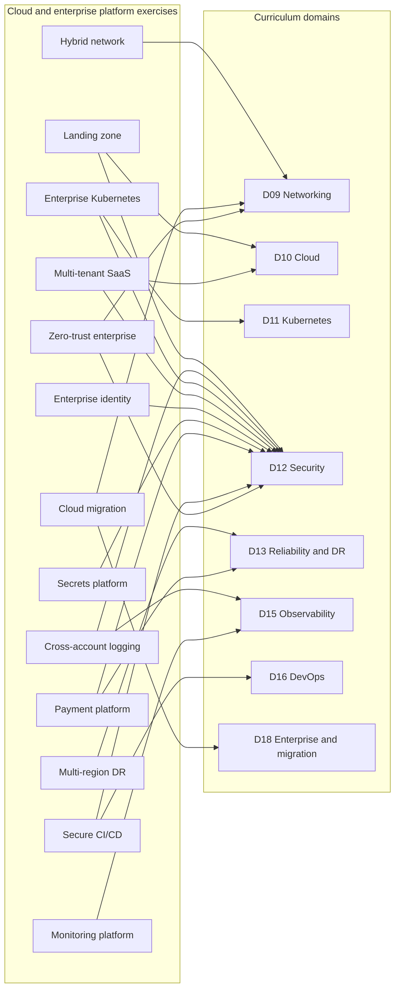

# Cloud and enterprise platform exercises

> Application exercises ask "how do I build this service?". Platform exercises ask "what must exist so
> that fifty teams can build services safely?". The answers are accounts, networks, identities, pipelines,
> and guardrails, and the hard part is that every team lives with your choices for years.

!!! abstract "Page facts"
    **Level:** Mixed (each brief is Level 2; the full exercises are Level 3) · **Status:** Outline ·
    **Time:** 20 minutes to read; 60-90 minutes per full exercise · **Last verified:** 2026-11-21

## How to use these exercises

Work every exercise with the [twelve-step design method](design-method.md). Platform designs reward three
habits more than application designs do:

- **Name the tenants of the platform.** A landing zone, a Kubernetes platform, or a secrets service has
  internal customers (product teams, auditors, the security team). Write their needs down before drawing
  anything; most platform failures are platforms nobody wanted to use.
- **Design the paved road and the escape hatch together.** Say what the default, self-service path is, and
  what a team does when the default does not fit. A platform with no escape hatch gets bypassed; one with no
  default gets ignored.
- **Do the arithmetic.** The scale figures in each brief are labelled assumptions. Several of these
  platforms are dominated by one number (log volume, active metric series, rotations per day); find it
  before choosing technology.
- **Full exercises** have a problem statement, requirements, scale arithmetic, hints, a reference solution,
  alternatives, failure modes, and a rubric. Two exist today:
  [multi-account landing zone](multi-account-landing-zone.md) and
  [zero-trust enterprise](zero-trust-enterprise.md). The others are briefs only; pages marked with a
  D-identifier are planned and not yet written.

## Exercises

### Multi-account landing zone

- **Brief.** A SaaS scale-up, Kalvent Analytics, has outgrown a single cloud account. Design the account
  structure, identity federation, network baseline, logging, guardrails, and account vending it moves to,
  and the migration that gets it there without stopping product work.
- **Scale to assume.** See the full exercise; the drivers are onboarding speed and isolating customers'
  data.
- **Decisions that dominate.** (1) Account and organizational-unit structure: by environment, by team, or
  by tenant tier. (2) Preventive versus detective guardrails, and who may change them. (3) Network
  topology: hub-and-spoke with central egress, or independent networks per account.
- **Read first.** [Cloud building blocks and landing zones](../cloud-architecture/cloud-building-blocks-and-landing-zones.md);
  [Multi-account strategy and infrastructure automation](../cloud-architecture/multi-account-strategy-and-infrastructure-automation.md);
  [Identity and access management](../security-architecture/identity-and-access-management.md);
  [Case study 08](../end-to-end-case-studies/cs-08-multi-account-landing-zone-and-hub-and-spoke-network.md).
- **Status.** Full exercise: [Design a multi-account landing zone](multi-account-landing-zone.md).

### Centralized cross-account logging

- **Brief.** Collect audit logs, network flow logs, and DNS query logs from every AtlasMart account into
  one place that the security team can search and that no workload account can alter or delete. Logs must
  survive the compromise of any single account, including an administrator in it.
- **Scale to assume.** 29 accounts; 300 GB of logs per day across all of them (assumption); 1-year
  retention, so 300 GB × 365 ≈ 110 TB stored; the last 30 days searchable quickly, so 300 GB × 30 = 9 TB
  hot.
- **Decisions that dominate.** (1) Push from accounts versus pull by the log account, and where the
  delivery credentials live. (2) Immutability: object locks, separate account ownership, and who can shorten
  retention. (3) Hot versus cold tiers: what is indexed for search and what is only archived.
- **Read first.** [Security operations](../security-architecture/security-operations.md);
  [Cloud building blocks and landing zones](../cloud-architecture/cloud-building-blocks-and-landing-zones.md);
  [Data security and privacy](../security-architecture/data-security-and-privacy.md) (logs contain personal
  data too); planned: observability fundamentals (D15-T01).
- **Status.** Brief only, full exercise planned.

### Multi-region disaster recovery

- **Brief.** AtlasMart's whole retail platform (catalogue, checkout, payments, order management, tracking)
  runs in one region. Design recovery from the loss of that region, with different targets for different
  services, and a plan that is tested rather than hoped for.
- **Scale to assume.** 40 services in three recovery tiers (assumption): tier 1 (checkout, payments,
  tracking) RPO 5 minutes and RTO 1 hour, matching NFR-7; tier 2 RPO 1 hour and RTO 4 hours; tier 3 restore
  from backup within 24 hours. Tracking alone holds about 430 GB of events.
- **Decisions that dominate.** (1) Strategy per tier: backup and restore, pilot light, warm standby, or
  active-active. (2) Data replication across regions, and what customers see for orders in flight at the
  moment of failure. (3) Failover authority: automated, or a human decision with a runbook, and how failback
  works.
- **Read first.** [High availability design](../reliability-and-disaster-recovery/high-availability-design.md);
  [SLAs, SLOs, SLIs, error budgets, and recovery objectives](../architecture-fundamentals/slas-slos-slis-error-budgets-and-recovery-objectives.md);
  [Scaling, partitioning, and replication](../distributed-systems/scaling-partitioning-and-replication.md);
  planned: disaster recovery strategies (D13-T03), case study 10 (multi-region DR).
- **Status.** Brief only, full exercise planned. The single-service version is the
  [multi-region application](infrastructure-component-exercises.md#multi-region-application) brief.

### Hybrid cloud network

- **Brief.** Connect AtlasMart's corporate office and its distribution-centre data centre to the cloud hub,
  so the warehouse system can call cloud services privately and keep working when one link fails.
- **Scale to assume.** Office `192.168.0.0/16` and distribution centre `172.16.0.0/16` (assumptions from
  the address plan); cloud hub `10.0.0.0/16` with prod, staging, and dev spokes; a dedicated private link to
  the distribution centre with a site-to-site VPN as backup.
- **Decisions that dominate.** (1) Routing: which prefixes each side advertises, summarization, and how the
  dedicated link is preferred over the VPN. (2) Hybrid DNS: who resolves `internal.atlasmart.example` from
  on premises, and on-premises names from the cloud. (3) Failure behaviour: what breaks, and for how long,
  when the dedicated link drops.
- **Read first.** [Networking fundamentals](../networking/networking-fundamentals-ip-cidr-routing-and-dns.md);
  [Hybrid connectivity and VPNs](../networking/hybrid-connectivity-and-vpns.md);
  [Network security, load balancing, and traffic flow](../networking/network-security-load-balancing-and-traffic-flow.md);
  planned: case study 09 (hybrid migration with private connectivity).
- **Status.** Brief only, full exercise planned.

### Secure enterprise Kubernetes

- **Brief.** Design the shared Kubernetes platform that AtlasMart's product teams deploy to: cluster
  topology, tenancy between teams, admission policy, secrets, ingress and egress, upgrades, and what a team
  gets on day one.
- **Scale to assume.** Three clusters (dev, staging, prod) in the platform team's accounts; nine teams
  sharing them through namespaces; prod at 6 worker nodes of 4 vCPU, autoscaling to 18; Order Tracking's
  requests reach 13.35 vCPU at maximum replicas (from the compute sizing page).
- **Decisions that dominate.** (1) Shared clusters with namespaces versus a cluster per team. (2) What
  admission policy enforces (signed images, Pod Security profile, resource requests) and how exceptions are
  granted. (3) Upgrade strategy: in place, or blue-green clusters.
- **Read first.** [Kubernetes architecture and workloads](../containers-and-kubernetes/kubernetes-architecture-and-workloads.md);
  [Kubernetes networking, storage, and service mesh](../containers-and-kubernetes/kubernetes-networking-storage-and-service-mesh.md);
  [Cloud-native ecosystem tools](../containers-and-kubernetes/cloud-native-ecosystem-tools.md);
  [Infrastructure and supply-chain security](../security-architecture/infrastructure-and-supply-chain-security.md);
  [Lab 12](../labs/lab-12-local-kubernetes-deployment.md); planned: case study 11 (enterprise Kubernetes
  with GitOps).
- **Status.** Brief only, full exercise planned.

### Multi-tenant SaaS

- **Brief.** Kalvent Analytics sells a reporting product to businesses. Design tenant isolation for
  compute, data, and identity, so that one tenant's heavy report cannot slow others and one tenant can never
  read another's data, while keeping the cost per small tenant low.
- **Scale to assume.** 2,000 tenants; the largest 1% (20 tenants) produce 40% of the load; a few tenants
  require their data in a specific region (assumptions).
- **Decisions that dominate.** (1) Isolation model: pooled, bridged (shared compute, separate data), or
  silo per tenant, possibly by tier. (2) How tenant identity flows from sign-in to every query and log line.
  (3) Noisy-neighbour controls: quotas, per-tenant queues, and when a tenant moves to its own tier.
- **Read first.** [Multi-account strategy and infrastructure automation](../cloud-architecture/multi-account-strategy-and-infrastructure-automation.md);
  [Identity and access management](../security-architecture/identity-and-access-management.md);
  [Data security and privacy](../security-architecture/data-security-and-privacy.md);
  [Rate limiter exercise](rate-limiter.md); planned: case study 03 (multi-tenant SaaS).
- **Status.** Brief only, full exercise planned.

### Enterprise identity

- **Brief.** Design workforce identity for AtlasMart: one identity provider, single sign-on into every
  cloud account and SaaS tool, MFA that resists phishing, joiner-mover-leaver automation, privileged access,
  and access reviews.
- **Scale to assume.** 3,000 employees and 500 contractors, so 3,500 identities; 120 SaaS applications; 40
  joiners and 40 leavers a week; a leaver's access revoked everywhere within 1 hour (assumptions).
- **Decisions that dominate.** (1) Source of truth for people (the HR system) and how changes flow to the
  identity provider and onward. (2) Standing versus just-in-time privileged access. (3) Contractors:
  separate directory or same directory with different policies.
- **Read first.** [Identity and access management](../security-architecture/identity-and-access-management.md);
  [Security principles and threat modeling](../security-architecture/security-principles-and-threat-modeling.md);
  [Zero-trust enterprise exercise](zero-trust-enterprise.md).
- **Status.** Brief only, full exercise planned.

### Secrets platform

- **Brief.** Replace secrets scattered across configuration files and pipeline variables with a platform
  that issues, rotates, and audits secrets for every AtlasMart workload, and removes static credentials
  wherever workload identity can replace them.
- **Scale to assume.** About 60 services × 3 environments = 180 workloads with 5 secrets each on average,
  so 900 secrets; rotating every 90 days gives 900 ÷ 90 = 10 rotations a day (assumptions).
- **Decisions that dominate.** (1) Which secrets disappear (replaced by workload identity) and which
  remain. (2) Delivery to workloads: injected at start, mounted files, or fetched at runtime, and what
  happens when the secrets service is down. (3) Rotation without outages: dual-secret overlap windows.
- **Read first.** [Data security and privacy](../security-architecture/data-security-and-privacy.md);
  [Identity and access management](../security-architecture/identity-and-access-management.md);
  [Cloud-native ecosystem tools](../containers-and-kubernetes/cloud-native-ecosystem-tools.md) (External
  Secrets Operator, Secrets Store CSI Driver).
- **Status.** Brief only, full exercise planned.

### Cloud migration

- **Brief.** A portfolio of on-premises applications must move to the cloud over two years. Classify each
  application, plan migration waves, and design the cutover, validation, and rollback for one critical
  application.
- **Scale to assume.** 120 applications; waves of 10 to 15 applications, so 120 ÷ 15 = 8 to 120 ÷ 10 = 12
  waves; one critical warehouse system that can be down for at most 2 hours during cutover (assumptions).
- **Decisions that dominate.** (1) The strategy per application (rehost, replatform, refactor, repurchase,
  retain, retire, relocate) and the evidence behind it. (2) Wave order: dependencies, risk, and early
  learning. (3) Data migration and cutover: bulk copy plus change capture, parallel run, and the rollback
  point.
- **Read first.** [As-Is and To-Be architecture, gap analysis, and build vs buy](../architecture-fundamentals/as-is-and-to-be-architecture-gap-analysis-and-build-vs-buy.md);
  [Hybrid connectivity and VPNs](../networking/hybrid-connectivity-and-vpns.md);
  planned: legacy modernization and migration (D18-T03), case study 09.
- **Status.** Brief only, full exercise planned.

### Monitoring platform

- **Brief.** Design the metrics, logs, and traces platform all AtlasMart teams use: collection, storage,
  dashboards, alerting, and cost control, with each team owning its own alerts.
- **Scale to assume.** 1,500 instances (from the configuration-service brief) × 500 active series each =
  750,000 active series; a 30 s scrape interval gives 750,000 ÷ 30 = 25,000 samples per second
  (assumptions).
- **Decisions that dominate.** (1) Cardinality control: which labels are allowed and who pays for a new
  one. (2) Build versus buy for storage and query. (3) Alert routing and ownership: symptoms on SLOs versus
  causes on resources.
- **Read first.** [SLAs, SLOs, SLIs, error budgets, and recovery objectives](../architecture-fundamentals/slas-slos-slis-error-budgets-and-recovery-objectives.md);
  [Cloud-native ecosystem tools](../containers-and-kubernetes/cloud-native-ecosystem-tools.md)
  (OpenTelemetry, Prometheus, Grafana); planned: observability fundamentals (D15-T01), monitoring and
  alerting (D15-T02).
- **Status.** Brief only, full exercise planned.

### Payment platform

- **Brief.** Design AtlasMart's payment platform: authorization at checkout, capture at dispatch, refunds,
  and reconciliation with the payment service provider, with card data kept out of AtlasMart's systems.
- **Scale to assume.** 60,000 orders a day, so 60,000 ÷ 86,400 ≈ 0.7 payments per second on average;
  design peak 30 per second on sale days (assumption); every payment charged at most once even when
  requests are retried.
- **Decisions that dominate.** (1) Tokenization and hosted payment pages to narrow PCI DSS scope. (2)
  Idempotency keys and the payment state machine (authorized, captured, refunded, failed). (3)
  Reconciliation: how mismatches between AtlasMart's ledger and the provider's settlement file are found and
  resolved.
- **Read first.** [Transactions, sagas, and delivery guarantees](../distributed-systems/transactions-sagas-and-delivery-guarantees.md);
  [Lab 04: idempotency](../labs/lab-04-idempotency-and-duplicates.md);
  [Compliance and regulatory frameworks](../security-architecture/compliance-and-regulatory-frameworks.md);
  planned: case study 05 (payment and order workflow).
- **Status.** Brief only, full exercise planned.

### Secure CI/CD

- **Brief.** Design the build and release pipeline for all AtlasMart services so that what runs in
  production is provably what was reviewed and built, with no long-lived deployment credentials.
- **Scale to assume.** Nine teams; 200 builds a day; deployments to three environments; a target of SLSA
  Build Level 3 for production services (assumptions).
- **Decisions that dominate.** (1) Build isolation and provenance: hosted, ephemeral builders and signed
  attestations. (2) Deployment identity: short-lived federated credentials instead of stored keys, scoped
  per environment. (3) Promotion and policy: the same artifact digest promoted through environments, and
  admission checks that refuse anything else.
- **Read first.** [Infrastructure and supply-chain security](../security-architecture/infrastructure-and-supply-chain-security.md);
  [Containers and images](../containers-and-kubernetes/containers-and-images.md);
  [Lab 15](../labs/lab-15-infrastructure-module-and-static-checks.md); planned: CI/CD pipeline design
  (D16-T02), DevSecOps (D16-T04).
- **Status.** Brief only, full exercise planned.

### Zero-trust enterprise

- **Brief.** An engineering consultancy, Pellora Engineering, has hybrid work, contractors on unmanaged
  devices, and a VPN that gives everyone the whole network. Design access to its applications and files that
  checks user, device, and context on every request.
- **Scale to assume.** See the full exercise.
- **Decisions that dominate.** (1) Where policy is decided and enforced (identity-aware proxy, application,
  or both). (2) Device trust for managed and unmanaged devices. (3) The migration path off the VPN, and what
  stays on it longest.
- **Read first.** [Security principles and threat modeling](../security-architecture/security-principles-and-threat-modeling.md);
  [Network security architecture](../security-architecture/network-security-architecture.md);
  [Identity and access management](../security-architecture/identity-and-access-management.md);
  [Case study 15](../end-to-end-case-studies/cs-15-zero-trust-application-architecture.md).
- **Status.** Full exercise: [Design a zero-trust enterprise](zero-trust-enterprise.md).

## How the exercises map to the curriculum

**Figure 1 — Which domains each platform exercise practises.** Each arrow points from an exercise to a
domain whose ideas it exercises most heavily.

How to read it: security (D12) receives arrows from almost every exercise, which is the point of this
group: on a platform, security is not a separate box but a property of accounts, networks, identities, and
pipelines.

| Exercise | Main domains | Secondary domains |
|---|---|---|
| Multi-account landing zone | D10 Cloud, D12 Security | D09 Networking, D17 FinOps |
| Centralized cross-account logging | D12 Security, D15 Observability | D10 Cloud, D17 FinOps (storage cost) |
| Multi-region disaster recovery | D13 Reliability and DR | D04 Distributed systems, D17 FinOps |
| Hybrid cloud network | D09 Networking | D18 Hybrid cloud |
| Secure enterprise Kubernetes | D11 Kubernetes, D12 Security | D16 Platform engineering |
| Multi-tenant SaaS | D10 Cloud, D12 Security | D06 Databases, D17 FinOps |
| Enterprise identity | D12 Security | D18 Enterprise architecture |
| Secrets platform | D12 Security | D11 Kubernetes, D16 DevOps |
| Cloud migration | D18 Enterprise and migration, D09 Networking | D06 Databases, D13 Reliability |
| Monitoring platform | D15 Observability | D17 FinOps (cardinality cost) |
| Payment platform | D12 Security, D13 Reliability | D04 Distributed systems, D05 Integration |
| Secure CI/CD | D16 DevOps, D12 Security | D11 Kubernetes |
| Zero-trust enterprise | D12 Security, D09 Networking | D18 Enterprise architecture |

## Review notes

- Canonical page for D29-T04, status Outline: every inventory item has a brief, a stated scale, three
  dominating decisions, reading, and a status. Full exercises exist for the multi-account landing zone and
  the zero-trust enterprise; the other eleven are briefs only.
- Collection pages have no knowledge check and no references table by design; sources live on the full
  exercise pages and the topic pages they link.
- The master prompt names the first item "AWS multi-account landing zone"; the brief is vendor-neutral and
  the full exercise uses AWS services in its reference solution.
- New assumptions introduced in the briefs: 300 GB of logs per day and a 30-day hot window (logging); 40
  services in three recovery tiers with tier 2 at RPO 1 h / RTO 4 h and tier 3 at 24 h (DR); 2,000 tenants
  with the top 1% producing 40% of load (SaaS); 3,000 employees, 500 contractors, 120 SaaS apps, 40 joiners
  and 40 leavers a week, 1-hour revocation (identity); 60 services and 5 secrets each with 90-day rotation
  (secrets); 120 applications in waves of 10 to 15 and a 2-hour cutover window (migration); 500 active
  series per instance and a 30 s scrape interval (monitoring); a 30 per second payment design peak
  (payments); 200 builds a day and a SLSA Build Level 3 target (CI/CD). Other figures come from the address
  plan, the compute sizing page, NFR-7, and the configuration-service brief.
- Figure 1 uses two subgraphs in a `flowchart LR` like the other collection pages; check it renders legibly
  at phone width.
