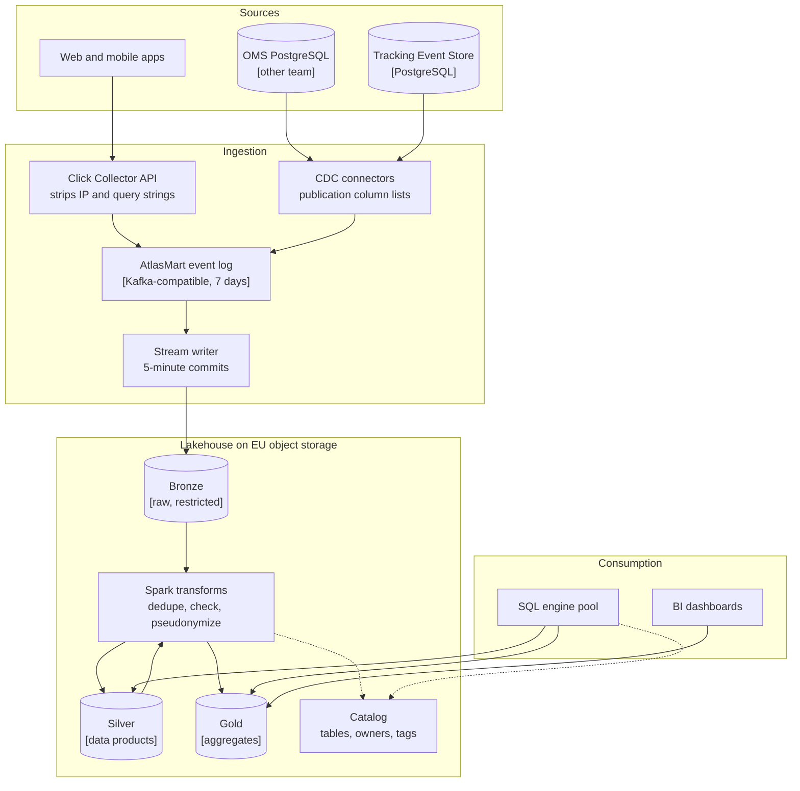
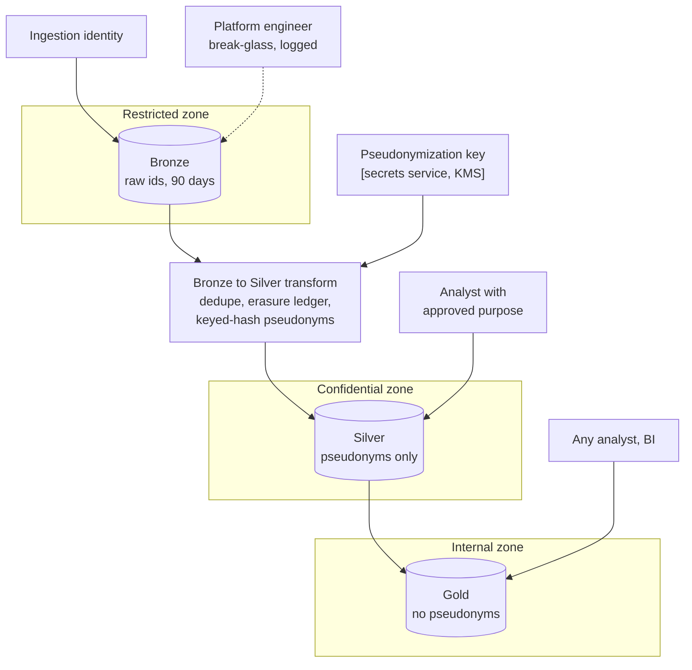
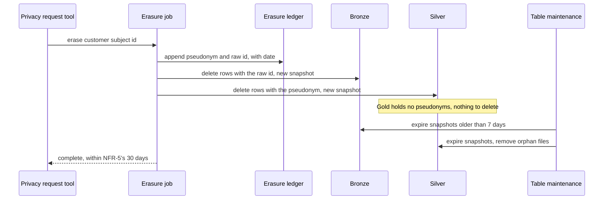
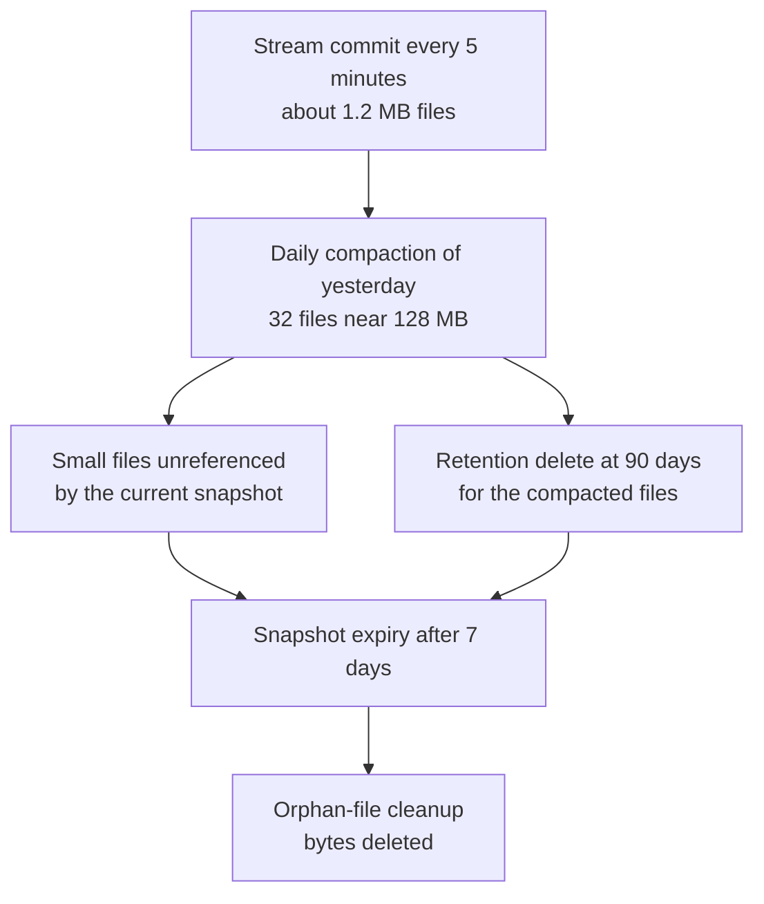

# Exercise: design an analytics data lake

> A data lake is easy to start: point every source at a bucket. The design work is everything that
> stops the bucket turning into a swamp: tables that can be updated and deleted safely, a layer
> where personal data is reduced before most people can see it, a catalog that says who owns each
> table, and housekeeping that keeps millions of tiny files and runaway queries from eating the
> budget.

!!! abstract "Page facts"
    **Level:** Advanced · **Status:** Draft · **Time:** 75-90 minutes (50 minutes to attempt, the
    rest to compare) · **Last verified:** 2026-11-27

## Problem statement

AtlasMart (fictional) is an online retailer: 2,000,000 registered customers, 400,000 daily active
users, 60,000 orders a day, one EU cloud region with three zones, and the constraint that EU
customer data stays in the EU (C-4). Its analysts today query a read replica of the Order
Management System (OMS), a 12-year-old PostgreSQL monolith owned by another team, and export
spreadsheets. Website and app click data is thrown away after a week by a third-party tag tool. A
nightly batch builds delivery-performance aggregates for the carrier meeting.

The Chief Data Officer wants one analytics platform: clickstream, orders, and tracking events in
one place, queryable with SQL by about 40 analysts and data scientists, feeding the trading
dashboards every morning, and ready for the recommendation work planned next year. The privacy
team's conditions are blunt: no delivery addresses in the platform, customer identifiers reduced
before analysts see them, every table with an owner and a retention period, and erasure requests
honoured everywhere, not just in the OMS.

Design the platform: ingestion, storage layers, table format, transformations, catalog, access
control, retention and erasure, operations, and cost. A small central data platform team (4
engineers) will run it; product teams own their source data.

## How to use this exercise

1. **Attempt first.** Read the problem statement, requirements, and scale assumptions only.
2. **Time box.** 50 minutes, following the twelve steps of the [design method](design-method.md).
   Produce at least a volume and storage estimate per layer, a container diagram, a table of
   layers (contents, retention, readers), the point where identifiers are pseudonymized, a
   small-files plan with arithmetic, an erasure path, and a cost line per workload.
3. **Use the hints only when stuck,** one at a time; each is stronger than the last.
4. **Then compare** with the reference solution and score yourself against the rubric. A different
   layer split or table format with stated reasons is a strong answer; a lake with no retention
   or ownership is not.

## Requirements

### Functional requirements

1. **FR-1 Ingest.** Land three sources: clickstream from the web and mobile apps, changes from the
   OMS database (orders, order lines, payments status, products), and tracking events from the
   Order Tracking System.
2. **FR-2 Query.** Analysts and data scientists query cleaned data with SQL; BI dashboards read
   business aggregates.
3. **FR-3 Data products.** Each source team publishes documented, owned tables (schema, meaning,
   freshness, quality checks, classification) in a catalog that analysts search.
4. **FR-4 Rebuild.** Any cleaned or aggregate table can be rebuilt from raw data still held, and
   the last 7 days of any table can be queried as it was (time travel, for audits and bad loads).
5. **FR-5 Erasure.** A valid erasure request removes the customer's rows from every layer.
6. **FR-6 Delivery performance.** The existing nightly delivery-performance aggregates move onto
   the platform without missing their 16:00 deadline.

### Non-functional requirements

| ID | Requirement | Target |
|---|---|---|
| NFR-1 | Freshness (assumption) | Raw data queryable within 15 minutes of the event; cleaned data within 1 hour; daily aggregates by 07:00 |
| NFR-2 | Residency | Every copy, backup, extract, and BI cache stays in the EU (C-4) |
| NFR-3 | Privacy | No delivery addresses, names, emails, phone numbers, or full IP addresses anywhere in the platform; customer identifiers pseudonymized before the cleaned layer |
| NFR-4 | Retention | Raw clickstream 90 days; aggregates 25 months; tracking data deleted 180 days after delivery (as in the source); every table has a stated period |
| NFR-5 | Erasure (assumption) | Completed in every layer within 30 days of a valid request; the legal deadline depends on jurisdiction, so ask counsel |
| NFR-6 | Correctness (assumption) | Daily order and order-line counts match the OMS exactly; clickstream duplicates removed by event id |
| NFR-7 | Cost (assumption) | Platform compute at most 10,000 CU a month, shown back per consuming team |
| NFR-8 | Isolation (assumption) | Ad hoc queries can never delay the scheduled 07:00 and 16:00 builds |

### Clarifying questions a good candidate asks

- Does anything need sub-second or per-second dashboards? (Here: no. Live sale-day dashboards are
  the [real-time analytics exercise](real-time-analytics.md); this platform is minutes to hours.)
- Who may ever see a real customer id? (Here: nobody through the platform. Customer service uses
  the OMS. Re-identification for an approved purpose goes through a separate, logged process.)
- Is the OMS team willing to change its database? (Here: it will create a publication for logical
  replication and accept a monitored replication slot, nothing more. The
  [CDC pipeline exercise](cdc-pipeline.md) designs that link in depth.)
- How long must order history be kept for analytics? (Here: Finance asks for 7 years of order
  facts; plan storage for that and confirm the period with counsel.)
- Are the clickstream events already structured? (Here: JSON with a schema per event type, sent by a
  first-party collector; about 30 fields per event.)
- Is there a preferred engine or vendor? (Here: managed Spark for batch, a SQL engine for
  interactive queries, a BI tool; open formats preferred so engines can change.)

## Scale assumptions

### Stated assumptions

Values from earlier pages are cited; new ones are **exercise assumptions**.

| Id | Assumption | Value |
|---|---|---|
| A1 | Clickstream events (Phase 5 assumption) | 400,000 DAU × 40 events = 16,000,000 a day, 1 KB each, peak 4× average |
| A2 | OMS change events per order (assumption) | 10: 1 order insert, 3 order-line inserts, 6 status updates; 1 KB each with before and after images |
| A3 | Order lines (Phase 5 assumption) | 60,000 × 3 = 180,000 a day; 300 B per row in the cleaned layer (assumption) |
| A4 | Tracking events (existing) | 480,000 a day × 500 B |
| A5 | Columnar compressed size relative to raw JSON (assumption; measure on a sample) | 25% |
| A6 | Retention (Phase 5 and existing, plus assumptions) | Bronze 90 days for all sources; Silver clickstream 13 months (assumption); Silver orders 7 years (assumption); tracking 180 days after delivery; Gold 25 months |
| A7 | Bronze writer tasks reading the clickstream topic (assumption; the topic itself has 24 partitions, from the event streaming page) | 12 |
| A8 | Transform throughput (illustrative; measure) | 2 GB of raw input per vCPU-hour for parse, clean, deduplicate, pseudonymize |
| A9 | Target data file size after compaction (assumption) | 128 MB |
| A10 | Active products (assumption) | 50,000 |
| A11 | Interactive SQL pool (assumption) | 16 vCPU, 10 hours a day, 22 working days a month |
| A12 | Existing delivery-performance batch ([sustainability page](../finops-and-sustainability/sustainable-and-carbon-aware-architecture.md)) | 16 vCPU × 4 h = 64 vCPU-hours a night, due by 16:00 |
| A13 | Cost rate (illustrative) | 1 vCPU-hour = 1 CU |

### The estimate

- **Clickstream rate:** 16,000,000 ÷ 86,400 ≈ **185 events/s** on average; × 4 ≈ **740/s** at
  peak; 740 × 1 KB ≈ 740 KB/s ≈ **5.9 Mbit/s**. Ingest bandwidth is not the problem.
- **Raw volume per day:** clickstream 16,000,000 × 1 KB = **16 GB**; OMS 60,000 × 10 = 600,000
  changes × 1 KB = **0.6 GB**; tracking 480,000 × 500 B = **0.24 GB**. Total ≈ **16.84 GB a day**,
  of which clickstream is 16 ÷ 16.84 ≈ **95%**.
- **Bronze (90 days):** 16.84 × 90 ≈ 1,516 GB raw; × 25% ≈ **380 GB** stored.
- **Silver clickstream (13 months ≈ 395 days):** 16 × 395 = 6,320 GB raw; × 25% ≈ **1.6 TB**.
- **Silver orders (7 years):** 180,000 × 365 × 7 ≈ **460 million order lines** × 300 B ≈ 138 GB raw;
  × 25% ≈ **35 GB**. Seven years of orders are 2% of 13 months of clicks.
- **Silver tracking (about 180 days held):** 480,000 × 180 = 86,400,000 events × 500 B ≈ 43 GB
  raw; × 25% ≈ **11 GB**.
- **Gold (25 months ≈ 760 days):** sales per product per day, 50,000 × 760 × 100 B (assumption) ≈
  **3.8 GB**; with funnels and carrier aggregates, tens of GB at most.
- **Total:** 380 + 1,580 + 35 + 11 + about 10 ≈ **2 TB** of table data, plus the files that old
  snapshots keep alive for 7 days of time travel.
- **Files, naive:** a streaming writer with 12 tasks committing every 60 s makes 1,440 × 12 =
  **17,280 files a day**; compressed clickstream is 16 GB × 25% = 4 GB a day, so the average file
  is 4,000 MB ÷ 17,280 ≈ **231 KB**, and 90 days of Bronze clickstream hold about **1.56 million
  files**.
- **Files, designed:** commit every 5 minutes: 288 × 12 = 3,456 files a day of about 1.2 MB, then
  compact daily to 128 MB: 4,000 ÷ 128 ≈ **32 files a day**, 108 times fewer.
- **Batch compute per day:** clickstream to Silver 16 GB ÷ 2 = 8 vCPU-hours; hourly CDC merges
  24 × 0.25 (assumed fixed overhead per run dominates the tiny volume) = 6; compaction 2
  (assumption); Gold builds 32 (assumption); delivery-performance batch 64 (A12). Total **112
  vCPU-hours a day**.
- **Query scan, worst versus designed:** a question asked of raw Bronze clickstream over 90 days
  reads up to 16 × 90 × 25% = 360 GB; the same question on Silver, one day's partition (1,580 GB ÷
  395 ≈ 4 GB) and 3 of 30 columns, reads roughly 0.4 GB, about **900 times less**.

## Hints

??? question "Hint 1: where is the volume, and where is the risk?"
    Rank the three sources by bytes and by sensitivity. Are they the same ranking? Which source
    dominates storage and file counts, and which one can carry a delivery address into the platform
    if nobody stops it at the source?

??? question "Hint 2: what does a table need that a folder of files does not?"
    List the operations the requirements imply: append every few minutes, upsert changes from the
    OMS, delete one customer's rows, add a column, read last Tuesday's version, let two jobs write at
    once. Which of these can a folder of Parquet files do safely? What does an open table format add,
    and what housekeeping does it then require?

??? question "Hint 3: the shape of a good answer"
    Clickstream and CDC land through the event log into a restricted Bronze layer; a transform
    deduplicates, validates, applies the erasure ledger, and pseudonymizes identifiers with a keyed
    hash into Silver data products owned by source teams; Gold holds non-personal business
    aggregates. All three layers are open-table-format tables registered in one catalog with owner,
    classification, and retention; access is by layer and by column tag; compaction, snapshot
    expiry, and retention deletes run as scheduled jobs; ad hoc SQL runs in its own pool with scan
    limits.

## Reference solution

### The twelve steps, briefly

| Step | Decision |
|---|---|
| 1 Problem | One governed analytics platform for clicks, orders, and tracking, trusted by analysts and acceptable to the privacy team |
| 2 Requirements | FR-1 to FR-6; NFR-3 (privacy), NFR-4 (retention), and NFR-5 (erasure) shape the layers more than volume does |
| 3 Estimate | 16.84 GB raw a day, 95% clickstream; about 2 TB stored; 32 instead of 17,280 files a day; 112 vCPU-hours of batch a day |
| 4 Boundaries | Source teams own data products; the platform team owns ingestion, storage, catalog, and housekeeping; the OMS team owns its publication |
| 5 Contracts | Event schemas per clickstream type with compatibility checks; a CDC publication with an explicit column list; a data-product contract per Silver table |
| 6 Data | Bronze, Silver, Gold as open-table-format tables on EU object storage, partitioned by event date |
| 7 Style | Lakehouse with medallion layers; streaming into Bronze, batch from Bronze onward |
| 8 Deployment | One EU region; object storage, managed Spark, a SQL engine pool, the managed event log, a catalog service, a BI tool configured for EU processing |
| 9 Security | Bronze restricted; keyed-hash pseudonymization before Silver; tag-based column masking; no delivery addresses at source |
| 10 Resilience | Bronze replay rebuilds Silver and Gold; time travel undoes bad loads; event log retention of 7 days covers a stalled writer |
| 11 Operations | Freshness and quality checks per data product; compaction, snapshot expiry, orphan cleanup, retention deletes; query cost showback |
| 12 Decisions | ADR-sized choices in the alternatives table; about 8,340 CU a month of compute |

### Containers

**Figure 1 — Container diagram for the AtlasMart analytics platform.** C4-style container view;
cylinders are data stores; the OMS is owned by another team.

How to read it: data moves top to bottom from sources to consumers; the transform box appears
twice in the flow because Spark reads Bronze to write Silver and reads Silver to write Gold. Dotted
arrows are metadata calls: every engine finds tables, and commits new versions of them, through the
catalog. Nothing reads the OMS directly any more.

### Layers

| Layer | Contents | Format and partitioning | Retention | Readers |
|---|---|---|---|---|
| Bronze | Events and change records exactly as received, plus ingestion metadata (offset, arrival time) | Open table format; raw payload column; partitioned by arrival date | 90 days, all sources | Ingestion and transform identities; platform engineers by logged break-glass only |
| Silver | Deduplicated, validated, typed, conformed tables; customer ids replaced by pseudonyms; one data product per source domain (sessions and page views, orders and order lines, shipments and tracking events) | Open table format; partitioned by event date | Clickstream 13 months; orders 7 years; tracking 180 days after delivery | Analysts and data scientists by approved purpose; Confidential columns masked by tag |
| Gold | Non-personal business aggregates: daily sales per product, conversion funnels, delivery performance per carrier | Open table format; small; star schemas for BI | 25 months | All analysts, BI service |

The rule that makes the layers useful is that **each layer has a different promise**: Bronze
promises completeness (nothing received is lost, so anything can be rebuilt), Silver promises
correctness and documented meaning, Gold promises stable business definitions. See
[Warehouses, lakes, lakehouses, and data mesh](../data-engineering-and-analytics/warehouses-lakes-lakehouses-and-data-mesh.md)
for the pattern in general.

### Why an open table format

A folder of Parquet files on object storage can be appended to and read, but the requirements ask
for more: hourly upserts of OMS changes (FR-1), row deletes for erasure (FR-5), new columns as
events evolve, reading a table as of last week (FR-4), and a stream writer and a compaction job
writing the same table. An open table format (Apache Iceberg, Delta Lake, or Apache Hudi) adds a
metadata layer over immutable data files: every commit writes new files and a new snapshot that
lists the files making up the table, and the catalog swaps a pointer to that snapshot atomically.
Readers see one snapshot or the next, never half a write; old snapshots give time travel; deletes
are recorded as new files plus new snapshots, so the old bytes physically remain until snapshots
are expired. That last point is the one that matters for privacy (see erasure below).

The reference does not depend on which of the three formats is used; choose by which engines and
catalogs the platform runs, and check each engine's current support for row-level deletes and
schema evolution in the format's documentation. Mechanics are on
[Big data processing engines and table formats](../data-engineering-and-analytics/big-data-processing-engines-and-table-formats.md).

### Ingestion

- **Clickstream.** The first-party Click Collector API validates each event against its schema,
  reduces the IP address to a country and region and drops it, strips URL query strings except an
  allowlist of campaign parameters, and publishes to a clickstream topic keyed by session id. The
  stream writer commits to Bronze every 5 minutes, so data is queryable within about 6 minutes
  (NFR-1). Schema changes are proposed by the app teams in the schema repository and checked for
  backward compatibility in CI before an app can send them.
- **OMS and tracking changes.** PostgreSQL logical replication from both databases into CDC
  topics, keyed by primary key, with each publication naming an **explicit column list** that
  excludes address and contact columns. Without a column list, columns added to a table later are
  replicated automatically, which is exactly how an address column would leak in. Bronze stores the
  change records; an hourly merge applies them in log order to Silver current-state and history
  tables. The replication slot, its lag, and the OMS disk it can fill are designed in the
  [CDC pipeline exercise](cdc-pipeline.md); here the requirement is an alert on slot lag that pages
  the platform team before it threatens the OMS.
- **Why the event log, not direct writes to storage.** It decouples the apps and databases from
  the lakehouse (a stalled writer loses nothing for 7 days), and the same topics later feed the
  [real-time analytics](real-time-analytics.md) path. See
  [Event streaming and log-based architecture](../messaging-and-streaming/event-streaming-and-log-based-architecture.md).

### Pseudonymization before Silver

Bronze holds what arrives: customer subject ids (already opaque ids from the identity provider,
never emails), anonymous device cookie ids, order ids. These are still personal data. The Bronze to
Silver transform replaces each identifier with a **keyed hash** (for example HMAC-SHA-256 of the id
with a secret key), so the same customer gets the same pseudonym in clicks and orders and analysts
can join them, but nobody without the key can compute the pseudonym for a known customer or reverse
it. The key lives in the secrets service behind the KMS; only the transform job's workload identity
can use it; rotating it would change every pseudonym, so rotation is a planned rebuild, not a
routine. Free-text fields (on-site search terms) pass a pattern-based redaction for email addresses
and phone numbers.

Pseudonymized data is still personal data under GDPR, so Silver stays classified Confidential with
need-to-know access; only Gold aggregates are designed to be non-personal (no pseudonyms, and no
published cell describing fewer than 10 customers, an assumption). The techniques are compared on
[Data security and privacy](../security-architecture/data-security-and-privacy.md).

**Figure 2 — Layers, trust boundaries, and who can read what.** The pseudonymization step is the
boundary between data few people can see and data many people can see.

How to read it: solid arrows into a store are writes or routine reads; the dotted arrow is an
exceptional, logged read. The key feeds only the transform, so a person who can read Silver cannot
recompute a pseudonym for a known customer.

### Catalog, data products, and access control

Two catalogs do different jobs. The **technical catalog** holds each table's current metadata
pointer and is where engines commit; it must be highly available because commits stop without it.
The **business catalog** holds what people search: owner team, description, column meanings,
classification tags per column, freshness objective, quality checks, retention, and allowed
purposes. Jobs emit lineage events (OpenLineage is an open standard for this) so the catalog can
answer "which dashboards use this column?" before a producer changes it.

A **data product contract** is required before a Silver table is published: schema, owner, freshness
objective, quality checks, classification, retention. The orders team, not the platform team, owns
the orders data product; the platform team owns the template, the checks runner, and the storage.
This is the light version of [data mesh](../data-engineering-and-analytics/warehouses-lakes-lakehouses-and-data-mesh.md)
that a 4-engineer platform team can support.

Access is granted by **role and tag**, not table by table: roles for ingestion, transforms (one
per domain, writing only its own Silver and Gold tables), analysts by purpose, and the BI service;
column tags (`confidential`, `pseudonym`, `free-text`) drive masking policies in the SQL engine, so
a new column tagged `pseudonym` is masked for general analysts on the day it appears. Every query
is logged with the person, the tables, and the bytes scanned.

### Retention and erasure

| Data | Period | Mechanism |
|---|---|---|
| Bronze, all sources | 90 days from arrival | Daily delete of partitions older than 90 days |
| Silver clickstream | 13 months | Daily partition delete by event date |
| Silver orders | 7 years (confirm with counsel) | Yearly partition delete |
| Silver tracking | 180 days after delivery | Daily row delete by shipment delivery date (partitions are by event date, so whole-partition drops do not fit) |
| Gold | 25 months | Monthly partition delete |
| Old snapshots | 7 days (FR-4) | Snapshot expiry, then orphan-file cleanup |

A delete in an open table format writes a new snapshot; the old data files remain reachable from
older snapshots until those expire and the files are removed. Retention and erasure are therefore
complete only after **snapshot expiry and file cleanup**, which here happen within 7 days.

**Figure 3 — Erasure across the layers.** The erasure ledger is what stops a rebuild from bringing
the customer back.

How to read it: the deletes take effect for queries at once, but the bytes disappear only when
maintenance expires the snapshots. Every Bronze to Silver run, including a full rebuild, filters
out ledger entries, so a replay of Bronze cannot resurrect an erased customer. The ledger is itself
personal data, stored in the restricted zone, holding only identifiers and dates.

### Small files and table maintenance

The estimate showed the trap: a 60-second commit interval yields 17,280 files a day averaging
231 KB. Each file costs a metadata entry, an object-store request per read, and planning time for
every query, so queries slow down and request charges rise even though the data is small. The
design attacks it three ways: commit every 5 minutes (enough for NFR-1), compact each closed day
into files near 128 MB (32 a day), and expire snapshots so the replaced small files can be deleted.

**Figure 4 — The life of a clickstream data file.** Every file passes through these states; a
platform that never runs the last three keeps every byte it ever wrote.

How to read it: compaction does not delete anything; it writes new large files and a snapshot
that no longer references the small ones. Bytes leave storage only after snapshot expiry and
cleanup, which is why erasure and retention depend on the same housekeeping.

Compaction and the stream writer commit to the same table, so they can conflict; the table format
resolves this with optimistic concurrency (one commit retries), and the design avoids most
conflicts by compacting only closed days that the writer no longer touches.

### Transformations and quality

Spark jobs run per data product: Bronze to Silver hourly (clickstream) and on each CDC merge;
Silver to Gold daily, finishing by 07:00 (NFR-1). Each job uses **write, audit, publish**: write the
new data to a staged snapshot or table, run the product's checks (row counts against the OMS for
orders, uniqueness of event ids, null rates, freshness), and publish only if they pass; a failing
check alerts the owning team and leaves yesterday's Gold in place. Late clickstream events (mobile
apps offline) land in their event-date partition, and Gold rebuilds the last 3 days each night
(assumption). The delivery-performance batch becomes a Gold job reading Silver tracking and orders,
keeping its 16:00 deadline and its carbon-aware window.

### Cost

Compute per month at 1 vCPU-hour = 1 CU (illustrative):

| Line | Arithmetic | CU per month |
|---|---|---|
| Daily batch (transforms, merges, compaction, Gold, delivery batch) | 112 × 30 | 3,360 |
| Stream writer and CDC connectors (assumption, 2 vCPU always on) | 2 × 730 | 1,460 |
| Interactive SQL pool (A11) | 16 × 10 × 22 | 3,520 |
| **Total** | | **8,340** |

That is 83% of NFR-7's 10,000 CU budget. The largest single line is people asking questions, and
the largest batch job is the inherited delivery-performance batch (64 of 112 vCPU-hours, 57%),
which once it reads 46 GB of compact Silver tables instead of the OMS is worth profiling. Storage
(about 2 TB plus snapshots) and object-store requests are priced with the provider's calculator;
the small-files plan matters for the request line. Showback by query tag gives each consuming team
its share of the SQL pool (see [Cloud cost models and FinOps](../finops-and-sustainability/cloud-cost-models-and-finops.md)).

## Alternatives and trade-offs

| Choice | Favor when | Avoid when |
|---|---|---|
| Lakehouse on an open table format (reference) | Several engines share one copy; row-level deletes and upserts are needed; raw clickstream must be cheap to keep | A small SQL-only team with modest structured data, where a managed warehouse is simpler to run |
| Managed cloud data warehouse only | Data is mostly structured; users are SQL-only; the team wants the least to operate | Data science and streaming need direct file access; storage format lock-in is a concern |
| Plain files on object storage, no table format | Append-only archives read by one engine | Upserts, deletes for erasure, concurrent writers, or time travel are required |
| Apache Iceberg, Delta Lake, or Apache Hudi | Chosen by the engines and catalogs you run and their documented feature support | Chosen from benchmark headlines rather than from engine support and operations |
| Keyed-hash pseudonyms (reference) | Stateless, deterministic joins at 740 events/s; no lookup service | Re-identification is routine, or keys must rotate often: use a token vault |
| Token vault with random pseudonyms | Deleting the mapping is part of erasure; re-identification is tightly controlled | The vault becomes a synchronous dependency of every transform |
| 5-minute streaming commits (reference) | Raw data needed within 15 minutes | Hourly freshness is enough: hourly batch loads from the event log make far fewer files |
| Central team builds every pipeline | Few sources and one consuming team | Nine product teams and 4 platform engineers: the central team becomes the queue |
| Star schemas in Gold (reference) | BI with shared dimensions (product, date, carrier) across many reports | A handful of fixed dashboards that a wide table serves more simply |

## Failure modes and how the design handles them

- **Small files.** Detect: files per partition and average file size per table; query planning
  time. Prevent: 5-minute commits, daily compaction of closed days, snapshot expiry and orphan
  cleanup as scheduled, monitored jobs with an owner.
- **Schema drift.** An app release renames a field or changes a type. Detect: collector schema
  validation, CI compatibility checks, Silver null-rate checks. Handle: Bronze keeps the raw
  payload so nothing is lost; additive changes flow through schema evolution; breaking changes fail
  the Silver check, alert the owning team, and are replayed from Bronze once mapped.
- **Personal data leaking into Bronze.** An email in a search term, a full IP in a header, or a new
  address column in the OMS. Detect: daily sampled scans of Bronze and Silver for email, phone, and
  address patterns; catalog alerts on new untagged columns. Prevent: collector stripping, explicit
  publication column lists, redaction before Silver. Handle: delete the affected rows, expire
  snapshots, record an incident with the privacy team.
- **Runaway queries.** A query over 90 days of raw Bronze clickstream (360 GB) or an accidental cross
  join. Detect: bytes scanned and runtime per query. Prevent: Bronze not readable by analysts;
  required partition filters on large Silver tables; per-query scan and runtime limits; the SQL pool
  separate from scheduled builds (NFR-8); showback that makes the cost visible to the team.
- **CDC slot growth.** The connector stops, the OMS keeps write-ahead log for the slot, and the
  OMS disk fills. Detect: slot lag alert. Handle: the CDC exercise's slot limits and runbook; the
  OMS's health wins over the platform's completeness, and a re-snapshot repairs the gap.
- **Erasure undone by a rebuild.** Detect: a test that rebuilds Silver for a sample day and checks
  ledger entries are absent. Prevent: the ledger filter in every Bronze to Silver run.
- **Duplicate and late events.** At-least-once delivery from the log and offline phones. Handle:
  deduplicate on event id in Silver; event-date partitions and a 3-day Gold rebuild window.
- **Catalog unavailable.** Commits stop, queries may fail to plan. Handle: writers retry with
  backoff, the event log buffers 7 days, and the catalog runs replicated across zones.
- **Residency drift.** A BI extract or a SaaS cache processed outside the EU. Prevent: BI tool
  configured for EU processing, extracts disabled by default, the region checked in the platform's
  policy as code (C-4).

## Evaluation rubric

| Area | Weak answer | Strong answer |
|---|---|---|
| Requirements | "Put everything in a bucket" | Asks about freshness, who may see identifiers, OMS change limits, retention, erasure |
| Estimation | No numbers, or orders treated as the volume | Per-source daily volume, 95% clickstream, storage per layer with retention and compression, file-count arithmetic |
| Layers | Bronze, Silver, Gold named but undefined | A different promise, retention, and reader set per layer, with the reason |
| Table format | "Parquet" | Explains snapshots, atomic commits, deletes, schema evolution, and the housekeeping they require |
| Privacy | Encryption at rest only | Stops addresses at the source, pseudonymizes before Silver with a protected key, keeps Gold non-personal, handles free text |
| Erasure and retention | Deletes from Silver only | Every layer, snapshot expiry, a ledger that survives rebuilds, stated periods per table |
| Governance | A wiki page of tables | Business catalog with owners, contracts, tags, lineage; tag-based masking; per-domain write roles |
| Operations | Not mentioned | Compaction, snapshot expiry, quality checks with write-audit-publish, freshness alerts, slot lag |
| Cost | Ignored | CU per workload, the SQL pool and inherited batch as drivers, query limits and showback |

## Extensions

1. **Real-time layer.** Sale-day dashboards need conversion rates within seconds. What reads the
   event log directly, and what stays in the lakehouse? Compare with the
   [real-time analytics exercise](real-time-analytics.md).
2. **Full data mesh.** All nine product teams publish their own Gold products. What does federated
   governance decide centrally, and what does the platform team stop doing?
3. **Disaster recovery.** Recover the platform in AtlasMart's second EU region. Is Bronze replay
   from a replicated event log enough, or must table snapshots be replicated, and what RPO does
   analytics actually need?
4. **Recommendation features.** Data scientists want per-customer features from Silver for the
   recommendation engine planned in Phase 6 (D19-T02, D20-T02). How do pseudonyms, erasure, and
   feature freshness carry over?
5. **Crypto-shredding.** Encrypt each customer's Silver rows under a per-customer key so erasure is
   one key deletion. What does 2,000,000 keys cost in operations, and what breaks for joins and
   aggregation?

## Related topics

- [The architecture design method](design-method.md) — the twelve steps used above.
- [Warehouses, lakes, lakehouses, and data mesh](../data-engineering-and-analytics/warehouses-lakes-lakehouses-and-data-mesh.md)
  — the medallion layers and data products in general.
- [Big data processing engines and table formats](../data-engineering-and-analytics/big-data-processing-engines-and-table-formats.md)
  — Spark, snapshots, compaction, and schema evolution.
- [Batch, streaming, ETL/ELT, and pipelines](../data-engineering-and-analytics/batch-streaming-etl-elt-and-pipelines.md)
  and [Data modeling, metadata, and data governance](../data-engineering-and-analytics/data-modeling-metadata-and-data-governance.md)
  — pipelines, quality checks, catalogs, lineage.
- [OLTP vs OLAP, dimensional modeling, and BI](../data-engineering-and-analytics/oltp-vs-olap-dimensional-modeling-and-bi.md)
  — the star schemas in Gold.
- [Data security and privacy](../security-architecture/data-security-and-privacy.md) —
  pseudonymization, retention, deletion ledgers.
- [CDC pipeline exercise](cdc-pipeline.md), [Real-time analytics exercise](real-time-analytics.md),
  and [Data platform exercises](data-platform-exercises.md) — the neighbouring exercises.
- [Case study 12: data lakehouse with batch and streaming ingestion](../end-to-end-case-studies/cs-12-data-lakehouse-with-batch-and-streaming-ingestion.md)
  — the same pattern for a different company.
- **Planned:** classical machine learning including recommendations (D19-T02); ML lifecycle and
  feature stores (D20-T02).

## References

| Source | Type | Checked |
|---|---|---|
| Michael Armbrust, Ali Ghodsi, Reynold Xin, and Matei Zaharia, [Lakehouse: A New Generation of Open Platforms that Unify Data Warehousing and Advanced Analytics](https://www.cidrdb.org/cidr2021/papers/cidr2021_paper17.pdf), CIDR 2021 | Paper (the lakehouse argument) | 2026-11-27 |
| Michael Armbrust et al., [Delta Lake: High-Performance ACID Table Storage over Cloud Object Stores](https://www.vldb.org/pvldb/vol13/p3411-armbrust.pdf), PVLDB 13(12), 2020 | Paper (transaction log over object storage, small-file and metadata problems) | 2026-11-27 |
| Apache Iceberg: [Table Spec](https://iceberg.apache.org/spec/), [Maintenance](https://iceberg.apache.org/docs/latest/maintenance/), and [Evolution](https://iceberg.apache.org/docs/latest/evolution/); [Delta Lake documentation](https://docs.delta.io/latest/delta-intro.html); [Apache Hudi overview](https://hudi.apache.org/docs/overview) | Official documentation (snapshots, snapshot expiry, compaction, orphan files, schema evolution) | 2026-11-27 |
| [Apache Parquet documentation](https://parquet.apache.org/docs/) — Apache Software Foundation | Official documentation (columnar file format) | 2026-11-27 |
| [Logical replication: Column Lists](https://www.postgresql.org/docs/current/logical-replication-col-lists.html) — PostgreSQL documentation | Official documentation (publishing only listed columns; later columns not added automatically) | 2026-11-27 |
| [What is the medallion lakehouse architecture?](https://learn.microsoft.com/en-us/azure/databricks/lakehouse/medallion) — Microsoft Learn (Azure Databricks) | Vendor documentation (Bronze, Silver, Gold layers) | 2026-11-27 |
| [Guidelines 01/2025 on Pseudonymisation](https://www.edpb.europa.eu/our-work-tools/documents/public-consultations/2025/guidelines-012025-pseudonymisation_en) — European Data Protection Board | Regulatory guidance (pseudonymised data remains personal data; keyed techniques) | 2026-11-27 |
| [About OpenLineage](https://openlineage.io/docs/) — OpenLineage project | Open standard documentation (lineage events from jobs) | 2026-11-27 |

## Review notes

- Full exercise for the D29-T03 "Data lake" item; H2s follow the URL shortener exemplar. Four
  Mermaid figures (containers, trust zones, erasure sequence, file lifecycle); check Figure 1 (four
  subgraphs, 14 nodes) at phone width.
- Phase 5 assumptions used as given: clickstream 16,000,000 events a day, 185/s, 740/s, 16 GB;
  180,000 order lines; event log with 7-day retention; CDC by logical replication; Bronze 90 days;
  Gold 25 months; pseudonymization before Silver; 4-engineer platform team. Existing facts: 480,000
  tracking events × 500 B, 180-day tracking retention, the 64 vCPU-hour batch due 16:00, C-4.
- New exercise assumptions: A2 (10 OMS changes per order at 1 KB), the 300 B order-line row, A5
  (25% compression), A6's Silver periods (13 months clickstream, 7 years orders), A7 (12 writer
  tasks on a 24-partition topic), A8 (2 GB per vCPU-hour), A9 (128 MB), A10 (50,000 products), A11 (SQL pool), 100 B
  per Gold row, 30 fields per event, 0.25 vCPU-hour per CDC merge run, 2 vCPU-hours compaction,
  32 vCPU-hours of Gold builds, 2 vCPU always on for ingestion, 3-day Gold rebuild window, 7-day
  time travel, 10-customer minimum cell, 30-day erasure target, 10,000 CU budget, NFR-1's 15
  minutes / 1 hour / 07:00. Reviewer: recheck 16.84 GB, 95%, 380 GB, 1.6 TB, 460 million and
  35 GB, 11 GB, 3.8 GB, 17,280 files of 231 KB, 1.56 million, 3,456 and 32 files (108×), 112
  vCPU-hours, 360 GB and the 900× scan ratio, 8,340 CU (83%), 57%.
- The 7-year order retention and the 30-day erasure target are planning assumptions, not legal
  statements; the page says to confirm with counsel. GDPR is mentioned only for the principle that
  pseudonymized data stays personal data, citing the EDPB guidelines (the cited URL is the public
  consultation page for Guidelines 01/2025).
- Product names (Iceberg, Delta Lake, Hudi, Parquet, OpenLineage, PostgreSQL) are checked against
  their own documentation; no product is recommended over another, and no performance comparison is
  made. The medallion page is vendor documentation, cited only for the layer names.
- Only defined here, depth elsewhere: the CDC link itself (CDC exercise), the real-time path
  (real-time analytics exercise), dimensional modeling (D07-T05 page).
