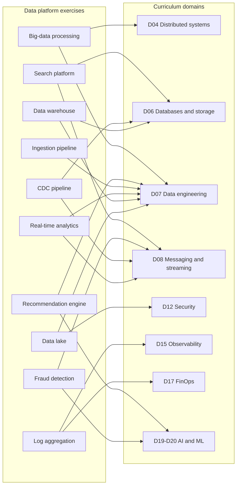

# Data platform exercises

> Application exercises ask "how does a request get its answer?". Data platform exercises ask "how
> does every fact the business produces get somewhere useful, correct, and lawful, and stay there
> only as long as it should?". The answers are pipelines, table layouts, ownership, and
> housekeeping, and the hard part is that data outlives every system that produced it.

!!! abstract "Page facts"
    **Level:** Mixed (each brief is Level 2; the full exercises are Level 3) · **Status:** Outline ·
    **Time:** 20 minutes to read; 60-90 minutes per full exercise · **Last verified:** 2026-11-27

## How to use these exercises

Work every exercise with the [twelve-step design method](design-method.md). Data designs reward
three habits more than application designs do:

- **Rank the sources twice.** Once by bytes, once by sensitivity. The source that dominates storage
  (usually clickstream or logs) is rarely the one that can carry a delivery address or a card number
  into the platform; design for both rankings.
- **Give every dataset an owner, a meaning, and an end date.** A table nobody owns is never fixed, a
  column nobody defined is used three ways, and data with no retention period is kept forever. Write
  those three down before choosing an engine.
- **Do the arithmetic.** The scale figures in each brief are labelled AtlasMart (or case-study
  company) assumptions. Many data platforms are dominated by one number (events a day, files per
  partition, bytes scanned per query); find it before choosing technology.
- **Full exercises** have a problem statement, requirements, scale arithmetic, hints, a reference
  solution, alternatives, failure modes, and a rubric. Three exist: [data lake](data-lake.md),
  [CDC pipeline](cdc-pipeline.md), and [real-time analytics](real-time-analytics.md). Fraud
  detection is worked end to end in case study 13. The others are briefs only; items marked with a
  D-identifier are planned and not yet written.

The briefs share AtlasMart's Phase 5 data-platform assumptions: 400,000 daily active users × 40
clickstream events = 16,000,000 events a day (16,000,000 ÷ 86,400 ≈ 185 per second, 4× peak ≈ 740
per second, 1 KB each, about 16 GB a day); 60,000 orders × 3 = 180,000 order lines a day; a managed,
Kafka-compatible event log with 7-day retention; a lakehouse on EU object storage organized as
Bronze, Silver, and Gold. New figures introduced in a brief are marked "assumption".

## Exercises

### Data lake

- **Brief.** Build AtlasMart's analytics platform: clickstream, OMS changes, and tracking events
  landed in Bronze, cleaned and pseudonymized into Silver data products, and aggregated into Gold for
  dashboards, with a catalog, access control, retention, and erasure that the privacy team accepts.
- **Scale to assume.** Clickstream 16 GB a day, OMS changes 60,000 orders × 10 changes × 1 KB =
  0.6 GB (assumption), tracking 480,000 events × 500 B = 0.24 GB: 16.84 GB a day, 95% of it
  clickstream; about 2 TB stored across the layers after retention.
- **Decisions that dominate.** (1) What each layer promises, who reads it, and how long it keeps
  data. (2) Where and how customer identifiers are pseudonymized, and how erasure reaches every
  layer and every old snapshot. (3) Commit interval, compaction, and snapshot expiry, which decide
  whether the platform drowns in small files.
- **Read first.** [Warehouses, lakes, lakehouses, and data mesh](../data-engineering-and-analytics/warehouses-lakes-lakehouses-and-data-mesh.md);
  [Big data processing engines and table formats](../data-engineering-and-analytics/big-data-processing-engines-and-table-formats.md);
  [Data security and privacy](../security-architecture/data-security-and-privacy.md);
  [Case study 12](../end-to-end-case-studies/cs-12-data-lakehouse-with-batch-and-streaming-ingestion.md).
- **Status.** Full exercise: [Design an analytics data lake](data-lake.md).

### Data warehouse

- **Brief.** Finance and merchandising want one governed source for sales, returns, and margin, with
  definitions that do not change between reports. Design the dimensional model, its load from the
  lakehouse, and the semantic layer the BI tool reads.
- **Scale to assume.** 180,000 order lines a day × 365 = 65.7 million fact rows a year; 7 years
  (assumption) ≈ 460 million rows; at 100 B per compressed fact row (assumption) ≈ 46 GB. Dimensions:
  2,000,000 customers (pseudonymized), 50,000 products (assumption), 12 carriers, a date dimension.
- **Decisions that dominate.** (1) The grain of the sales fact (the order line) and which dimensions
  are conformed across finance, merchandising, and logistics. (2) Slowly changing dimensions: which
  product and customer attributes keep history, and how. (3) Gold tables in the lakehouse versus a
  separate managed warehouse, and where metric definitions live.
- **Read first.** [OLTP vs OLAP, dimensional modeling, and BI](../data-engineering-and-analytics/oltp-vs-olap-dimensional-modeling-and-bi.md);
  [Data modeling, metadata, and data governance](../data-engineering-and-analytics/data-modeling-metadata-and-data-governance.md);
  [Warehouses, lakes, lakehouses, and data mesh](../data-engineering-and-analytics/warehouses-lakes-lakehouses-and-data-mesh.md);
  [Data lake exercise](data-lake.md) (the Gold layer this warehouse builds on).
- **Status.** Brief only, full exercise planned.

### Real-time analytics

- **Brief.** On sale days the trading team wants conversion, revenue per minute, top products, and
  anomalies on a live dashboard within seconds, not tomorrow morning.
- **Scale to assume.** See the full exercise; the driver is the clickstream at 185 events per second
  on average and 740 at peak, joined with order events from the OMS change stream.
- **Decisions that dominate.** (1) Stream processing with windows and watermarks versus frequent
  micro-batches. (2) The serving store for fresh aggregates and how dashboards query it. (3) Late and
  duplicate events: exact counts with exactly-once processing, or approximate counts reconciled
  later against the lakehouse.
- **Read first.** [Event streaming and log-based architecture](../messaging-and-streaming/event-streaming-and-log-based-architecture.md);
  [Batch, streaming, ETL/ELT, and pipelines](../data-engineering-and-analytics/batch-streaming-etl-elt-and-pipelines.md);
  [Big data processing engines and table formats](../data-engineering-and-analytics/big-data-processing-engines-and-table-formats.md).
- **Status.** Full exercise: [Design real-time analytics](real-time-analytics.md).

### Log aggregation

- **Brief.** Collect application logs from every AtlasMart service on the production Kubernetes
  cluster so that engineers can search them during incidents and correlate them with traces. This is
  the operational sibling of the security-focused centralized logging brief in the
  [cloud and enterprise platform exercises](cloud-and-enterprise-platform-exercises.md#centralized-cross-account-logging).
- **Scale to assume.** 400 production pods × 20 log lines per second × 300 B = 2.4 MB/s, so 2.4 ×
  86,400 ≈ 207 GB a day (assumptions); 14 days searchable = 207 × 14 ≈ 2.9 TB hot; 90 days archived ≈
  18.6 TB.
- **Decisions that dominate.** (1) Structured logs, levels, and sampling at the source, so volume is
  decided by design rather than by accident. (2) Full-text indexing versus indexing only labels and
  scanning content, a choice that sets most of the cost. (3) Personal data in logs, and retention per
  log class.
- **Read first.** [Observability fundamentals: logs, metrics, and traces](../observability-and-sre/observability-fundamentals-logs-metrics-and-traces.md);
  [Monitoring, alerting, and on-call](../observability-and-sre/monitoring-alerting-and-on-call.md);
  [Lab 11: tracing and structured logging](../labs/lab-11-tracing-and-structured-logging.md);
  [Data security and privacy](../security-architecture/data-security-and-privacy.md).
- **Status.** Brief only, full exercise planned.

### Ingestion pipeline

- **Brief.** Suppliers send daily product feeds and carriers send daily invoice files. Design the
  batch ingestion that lands them in the lakehouse, rejects bad files without stopping good ones, and
  can safely re-run any day.
- **Scale to assume.** 300 suppliers × 1 feed a day × 20 MB = 6 GB a day; 12 carriers × 1 invoice
  file a day; 2% of files malformed, so about 300 × 2% = 6 quarantined supplier files a day
  (assumptions).
- **Decisions that dominate.** (1) The landing contract: schema, validation, quarantine, and who is
  told when a file fails. (2) Idempotent loads: file checksums, partition overwrite, and what a re-run
  of last Tuesday does. (3) Orchestration: dependencies between feeds, late files, and backfills.
- **Read first.** [Batch, streaming, ETL/ELT, and pipelines](../data-engineering-and-analytics/batch-streaming-etl-elt-and-pipelines.md);
  [Data modeling, metadata, and data governance](../data-engineering-and-analytics/data-modeling-metadata-and-data-governance.md);
  [Storage architecture](../databases-and-storage/storage-architecture.md);
  [Job scheduler exercise](job-scheduler.md).
- **Status.** Brief only, full exercise planned.

### CDC pipeline

- **Brief.** Stream every change in the OMS PostgreSQL database into the AtlasMart event log and on
  into the lakehouse, without harming a 12-year-old monolith that another team owns.
- **Scale to assume.** See the full exercise; the base volume is 60,000 orders and 180,000 order
  lines a day from the OMS.
- **Decisions that dominate.** (1) The initial snapshot and the handover to streaming without gaps
  or duplicates. (2) Ordering, deletes, and schema changes as they reach consumers. (3) Replication
  slot safety: what happens to the OMS disk when the pipeline stops.
- **Read first.** [Relational databases and SQL internals](../databases-and-storage/relational-databases-and-sql-internals.md);
  [Event streaming and log-based architecture](../messaging-and-streaming/event-streaming-and-log-based-architecture.md);
  [Case study 09](../end-to-end-case-studies/cs-09-hybrid-migration-with-private-connectivity.md)
  (logical replication during a migration).
- **Status.** Full exercise: [Design a CDC pipeline](cdc-pipeline.md).

### Fraud detection

- **Brief.** Halvane Pay (fictional), an online payment service provider for small merchants, must
  score each payment for fraud before it is authorized, using the payer's and merchant's recent
  behaviour, and learn from chargebacks that arrive weeks later.
- **Scale to assume.** See case study 13 for Halvane Pay's assumed volumes and latency budget. Every
  rule, score, and rate there is illustrative, not taken from any real company; regulation depends on
  jurisdiction, so ask counsel.
- **Decisions that dominate.** (1) Synchronous scoring inside the authorization latency budget, and
  whether to fail open or closed when the scorer is slow. (2) Features over sliding windows (payments
  per card in the last hour): stream-processor state or an online feature store. (3) The feedback
  loop: delayed labels, rule and model changes, and who approves them.
- **Read first.** [Event-driven architecture](../messaging-and-streaming/event-driven-architecture.md);
  [Event streaming and log-based architecture](../messaging-and-streaming/event-streaming-and-log-based-architecture.md);
  [Transactions, sagas, and delivery guarantees](../distributed-systems/transactions-sagas-and-delivery-guarantees.md).
- **Status.** Brief only, full exercise planned; worked end to end in
  [Case study 13: real-time fraud detection pipeline](../end-to-end-case-studies/cs-13-real-time-fraud-detection-pipeline.md).

### Recommendation engine

- **Brief.** Add "customers also bought" on product pages and a personalized home page to AtlasMart,
  trained on pseudonymized clickstream and orders from the lakehouse.
- **Scale to assume.** 400,000 DAU × 10 recommendation requests each = 4,000,000 a day ≈ 46 per
  second, × 4 ≈ 185 at peak; 50,000 products; precomputed top-20 lists for 2,000,000 customers × 20
  × 8 B per product id = 320 MB (assumptions).
- **Decisions that dominate.** (1) Batch precomputation versus real-time scoring per request, and how
  fresh "recently viewed" must be. (2) Training data from pseudonymized Silver tables, and how erasure
  and retention reach features and models. (3) Cold start, feedback loops, and evaluation offline
  versus with controlled experiments.
- **Read first.** [Data lake exercise](data-lake.md); [Warehouses, lakes, lakehouses, and data mesh](../data-engineering-and-analytics/warehouses-lakes-lakehouses-and-data-mesh.md);
  [Caching architecture](../databases-and-storage/caching-architecture.md); planned: classical machine
  learning including recommendations (D19-T02), ML lifecycle and feature stores (D20-T02).
- **Status.** Brief only; full exercise planned for Phase 6 with the AI foundations (D19-T02,
  D20-T02).

### Search platform

- **Brief.** Product search for AtlasMart: typo tolerance, facets (brand, size, price), ranking that
  merchandising can tune, and prices and stock levels in results that are never more than a minute
  stale.
- **Scale to assume.** 50,000 products × 10 KB per search document = 500 MB of source documents;
  400,000 DAU × 5 searches = 2,000,000 searches a day ≈ 23 per second, × 4 ≈ 93 at peak; 50,000
  products × 20 price or stock changes a day = 1,000,000 updates ≈ 12 per second (assumptions).
- **Decisions that dominate.** (1) A dedicated search engine with an inverted index versus the
  database's full-text search. (2) The index update path (events or CDC from the catalogue and
  inventory) and full reindexing without downtime. (3) Who owns relevance, and how a ranking change is
  measured before it ships.
- **Read first.** [NoSQL databases](../databases-and-storage/nosql-databases.md) (search stores);
  [Event-driven architecture](../messaging-and-streaming/event-driven-architecture.md);
  [Caching architecture](../databases-and-storage/caching-architecture.md); planned: retrieval,
  hybrid search, and reranking (D22-T04).
- **Status.** Brief only, full exercise planned.

### Big-data processing

- **Brief.** Analytics changes the definition of a session (30 minutes of inactivity becomes 20).
  Recompute sessions and every Gold table that depends on them over the 13 months of Silver
  clickstream, without delaying the daily 07:00 builds.
- **Scale to assume.** 16 GB × 395 days = 6,320 GB of raw-equivalent input (about 1.6 TB stored at
  the data lake's 25% compression); at the data lake's illustrative 2 GB per vCPU-hour, 6,320 ÷ 2 =
  3,160 vCPU-hours ≈ 3,160 CU, which is 49 hours on 64 vCPU or about 12 hours on 256 vCPU for the same
  cost.
- **Decisions that dominate.** (1) Partitioning and skew: a bot session with millions of events
  lands on one task. (2) Cluster size, preemptible capacity, and checkpointing so a lost node does not
  restart the whole job. (3) Idempotent partition overwrites and the cutover of downstream Gold
  tables so dashboards never mix old and new definitions.
- **Read first.** [Big data processing engines and table formats](../data-engineering-and-analytics/big-data-processing-engines-and-table-formats.md);
  [Batch, streaming, ETL/ELT, and pipelines](../data-engineering-and-analytics/batch-streaming-etl-elt-and-pipelines.md);
  [Scaling, partitioning, and replication](../distributed-systems/scaling-partitioning-and-replication.md);
  [Cloud cost models and FinOps](../finops-and-sustainability/cloud-cost-models-and-finops.md).
- **Status.** Brief only, full exercise planned.

## How the exercises map to the curriculum

**Figure 1 — Which domains each data platform exercise practises.** Each arrow points from an
exercise to a domain whose ideas it exercises most heavily.

How to read it: data engineering (D07) receives arrows from half the exercises and messaging and
streaming (D08) from four, which is the point of this group: most data platform problems are
decided by how data moves and is stored, before any engine is chosen. The AI box is planned content
(Phases 6 and 7).

| Exercise | Main domains | Secondary domains |
|---|---|---|
| Data lake | D07 Data engineering, D12 Security | D06 Storage, D17 FinOps |
| Data warehouse | D07 Data engineering, D06 Databases | D12 Security (pseudonymized dimensions) |
| Real-time analytics | D08 Messaging and streaming, D07 Data engineering | D14 Performance |
| Log aggregation | D15 Observability | D17 FinOps (index cost), D12 Security (personal data in logs) |
| Ingestion pipeline | D07 Data engineering | D06 Storage, D13 Reliability (re-runs) |
| CDC pipeline | D06 Databases, D08 Messaging and streaming | D04 Distributed systems (ordering), D18 Migration |
| Fraud detection | D08 Messaging and streaming, D19-D20 AI and ML (planned) | D12 Security, D04 Distributed systems |
| Recommendation engine | D19-D20 AI and ML (planned), D07 Data engineering | D06 Caching, D12 Privacy |
| Search platform | D06 Databases, D08 Messaging and streaming | D14 Performance |
| Big-data processing | D07 Data engineering, D04 Distributed systems | D17 FinOps |

## Review notes

- Canonical page for D29-T03, status Outline: every inventory item (data lake, data warehouse,
  real-time analytics, log aggregation, ingestion pipeline, CDC pipeline, fraud detection,
  recommendation engine, search platform, big-data processing) has a brief, a stated scale, three
  dominating decisions, reading, and a status. Full exercises exist for the data lake, the CDC
  pipeline, and real-time analytics; fraud detection points at case study 13; the recommendation
  engine is planned for Phase 6 (D19-T02, D20-T02); the rest are briefs only.
- Collection pages have no knowledge check and no references table by design; sources live on the
  full exercise pages and the topic pages they link.
- Phase 5 assumptions used as given: 16,000,000 clickstream events a day, 185/s and 740/s, 1 KB,
  16 GB; 180,000 order lines; the event log; the Bronze/Silver/Gold lakehouse. The data lake brief's
  0.6 GB of OMS changes, 50,000 products, 25% compression, 13-month Silver clickstream, and 2 GB per
  vCPU-hour come from the data lake exercise and are reused here so the numbers agree.
- New assumptions introduced in the briefs: 7-year history and 100 B per fact row (warehouse); 400
  pods × 20 lines/s × 300 B with 14 days hot and 90 days archived (log aggregation); 300 suppliers ×
  20 MB, 12 carrier invoice files, 2% malformed (ingestion); 10 recommendation requests per DAU,
  top-20 lists, 8 B ids (recommendations); 10 KB search documents, 5 searches per DAU, 20 price or
  stock changes per product a day (search); a 30 to 20 minute session change and 64- and 256-vCPU
  clusters (big-data processing). Reviewer: recheck 207 GB a day (2.4 MB/s × 86,400), 2.9 TB and
  18.6 TB, 460 million rows and 46 GB, 46/s and 185/s, 320 MB, 23/s and 93/s, 12/s, 3,160 vCPU-hours,
  49 h and 12.3 h.
- The CDC and real-time analytics scale lines defer to their full exercises (written in parallel) to
  avoid contradicting them; check they quote the same base volumes. The fraud brief defers to case
  study 13 for Halvane Pay's figures for the same reason.
- Figure 1 uses two subgraphs in a `flowchart LR` like the other collection pages; check it renders
  legibly at phone width.
