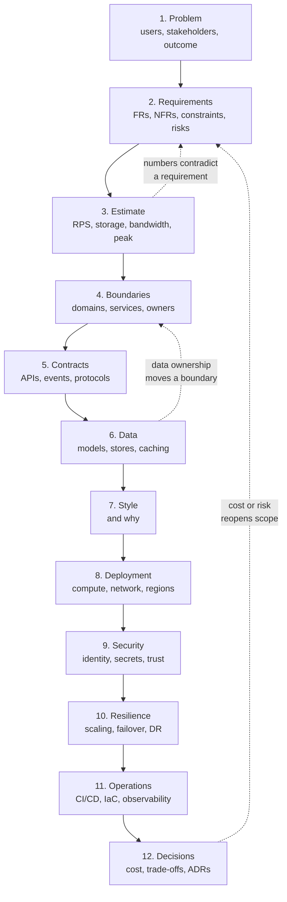
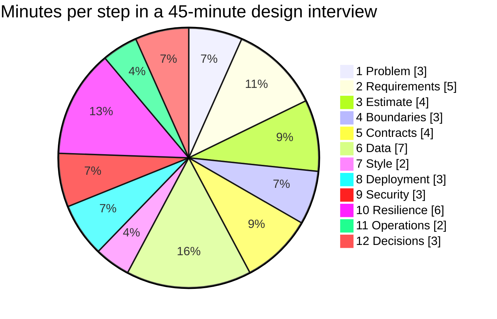
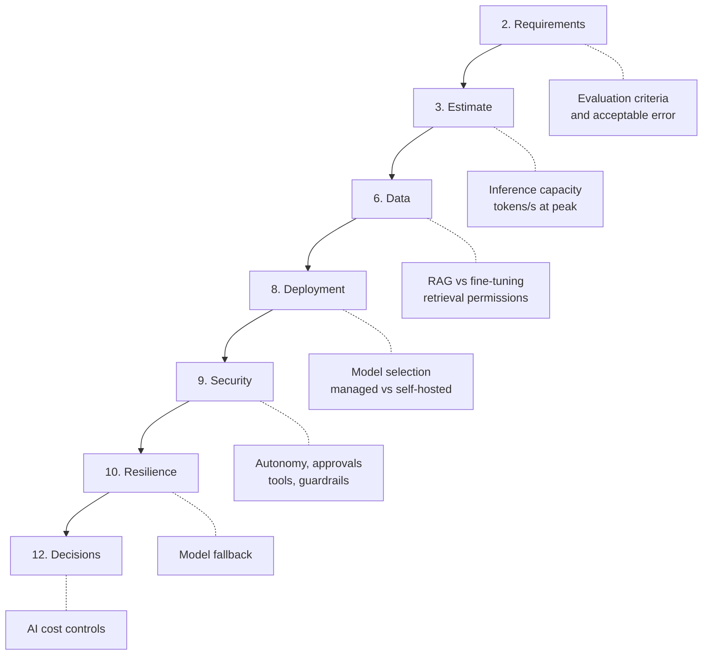

# The architecture design method

> A design is a chain of decisions, each justified by something written down earlier. The twelve
> steps on this page are the order in which those decisions become possible, and the checklist at
> the end is how you know you have not skipped one.

!!! abstract "Page facts"
    **Level:** Mixed (the sequence is Level 1-2; trade-offs, AI decisions, and timeboxing a real
    design are Level 3) · **Status:** Draft · **Time:** 60-90 minutes · **Last verified:** 2026-11-20

## Learning objectives

After this page you should be able to:

- List the twelve steps of the design method, the question each answers, and the artifact each
  produces.
- Apply the method to an unfamiliar problem within a 45-minute interview and within a two-week
  real design, spending time where the risk is.
- Recognize the common mistakes at each step, especially choosing technology before the numbers
  exist.
- Name the additional decisions an AI system needs (model, hosting, retrieval, autonomy, evaluation,
  guardrails, capacity, fallback, cost) and attach each to the step where it belongs.
- Trace a complete design (the AtlasMart Order Tracking System) through all twelve steps and find
  the page that did each step in full.

## Prerequisites

- [Functional vs non-functional requirements](../architecture-fundamentals/functional-vs-non-functional-requirements.md)
  — step 2 is that page applied.
- [Capacity estimation](../performance-and-scalability/capacity-estimation.md) — step 3 is that
  page applied.
- [The C4 model](../architecture-fundamentals/c4-model.md) — the diagrams that steps 4 and 8
  produce.

## The problem this solves

Ask five engineers to design the same system and you will usually get five diagrams that start in
five different places: one with the database, one with Kubernetes, one with the API, one with a
message broker the engineer used last month. None is wrong on its own; what is missing is the
reasoning that connects the business problem to each box. A design method fixes the order of
thinking so that every decision has an input (a requirement, a number, a constraint) and every
input is used by some decision. It also makes the work reviewable: a reviewer can open the
estimate and check the arithmetic instead of arguing about taste. In an interview, the same method
stops you running out of time before you reach the parts the interviewer cares about.

## What it is

The **architecture design method** used throughout this repository is a sequence of twelve steps.
Each step answers one question, produces one or more artifacts, and feeds the steps after it.

| # | Step | Short name |
|---|---|---|
| 1 | Understand the business problem, users, stakeholders, and outcome | Problem |
| 2 | Gather functional requirements, NFRs, assumptions, constraints, and risks | Requirements |
| 3 | Estimate users, requests/second, concurrency, storage, bandwidth, growth, and peak load | Estimate |
| 4 | Define system boundaries, domains, services, and responsibilities | Boundaries |
| 5 | Design APIs, events, protocols, and integration contracts | Contracts |
| 6 | Design data models, databases, storage, replication, indexes, and caching | Data |
| 7 | Select the architecture style and explain why | Style |
| 8 | Design compute, network, cloud services, regions, and deployment | Deployment |
| 9 | Define identity, authorization, encryption, secrets, and trust boundaries | Security |
| 10 | Design scaling, resilience, failover, DR, and performance | Resilience |
| 11 | Design CI/CD, IaC, observability, support, and operations | Operations |
| 12 | Estimate costs, document trade-offs, validate assumptions, and record ADRs | Decisions |

The order is a dependency order, not a waterfall. Later steps regularly send you back: a cost
estimate in step 12 can reopen a requirement in step 2, and a data model in step 6 can move a
service boundary from step 4. What the order guarantees is that you never make a decision whose
input does not yet exist.

## Mental model

Think of a building surveyor and architect planning a house extension. First, who lives there and
what problem the extension solves (a growing family, a home office). Then the brief: rooms, budget,
planning rules, the neighbour's right to light. Then measurements: floor area, loads on the
foundations. Only then the floor plan, the plumbing and wiring, the materials, the fire exits, the
maintenance access, and finally the costed plan with the choices written down for the client and
the planning office. Nobody chooses the tiles before measuring the room.

**Where the analogy breaks:** a house is built once and rarely changes shape; software is changed
every week, so steps 11 and 12 (operations, recorded decisions) matter far more than the analogy
suggests. And a house's load is predictable, while a system's peak can be ten times its average on
one marketing email, which is why step 3 carries so much weight.

## Key terms

| Term | Meaning on this page |
|---|---|
| Functional requirement (FR) | What the system must do, with acceptance criteria |
| Non-functional requirement (NFR) | How well it must do it, as a measurable target (latency, availability, scale) |
| Constraint | A decision already made for you (platform, regulation, deadline) |
| Back-of-the-envelope estimate | Order-of-magnitude arithmetic from stated assumptions |
| Container (C4) | A separately deployable unit: an application, a service, a data store |
| Trust boundary | A line in a diagram where data or calls cross between different levels of trust |
| Architecture Decision Record (ADR) | A short, dated record of one decision, its context, options, and consequences |
| Fitness function | An automated check that a quality attribute still holds |
| Timebox | A fixed time budget for a step, after which you record what is open and move on |

## How it works

**Figure 1 — The twelve-step design method.** Solid arrows are the default order; dashed arrows are
the most common loops back. Every step writes down what it produced before the next starts.

How to read it: start at the top and follow the solid arrows. The dashed arrows are not failures;
they are the method working. A design with no loops back usually means the later steps were not
taken seriously.

Each step below gives the question it answers, the artifacts it produces (with the page that teaches
them), common mistakes, and a suggested time budget for a 45-minute interview and for a two-week
real design (ten working days). The budgets are guidance from practice, not measurements; shift
time toward whichever step carries the most risk for your problem.

### Step 1 — Understand the business problem, users, stakeholders, and outcome

- **Question:** what outcome does the business want, for whom, measured how, and by when?
- **Artifacts:** a one-paragraph problem statement, a stakeholder list, and one success metric with
  a baseline and a target. Taught on
  [Stakeholders, business capabilities, and success metrics](../architecture-fundamentals/stakeholders-business-capabilities-and-success-metrics.md)
  and [What does a Solutions Architect do?](../architecture-fundamentals/what-does-a-solutions-architect-do.md).
- **Common mistakes:** accepting a solution as the problem ("we need a mobile app"); no baseline,
  so success cannot be measured; forgetting the people who operate or pay for the system.
- **Time:** interview 3 minutes (restate the problem, name the users, ask what success looks like);
  real design 1 day.

### Step 2 — Gather functional requirements, NFRs, assumptions, constraints, and risks

- **Question:** what must the system do, how well, within which limits, and what could stop it?
- **Artifacts:** numbered FRs with acceptance criteria, measurable NFRs, and a constraints,
  assumptions, dependencies, and risks register. Taught on
  [Functional vs non-functional requirements](../architecture-fundamentals/functional-vs-non-functional-requirements.md),
  [Quality attributes and trade-offs](../architecture-fundamentals/quality-attributes-and-trade-offs.md),
  [Constraints, assumptions, dependencies, risks, and scope](../architecture-fundamentals/constraints-assumptions-dependencies-risks-and-scope.md),
  and [SLAs, SLOs, SLIs, error budgets, and recovery objectives](../architecture-fundamentals/slas-slos-slis-error-budgets-and-recovery-objectives.md).
- **Common mistakes:** adjectives instead of numbers ("fast", "scalable"); listing twenty NFRs with
  equal weight instead of ranking the three that drive the design; no explicit out-of-scope list.
- **Time:** interview 5 minutes (three to five FRs, the three NFRs that matter, two or three
  clarifying questions); real design 1.5 days.

### Step 3 — Estimate users, requests/second, concurrency, storage, bandwidth, growth, and peak load

- **Question:** how big is this, at the average, at the peak, and in two to five years?
- **Artifacts:** an estimate sheet where every number is an assumption or arithmetic from one:
  average and peak RPS, read:write ratio, storage over the retention period, bandwidth, cache
  working set, and concurrency by Little's Law. Taught on
  [Capacity estimation](../performance-and-scalability/capacity-estimation.md) and
  [Performance fundamentals and Little's Law](../performance-and-scalability/performance-fundamentals-and-littles-law.md).
- **Common mistakes:** registered users instead of active users; averages without a peak factor;
  raw storage without replication and index multipliers; false precision.
- **Time:** interview 4 minutes; real design half a day, then revisited after load tests.

### Step 4 — Define system boundaries, domains, services, and responsibilities

- **Question:** what is inside the system, what is outside, and who owns each part and each piece of
  data?
- **Artifacts:** a C4 system context diagram, a first container diagram, and a responsibility list
  (one owner per piece of data). Taught on [The C4 model](../architecture-fundamentals/c4-model.md)
  and [As-Is and To-Be architecture, gap analysis, and build vs buy](../architecture-fundamentals/as-is-and-to-be-architecture-gap-analysis-and-build-vs-buy.md).
- **Common mistakes:** splitting into many services before knowing the domains; two services
  writing the same data; leaving external systems off the diagram, so their failure modes are never
  considered.
- **Time:** interview 3 minutes; real design 1 day.

### Step 5 — Design APIs, events, protocols, and integration contracts

- **Question:** how do clients and other systems talk to each part, and what is promised in each
  contract?
- **Artifacts:** an API sketch (resources or operations, status codes, pagination, idempotency),
  event schemas, and integration contracts with partners. Taught on
  [API design](../application-and-api-architecture/api-design-rest-graphql-grpc-and-async-apis.md),
  [Integration architecture](../application-and-api-architecture/integration-architecture.md), and
  [Transport and application protocols](../networking/transport-and-application-protocols.md).
- **Common mistakes:** exposing the database schema as the API; no idempotency on unsafe operations;
  no versioning story; choosing a protocol for fashion rather than for the consumer.
- **Time:** interview 4 minutes (the two or three most important operations); real design 1 day.

### Step 6 — Design data models, databases, storage, replication, indexes, and caching

- **Question:** what data exists, how is it accessed, where does it live, and how is it kept safe and
  fast?
- **Artifacts:** an entity or table sketch with keys and indexes, a store choice per data type with
  the access pattern that justifies it, a replication and backup plan, and a cache plan with TTLs.
  Taught on [Relational databases and SQL internals](../databases-and-storage/relational-databases-and-sql-internals.md),
  [Caching architecture](../databases-and-storage/caching-architecture.md), and
  [Scaling, partitioning, and replication](../distributed-systems/scaling-partitioning-and-replication.md).
- **Common mistakes:** picking a store before writing the access patterns; caching without an
  invalidation or staleness rule; sharding a dataset the estimate shows fits on one node.
- **Time:** interview 7 minutes (this is often where interviewers probe); real design 1 day.

### Step 7 — Select the architecture style and explain why

- **Question:** which overall style (modular monolith, microservices, event-driven, serverless, a
  mix) fits the team, the change rate, and the NFRs?
- **Artifacts:** a short statement of the style and the two or three quality attributes that chose
  it, usually as an ADR. Taught on [Architecture styles](../software-architecture/architecture-styles.md),
  [Microservices architecture](../software-architecture/microservices-architecture.md), and
  [Message queues and brokers](../messaging-and-streaming/message-queues-and-brokers.md).
- **Common mistakes:** choosing microservices for a small team and a small system; naming a style
  without the reason; treating the style as the first decision rather than a consequence of steps 2
  to 6.
- **Time:** interview 2 minutes; real design half a day.

### Step 8 — Design compute, network, cloud services, regions, and deployment

- **Question:** where does each container run, how is it reached, and across how many zones and
  regions?
- **Artifacts:** a deployment diagram (zones, regions, load balancers, network segments), compute
  choices with sizing from step 3, and the managed services used. Taught on
  [High availability design](../reliability-and-disaster-recovery/high-availability-design.md),
  [Networking fundamentals](../networking/networking-fundamentals-ip-cidr-routing-and-dns.md), and
  the deployment diagram section of [The C4 model](../architecture-fundamentals/c4-model.md).
- **Common mistakes:** one instance per tier ("we will scale later"); multi-region by default with no
  NFR that needs it; forgetting egress, DNS, and certificates.
- **Time:** interview 3 minutes; real design 0.75 day.

### Step 9 — Define identity, authorization, encryption, secrets, and trust boundaries

- **Question:** who and what may call each part, how is that checked, how is data protected in
  transit and at rest, and where are the trust boundaries?
- **Artifacts:** trust boundaries drawn on the container diagram, an authentication and
  authorization model per entry point, a secrets plan, an encryption statement, and a short threat
  model. Taught on the trust boundary sections of [The C4 model](../architecture-fundamentals/c4-model.md),
  the security steps of [API design](../application-and-api-architecture/api-design-rest-graphql-grpc-and-async-apis.md),
  and threat modelling on
  [Trade-offs, principles, ADRs, and architecture governance](../architecture-fundamentals/trade-offs-principles-adrs-and-architecture-governance.md);
  security architecture in depth is planned for D12.
- **Common mistakes:** authentication without resource-level authorization; secrets in configuration
  files; trusting internal networks; leaving security to a final review instead of the design.
- **Time:** interview 3 minutes; real design 0.75 day.

### Step 10 — Design scaling, resilience, failover, DR, and performance

- **Question:** what happens at the peak, when a dependency is slow, when a zone fails, and when a
  region or the data is lost?
- **Artifacts:** a scaling plan (what scales, on which signal), a failure-mode table (failure,
  detection, response), timeout and retry budgets, and recovery objectives (RPO, RTO) with the
  mechanism that meets them. Taught on
  [High availability design](../reliability-and-disaster-recovery/high-availability-design.md),
  [Resilience mechanics: timeouts, retries, and backpressure](../distributed-systems/resilience-mechanics-timeouts-retries-and-backpressure.md),
  and [Distributed systems fundamentals](../distributed-systems/distributed-systems-fundamentals-time-and-coordination.md).
- **Common mistakes:** "it autoscales" with no limit or signal; retries without backoff or budget;
  backups never restored in a test; an RTO nobody has timed.
- **Time:** interview 6 minutes; real design 1 day.

### Step 11 — Design CI/CD, IaC, observability, support, and operations

- **Question:** how is the system built, deployed, observed, supported, and changed safely?
- **Artifacts:** a pipeline sketch (build, test, deploy, rollback), an infrastructure-as-code
  statement, SLIs and alerts tied to the NFRs, dashboards, and runbooks for the top failure modes.
  SLIs and alerting are taught on
  [SLAs, SLOs, SLIs, error budgets, and recovery objectives](../architecture-fundamentals/slas-slos-slis-error-budgets-and-recovery-objectives.md);
  observability and DevOps in depth are planned for D15 and D16.
- **Common mistakes:** alerts on causes (CPU) rather than symptoms (SLO burn); no rollback path; an
  operations model that assumes the design team will be on call forever.
- **Time:** interview 2 minutes (mention it; interviewers notice when it is missing); real design
  half a day.

### Step 12 — Estimate costs, document trade-offs, validate assumptions, and record ADRs

- **Question:** what will this cost, what did we give up, which assumptions are still unproven, and
  where is each decision written down?
- **Artifacts:** a cost model by line item (compute, storage, egress, managed services) driven by the
  step 3 numbers, a trade-off table, an assumption list with the test or measurement that will
  validate each, and ADRs for the significant decisions. Taught on
  [Trade-offs, principles, ADRs, and architecture governance](../architecture-fundamentals/trade-offs-principles-adrs-and-architecture-governance.md);
  FinOps in depth is planned for D17. Never quote prices from memory; use the provider's current
  pricing pages.
- **Common mistakes:** no cost estimate at all; ADRs that record the choice but not the rejected
  options; assumptions that are never tested.
- **Time:** interview 3 minutes (summarize the three main trade-offs and what you would validate
  first); real design half a day.

### Time budgets compared

**Figure 2 — A 45-minute interview budget.** Minutes per step from the sections above; they sum
to 45.

How to read it: the largest slices are data (step 6) and resilience (step 10), because that is where
most designs succeed or fail and where interviewers ask follow-up questions. In a two-week design
the same twelve steps take 1, 1.5, 0.5, 1, 1, 1, 0.5, 0.75, 0.75, 1, 0.5, and 0.5 days (10 days in
total); the real design spends relatively more on understanding the problem and requirements,
because mistakes there are the most expensive to fix later.

### Additional decisions for AI systems

A system that uses machine learning models, especially large language models (LLMs), passes through
the same twelve steps and adds the decisions below. They are given here at definition depth; each is
covered in depth in the planned AI domains: generative AI and LLMs (D21), retrieval-augmented
generation (D22), agentic AI and MCP (D23), AI infrastructure and LLMOps (D24), and AI evaluation,
security, and governance (D25).

| Decision | What you decide | Typical options | Attaches to step |
|---|---|---|---|
| Model selection | Which model or models do the task, judged on quality for this task, latency, context length, cost per request, licence, and data-handling terms | A large general model; a smaller, cheaper model; a specialized model; a router that picks per request | 6-8 |
| Managed vs self-hosted | Whether to call a provider's hosted model API or run model weights on your own infrastructure | Managed API (fastest start, provider data terms apply); self-hosted open-weight model (control and data locality, but you own GPUs, scaling, and patching) | 8 |
| RAG vs fine-tuning | How the model gets your organization's knowledge | Retrieval-augmented generation (RAG) fetches relevant documents at request time and puts them in the prompt, good for changing facts and citations; fine-tuning adjusts model weights on examples, good for style, format, or a narrow task; often both | 6 |
| Retrieval and data permissions | Which documents a given user's request may retrieve, so the model never sees what the user could not | Filter retrieval by the caller's identity and document access lists at query time; separate indexes per tenant; never rely on the prompt to hide data | 6, 9 |
| Agent autonomy and approvals | How much an AI agent may do without a human, and which actions need approval | Suggest only; act with human approval per action; act autonomously within limits with audit; autonomy rises only with evidence from evaluation | 4, 9 |
| Tool permissions | Which tools (APIs, databases, file systems) an agent may call, with which credentials and scopes | Least-privilege credentials per tool; read-only by default; allow-lists of operations; rate and spend limits per tool | 9 |
| Evaluation | How you know the system is good enough before and after release | Offline test sets with expected answers, automated graders, human review, online metrics such as task success and escalation rate; run on every model or prompt change | 2, 11 |
| Safety and guardrails | What stops harmful, off-topic, or leaked output and hostile input | Input and output filters, prompt-injection defences, topic restrictions, personal-data redaction, refusal policies, content logging for review | 9 |
| Inference capacity | How many requests and tokens per second must be served at what latency, and on what hardware or quota | Tokens per second at peak from step 3; GPU count and type when self-hosted; provider throughput quotas when managed (check the provider's current documentation) | 3, 8 |
| Model fallback | What happens when the model or provider is slow, failing, or rate limited | A secondary model or provider; a smaller local model; cached answers; a non-AI path such as search results or a human queue | 10 |
| AI cost controls | How spend per request and per month stays within budget | Token budgets per request, prompt caching, routing easy requests to smaller models, per-tenant quotas, spend alerts | 12 |

**Figure 3 — Where the AI decisions attach.** The left column is the twelve-step chain (only the
steps that gain an AI decision are shown); each dashed branch is the decision added at that step.

How to read it: follow the solid chain from top to bottom; at each step, the dashed node is the
extra question you must answer for an AI system. Evaluation appears at step 2 because "good enough"
must be defined as a requirement before anything is built, and again in step 11 as a pipeline gate.

Three rules carry over from the general method and matter more for AI systems. First, write the
quality target as a number (for example, an answer accuracy on a fixed test set), because model
behaviour is probabilistic and "works in the demo" proves little. Second, the permission model is
enforced outside the model: retrieval filters and tool credentials decide what the model can see
and do, not instructions in the prompt. Third, the cost model is per request and per token, so
step 3's peak estimate directly sets the bill.

### The one-page checklist

Copy this table into your design document or interview notes. A step is done when its "done when"
column is true and its artifact exists.

| Step | Done when | Artifact |
|---|---|---|
| 1 Problem | The outcome, the users, and one success metric with baseline and target are written in one paragraph | Problem statement, stakeholder list |
| 2 Requirements | FRs have acceptance criteria; the top NFRs have numbers; scope and constraints are listed | FR/NFR list, constraints and risks register |
| 3 Estimate | Average and peak RPS, read:write ratio, storage, bandwidth, and concurrency are derived from labelled assumptions | Estimate sheet |
| 4 Boundaries | Every piece of data has one owner; external systems are on the diagram | Context diagram, container diagram |
| 5 Contracts | The main operations, events, errors, idempotency, and versioning rules are written | API sketch, event schemas |
| 6 Data | Each store is justified by an access pattern; keys, indexes, replication, and cache TTLs are stated | Data model, storage plan |
| 7 Style | The style is named with the quality attributes that chose it | Style ADR |
| 8 Deployment | Every container has a place, a size from step 3, and redundancy across zones (and regions if required) | Deployment diagram |
| 9 Security | Trust boundaries, authentication and authorization per entry point, secrets, and encryption are stated | Annotated diagram, threat model |
| 10 Resilience | Each top failure mode has detection and response; RPO and RTO have a mechanism | Failure-mode table, scaling plan |
| 11 Operations | NFRs map to SLIs and alerts; deploy and rollback are described | Pipeline sketch, SLO and alert list, runbook titles |
| 12 Decisions | Costs are estimated by line item; trade-offs and open assumptions are listed; ADRs exist | Cost model, trade-off table, ADRs |
| AI (if any) | Model, hosting, retrieval, permissions, autonomy, evaluation, guardrails, capacity, fallback, and cost controls are decided | AI decision record, evaluation plan |

## Worked example: AtlasMart Order Tracking System through all twelve steps

The fictional AtlasMart Order Tracking System has been designed across the earlier pages, one step
at a time. Here is the whole design compressed into one table, with a link to the page that did each
step in full. All numbers are the AtlasMart assumptions used throughout the repository.

| Step | AtlasMart decision (compressed) | Done in full on |
|---|---|---|
| 1 Problem | Customers phone support to ask where their order is because status updates nightly. Success metric: order-status contacts from 9,000 a week to at most 5,400 a week within two quarters of launch | [Stakeholders and success metrics](../architecture-fundamentals/stakeholders-business-capabilities-and-success-metrics.md) |
| 2 Requirements | FR-1 to FR-5 (view status, record scans, notify, reschedule, agent view); NFR-1 60 s freshness for 99% of events, NFR-2 99.9% monthly, NFR-3 p95 300 ms and p99 800 ms, NFR-5 owner-only access, NFR-6 no addresses stored, NFR-7 no acknowledged event lost; constraints C-1 vendor webhooks only, C-2 one region with three zones | [Requirements](../architecture-fundamentals/functional-vs-non-functional-requirements.md), [Constraints and scope](../architecture-fundamentals/constraints-assumptions-dependencies-risks-and-scope.md) |
| 3 Estimate | 1.2 million reads a day ≈ 13.9/s average, 70/s daily peak, 210/s sale-day design peak; 480,000 scan events a day ≈ 5.6/s, peak about 70/s; read:write 2.5 : 1; about 430 GB of event storage at 13 months; 1.8 GB cache working set; about 10.5 requests in flight at the design peak | [Capacity estimation](../performance-and-scalability/capacity-estimation.md) |
| 4 Boundaries | The tracking system owns scan events and status; the Order Management System owns orders; the Identity Provider owns identity. Containers: Tracking Web UI, Tracking API, Webhook Ingestor, Event Queue, Event Processor, Tracking Event Store, Status Cache, Notification Worker | [The C4 model](../architecture-fundamentals/c4-model.md) |
| 5 Contracts | REST Tracking API with `404` for both "missing" and "not yours"; cursor pagination; idempotency key on reschedule; per-customer rate limit 10 requests/s with burst 20; inbound carrier webhook with HMAC signature and timestamp, acknowledged with `202` after enqueue | [API design](../application-and-api-architecture/api-design-rest-graphql-grpc-and-async-apis.md), [Integration architecture](../application-and-api-architecture/integration-architecture.md) |
| 6 Data | PostgreSQL event store, primary plus synchronous standby; Redis Status Cache, cache-aside with a 30 s TTL; dedupe on carrier event id | [Relational databases](../databases-and-storage/relational-databases-and-sql-internals.md), [Caching architecture](../databases-and-storage/caching-architecture.md) |
| 7 Style | One small service with an event-driven ingest path: a queue between the ingestor and the processor absorbs carrier bursts; no microservice split, because one team owns it and the load is small | [Message queues and brokers](../messaging-and-streaming/message-queues-and-brokers.md), [Architecture styles](../software-architecture/architecture-styles.md) |
| 8 Deployment | One region, three zones; three Tracking API instances (one per zone, set by availability, not load); two Event Processor workers in different zones; managed queue, database, and cache | [High availability design](../reliability-and-disaster-recovery/high-availability-design.md), [Capacity estimation](../performance-and-scalability/capacity-estimation.md) |
| 9 Security | Customer and agent tokens from the Identity Provider, validated locally; ownership checked on every request; webhook signatures verified before parsing; delivery addresses never stored | [API design](../application-and-api-architecture/api-design-rest-graphql-grpc-and-async-apis.md), [Requirements](../architecture-fundamentals/functional-vs-non-functional-requirements.md) |
| 10 Resilience | Availability arithmetic showed the first design missed 99.9%; fixes: validate tokens without calling the Identity Provider on each request, and serve stale status from a zone-redundant cache during database failover. RPO 5 min, RTO 1 h | [High availability design](../reliability-and-disaster-recovery/high-availability-design.md), [Resilience mechanics](../distributed-systems/resilience-mechanics-timeouts-retries-and-backpressure.md) |
| 11 Operations | SLOs derived from NFR-2 and NFR-3; per-carrier lag dashboard with an alert when p95 lag exceeds 120 s for 5 minutes (NFR-8); burn-rate alerting | [SLAs, SLOs, and SLIs](../architecture-fundamentals/slas-slos-slis-error-budgets-and-recovery-objectives.md) |
| 12 Decisions | ADR-OT-004 (managed message queue for carrier events) and ADR-OT-005 (cache strategy); accepted risk of 30 s cache staleness; about 144 GB a month of API egress noted as a cost line | [Trade-offs and ADRs](../architecture-fundamentals/trade-offs-principles-adrs-and-architecture-governance.md), [Capacity estimation](../performance-and-scalability/capacity-estimation.md) |

Three loops back happened along the way, and they show why the method is not a waterfall:

1. **Step 3 shrank step 6.** The estimate showed tens of writes per second and a 1.8 GB hot set, so
   sharding and a distributed NoSQL store were dropped before anyone drew them.
2. **Step 10 changed step 9.** The availability arithmetic showed that calling the Identity
   Provider on every request consumed half the error budget, so token validation moved into the
   Tracking API.
3. **Step 2 absorbed a risk from step 12.** FR-4 (reschedule) depends on a hub-departure signal the
   vendor may not deliver, so it was ranked "Could" and made droppable from the launch.

In a 45-minute interview the same design would be told in the budget of Figure 2: three minutes of
problem and success metric, five of FRs and the three driving NFRs (freshness, availability,
latency), four of arithmetic, then the container diagram, the two API operations, the event store
and cache with the 30 s TTL argument, and six minutes on what happens when a carrier floods the
webhook or a zone fails.

## Real-world architecture example

A fictional mid-sized insurer runs its design reviews on a single document template whose headings
are the twelve steps. A design enters review when the checklist above is complete except for open
assumptions, which are listed with an owner and a date. The review board reads the estimate and the
failure-mode table first, because those are where past incidents started. Small changes (a new
endpoint on an existing service) fill in only the steps they touch: usually 2, 5, 9, and 11, with
"unchanged" written against the rest so the reviewer knows they were considered rather than
forgotten. For AI features the template adds the AI decision row, and the review cannot pass without
an evaluation plan and a named owner for guardrail incidents. The method's value in this setting is
less about creativity and more about completeness: a reviewer can see in two minutes which question
has not been answered.

## Design choices and trade-offs

| Choice | Favor when | Avoid when |
|---|---|---|
| Follow all twelve steps in order | A new system, a review, or an interview where completeness is judged | A small change to a known system; fill in only the affected steps |
| Breadth first: a thin pass through all steps, then deepen | Time is short or the problem is unfamiliar; you need to find the risky step early | The risky part is already known; go deep on it first |
| Depth first on the riskiest step | One step dominates (an extreme scale number, a hard regulatory constraint) | Risk is spread evenly; you would starve the other steps |
| Start from a reference architecture | The problem matches a well-known pattern (web app, data pipeline, RAG assistant) | The constraints differ from the reference's hidden assumptions; adapt with care |
| Design for the estimate plus planned growth | Growth is forecast and elasticity exists | Demand is unknowable; design for elasticity and load shedding instead of a fixed size |
| Full ADRs for every decision | Decisions are costly to reverse or contested | Trivial or easily reversed choices; a one-line note is enough |

## Failure modes and anti-patterns

- **Technology first.** The first sentence names a product. Detect: a diagram exists before the
  estimate. Prevent: no box gets a technology label until step 6 or later.
- **Numbers-free design.** Every component "scales". Detect: no RPS or GB anywhere in the document.
  Prevent: step 3's estimate sheet is a review entry criterion.
- **Gold-plating.** Multi-region active-active for a 99.9% internal tool. Detect: a component with no
  requirement that needs it. Prevent: every component traces back to an FR, an NFR, or a constraint.
- **The unmentioned operator.** No monitoring, deployment, or on-call story. Detect: step 11 is
  empty. Prevent: map each NFR to an SLI and an alert.
- **Single-option decisions.** ADRs that list only the chosen option. Detect: no "options considered"
  section. Prevent: require at least two real alternatives and why they lost.
- **Assumptions that never die.** The estimate is never replaced by measurement. Detect: the same
  assumed numbers a year after launch. Prevent: step 12 lists each assumption with the test that
  will validate it.
- **Interview time sink.** Twenty minutes on requirements, no time for data or failure. Detect: the
  clock. Prevent: the budgets in Figure 2, with a spoken "I'll park this and come back".
- **Prompt as policy (AI).** Relying on instructions to the model to hide data or forbid actions.
  Detect: no retrieval filter or tool scope in the design. Prevent: enforce permissions outside the
  model.

## Security considerations

Security has its own step (9), but it is not confined to it. Step 1 names who could be harmed;
step 2 turns that into NFRs such as NFR-5 and NFR-6; step 4's boundaries are where trust boundaries
sit; step 5's contracts decide what is authenticated and how; step 6 decides what personal data is
stored at all; step 11 decides who can deploy and how secrets reach production. A good test of a
design is to pick any arrow on the container diagram and ask: who is calling, how is that proven,
what may they do, and what stops them doing more? For AI systems add two more questions: what can
the model see that the user cannot (it should be nothing), and what can the model do that the user
did not ask for (it should be nothing without an approval).

## Performance, reliability, and cost

- **Performance:** step 3 sets the numbers that steps 6, 8, and 10 must meet; latency budgets are
  set per hop in step 10 and measured in step 11. A design without a latency budget per hop cannot
  explain where 300 ms goes.
- **Reliability:** availability arithmetic in step 10 frequently changes earlier steps, as it did for
  AtlasMart. Do it before the design is presented, not after the first outage.
- **Cost:** cost belongs in step 12 but is driven by steps 3 and 8. The largest cost errors come
  from minimum footprints (instances per zone, always-on capacity, GPUs for AI) and from retention,
  not from per-request compute.

## Hands-on lab: a timed design rehearsal

1. Pick one of the exercises in this section: the [URL shortener](url-shortener.md) or the
   [rate limiter](rate-limiter.md). Read only its problem statement and requirements.
2. Copy the one-page checklist into a blank document. Set a 45-minute timer.
3. Work through the twelve steps, keeping to the budget in Figure 2. When a step's time runs out,
   write one line on what is open and move on.
4. When the timer ends, mark each checklist row done, partly done, or missing.
5. Compare with the exercise's reference solution and its evaluation rubric. Note the two rows where
   your answer was weakest.
6. Repeat a week later with the other exercise and check whether those two rows improved.

??? question "Hint: what if I run out of time at step 6?"
    That usually means steps 1 and 2 ran long. Next time, cap requirements at five FRs and three NFRs,
    say the rest aloud as "assumed", and keep the estimate to rates, storage, and cache size. In the
    interview itself, jump to a one-minute sketch of steps 8 to 12 rather than leaving them blank:
    breadth is scored before depth.

## Knowledge check

1. Why does the estimate (step 3) come before boundaries and data (steps 4 and 6)?
2. Give one example of a later step sending you back to an earlier one, and explain why that is a
   sign of a healthy design process.
3. In a 45-minute interview, which two steps get the largest time budget on this page, and why?
4. A team building an internal assistant plans to tell the model "do not reveal documents the user
   is not allowed to see". What is wrong with that, and where in the method is it fixed?
5. What makes a checklist row "done" for step 12?

??? success "Answers"
    1. Boundaries and data choices depend on scale. Whether a store needs partitioning, whether a
       cache is worthwhile, and how many instances run all follow from the numbers. Without them the
       choices are taste.
    2. The AtlasMart availability arithmetic (step 10) showed the Identity Provider call on every
       request consumed half the error budget, which changed the security design (step 9). Loops
       back mean the later steps actually tested the earlier decisions.
    3. Data (step 6, 7 minutes) and resilience (step 10, 6 minutes): they carry the most risk and
       attract the most follow-up questions.
    4. A prompt instruction is not an access control; the model can be manipulated or simply err.
       The fix is a retrieval permission filter enforced outside the model (steps 6 and 9, D30-T02
       "retrieval and data permissions").
    5. Costs are estimated by line item from the step 3 numbers, trade-offs and open assumptions are
       listed with how each will be validated, and the significant decisions have ADRs with the
       rejected options.

## Architecture discussion questions

1. Your organization wants every design, however small, to complete all twelve steps before review.
   Argue for and against, and propose a rule for which steps a small change must complete.
2. For an AI customer-support agent that can issue refunds, which of the AI decisions would you take
   first, and what evidence would you require before raising the agent's autonomy?
3. The method puts architecture style at step 7, after contracts and data. Some teams choose the
   style first because the platform mandates it. How does a mandated style change the method, and
   where would you record it?

## Summary

The design method is twelve steps in dependency order: problem, requirements, estimate, boundaries,
contracts, data, style, deployment, security, resilience, operations, and decisions. Each step
answers one question and produces an artifact taught elsewhere in this repository, and later steps
legitimately send you back to earlier ones. AI systems add decisions about models, hosting,
retrieval, permissions, autonomy, evaluation, guardrails, inference capacity, fallback, and cost,
each attached to an existing step. In an interview, a time budget per step keeps the design
balanced; in a real design, the one-page checklist shows a reviewer at a glance what has and has not
been decided.

## Related topics

- **Before:** [Functional vs non-functional requirements](../architecture-fundamentals/functional-vs-non-functional-requirements.md);
  [Capacity estimation](../performance-and-scalability/capacity-estimation.md);
  [The C4 model](../architecture-fundamentals/c4-model.md)
- **Alongside:** [URL shortener exercise](url-shortener.md); [Rate limiter exercise](rate-limiter.md);
  [Distributed cache exercise](distributed-cache.md); [Job scheduler exercise](job-scheduler.md);
  [Trade-offs, principles, ADRs, and architecture governance](../architecture-fundamentals/trade-offs-principles-adrs-and-architecture-governance.md)
- **Planned:** application design exercises (D29-T01); infrastructure component exercises (D29-T02);
  AI platform exercises (D29-T05); generative AI and LLMs (D21); RAG and vector search (D22);
  agentic AI and MCP (D23); AI infrastructure and LLMOps (D24); AI evaluation, security, and
  governance (D25); security architecture (D12); observability and SRE (D15); DevOps and IaC (D16);
  FinOps (D17).

## References

| Source | Type | Checked |
|---|---|---|
| [The C4 model for visualising software architecture](https://c4model.com/) — Simon Brown | Official documentation (diagram levels used in steps 4 and 8) | 2026-11-20 |
| [arc42 overview](https://arc42.org/overview) — arc42 project | Documentation template (an alternative structure for the same content) | 2026-11-20 |
| [Architectural Decision Records](https://adr.github.io/) — ADR GitHub organization | Community documentation (step 12) | 2026-11-20 |
| [AWS Well-Architected Framework](https://docs.aws.amazon.com/wellarchitected/latest/framework/welcome.html) — Amazon Web Services | Official documentation (review questions for steps 8 to 12) | 2026-11-20 |
| [Site Reliability Engineering: Service Level Objectives](https://sre.google/sre-book/service-level-objectives/) — Google | Book chapter (free online; step 11) | 2026-11-20 |
| [Artificial Intelligence Risk Management Framework](https://www.nist.gov/itl/ai-risk-management-framework) — NIST | Framework (AI decisions: evaluation, guardrails, governance) | 2026-11-20 |
| [OWASP Top 10 for Large Language Model Applications](https://owasp.org/www-project-top-10-for-large-language-model-applications/) — OWASP | Community standard (AI security decisions) | 2026-11-20 |
| Mark Richards and Neal Ford, *Fundamentals of Software Architecture* (O'Reilly, 2020) | Book (architecture characteristics and style selection, step 7) | 2026-11-20 |

## Review notes

- Canonical page for D30-T01 and D30-T02. Every D30-T01 step has its own section; every D30-T02
  decision is covered at definition depth in one table row plus Figure 3. The AI decisions are only
  defined here by design; depth belongs to D21-D25, which are planned.
- The time budgets (45-minute interview, ten-day design) are the author's guidance, not measured
  data; a reviewer should check they read as advice.
- The worked example introduces no new AtlasMart numbers; every figure is taken from the linked
  pages. The "fictional insurer" in the real-world example has no numbers.
- Links to `architecture-styles.md`, `microservices-architecture.md`,
  `scaling-partitioning-and-replication.md`, `resilience-mechanics-timeouts-retries-and-backpressure.md`,
  `distributed-cache.md`, and `job-scheduler.md` point at pages written in the same batch; confirm
  they exist before publishing.
- Figure 2 uses a Mermaid `pie` chart with `showData`; if it renders poorly, remove `showData`.
