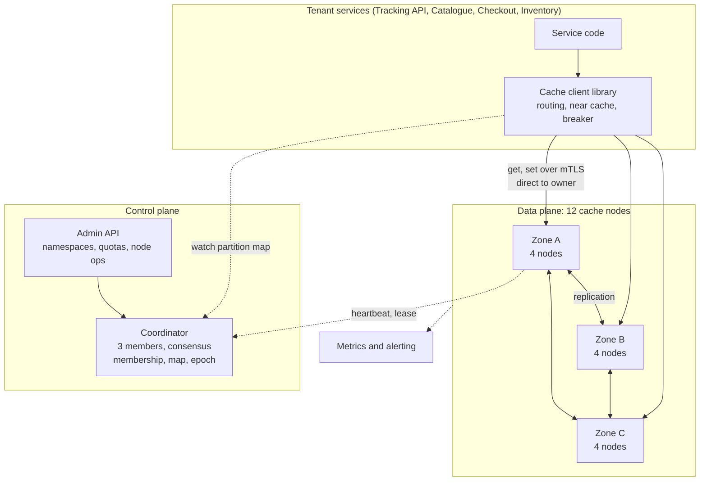
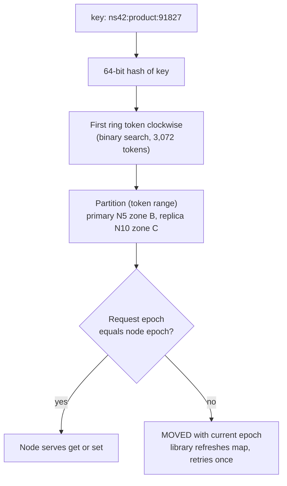
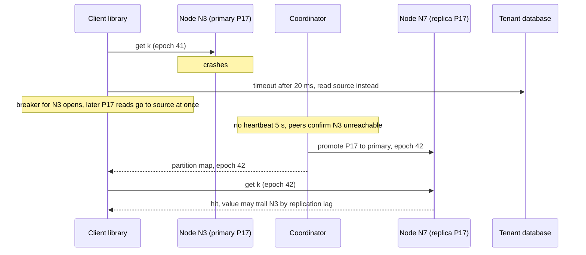

# Exercise: design a distributed cache

> "Use Redis" is a product choice, not a design. This exercise asks you to design the thing itself:
> how keys find nodes, how copies stay close enough, what is thrown away when memory runs out, and
> what a client experiences in the ten seconds after a node dies.

!!! abstract "Page facts"
    **Level:** Advanced · **Status:** Draft · **Time:** 60-90 minutes · **Last verified:** 2026-11-20
    · **Exercise set:** [Infrastructure component exercises](infrastructure-component-exercises.md)

## Problem statement

AtlasMart's platform team wants to offer one shared, multi-tenant, in-memory cache service to every
product team instead of each team running its own cache. Tenants include the Tracking API's Status
Cache, the Catalogue's product-page fragments, Checkout's session data, and Inventory's availability
counts. The service must hold more data than one machine's memory, keep serving when a node or a whole
availability zone fails, let the platform team add and remove nodes without an outage, and make a hot
product page during a flash sale harmless.

Design the cache service. You may assume an in-memory key-value engine exists on each node (a hash
table with an eviction policy); your job is the distributed system around it: partitioning, routing,
replication, membership, rebalancing, and failure handling. Treat cached data as losable: the source of
truth for every entry lives in a tenant's database.

## How to use this exercise

1. Read the requirements and scale, then close this page and spend 30-45 minutes on your own design,
   following the [twelve-step design method](design-method.md). Write the estimate down before you
   draw anything.
2. Open the hints one at a time only when you are stuck; each one gives away more.
3. Compare your design with the reference solution step by step. The reference is one defensible
   answer, not the answer; where yours differs, check whether the alternatives table covers your
   choice and whether you can state the trade-off.
4. Score yourself with the evaluation rubric, then attempt one extension.

## Requirements

### Functional requirements

1. **FR-1** Get, set, and delete a value by key within a tenant namespace. Every set carries a TTL.
2. **FR-2** Batch get of up to 100 keys in one call.
3. **FR-3** Compare-and-set: a set succeeds only if the stored version equals the caller's expected
   version (so a slow writer cannot overwrite a newer value).
4. **FR-4** Namespaces per tenant, each with a memory quota, a maximum TTL, and an operation-rate
   quota.
5. **FR-5** Operators can add, remove, and replace nodes while the service is serving traffic.
6. **FR-6** Per-namespace statistics: hit rate, evictions, memory used, operation rate, latency.

### Non-functional requirements

| ID | Requirement | Measure |
|---|---|---|
| NFR-1 | Latency | p99 get and set ≤ 3 ms measured at the client library, same region, at design peak |
| NFR-2 | Throughput | 300,000 operations per second at peak, still met with one zone lost |
| NFR-3 | Availability | 99.9% monthly per namespace; one node failure makes at most 1/12 of keys unavailable for at most 10 s |
| NFR-4 | Freshness | No entry is served after its TTL; after a failover, a value may be older than the last acknowledged write by at most the replication lag |
| NFR-5 | Capacity | 40 million live keys, 2 KB average entry, 30% growth per year |
| NFR-6 | Security | Mutual TLS between clients and nodes; a tenant can read and write only its own namespaces; no personal data in key names |
| NFR-7 | Operability | Adding or removing a node moves only that node's share of keys and completes in under 10 minutes; no client code change |
| NFR-8 | Durability | None. Entries may be lost at any time; tenants must tolerate a miss |

### Clarifying questions to ask

- Is this a cache or a store? If any tenant cannot tolerate losing data, it needs a database, and the
  design changes completely (persistence, synchronous replication, backups).
- How bad is a stale value after an invalidation is lost? Session data and prices differ.
- What are the value size distribution and the largest value? A few 1 MB values change networking
  and eviction more than millions of small ones.
- Do tenants need atomic operations beyond compare-and-set (counters for rate limiting, sets, lists)?
- Is the service single-region? Multi-region replication of a cache is a different exercise.
- How hard must tenant isolation be: shared nodes with quotas, or dedicated nodes per tenant?

## Scale assumptions

**Stated assumptions.** The cache is sized for AtlasMart's whole platform in year three, which is far
larger than the Tracking API alone (its Status Cache needs only about 1.8 GB, as the
[capacity page](../performance-and-scalability/capacity-estimation.md) shows). All figures below are
exercise assumptions, not measurements.

| Assumption | Value |
|---|---|
| Live keys | 40,000,000 |
| Average entry (key plus value) | 2,000 B |
| Per-entry engine overhead (hash slot, version, expiry, recency clock) | 100 B |
| Allocator fragmentation and free-space headroom | × 1.25 |
| Replication factor | 2 (one primary, one replica, in different zones) |
| Usable memory per node for data | 32 GB of a 64 GB node (rest: OS, connection buffers, migration buffers) |
| Peak operations | 300,000 per second, 90% reads |
| Per-node engine capacity | 100,000 simple operations per second at target CPU (to be measured) |
| Hottest key during a flash sale | 20,000 reads per second |
| Client service instances using the library | 40 |

**Arithmetic.**

- Memory per copy: 40,000,000 × (2,000 + 100) B = 84 GB; with fragmentation headroom 84 × 1.25 =
  **105 GB**. With replication factor 2: **210 GB**.
- Nodes for memory alone: 210 ÷ 32 = 6.6, so **7 nodes**.
- Nodes to survive a zone loss *and* restore two copies of everything: the surviving two zones must
  hold 210 GB, so at least 7 surviving nodes; with an equal count per zone that is 4 per zone, **12
  nodes** in total (8 survivors × 32 GB = 256 GB ≥ 210 GB). Normal memory fill: 210 ÷ (12 × 32) ≈
  **55%**.
- Operations per node: 300,000 ÷ 12 = **25,000/s** normally; 300,000 ÷ 8 = **37,500/s** with a zone
  lost, about 38% of the assumed per-node capacity.
- Replication: 10% writes = 30,000 sets/s, each applied twice; replica applies add 30,000 ÷ 12 =
  2,500/s per node.
- Bandwidth: 300,000 × 2 KB = 600 MB/s ≈ **4.8 Gbit/s** cluster-wide, 0.4 Gbit/s per node normally and
  0.6 Gbit/s with a zone lost. Replication adds 30,000 × 2 KB = 60 MB/s cluster-wide.
- Hot key: 20,000 reads/s on one key lands on one primary, almost doubling that node's normal 25,000/s.
  A client-side near cache with a 1-second TTL caps it at one read per client instance per second:
  **40 reads/s**.
- Rebalancing when a 13th node joins: it takes about 1/13 of the data, 210 ÷ 13 ≈ **16 GB**. At a
  throttled 50 MB/s (an assumption chosen to protect serving traffic) that is 16,000 ÷ 50 ≈ 320 s ≈
  **5.4 minutes**, within NFR-7. With naive `hash(key) mod N`, going from 12 to 13 nodes would move
  about 12/13 ≈ 92% of keys, emptying the cache in practice.
- Re-replication after a node loss: the lost node held 210 ÷ 12 ≈ 17.5 GB of copies. From a single
  source at 50 MB/s that takes about 350 s; spread across 11 peers in parallel, about 32 s. Virtual
  nodes are what create that parallelism.
- Load spread with virtual nodes: with *k* random points per node, each node's share of the ring
  varies with a coefficient of variation of about 1/√*k*. With 256 points: 1/16 ≈ **6%**; with one
  point per node the spread is as large as the share itself. [Lab 08](../labs/lab-08-sharding-and-consistent-hashing.md)
  lets you measure this.

## Hints

??? question "Hint 1: where does a key live, and what moves when the cluster changes?"
    Work out what fraction of keys changes owner under `hash(key) mod N` when N goes from 12 to 13.
    Then find a placement scheme where adding a node moves only the keys that the new node takes. Ask
    also how evenly keys spread when each node has a single position, and how many sources can feed a
    replacement node.

??? question "Hint 2: who decides ownership, and how is an old view rejected?"
    During a failover, clients, the old primary, and the new primary can briefly disagree about who
    owns a partition. Which single number, attached to every request and every ownership change,
    lets a node refuse traffic routed with an outdated view? And what must stop a primary that has
    been cut off from serving writes after its replica was promoted?

??? question "Hint 3: the shape of one good answer"
    Consistent hashing with about 256 virtual nodes per physical node; each ring range is a partition
    with a primary and one asynchronous replica in another zone. A small consensus-backed coordinator
    owns membership and a versioned partition map (an epoch). Nodes serve only while they hold a lease
    from the coordinator that is shorter than the failure-detection timeout. A smart client library
    routes directly, refreshes the map when told its epoch is stale, and keeps a near cache for hot
    keys. Sampled LRU per node, mandatory TTLs, and 12 nodes sized for zone loss.

## Reference solution

The walk-through follows the [design method](design-method.md); each step is brief, and the depth
goes where the decisions are.

### Step 1 — Business problem and outcome

Teams each run their own cache today, sized and patched inconsistently. The outcome is one service
with a published latency and availability objective, cheaper than the sum of per-team caches, that
no team has to operate. Success metrics: tenant hit rates at or above their current ones, no
cache-caused incident in a quarter, and onboarding a namespace in under a day.

### Step 2 — Requirements, assumptions, constraints, risks

As stated above. The key assumption is NFR-8: data is losable. The main risks are a failover that
floods tenant databases with misses, a hot key that saturates one node, and one tenant evicting
another tenant's data.

### Step 3 — Estimate

The arithmetic in the scale section decides three things: **12 nodes, 4 per zone** (set by memory
under zone loss, not by throughput); **replication factor 2** (a third copy would raise memory to
315 GB and 15+ nodes for a cache whose data is losable); and **a near cache is mandatory** for flash-sale
keys, because no amount of partitioning splits one key.

### Step 4 — Boundaries and responsibilities

| Container | Responsibility | State |
|---|---|---|
| Cache node | Store entries for the partitions it owns, apply replication, evict, expire | Memory only |
| Coordinator | Membership, failure decisions, partition map with epoch, node leases | Small, replicated by consensus (3 members, one per zone) |
| Client library | Route each key to its owner, near cache, timeouts, circuit breaker per node, batch splitting | Copy of the partition map |
| Admin API | Namespaces, quotas, credentials, node add and remove, rebalancing orchestration | Writes to the coordinator |

The split between a **data plane** (nodes and client library, on every request) and a **control plane**
(coordinator and admin API, on membership changes only) is the central structural decision: the
coordinator can be unavailable for minutes without affecting gets and sets, as long as no node fails
in that time.

**Figure 1 — Container view of the cache service.** Solid arrows are the per-request data path;
dashed arrows are control-plane traffic.



How to read it: a get goes from the client library straight to the node that owns the key, one network
hop; the coordinator is consulted only when the map changes. Replication links run between zones because
a partition's primary and replica are always in different zones (only one heartbeat arrow is drawn; every
node has one).

### Step 5 — APIs and contracts

The data-plane protocol is a compact binary request/response protocol over TLS on long-lived
connections (one connection pool per node in each client). Every request carries the namespace, the
key, and the client's **map epoch**.

| Operation | Input | Output | Notes |
|---|---|---|---|
| `get` | namespace, key, epoch | value and version, or miss | Served by the primary; a namespace may opt in to replica reads |
| `get_many` | namespace, up to 100 keys, epoch | values and misses | The library splits by owner and sends in parallel |
| `set` | namespace, key, value, ttl, optional expected version, epoch | new version | TTL is required and capped by the namespace maximum |
| `delete` | namespace, key, epoch | ok | Deletes are replicated like sets |
| Any, wrong owner | | `MOVED` with the current epoch | The library refreshes its map and retries once |

The admin API is ordinary HTTPS with JSON: create a namespace (quota, maximum TTL, rate limit,
classification), rotate its credentials, read statistics, and start a node addition or removal.

### Step 6 — Data model and storage

Each node keeps one hash table per owned partition (so a partition can be streamed or dropped as a
unit) holding entries with these fields:

| Field | Size | Purpose |
|---|---|---|
| key | variable | Namespace prefix plus tenant key |
| value | variable | Opaque bytes |
| version | 8 B | Increases on every set; used for compare-and-set and replica ordering |
| expires_at | 8 B | Absolute expiry in milliseconds, set by the primary |
| recency clock | 3 B | Coarse last-access time for approximate LRU |
| namespace id | 2 B | Quota accounting and per-tenant eviction |

The coordinator stores the **partition map**: a sorted list of ring tokens, each owned by a virtual
node; for each range, the primary node and the replica node; and an **epoch** that increases on every
change. It also stores membership (node, zone, state, lease expiry).

### Step 7 — Architecture style

A partitioned, replicated, stateful service with a separate consensus-backed control plane. This is the
shape of most distributed data stores; the choice to make here is the routing style, and the
reference picks a **smart client** (client-side routing): one network hop, no proxy tier to size or fail.
The cost is a library to maintain per language, so the platform also runs a thin routing proxy for
languages without a library (see the alternatives table).

**The key algorithm: placement on the ring.** The coordinator computes the map; clients and nodes only
read it. The placement rule it applies:

```python
import bisect
import hashlib


def h64(data: bytes) -> int:
    return int.from_bytes(hashlib.blake2b(data, digest_size=8).digest(), "big")


class Ring:
    def __init__(self, zone_of: dict[str, str], vnodes: int = 256):
        # zone_of maps physical node id -> zone
        self.zone_of = zone_of
        points = sorted((h64(f"{n}#{i}".encode()), n) for n in zone_of for i in range(vnodes))
        self.tokens = [t for t, _ in points]
        self.owners = [n for _, n in points]

    def owners_for(self, key: bytes) -> tuple[str, str]:
        """Primary is the first point clockwise; replica is the next point in another zone."""
        i = bisect.bisect(self.tokens, h64(key)) % len(self.tokens)
        primary = self.owners[i]
        for step in range(1, len(self.tokens)):
            candidate = self.owners[(i + step) % len(self.tokens)]
            if self.zone_of[candidate] != self.zone_of[primary]:
                return primary, candidate
        raise RuntimeError("placement needs nodes in at least two zones")
```

Adding a node inserts its 256 points; each point takes over only the range just counter-clockwise of
it, so only keys in those ranges move. Removing a node gives each of its ranges to the next point
clockwise, which belongs to many different nodes, so the load and the copying spread out.

**Figure 2 — How a request finds its node.**



How to read it: everything above the diamond happens inside the client library with no network call;
12 nodes × 256 virtual nodes give 3,072 tokens, so the lookup is a binary search of about 12 steps.

**Eviction.** Each node enforces a memory limit (32 GB) and per-namespace quotas. When an insert would
exceed either, the node evicts with **sampled LRU**: pick a handful of random entries (first from
namespaces over quota), evict the one with the oldest recency clock, keep the best few candidates in a
small pool across rounds, and repeat until there is room. Exact LRU needs a linked list touched on every
read; sampling gets close to the same hit rate for a fraction of the memory and lock traffic, which is
the approach the Redis eviction documentation describes. Namespaces whose access pattern is
frequency-skewed may opt in to an LFU variant that keeps a small decaying counter in the same 3 bytes.

**TTL expiry.** Two mechanisms together: **lazy** (a get that finds an expired entry deletes it and
returns a miss) and **active** (a background task repeatedly samples entries that have a TTL and deletes
the expired ones, and repeats immediately when a large share of a sample was expired). Only the primary
expires entries; it replicates the expiry as a delete. A replica answering a read checks `expires_at`
and reports a miss for a logically expired entry, but does not delete it on its own clock, so clock skew
between primary and replica cannot make them diverge.

**Replication and its consistency.** Each partition's primary applies a write, acknowledges the client,
and streams the write (with its version) to the replica asynchronously. This gives read-your-writes for
a client while the primary is stable, and *no guarantee* across a failover: writes acknowledged in the
last few milliseconds before a crash may be lost, so the new primary can return an older value or still
hold an entry that was deleted. Two rules bound the damage: every entry has a TTL (staleness can never
exceed it), and tenants that cannot tolerate a lost invalidation either use short TTLs or set their
namespace to **synchronous deletes** (the primary waits for the replica on deletes only, adding one
cross-zone round trip to deletes but not to the hot read path). Replica reads, when a namespace opts in,
are eventually consistent.

### Step 8 — Compute, network, deployment

Twelve memory-optimized virtual machines, four per zone, in AtlasMart's single region; swap disabled so
an overloaded node fails fast rather than slowly. Three coordinator members on small instances, one per
zone. Clients connect over the regional network; cross-zone traffic is unavoidable for two-thirds of
requests (the owner is in another zone) and for all replication, and it is a cost line to estimate with
the provider's current pricing. Kubernetes stateful sets are workable if nodes get stable identities and
the scheduler respects zone spread; plain instance groups are simpler for twelve long-lived nodes.

### Step 9 — Identity, authorization, encryption, trust boundaries

- **Transport:** mutual TLS from client to node, node to node, and node to coordinator; each tenant
  service authenticates with its workload identity.
- **Authorization:** the node checks on every request that the caller's identity may use the namespace;
  admin operations require a platform-operator role and are audited.
- **Data handling:** namespaces declare a data classification at creation; payment data and secrets are
  not allowed. Key names must not contain personal data (hash an email before using it in a key), because
  keys appear in logs, metrics, and hot-key reports.
- **Memory hygiene:** swap and core dumps disabled, so cached personal data never reaches disk.
- **Isolation:** quotas on memory and operation rate stop one tenant from evicting or starving others.

### Step 10 — Scaling, resilience, failover, performance

**Membership and failure detection.** Every node renews a **lease** with the coordinator every second;
the lease lasts 4 s. The coordinator suspects a node after 5 s without a heartbeat and asks two peers to
probe it directly (an indirect probe, as in SWIM) before declaring it failed, which avoids failing a
healthy node whose link to the coordinator is the only thing broken. On failure it promotes, for every
partition the dead node led, the replica to primary, chooses a new replica in another zone, increments
the epoch, and publishes the map. Because a node stops serving as soon as its own lease lapses (4 s)
and promotion happens no earlier than 5 s, an old primary that was merely cut off has stopped accepting
writes before its replica takes over. The coordinator's majority quorum means a minority-side coordinator
member cannot publish a map, so there is no split-brain map. This is the lease-and-fencing pattern from
the [distributed systems fundamentals page](../distributed-systems/distributed-systems-fundamentals-time-and-coordination.md),
with the epoch acting as the fencing token.

**What clients see during failover.** For the roughly 5-6 s between the crash and the new map, requests
for the dead node's partitions (1/12 of keys) fail. The client library uses a short timeout (20 ms, an
assumption), opens a per-node circuit breaker after a few failures so later requests fail instantly,
and reports a miss to the application. If every tenant then reads its database, 1/12 of 270,000 reads/s
≈ **22,500 extra database reads per second** arrive at once, spread across tenants. Each tenant must
absorb its share or shed it: request coalescing (one database read per key at a time), serving the
near-cache copy past its TTL for a few seconds, and load shedding. After the new map arrives, reads hit
the promoted replica, which was warm, so the hit rate recovers immediately rather than over hours.

**Figure 3 — A node fails: what the client library sees.**



How to read it: the gap between the first get and the epoch-42 map is the unavailability window in
NFR-3; everything the tenant database absorbs happens inside it.

**Rebalancing.** Adding a node is a controlled migration, one partition at a time: the coordinator
marks the partition "moving", the old owner streams a snapshot of the partition followed by the writes
that arrived during the copy, and when the new owner has caught up the coordinator flips ownership
with an epoch increment. The old owner answers `MOVED` from then on and drops the partition. Throttling
the stream (50 MB/s in the estimate) protects serving latency. A simpler alternative for a cache is to
flip ownership immediately and let the new node fill on misses; that costs 1/13 of keys missing once,
which a tenant database may or may not absorb.

**Hot keys.** Nodes keep a small top-k counter of key frequencies (a count-min sketch) and expose the
hottest keys as a metric. Defenses, in order: the client near cache (bounded staleness of about 1 s,
enabled per namespace); replica reads for that namespace (doubles capacity for a key); and, for extreme
cases, a tenant-side key split (`product:91827#0` to `#7`, read one at random, write all eight).

**Performance.** One hop per request, connection reuse, and pipelining in `get_many` keep NFR-1 within
reach; the tail risk is a node doing a large eviction or migration at the same time, which is why both
are incremental and throttled.

### Step 11 — CI/CD, observability, operations

- **Metrics per node and per namespace:** operations per second, hit rate, evictions per second, memory
  used against quota, p50/p99 latency (server and client side), replication lag in milliseconds, map
  epoch, and hot keys.
- **Alerts:** memory over 80% of the node limit; replication lag over 1 s; hit rate dropping by half for
  a namespace; more than one epoch change per minute (flapping membership).
- **Upgrades:** rolling, one node at a time, by planned failover (promote its replicas first, then
  restart), never by killing a primary.
- **Game days:** kill a node and a zone in staging under load and measure the window and the tenant
  database spike against the estimate.

### Step 12 — Cost, trade-offs, ADRs

Cost is dominated by memory: 12 × 64 GB = 768 GB of RAM, plus cross-zone transfer for replication and
for two-thirds of requests. Compare against running a managed cache service with the same memory and
check the provider's current documentation for pricing; at this size the deciding factors are usually
operational skill and multi-tenancy needs, not price. ADRs to record: smart client versus proxy routing;
replication factor 2 with asynchronous replication; coordinator-based membership versus gossip; sizing
for zone loss with 12 nodes; sampled LRU with per-namespace quotas.

## Alternatives and trade-offs

| Decision | Reference choice | Alternative | Choose the alternative when |
|---|---|---|---|
| Partitioning | Consistent hashing, 256 virtual nodes | Fixed number of slots (for example 16,384) assigned to nodes by the coordinator | You want explicit, operator-visible slot moves and a simpler map; most production caches do this |
| Partitioning | Consistent hashing | Rendezvous (highest-random-weight) hashing | Small node counts and no wish to store tokens; every lookup scores every node |
| Routing | Smart client library | Proxy tier between clients and nodes | Many languages, clients you cannot upgrade, or a need for central policy; costs one more hop and a tier to scale |
| Replication | Async, one replica | Synchronous replica (wait for both) | Lost invalidations are unacceptable for most writes; adds a cross-zone round trip to every write |
| Replication | One replica | No replica | Data is cheap to recompute and tenant databases can absorb a node's misses; halves memory |
| Membership | Consensus coordinator plus leases | Gossip among nodes (each node spreads suspicions; a majority of primaries votes a failover) | You do not want a separate control plane; convergence is probabilistic and split-brain avoidance is subtler |
| Eviction | Sampled LRU | Exact LRU, LFU, or TTL-first | Exact when memory overhead is fine and the workload is small; LFU for stable popularity |
| Rebalancing | Warm migration | Cold flip (new owner starts empty) | Tenant databases can absorb 1/N extra misses and simplicity wins |
| Hot keys | Near cache | Read replicas for the key, or key splitting | Near-cache staleness is unacceptable; key splitting needs tenant cooperation |

## Failure modes and how the design handles them

| Failure | Effect without a defense | How the design handles it |
|---|---|---|
| One node crashes | 1/12 of keys unavailable until someone acts | Lease expiry, promotion of warm replicas, new epoch within about 5-6 s; client breakers and coalescing protect databases meanwhile |
| A zone is lost | A third of nodes gone; replicas of their partitions are in the other zones | All lost primaries have replicas elsewhere and are promoted; 8 survivors hold 256 GB, so the coordinator restores two copies within the estimate |
| Node cut off from the coordinator but reachable by clients | Old primary keeps accepting writes while its replica is promoted (split brain) | The node stops serving when its 4 s lease lapses, before the 5 s promotion; stale-epoch requests get `MOVED` |
| Coordinator loses quorum | No map changes possible | Data path continues with the last map (static stability); failovers wait, which is alerted |
| Long pause on a node (garbage collection, stalled host) | False failover, then the node resumes as primary | Indirect probes reduce false suspicion; a resumed node finds its lease expired and rejoins as a replica |
| Hot key | One node saturates; latency rises for every tenant on it | Near cache, replica reads, key splitting, hot-key metric |
| Cache stampede on a popular key's expiry | Many clients miss at once and hit the database | Library-side request coalescing; tenants may refresh early with jitter (see [caching architecture](../databases-and-storage/caching-architecture.md)) |
| Replication lag grows | More lost writes on failover | Lag metric and alert; throttle bulk writers; synchronous deletes for sensitive namespaces |
| Memory fragmentation or a quota misconfiguration | Out-of-memory kill of a node | 32 GB limit well under the 64 GB host; quota checks on insert; memory alert at 80% |
| Rebalancing during peak | Latency spikes from migration traffic | Throttled, one partition at a time, pausable; done outside sale days |
| Client with a stale map | Requests sent to the wrong node | Epoch check on every request and `MOVED` response |

## Evaluation rubric

| Area | Weak answer | Strong answer |
|---|---|---|
| Requirements | Starts drawing nodes; never asks whether data may be lost | Establishes losable data, freshness tolerance, value sizes, and multi-tenancy before designing |
| Estimate | No numbers, or only total memory | Memory per copy, replication, usable memory per node, zone-loss sizing, per-node ops and bandwidth, hot-key load, rebalancing time |
| Partitioning | `hash mod N`, or "consistent hashing" with no mention of virtual nodes | Consistent hashing or slots with virtual nodes; explains movement on add and remove and load spread |
| Replication and consistency | "Replicate for safety" with no semantics | Names async versus sync, what is lost on failover, and how TTL bounds staleness |
| Routing | Unexplained "load balancer in front" | Compares client-side and proxy routing; handles stale maps with an epoch |
| Membership and failover | "Health checks will detect it" | Lease shorter than detection timeout, quorum-backed map, epoch as fence; describes what clients see and for how long |
| Eviction and TTL | "LRU" with no mechanism | Sampled LRU, per-tenant quotas, lazy plus active expiry, primary-driven expiry on replicas |
| Hot keys | Not mentioned, or "add more nodes" | Recognizes one key cannot be partitioned; near cache, replica reads, key splitting, detection |
| Security and operations | Omitted | mTLS, namespace authorization, no personal data in keys, memory hygiene, metrics, rolling upgrades |

## Extensions

1. **Second region.** AtlasMart adds a second region for disaster recovery. Do caches replicate across
   regions, or does each region warm its own? What happens to invalidations?
2. **Warm restart.** A full-cluster restart currently empties the cache. Design optional snapshots to
   local disk and estimate how long a 32 GB node takes to reload.
3. **Atomic counters for the rate limiter.** Suppose the [rate limiter exercise](rate-limiter.md) keeps its
   counters in this service. What changes in replication and failover when a lost increment means a customer gets
   extra requests?
4. **Dedicated capacity.** Checkout wants guaranteed latency unaffected by other tenants. Compare
   dedicated nodes within the cluster against a separate cluster.
5. **Tiered memory.** Extend each node with a local SSD tier for cold entries and decide what the
   latency objective becomes.

## Related topics

- **Before:** [Caching architecture](../databases-and-storage/caching-architecture.md) — patterns,
  TTLs, eviction, stampedes, and the AtlasMart Status Cache;
  [Distributed systems fundamentals, time, and coordination](../distributed-systems/distributed-systems-fundamentals-time-and-coordination.md)
  — leases, fencing, quorums, gossip; [Capacity estimation](../performance-and-scalability/capacity-estimation.md);
  [Design method](design-method.md).
- **Alongside:** [Scaling, partitioning, and replication](../distributed-systems/scaling-partitioning-and-replication.md);
  [Consistency models, CAP, and PACELC](../distributed-systems/consistency-models-cap-and-pacelc.md);
  [Lab 08: sharding and consistent hashing](../labs/lab-08-sharding-and-consistent-hashing.md);
  [High availability design](../reliability-and-disaster-recovery/high-availability-design.md);
  [Rate limiter exercise](rate-limiter.md); [Job scheduler exercise](job-scheduler.md);
  [Infrastructure component exercises](infrastructure-component-exercises.md).
- **Planned:** NoSQL databases, including in-memory stores (D06-T02); observability fundamentals
  (D15-T01).

## References

| Source | Type | Checked |
|---|---|---|
| David Karger et al., ["Consistent Hashing and Random Trees: Distributed Caching Protocols for Relieving Hot Spots on the World Wide Web"](https://www.cs.princeton.edu/courses/archive/fall09/cos518/papers/chash.pdf), STOC 1997 | Paper (course-hosted copy) | 2026-11-20 |
| Giuseppe DeCandia et al., ["Dynamo: Amazon's Highly Available Key-value Store"](https://www.allthingsdistributed.com/files/amazon-dynamo-sosp2007.pdf), SOSP 2007 | Paper (virtual nodes, preference lists, gossip membership) | 2026-11-20 |
| R. Nishtala et al., ["Scaling Memcache at Facebook"](https://www.usenix.org/conference/nsdi13/technical-sessions/presentation/nishtala), NSDI 2013 | Paper (client-side routing, leases against stale sets, regional pools) | 2026-11-20 |
| [Redis Cluster specification](https://redis.io/docs/latest/operate/oss_and_stack/reference/cluster-spec/) — Redis | Official documentation (hash slots, redirection, epochs, failover) | 2026-11-20 |
| [Redis documentation: Key eviction](https://redis.io/docs/latest/develop/reference/eviction/) — Redis | Official documentation (approximated LRU and LFU) | 2026-11-20 |
| Abhinandan Das, Indranil Gupta, and Ashish Motivala, ["SWIM: Scalable Weakly-consistent Infection-style Process Group Membership Protocol"](https://www.cs.cornell.edu/projects/Quicksilver/public_pdfs/SWIM.pdf), DSN 2002 | Paper (indirect probing, gossip dissemination) | 2026-11-20 |

## Review notes

- Exercise page under D29-T02; the canonical page for the topic is
  [Infrastructure component exercises](infrastructure-component-exercises.md).
- All scale figures are exercise assumptions for AtlasMart's platform in year three and are larger than
  anything AtlasMart's tracking service needs; the per-node engine capacity (100,000 operations per
  second) and the 50 MB/s migration throttle are illustrative and must be measured.
- New assumptions introduced: 40 million keys, 2 KB entries, 100 B overhead, ×1.25 fragmentation,
  32 GB usable of 64 GB nodes, 300,000 ops/s peak, 20,000 reads/s hot key, 40 client instances, 4 s node
  lease, 5 s detection, 20 ms client timeout, 256 virtual nodes.
- The 1/√*k* spread is the coefficient of variation of a node's ring share when its *k* points are placed
  independently at random; a reviewer may want Lab 08 to show the measured value next to it.
- The placement code is illustrative and was not added to the tested examples; a reviewer should decide
  whether it belongs in `tests/examples/`.
- Reviewer: check the Redis documentation links still describe slots, redirection, and approximated LRU
  in the current version; check that the course-hosted copy of the Karger paper is still available.
