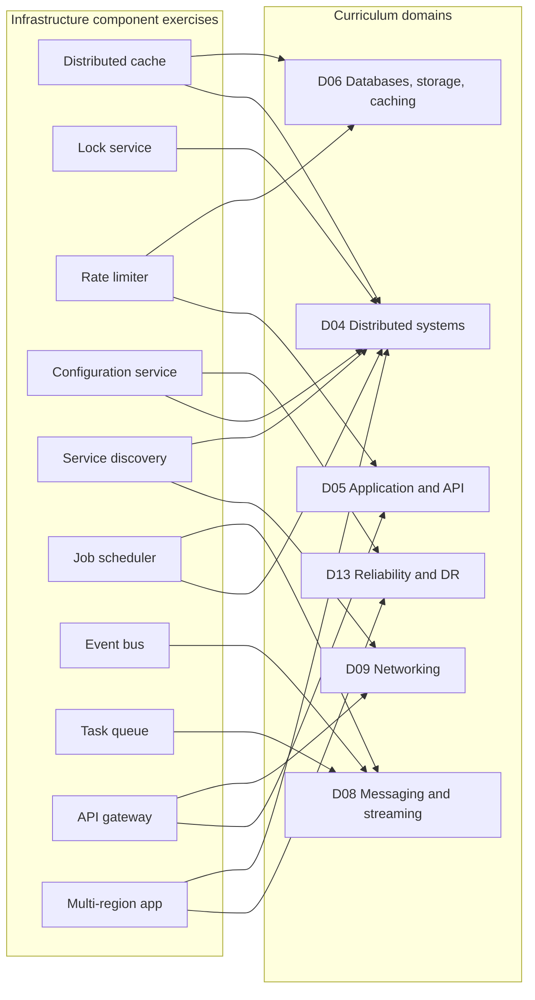

# Infrastructure component exercises

> Application designs keep saying "put a cache here", "take a lock", "schedule it", "publish an
> event". These exercises open those boxes: each one asks you to design a component that other teams
> will treat as a dependable primitive.

!!! abstract "Page facts"
    **Level:** Mixed (each brief is Level 2; the full exercises are Level 3) · **Status:** Outline ·
    **Time:** 15 minutes to read; 60-90 minutes per full exercise · **Last verified:** 2026-11-20

## How to use these exercises

Every exercise is meant to be worked with the [twelve-step design method](design-method.md): understand
the problem, write requirements, estimate, then design boundaries, contracts, data, style, deployment,
security, resilience, operations, and cost, recording trade-offs as you go.

- **Pick one, set a timer.** Give yourself 45-60 minutes for your own design before reading any reference
  solution. A design you produced and then compared teaches far more than one you read.
- **Use the stated scale.** The numbers in each brief are labelled assumptions, mostly derived from the
  fictional AtlasMart retailer used across this site. Do the arithmetic first; in several of these
  exercises it shows that the component is smaller than the name suggests.
- **Start from the three decisions.** Each brief names the decisions that dominate the design. A good
  answer makes each one explicitly, names the alternative it rejected, and says what would change the
  choice.
- **Read first, not after.** The "read first" pages hold the concepts the exercise assumes. Pages marked
  with a D-identifier are planned and not yet written.
- **Full exercises** have a problem statement, requirements, scale arithmetic, progressive hints, a
  reference solution, alternatives, failure modes, and a rubric. Three exist today:
  [distributed cache](distributed-cache.md), [rate limiter](rate-limiter.md), and
  [job scheduler](job-scheduler.md). The others are briefs only, with full exercises planned.

## Exercises

### Distributed cache

- **Brief.** Design a shared, multi-tenant, in-memory cache service for all of AtlasMart's teams. It must
  hold more than one machine's memory, survive a node or zone loss, rebalance without an outage, and keep a
  flash-sale hot key from saturating a node.
- **Scale to assume.** 40 million live keys of 2 KB on average; 300,000 operations per second at peak, 90%
  reads; one key at 20,000 reads per second during a flash sale; replication factor 2 across three zones.
- **Decisions that dominate.** (1) Partitioning and placement: consistent hashing with virtual nodes versus
  fixed slots. (2) Replication and failover semantics: what a client sees, and what is lost, when a primary
  dies. (3) Routing: smart client versus proxy tier.
- **Read first.** [Caching architecture](../databases-and-storage/caching-architecture.md);
  [Distributed systems fundamentals](../distributed-systems/distributed-systems-fundamentals-time-and-coordination.md);
  [Scaling, partitioning, and replication](../distributed-systems/scaling-partitioning-and-replication.md);
  [Lab 08: sharding and consistent hashing](../labs/lab-08-sharding-and-consistent-hashing.md).
- **Status.** Full exercise: [Design a distributed cache](distributed-cache.md).

### Distributed lock service

- **Brief.** Design a lock and lease service that AtlasMart's schedulers, leader elections, and
  one-at-a-time maintenance jobs can rely on. It must never grant the same lock to two live holders in a
  way that can corrupt a protected resource, and it must keep working when one zone is lost.
- **Scale to assume.** 2,000 active leases renewed every 5 s, so 2,000 ÷ 5 = 400 renewals per second; 50
  new acquisitions per second; a few kilobytes of state per lease; three zones (assumptions).
- **Decisions that dominate.** (1) Consensus group size and placement (three or five members across three
  zones) and what that does to write latency. (2) Lease semantics: duration, renewal, and the fencing token
  issued with every grant. (3) Client API: blocking acquire versus try-acquire, watches, and session
  expiry when a client disconnects.
- **Read first.** [Distributed systems fundamentals](../distributed-systems/distributed-systems-fundamentals-time-and-coordination.md)
  (leases, fencing, quorums, consensus);
  [Consistency models, CAP, and PACELC](../distributed-systems/consistency-models-cap-and-pacelc.md);
  [Lab 05: race condition](../labs/lab-05-race-condition.md).
- **Status.** Brief only, full exercise planned.

### Rate limiter

- **Brief.** Design the rate limiter that enforces AtlasMart's Tracking API limits (10 requests per second
  per customer with a burst of 20, 50 per second per support agent) consistently across three gateway
  instances, one per zone, without adding noticeable latency or becoming the reason tracking is down.
- **Scale to assume.** 210 legitimate requests per second at the sale-day design peak plus 2,100 per second
  of abusive traffic to reject, so 2,310 decisions per second; about 7,000 live counters of 150 B, roughly
  1 MB of limiter state.
- **Decisions that dominate.** (1) Algorithm: token bucket, fixed window, or sliding window, and how each
  treats bursts. (2) Where counters live: local per instance, a shared store, or a hybrid with periodic
  synchronization. (3) Failure behavior: fail open or fail closed when the counter store is unavailable.
- **Read first.** [Resilience mechanics: timeouts, retries, and backpressure](../distributed-systems/resilience-mechanics-timeouts-retries-and-backpressure.md);
  [Caching architecture](../databases-and-storage/caching-architecture.md);
  [API design](../application-and-api-architecture/api-design-rest-graphql-grpc-and-async-apis.md).
- **Status.** Full exercise: [Design a rate limiter](rate-limiter.md).

### Configuration service

- **Brief.** Design a central configuration service from which every AtlasMart service reads its settings
  and feature flags, with changes reviewed, rolled out gradually, and rolled back in seconds. A bad
  configuration push is one of the most common causes of outages, so safety matters more than speed.
- **Scale to assume.** 200 services with 1,500 running instances, 5,000 configuration keys, about 50
  changes per day, and every instance seeing a change within 30 s (assumptions). Instances poll every 15 s:
  1,500 ÷ 15 = 100 requests per second, or far fewer with long-polling or push.
- **Decisions that dominate.** (1) Source of truth: a consensus-backed key-value store, or a version-
  controlled repository with a distribution layer. (2) Distribution: push, long-poll, or poll, and how
  instances behave when the service is unreachable (keep the last known good configuration). (3) Safe
  rollout: schema validation, staged rollout by percentage or zone, and automatic rollback on error-rate
  regression.
- **Read first.** [Trade-offs, principles, ADRs, and architecture governance](../architecture-fundamentals/trade-offs-principles-adrs-and-architecture-governance.md);
  [High availability design](../reliability-and-disaster-recovery/high-availability-design.md) (static
  stability); planned: CI/CD pipeline design and deployment strategies (D16-T02).
- **Status.** Brief only, full exercise planned.

### Service discovery

- **Brief.** Design how AtlasMart's services find healthy instances of each other as instances start,
  stop, and move during deployments and autoscaling. Discovery sits on every request path, so its failure
  modes become everyone's failure modes.
- **Scale to assume.** 200 services, 1,500 instances, about 10 instance changes per minute during deployment
  windows, and lookups on every inter-service call but cached by clients (assumptions).
- **Decisions that dominate.** (1) Client-side discovery (a registry the caller queries) versus server-side
  (DNS, a load balancer, or a service mesh sidecar). (2) Registration and health: self-registration with
  heartbeats or platform-driven registration from the orchestrator. (3) Registry consistency: favor
  availability and tolerate brief staleness, or favor consistency and risk the registry blocking lookups.
- **Read first.** [Networking fundamentals: IP, CIDR, routing, and DNS](../networking/networking-fundamentals-ip-cidr-routing-and-dns.md);
  [Distributed system patterns](../software-architecture/distributed-system-patterns.md);
  [Consistency models, CAP, and PACELC](../distributed-systems/consistency-models-cap-and-pacelc.md);
  planned: Kubernetes networking, storage, and service mesh (D11-T03).
- **Status.** Brief only, full exercise planned.

### Job scheduler

- **Brief.** Design a shared scheduler for one-off and cron-style jobs, such as AtlasMart's 13-month
  retention deletion, nightly carrier reconciliation, and reminder notifications. It must never silently
  skip work, start jobs close to their due time, and behave sensibly across daylight-saving changes.
- **Scale to assume.** About 240,000 runs per day (design ceiling 720,000), 460,000 pending one-off jobs,
  and a burst of 60,000 reminders due at 19:00.
- **Decisions that dominate.** (1) Due-time storage and index: a relational table with a partial index,
  a time-bucketed table, or in-memory timing wheels. (2) Coordination: single leader, leased partitions with
  fencing tokens, or competing dispatchers. (3) Execution semantics: at-least-once with idempotent handlers,
  plus retry, dead-letter, and catch-up policies.
- **Read first.** [Distributed systems fundamentals](../distributed-systems/distributed-systems-fundamentals-time-and-coordination.md);
  [Message queues and brokers](../messaging-and-streaming/message-queues-and-brokers.md);
  [Lab 03: queue retries and dead letters](../labs/lab-03-queue-retries-and-dead-letter.md);
  [Lab 04: idempotency and duplicates](../labs/lab-04-idempotency-and-duplicates.md).
- **Status.** Full exercise: [Design a distributed job scheduler](job-scheduler.md).

### Event bus

- **Brief.** Design the event bus through which AtlasMart's domains publish facts (order placed, shipment
  delivered, price changed) for any number of other teams to consume, replay, and evolve against without
  coordinating releases.
- **Scale to assume.** About 1,000,000 events per day (assumption, including 480,000 tracking events and
  60,000 orders), so 1,000,000 ÷ 86,400 ≈ 11.6 per second on average and about 150 per second at peak;
  30 consumer groups; 7-day retention for replay.
- **Decisions that dominate.** (1) Log-based (partitioned, replayable) versus broker-based (queues per
  subscriber) and what replay costs in each. (2) Partition key and ordering: which events must stay in
  order relative to which. (3) Schema governance: a registry, compatibility rules, and versioning of event
  contracts.
- **Read first.** [Message queues and brokers](../messaging-and-streaming/message-queues-and-brokers.md);
  [Integration architecture](../application-and-api-architecture/integration-architecture.md);
  [Transactions, sagas, and delivery guarantees](../distributed-systems/transactions-sagas-and-delivery-guarantees.md);
  planned: event-driven architecture (D08-T02) and event streaming and log-based architecture (D08-T03).
- **Status.** Brief only, full exercise planned.

### Task queue

- **Brief.** Design a background task queue for work that must happen soon but not inside a user's
  request: generating invoice PDFs, resizing product images, and sending order emails. Unlike the job
  scheduler, tasks run as soon as a worker is free; unlike the event bus, each task is done by exactly one
  consumer.
- **Scale to assume.** 2,000,000 tasks per day (assumption), so about 23 per second on average and 200 per
  second at peak; task durations from 100 ms to 5 minutes; three priority levels.
- **Decisions that dominate.** (1) Acknowledgement and visibility timeout semantics, and how long-running
  tasks extend them. (2) Retries, poison tasks, and dead-letter handling. (3) Priority, fairness, and
  autoscaling workers on queue depth and age rather than CPU.
- **Read first.** [Message queues and brokers](../messaging-and-streaming/message-queues-and-brokers.md);
  [Resilience mechanics: timeouts, retries, and backpressure](../distributed-systems/resilience-mechanics-timeouts-retries-and-backpressure.md);
  [Performance fundamentals and Little's Law](../performance-and-scalability/performance-fundamentals-and-littles-law.md);
  [Lab 03: queue retries and dead letters](../labs/lab-03-queue-retries-and-dead-letter.md).
- **Status.** Brief only, full exercise planned.

### API gateway

- **Brief.** Design the gateway in front of AtlasMart's public and mobile APIs: one entry point that
  authenticates callers, routes to about 60 backend routes, applies quotas, and isolates backends from each
  other's failures, without becoming the bottleneck or the place where all business logic accumulates.
- **Scale to assume.** 5,000 requests per second at peak across all APIs (assumption, of which the
  tracking reads are 210), 70% from mobile web, p99 gateway overhead under 10 ms.
- **Decisions that dominate.** (1) One shared gateway versus a gateway per domain or per client type
  (backend for frontend). (2) What runs at the edge: token validation, rate limiting, request
  transformation, and what must stay in services. (3) Resilience: per-route timeouts, circuit breakers,
  and load shedding so one slow backend cannot exhaust the gateway.
- **Read first.** [API design: REST, GraphQL, gRPC, and async APIs](../application-and-api-architecture/api-design-rest-graphql-grpc-and-async-apis.md);
  [Transport and application protocols](../networking/transport-and-application-protocols.md);
  [Microservices architecture](../software-architecture/microservices-architecture.md);
  planned: network security, load balancing, and traffic flow (D09-T03); identity and access management
  (D12-T02).
- **Status.** Brief only, full exercise planned.

### Multi-region application

- **Brief.** Take the AtlasMart Order Tracking System, today in one region with three zones, and design it
  to survive the loss of a whole region. Decide what runs where, how data crosses regions, how traffic
  moves, and what customers see during and after a regional failover.
- **Scale to assume.** The tracking system's own figures: 210 reads per second and 70 events per second at
  design peak, about 430 GB of event storage, NFR-7 (no acknowledged event lost, RPO 5 minutes, RTO 1 hour).
- **Decisions that dominate.** (1) Active-passive versus active-active, and which components are which.
  (2) Cross-region data replication: asynchronous with a stated loss window, or synchronous at a latency
  cost, and how conflicts are handled. (3) Traffic routing and failover: DNS or a global load balancer,
  automated or human-triggered.
- **Read first.** [High availability design](../reliability-and-disaster-recovery/high-availability-design.md);
  [SLAs, SLOs, SLIs, error budgets, and recovery objectives](../architecture-fundamentals/slas-slos-slis-error-budgets-and-recovery-objectives.md);
  [Scaling, partitioning, and replication](../distributed-systems/scaling-partitioning-and-replication.md);
  [Lab 09: replication lag](../labs/lab-09-replication-lag.md); planned: disaster recovery strategies
  (D13-T03).
- **Status.** Brief only, full exercise planned.

## How the exercises map to the curriculum

**Figure 1 — Which domains each infrastructure exercise practises.** Each arrow points from an exercise
to a domain whose ideas it exercises most heavily.

How to read it: domains with many incoming arrows (distributed systems, messaging) are the ones these
exercises drill hardest; if a domain is new to you, read its pages before attempting the exercises that
point at it.

| Exercise | Main domains | Secondary domains |
|---|---|---|
| Distributed cache | D04 Distributed systems, D06 Databases and storage | D14 Performance and scalability |
| Distributed lock service | D04 Distributed systems | D13 Reliability |
| Rate limiter | D05 Application and API, D06 Databases and storage | D12 Security (abuse protection) |
| Configuration service | D04 Distributed systems, D13 Reliability | D16 DevOps (safe rollout) |
| Service discovery | D09 Networking, D04 Distributed systems | D11 Containers and Kubernetes |
| Job scheduler | D04 Distributed systems, D08 Messaging | D15 Observability |
| Event bus | D08 Messaging and streaming | D05 Integration, D07 Data |
| Task queue | D08 Messaging and streaming | D14 Performance and scalability |
| API gateway | D05 Application and API, D09 Networking | D12 Security |
| Multi-region application | D13 Reliability and DR, D04 Distributed systems | D17 FinOps (the cost of a second region) |

## Review notes

- Canonical page for D29-T02, status Outline: every inventory item has a brief, a stated scale, three
  dominating decisions, reading, and a status. Full exercises exist for the distributed cache, rate limiter,
  and job scheduler; the other seven are briefs only.
- Collection pages have no knowledge check and no references table by design; sources live on the full
  exercise pages and the topic pages they link.
- New AtlasMart assumptions introduced in the briefs: 2,000 active leases renewed every 5 s and 50
  acquisitions per second (lock service); 200 services, 1,500 instances, 5,000 configuration keys, 50 changes
  per day, 30 s propagation, 15 s polling (configuration service); about 10 instance changes per minute
  during deployments (service discovery); 1,000,000 events per day, 150 per second peak, 30 consumer groups,
  7-day retention (event bus); 2,000,000 tasks per day, 200 per second peak (task queue); 5,000 requests per
  second gateway peak, about 60 routes, 10 ms p99 overhead target (API gateway). Cache and scheduler figures
  come from their full exercise pages, as do the rate limiter figures (copied from the rate limiter
  exercise as it stood on 2026-11-20); the multi-region figures come from the capacity page and NFR-7.
- Figure 1 uses two stacked subgraphs linked with `~~~` and 17 links; check it renders legibly at phone
  width.
