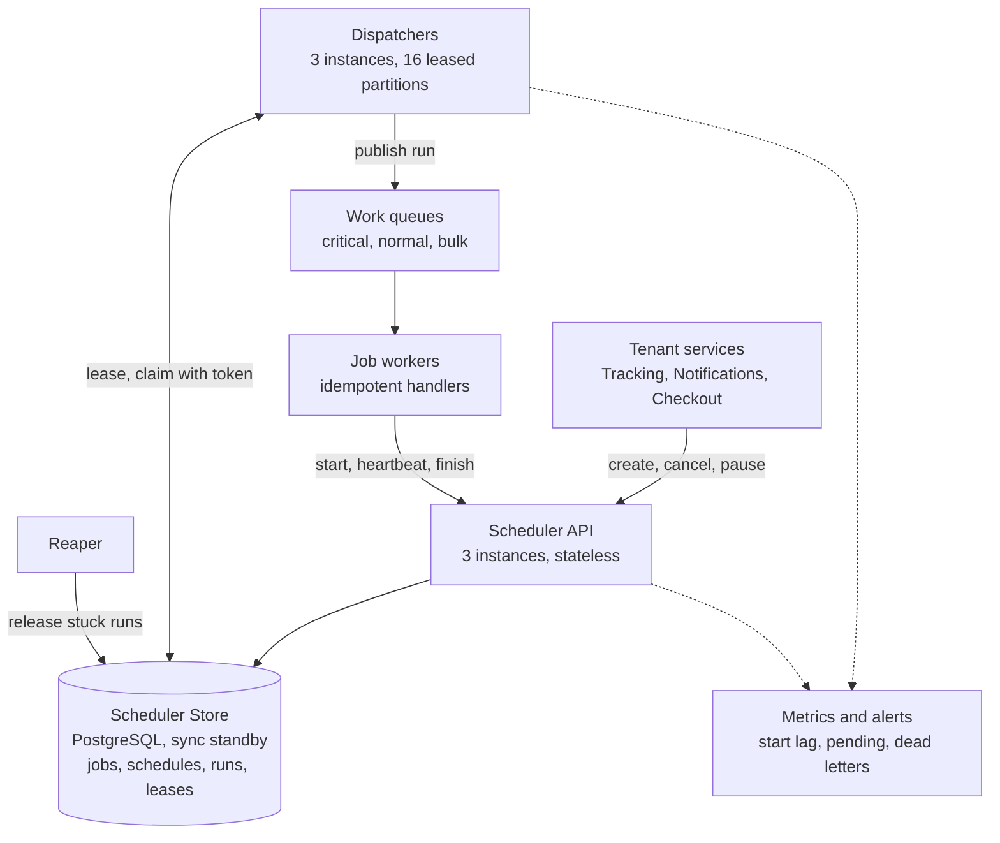
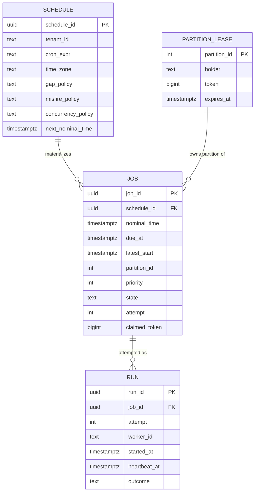
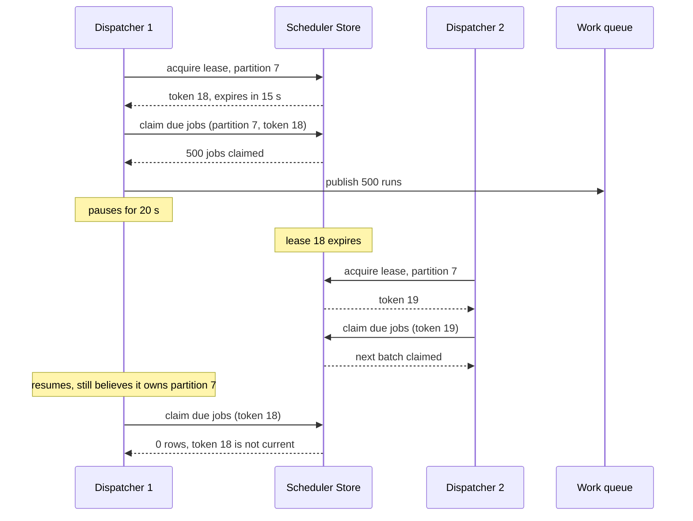
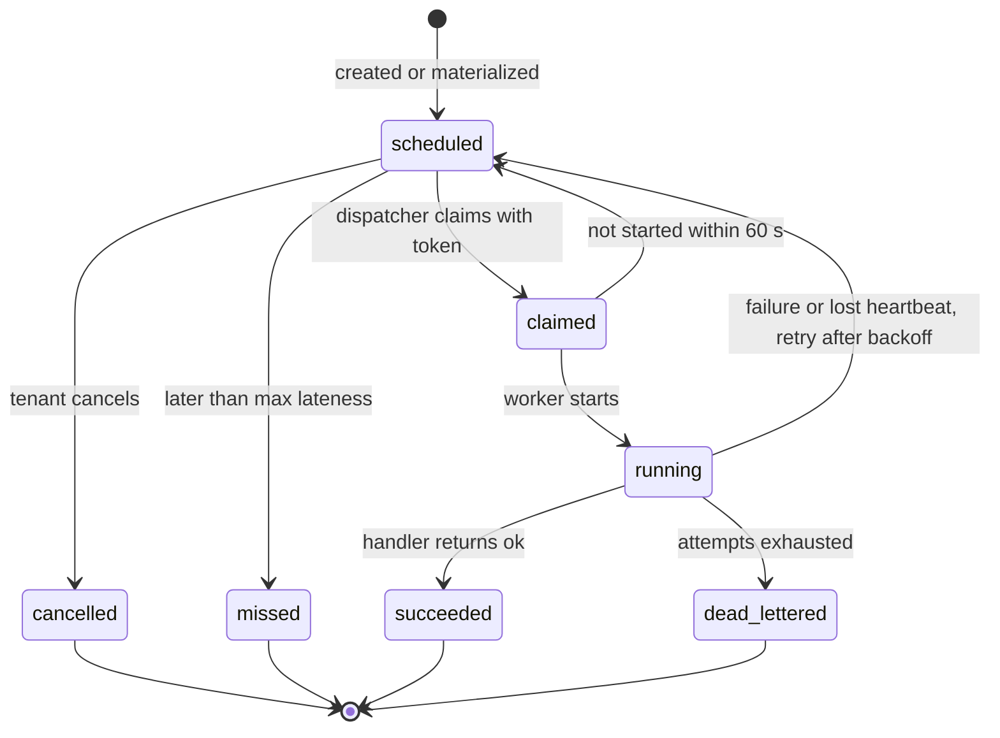

# Exercise: design a distributed job scheduler

> Running something at 02:00 every night looks like a one-line cron entry until the machine that runs
> it dies, two machines both run it, 02:00 does not exist on the night the clocks change, and 60,000
> reminders all fall due in the same second.

!!! abstract "Page facts"
    **Level:** Advanced · **Status:** Draft · **Time:** 60-90 minutes · **Last verified:** 2026-11-20
    · **Exercise set:** [Infrastructure component exercises](infrastructure-component-exercises.md)

## Problem statement

AtlasMart's teams run scheduled work on a mix of cron entries on individual virtual machines and
timers inside services. Three examples show the range:

- the **retention deletion job**, which every night removes tracking events older than 13 months from
  the Tracking Event Store (the retention requirement stated on the
  [gap analysis page](../architecture-fundamentals/as-is-and-to-be-architecture-gap-analysis-and-build-vs-buy.md));
- the **nightly carrier reconciliation**, one run per carrier per business date, which compares the
  carrier's daily file with the events AtlasMart received (the reconciliation step from the
  [integration architecture page](../application-and-api-architecture/integration-architecture.md));
- **scheduled reminder notifications**: "your parcel arrives tomorrow" the evening before delivery,
  "how was your delivery?" two days after it, and Checkout's abandoned-cart reminder a day after a
  cart is left.

When the VM running the cron entries was rebooted during patching last quarter, the retention job did
not run for three nights and nobody noticed. Design a shared, multi-tenant scheduler service that
stores one-off and recurring jobs durably, starts each one close to its due time, survives the loss of
any single machine or zone, never silently skips work, and tells its tenants how late it is running.
The scheduler triggers work; the work itself runs in tenant-owned handlers.

## How to use this exercise

1. Read the requirements and scale, then close this page and design on your own for 30-45 minutes,
   following the [twelve-step design method](design-method.md). Do the volume arithmetic first; it
   decides whether you need anything more exotic than one relational database.
2. Open the hints one at a time only when stuck.
3. Compare with the reference solution step by step; check your differences against the alternatives
   table and decide whether you can defend them.
4. Score yourself with the rubric, then try one extension.

## Requirements

### Functional requirements

1. **FR-1** Create a one-off job: tenant, job type, due time, payload (reference identifiers only),
   priority, optional start window, maximum lateness, retry policy, and a tenant-supplied idempotency
   key so a repeated create does not create a second job.
2. **FR-2** Create a recurring schedule from a cron expression and an IANA time zone, with an explicit
   policy for missing and repeated local times, a catch-up (misfire) policy, and a concurrency policy
   (allow or forbid overlapping runs).
3. **FR-3** Cancel a job; pause and resume a schedule.
4. **FR-4** Deliver each due run to a handler for its job type; the handler reports start, heartbeat,
   success, or failure.
5. **FR-5** Retry failed runs with backoff; after the last attempt, move the job to a dead-letter state
   and alert the owning tenant.
6. **FR-6** Show run history, current lateness, and dead-lettered jobs per tenant.

### Non-functional requirements

| ID | Requirement | Measure |
|---|---|---|
| NFR-1 | Start lag (start time minus due time, or minus window end for windowed jobs) | 99% of critical runs within 10 s; 99% of normal runs within 60 s; monthly |
| NFR-2 | Durability | No accepted job or schedule is lost (RPO 0 for definitions, like the Tracking Event Store); RTO 1 h for the whole service |
| NFR-3 | Execution semantics | At-least-once; duplicates rare and harmless because handlers are idempotent; a forbid-overlap schedule never has two runs active |
| NFR-4 | Scale | 240,000 runs per day today, design ceiling 720,000; a 60,000-job burst at one due time |
| NFR-5 | Fairness | One tenant's burst cannot push another tenant's critical runs past NFR-1 |
| NFR-6 | Security | Authenticated tenants, per-tenant authorization, allow-listed job types, no personal data in payloads (consistent with AtlasMart's NFR-6: no delivery addresses stored) |
| NFR-7 | Availability | Scheduler API 99.9% monthly; dispatching resumes within 30 s of losing any one instance |
| NFR-8 | Observability | Per-tenant lag dashboard; alert when p95 lag exceeds 120 s for 5 minutes (mirrors the tracking service's NFR-8) |

### Clarifying questions to ask

- Is at-least-once acceptable if handlers are idempotent, or does any job claim to need exactly-once?
  (Exactly-once *effects* come from idempotent handlers, not from the scheduler.)
- What should happen to a reminder that is two hours late: send it, or drop it?
- Which time zone does each schedule mean: the business's, the customer's, or UTC?
- Do jobs depend on each other (run B after A succeeds)? That is a workflow engine, a larger problem.
- How long can a job run? Seconds, or the hours a large deletion might take?
- Who may create a schedule that runs every minute, and who pays for it?

## Scale assumptions

**Stated assumptions** (AtlasMart figures from the [capacity page](../performance-and-scalability/capacity-estimation.md)
plus new, labelled assumptions):

| Job source | Kind | Created per day | Runs per day | Basis |
|---|---|---|---|---|
| "Arrives tomorrow" reminder | One-off | 60,000 | 60,000 | One per order (60,000 orders/day); due 19:00 local the evening before delivery; created at dispatch |
| "How was your delivery?" reminder | One-off | 60,000 | 60,000 | One per order; due 48 h after the delivered event |
| Abandoned-cart reminder | One-off | 100,000 | 60,000 | Assumption: 25% of 400,000 DAU leave a cart; due 24 h later; assumption: 40% cancelled because the customer buys |
| Every-minute schedules | Recurring | | 57,600 | Assumption: 40 schedules × 1,440 minutes |
| Hourly schedules | Recurring | | 2,400 | Assumption: 100 schedules × 24 |
| Daily schedules | Recurring | | 60 | Assumption: 60, including retention deletion (1) and carrier reconciliation (assumption: 12 carriers) |

Further assumptions: job row 1 KB, run-history row 400 B kept 30 days; a reminder handler takes 40 ms;
20 worker slots for the normal lane; dispatchers claim in batches of 500.

**Arithmetic.**

- Runs per day: 60,000 + 60,000 + 60,000 + 57,600 + 2,400 + 60 = **240,060 ≈ 240,000**. Average
  240,000 ÷ 86,400 ≈ **2.8 runs/s**. Design ceiling (×3 for growth and new tenants) 720,000/day ≈
  **8.3 runs/s**.
- Writes: each run costs about four row writes (claim, start, finish, history), so ≈ 11 writes/s on
  average; one-off creations and cancellations add (220,000 + 40,000) ÷ 86,400 ≈ 3/s. Tens of writes per
  second: one relational primary is ample, as it is for the Tracking Event Store.
- Pending jobs at any moment: "arrives tomorrow" reminders wait about 4 days (5-day transit) → 240,000;
  delivery-feedback wait 2 days → 120,000; abandoned carts wait 1 day → up to 100,000. Total ≈
  **460,000 rows × 1 KB ≈ 460 MB**. Run history: 240,000 × 30 × 400 B ≈ **2.9 GB**. With the capacity
  page's replication factor 3 and index overhead 1.5: (0.46 + 2.9) × 4.5 ≈ **15 GB**. Small.
- The burst: 60,000 "arrives tomorrow" reminders are due at 19:00. Claiming is not the bottleneck
  (500 per claim transaction). Execution is: 20 slots ÷ 0.04 s = **500 runs/s**, so 60,000 take
  **120 s** if released at once (Little's Law: 500/s × 0.04 s = 20 in flight). If each reminder declares
  a 15-minute start window, the dispatcher can release 60,000 ÷ 900 s ≈ **67/s**, using about 3 slots.
- The retention job: one day's worth of events turns 13 months old each night, 480,000 rows; in batches
  of 5,000 that is **96 batches**; at an assumed 1 s per batch, about **1.6 minutes**.
- Polling: 16 partitions each polled once per second is 16 small indexed queries per second; the
  polling interval adds at most 1 s to start lag.

The estimate's verdict: a single relational store with a due-time index carries this load with a
large margin. The hard parts are coordination, semantics, and time, not volume.

## Hints

??? question "Hint 1: where do due jobs live, and who picks them up?"
    "Run at 19:00" must survive a restart, so it lives in durable storage. What index finds "all jobs
    due now, oldest first" cheaply? Then: what happens if two machines both believe they are the
    scheduler, and what happens if none does?

??? question "Hint 2: leases are not enough"
    A dispatcher holding a lease can pause for longer than the lease. Where must a fencing token be
    checked so that the paused dispatcher's work is rejected? Since at-least-once delivery is
    unavoidable, what identifies one logical run uniquely so that handlers can make duplicates harmless?
    (Think about a schedule identifier plus the *nominal* time the run was meant for.)

??? question "Hint 3: the shape of one good answer"
    A relational store with a partial index on due time; 16 partitions, each owned by one dispatcher
    through a lease with a fencing token that the database checks inside the claim transaction;
    `FOR UPDATE SKIP LOCKED` claims; per-priority work queues with reserved capacity; handlers keyed by
    job identifier plus nominal time; retries with jittered backoff then a dead-letter state; a misfire
    policy per schedule; IANA time zones with explicit gap and overlap rules; start lag as the main SLI.

## Reference solution

The walk-through follows the [design method](design-method.md); each step is brief, and depth goes where
the decisions are.

### Step 1 — Business problem and outcome

Scheduled work is invisible until it fails: the retention job's three silent nights were a compliance
exposure, and a reminder sent after delivery is noise. The outcome is one scheduler that every team uses,
with a lag objective and alerts, so that "did it run?" has an answer. Success metrics: no unnoticed missed
run in a quarter, all cron VMs retired, NFR-1 met.

### Step 2 — Requirements, assumptions, constraints, risks

As stated above. Key assumptions: handlers can be made idempotent; payloads hold identifiers, not
personal data. Risks: double execution of non-idempotent work, top-of-the-hour bursts, daylight-saving
surprises, and one noisy tenant.

### Step 3 — Estimate

The arithmetic above decides: **one PostgreSQL primary with a synchronous standby** (matching the Tracking
Event Store pattern, so the team already operates it); **partitioning for availability and parallelism,
not volume** (16 partitions over 3 dispatchers); **start windows and priority lanes** to deal with the
19:00 burst.

### Step 4 — Boundaries and responsibilities

| Container | Responsibility |
|---|---|
| Scheduler API | Validate and store jobs and schedules, cancel, pause, record run results, serve history |
| Scheduler Store | Jobs, schedules, runs, partition leases; the single source of truth and the fencing authority |
| Dispatcher | Hold partition leases, materialize the next run of each recurring schedule, claim due jobs, publish runs to work queues |
| Work queues | Buffer runs per priority lane (critical, normal, bulk); at-least-once delivery |
| Job workers | Execute handlers for allow-listed job types; heartbeat; report outcome |
| Reaper | Return claims that were never started and runs whose heartbeat stopped to the scheduled state |

**Figure 1 — Container view of the scheduler.**



How to read it: the store is the only stateful container; dispatchers and workers can be killed at any
time and the store's rows say exactly what was due, claimed, running, or done.

### Step 5 — APIs and contracts

| Operation | Request | Response |
|---|---|---|
| `POST /v1/jobs` | tenant, type, due_at (UTC), window, max_lateness, priority, payload, retry policy, `Idempotency-Key` header | job_id (the same one for a repeated key) |
| `POST /v1/schedules` | tenant, type, cron, time_zone, gap_policy, misfire_policy, concurrency_policy, priority, payload | schedule_id |
| `DELETE /v1/jobs/{id}` | | cancelled, or conflict if already running |
| `POST /v1/schedules/{id}:pause` and `:resume` | | state |
| `GET /v1/jobs/{id}/runs` | | attempts with times, outcome, worker, lag |
| Worker contract | run message: job_id, run_id, attempt, nominal_time, type, payload, deadline | worker calls start, heartbeat (every 10 s), succeed, or fail with retryable flag |

Handlers must treat **(job_id, nominal_time)** as the idempotency key for their side effects; for a
reminder, the key is passed on to the Notification Provider, the same approach the
[fundamentals page](../distributed-systems/distributed-systems-fundamentals-time-and-coordination.md) uses
for tracking notifications.

### Step 6 — Data model, storage, and the due-time index

**Figure 2 — Scheduler data model.**



How to read it: a recurring schedule produces one job per nominal time, protected by a unique constraint
on (schedule_id, nominal_time); a one-off job has no schedule. Each attempt is a run.

The **due-time index** is a partial B-tree index on `(partition_id, priority, due_at)` restricted to
`state = 'scheduled'`; it holds only the ~460,000 pending rows, not history, so it stays small and hot.
A **time-bucketed table** (one row per job per minute bucket, scanned bucket by bucket) or an in-memory
heap per partition are the alternatives for much larger volumes; the estimate shows neither is needed
here.

### Step 7 — Architecture style and the key algorithm

A small, stateless-workers-around-a-database design: the database provides durability, ordering, and
fencing; the dispatchers are interchangeable. The reference uses **partitioned scheduling with leases**
rather than a single leader so that losing one dispatcher stalls only its partitions for one lease
period, and three dispatchers share the claim work.

**Leases and fencing.** Each partition has a row in `partition_lease`. A dispatcher acquires a free or
expired lease by updating the row, which increments `token`; the lease lasts 15 s (the same value
AtlasMart uses for its notification scheduler lease) and is renewed every 5 s. Expiry is judged by the
database's clock (`now()`), so dispatcher clock skew does not matter. The claim locks the lease row
for share inside the same transaction, so the lease cannot change hands mid-claim, and a dispatcher with
an outdated token claims nothing:

```sql
-- $1 = partition_id, $2 = the dispatcher's fencing token
WITH lease AS (
    SELECT 1 FROM partition_lease
    WHERE partition_id = $1 AND token = $2 AND expires_at > now()
    FOR SHARE
),
due AS (
    SELECT job_id FROM job
    WHERE partition_id = $1
      AND state = 'scheduled'
      AND due_at <= now()
      AND EXISTS (SELECT 1 FROM lease)
    ORDER BY priority, due_at
    LIMIT 500
    FOR UPDATE SKIP LOCKED
)
UPDATE job
SET state = 'claimed', claimed_token = $2, attempt = attempt + 1, claimed_at = now()
FROM due
WHERE job.job_id = due.job_id
RETURNING job.job_id, job.tenant_id, job.type, job.nominal_time, job.attempt;
```

After the transaction commits, the dispatcher publishes one message per claimed job to its lane's queue.
If it crashes between commit and publish, the reaper returns claims that have not started within 60 s to
`scheduled`; that is one of the places at-least-once comes from.

**Figure 3 — A paused dispatcher is fenced by the database.**



How to read it: the fence is in the claim query, not in the dispatcher's belief; Dispatcher 1's late
claim matches no lease row and therefore no jobs.

**Recurring schedules.** For each schedule in its partitions, the dispatcher materializes the next
occurrence as a job row: it computes the next nominal local time from the cron expression, converts it to
UTC with the schedule's time-zone rules (below), and inserts the job. The unique constraint on
(schedule_id, nominal_time) makes a duplicate materialization by a stale dispatcher fail harmlessly, so
correctness here does not even depend on the lease. It then advances `next_nominal_time`.

**Time zones and daylight saving.** Schedules store an IANA zone name, never a fixed offset, and the
conversion is done when each occurrence is materialized, so rule changes in the time-zone database apply
to future runs. Two edge cases need explicit policies. For a daily 01:30 schedule in `Europe/London`
(clocks move forward at 01:00 UTC on 28 March 2027 and back at 01:00 UTC on 31 October 2027):

| Local date | 01:30 local | Policy | Runs at (UTC) |
|---|---|---|---|
| 27 March 2027 | Exists once (GMT) | | 01:30 |
| 28 March 2027 | Does not exist (01:00 jumps to 02:00) | `shift`: first valid minute after the gap | 01:00 (02:00 BST) |
| 28 March 2027 | Does not exist | `skip`: no run that day | none |
| 31 October 2027 | Exists twice (BST, then GMT) | first occurrence only | 00:30 |
| 1 November 2027 | Exists once (GMT) | | 01:30 |

```python
from datetime import datetime, timedelta, timezone
from zoneinfo import ZoneInfo


def to_utc(wall: datetime, tz: ZoneInfo, gap_policy: str = "shift") -> datetime | None:
    """Convert a naive local wall time from a cron-style schedule to UTC.

    Repeated hour (autumn): use the first occurrence (fold=0).
    Missing hour (spring): 'shift' runs at the first valid minute after the gap, 'skip' returns None.
    """
    def exists(t: datetime) -> bool:
        aware = t.replace(tzinfo=tz, fold=0)
        return aware.astimezone(timezone.utc).astimezone(tz).replace(tzinfo=None) == t

    if not exists(wall):
        if gap_policy == "skip":
            return None
        while not exists(wall):
            wall += timedelta(minutes=1)
    return wall.replace(tzinfo=tz, fold=0).astimezone(timezone.utc)
```

Interval schedules ("every 15 minutes") are computed in UTC elapsed time and are unaffected. A practical
rule for local-time jobs is to avoid the hours in which the zone's clocks change; the retention job runs at
03:30 local for that reason.

**Catch-up (misfire) policy.** When a dispatcher outage or a pause leaves occurrences in the past, the
schedule's policy decides:

| Policy | Behavior | AtlasMart use |
|---|---|---|
| `coalesce` | Run once for all missed occurrences, with the latest nominal time | Retention deletion: one run deletes everything older than the cutoff; every-minute jobs |
| `backfill` (bounded, maximum 7) | One run per missed nominal time, oldest first | Carrier reconciliation: each business date must be reconciled once |
| `skip` | Do not run missed occurrences; wait for the next | Hourly cache warmers whose late output is useless |

One-off jobs use `max_lateness` instead: an "arrives tomorrow" reminder due at 19:00 with a 15-minute window
and 2 hours of maximum lateness is marked `missed` (and counted) rather than sent at 23:00.

### Step 8 — Compute, network, deployment

Three API instances and three dispatchers, one per zone; workers in tenant-owned pools or a shared pool
for simple job types (sending a reminder is a call to the notification service). The store is the same
managed PostgreSQL pattern as the Tracking Event Store (primary in one zone, synchronous standby in
another); the work queues use the same managed queue service as the Event Queue.

### Step 9 — Identity, authorization, encryption, trust boundaries

- Tenants call the API with their workload identity over TLS; each job and schedule is owned by a tenant,
  and a tenant can see and cancel only its own.
- **Job types are allow-listed and bound to handlers.** The scheduler never executes code or calls an
  arbitrary URL from a payload; a "call this URL at 19:00" feature would turn the scheduler into a
  server-side request forgery tool inside the network.
- Payloads hold identifiers (order id, carrier id, business date), never addresses or names; the handler
  looks up what it needs under its own permissions.
- The retention job runs under a database role that can only delete from the event tables, and every
  run logs the cutoff and the row count deleted, which is the audit evidence for the retention policy.
- Schedule creation and changes are audit-logged; schedules more frequent than every 5 minutes require
  platform approval (a guard against expensive mistakes as much as abuse).

### Step 10 — Scaling, resilience, retries, fairness

**At-least-once and idempotency.** Duplicates arise from three places: a dispatcher crash between commit
and publish, a worker that finishes but dies before reporting, and queue redelivery. The design accepts
them and makes them harmless: every side effect is keyed by (job_id, nominal_time); the retention job's
work is naturally idempotent (deleting rows already deleted removes nothing); the reconciliation writes
its result with an upsert keyed by (carrier, business date); reminders pass the key to the provider.

**Long-running runs.** Workers heartbeat every 10 s; the reaper returns a run with no heartbeat for 60 s to
`scheduled`. The retention job checkpoints the last deleted event id after each batch with a condition on
its attempt number (`WHERE job_id = $1 AND attempt = $2`), so a superseded attempt cannot overwrite the
checkpoint of the current one: the same fencing idea at the run level.

**Retries and dead letters.** A retryable failure sets `due_at = now() + backoff` with exponential backoff
and full jitter (base 30 s, cap 30 minutes, 5 attempts by default) and returns the job to `scheduled`. After
the last attempt the job becomes `dead_lettered`; the tenant is alerted and can re-drive it after fixing the
cause. Hands-on practice with the same mechanics is in
[Lab 03: retries and dead-letter queues](../labs/lab-03-queue-retries-and-dead-letter.md).

**Figure 4 — Job lifecycle.**



How to read it: every arrow back to `scheduled` is a potential duplicate execution, which is why handlers
must be idempotent; every terminal state is visible to the tenant.

**Priority and fairness.** Three lanes with separate queues and reserved worker capacity: critical
(retention, reconciliation, every-minute operational jobs), normal (reminders), bulk (backfills, re-drives).
Within a lane, the dispatcher claims in rounds across tenants with due work, up to each tenant's weight per
round (weighted round robin), so Checkout's abandoned-cart backlog cannot occupy every claim. The 19:00 burst
lands in the normal lane and its 15-minute window spreads it; critical work keeps its reserved slots.

**Scaling beyond the ceiling.** Raise the partition count (a configuration change plus a one-off
re-hash of pending rows), add dispatchers, and add worker slots per lane. Only at around a hundred times the
current volume would the due index or polling become the limit, and then the time-bucketed table or
per-partition in-memory timing wheels become worthwhile.

### Step 11 — CI/CD, observability, operations

- **The main SLI is start lag**: `started_at − due_at` (or minus the window end), as a histogram per tenant,
  lane, and job type. Alert when p95 exceeds 120 s for 5 minutes (NFR-8).
- **Supporting signals:** due-but-unclaimed count per partition (the earliest warning that dispatching has
  stopped), pending count, claims returned by the reaper, run duration, failure rate, dead-letter count per
  tenant, lease changes per hour (flapping), and missed one-off jobs.
- **Dead-man's switch** for critical schedules: if the retention job has not succeeded in 26 hours, page.
  This is the alert that would have caught the three silent nights.
- Schedules are declared in each tenant's repository and applied by its pipeline, so changes are reviewed.

### Step 12 — Cost, trade-offs, ADRs

Cost is small: a modest database, six small instances, and queue traffic of a few runs per second. The
expensive mistakes are elsewhere: duplicate sends to customers and silent misses. ADRs to record:
relational store with due index versus broker delayed messages; partitioned leases with database fencing;
at-least-once with idempotency keys; the default misfire policy per job category; local-time schedules
only with explicit gap and overlap policies.

## Alternatives and trade-offs

| Decision | Reference choice | Alternative | Choose the alternative when |
|---|---|---|---|
| Coordination | 16 partitions leased with fencing tokens | Single leader dispatcher | Volume is tiny and a pause of one lease period for all jobs is acceptable; simplest to reason about |
| Coordination | Leased partitions | Competing dispatchers with `SKIP LOCKED` and no leases | You only need claim safety (the row lock gives it) and can make materialization idempotent by unique key; fewer moving parts |
| Due-time index | B-tree partial index in PostgreSQL | Time-bucketed table (minute buckets) | Millions of jobs per minute; scans become cheap sequential bucket reads |
| Due-time index | Database polling | In-memory heap or timing wheel per partition, loaded from the store | Sub-second start precision at high volume; costs reload logic after failover |
| Storage of delays | Scheduler Store | Broker delayed delivery or message timers | Short delays only, no cancellation, no catch-up policy, no history needed |
| Platform | Build | Managed cloud scheduler | Its limits on delay, rate, time zones, and cancellation fit; check the provider's current documentation |
| Execution | At-least-once with idempotent handlers | At-most-once (mark done before running) | A missed run is better than a duplicate, for example a non-idempotent external call you cannot key |
| Misfire default | Per schedule | One global policy | Never; job categories genuinely differ |

## Failure modes and how the design handles them

| Failure | Without a defense | How the design handles it |
|---|---|---|
| Dispatcher crashes | Its partitions' jobs stop | Lease expires within 15 s; another dispatcher acquires with a higher token; due-but-unclaimed alert if none does |
| Dispatcher pauses past its lease | Two dispatchers claim the same partition | Claim query checks the token under a share lock; the stale holder claims nothing |
| Crash between claim commit and publish | Job stuck as claimed forever | Reaper returns unstarted claims after 60 s |
| Worker dies mid-run | Run never finishes | Heartbeat timeout returns it to scheduled; handler idempotency makes the rerun safe; checkpoint lets the retention job resume |
| Poison job (always fails) | Endless retries consume capacity | Backoff with jitter, attempt limit, dead-letter state, tenant alert |
| Database failover | Seconds without dispatch | Synchronous standby (RPO 0); dispatchers reconnect; jobs due during the gap start late and lag is visible |
| Dispatching down for hours | Silent misses | Misfire policies on recovery; due-but-unclaimed and dead-man's-switch alerts |
| 60,000 jobs due at 19:00 | Workers saturated, critical jobs delayed | Start windows spread the burst; lanes with reserved capacity |
| Noisy tenant | Other tenants' lag rises | Weighted round robin within lanes; per-tenant rate quotas on creation |
| Daylight-saving change | Run skipped or doubled | IANA zones, explicit gap and overlap policies, conversion per occurrence |
| Clock skew between machines | Early or late claims, wrong lease expiry | All due and lease comparisons use the database clock |
| Long run overlaps next occurrence | Two retention runs delete concurrently | `forbid` concurrency policy: the next occurrence waits or coalesces |
| A schedule set to every minute by mistake | Cost and downstream load | Approval for frequent schedules; per-tenant quotas |

## Evaluation rubric

| Area | Weak answer | Strong answer |
|---|---|---|
| Requirements | Starts with "use cron" or a queue | Separates one-off from recurring jobs; asks about lateness, idempotency, time zones, and job duration |
| Estimate | No volume, or assumes huge scale and over-builds | Computes runs/day, writes/s, pending rows, burst drain time, and concludes one database suffices |
| Storage and due index | "Store jobs in a table" with no query plan | Partial index on due time, claim with `SKIP LOCKED`, knows the bucketed and in-memory alternatives |
| Coordination | "Elect a leader" with no fencing | Leases plus fencing tokens checked by the store; explains the paused-holder case |
| Execution semantics | Claims exactly-once | At-least-once by design; idempotency key of job plus nominal time; lists where duplicates come from |
| Retries and dead letters | Retries forever, or not at all | Backoff with jitter, attempt limit, dead-letter state with alert and re-drive |
| Catch-up | Not considered | Coalesce, backfill, skip per schedule; max lateness for one-off jobs; examples that fit the job |
| Time zones | Stores local times or fixed offsets | IANA zone, conversion per occurrence, explicit gap and overlap policy, UTC for intervals |
| Fairness and bursts | Ignored | Lanes, reserved capacity, weighted round robin, start windows |
| Observability | "Add logging" | Start lag SLI and alert, due-but-unclaimed, dead-man's switch, dead-letter counts |

## Extensions

1. **Dependencies.** Reconciliation for a carrier must run only after that carrier's file has arrived.
   Extend the design with triggers and job dependencies, and decide where the line with a workflow engine
   falls.
2. **A second region.** Make the scheduler survive a regional outage without running every job twice.
3. **One hundred times the volume.** Redesign the due index for 24 million runs per day and estimate the
   new bottleneck.
4. **Business calendars.** Support "the second business day of the month, excluding public holidays" and
   decide where calendars are stored and who maintains them.
5. **Customer-facing reminders at scale.** Reminders should go out at 19:00 in each *customer's* time zone
   once AtlasMart sells abroad. What changes in the burst arithmetic?

## Related topics

- **Before:** [Distributed systems fundamentals, time, and coordination](../distributed-systems/distributed-systems-fundamentals-time-and-coordination.md)
  — leases, fencing tokens, clock skew; [Message queues and brokers](../messaging-and-streaming/message-queues-and-brokers.md);
  [Relational databases and SQL internals](../databases-and-storage/relational-databases-and-sql-internals.md);
  [Capacity estimation](../performance-and-scalability/capacity-estimation.md); [Design method](design-method.md).
- **Alongside:** [Transactions, sagas, and delivery guarantees](../distributed-systems/transactions-sagas-and-delivery-guarantees.md);
  [Resilience mechanics: timeouts, retries, and backpressure](../distributed-systems/resilience-mechanics-timeouts-retries-and-backpressure.md);
  [Lab 03: queue retries and dead letters](../labs/lab-03-queue-retries-and-dead-letter.md);
  [Lab 04: idempotency and duplicates](../labs/lab-04-idempotency-and-duplicates.md);
  [Lab 05: race condition](../labs/lab-05-race-condition.md);
  [Integration architecture](../application-and-api-architecture/integration-architecture.md) — reconciliation;
  [Distributed cache exercise](distributed-cache.md); [Rate limiter exercise](rate-limiter.md);
  [Infrastructure component exercises](infrastructure-component-exercises.md).
- **Planned:** observability fundamentals (D15-T01); monitoring, alerting, and on-call (D15-T02).

## References

| Source | Type | Checked |
|---|---|---|
| Google, [Site Reliability Engineering: Distributed Periodic Scheduling with Cron](https://sre.google/sre-book/distributed-periodic-scheduling/) | Book chapter (free online; idempotency, skipped versus doubled launches, leader with consensus) | 2026-11-20 |
| Martin Kleppmann, ["How to do distributed locking"](https://martin.kleppmann.com/2016/02/08/how-to-do-distributed-locking.html), 2016 | Article (leases and fencing tokens) | 2026-11-20 |
| [Leader election in distributed systems](https://aws.amazon.com/builders-library/leader-election-in-distributed-systems/) — Amazon Builders' Library | Vendor engineering article (cloud-neutral concepts) | 2026-11-20 |
| [Timeouts, retries, and backoff with jitter](https://aws.amazon.com/builders-library/timeouts-retries-and-backoff-with-jitter/) — Amazon Builders' Library | Vendor engineering article | 2026-11-20 |
| [PostgreSQL documentation: SELECT, the locking clause](https://www.postgresql.org/docs/current/sql-select.html) — PostgreSQL Global Development Group | Official documentation (`FOR UPDATE`, `FOR SHARE`, `SKIP LOCKED`) | 2026-11-20 |
| [Python documentation: zoneinfo](https://docs.python.org/3/library/zoneinfo.html) — Python Software Foundation | Official documentation (IANA zones, `fold` for repeated times) | 2026-11-20 |

## Review notes

- Exercise page under D29-T02; the canonical page for the topic is
  [Infrastructure component exercises](infrastructure-component-exercises.md).
- New AtlasMart assumptions: 25% of DAU abandon a cart and 40% of those reminders are cancelled; 40
  every-minute, 100 hourly, and 60 daily schedules; 12 carriers; 1 KB job rows and 400 B run rows kept 30
  days; 40 ms reminder handler; 20 normal-lane worker slots; 1 s per 5,000-row deletion batch; retention job
  at 03:30 local; 15-minute reminder windows and 2-hour maximum lateness. The 15 s lease reuses the value
  from the fundamentals page.
- The `to_utc` function was run against the `Europe/London` 2027 transitions shown in the table (Python
  `zoneinfo`); it was not added to `tests/examples/`. The SQL claim query was written against the
  PostgreSQL locking-clause documentation but not executed; a reviewer should run it against a local
  PostgreSQL and check the `FOR SHARE` lease row lock behaves as described under takeover.
- Figure 2 uses `erDiagram` attribute blocks and Figure 4 a `stateDiagram-v2` with a long transition
  label; verify both render.
