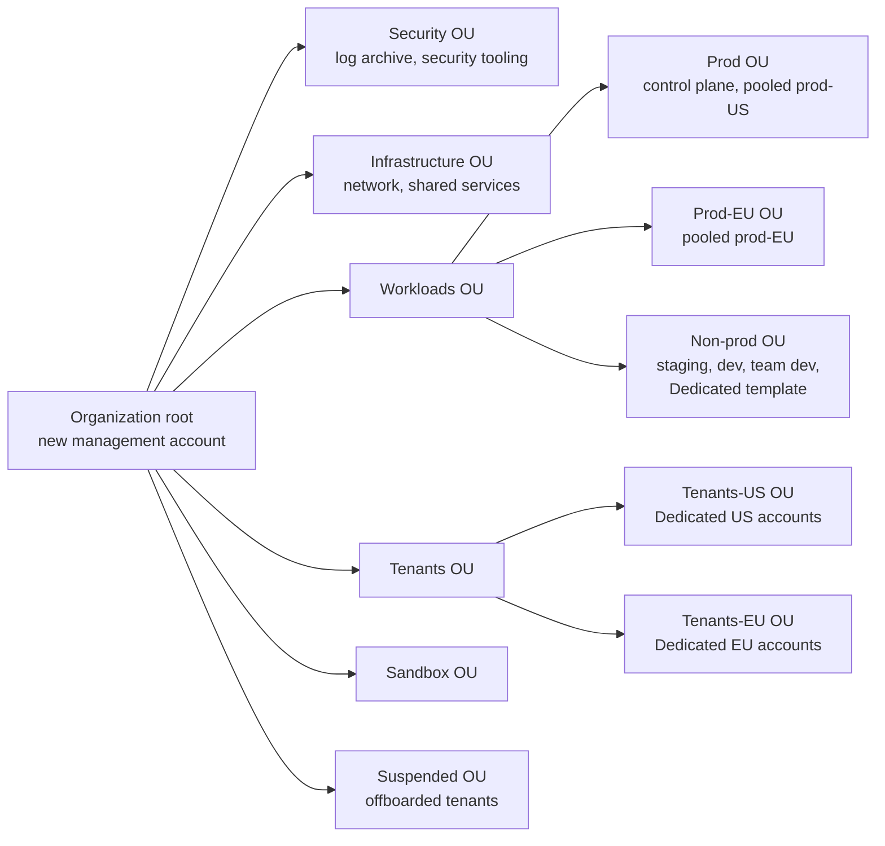
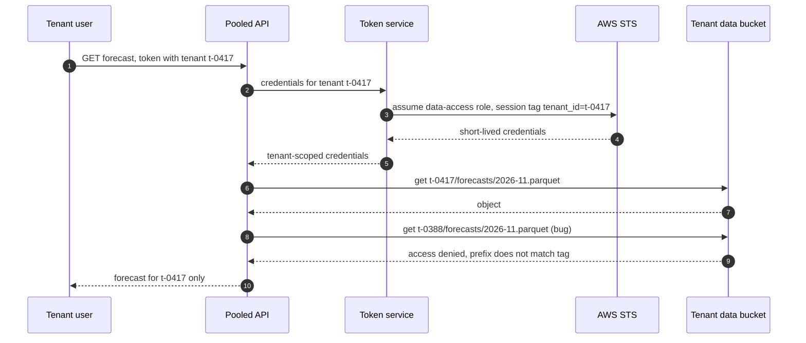
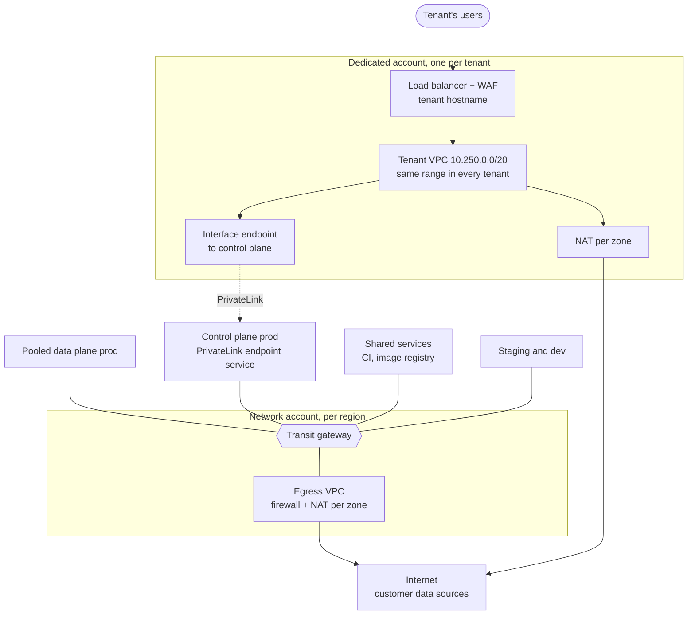
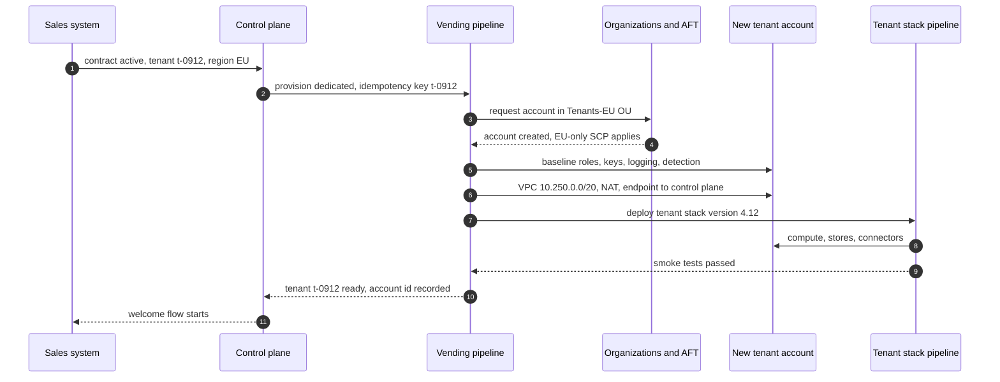

# Exercise: design a multi-account landing zone

> A start-up's single cloud account is a kitchen where everyone cooks, eats, and keeps the cash
> register. It works until a contractor's test script can read customer data, an enterprise prospect
> asks for proof that its data sits apart from everyone else's, and new engineers wait a week for
> access. This exercise designs the way out, with tenant isolation and onboarding speed as the drivers.

!!! abstract "Page facts"
    **Level:** Advanced · **Status:** Draft · **Time:** 60-90 minutes (45 minutes to attempt, the
    rest to compare) · **Last verified:** 2026-11-21

## Problem statement

Kalvent Analytics (`kalvent.example`) is a fictional SaaS scale-up. Mid-sized retailers and brands
connect their sales, inventory, and marketing data to Kalvent, which turns it into dashboards and
demand forecasts. Kalvent grew up in **one cloud account** on AWS: production, staging, developers'
experiments, CI runners, and every customer's data live side by side, separated by naming
conventions and a shared object-storage bucket with one prefix per customer.

Three pressures force a change. Enterprise customers now want a **Dedicated** tier whose data and
compute are provably separate from other customers', and their security questionnaires ask how
Kalvent isolates tenants. New EU customers want their data kept in an EU region. And the company is
hiring fast: engineers wait days for access, new teams share credentials, and nobody can say who can
read production data.

Design the multi-account landing zone Kalvent moves to: account and OU structure, tenant isolation,
identity, network, guardrails, logging, account vending for teams and tenants, and the migration out
of the single account. The reference solution uses AWS (the provider Kalvent already runs on), with a
note on Azure and Google Cloud equivalents. All company details and numbers are assumptions.

## How to use this exercise

1. **Attempt first.** Read only the problem statement, requirements, and scale assumptions.
2. **Time box.** Give yourself 45 minutes and follow the twelve steps of the
   [design method](design-method.md). Produce at least an account count with arithmetic, an OU tree,
   a tenant-isolation decision, a guardrail list split by type, a network sketch, a vending flow, and
   a migration plan.
3. **Use the hints only when stuck,** one at a time.
4. **Then compare** with the reference solution and score yourself against the rubric. A different
   choice with a stated reason and an honest trade-off is a strong answer.

## Requirements

### Functional requirements

1. **FR-1 Team onboarding.** A new engineer gets the right access from the corporate identity
   provider (IdP) without tickets; a new product team gets its accounts through a self-service request.
2. **FR-2 Tenant tiers.** Standard tenants share pooled infrastructure; Dedicated tenants get their
   own isolated data and compute.
3. **FR-3 Tenant onboarding.** Signing a Dedicated contract triggers automated creation of the
   tenant's isolated environment; Standard tenants are onboarded by the product itself.
4. **FR-4 Residency.** A tenant chooses US or EU at sign-up; its data and processing stay there.
5. **FR-5 Support access.** Kalvent staff can reach a Dedicated tenant's environment only with the
   tenant's recorded approval, for a limited time.
6. **FR-6 Central audit.** Every account's control-plane activity, and data access to tenant data,
   is logged where the people being logged cannot change it.
7. **FR-7 Tenant offboarding.** A departing Dedicated tenant's environment is deleted on contract
   terms, with evidence.
8. **FR-8 Migration.** Kalvent leaves the single account while shipping weekly releases.

### Non-functional requirements

1. **NFR-1 Onboarding speed.** Engineer access within 1 hour of the HR record; a team's three
   accounts within 1 working day; a Standard tenant within 5 minutes; a Dedicated tenant ready within
   4 hours of contract signature, with no human steps on the happy path.
2. **NFR-2 Tenant isolation.** No credential used to serve one tenant can read another tenant's data;
   Dedicated tenants share no data store, compute, network route, or encryption key with others.
3. **NFR-3 Least privilege.** No standing human write access to production or to any Dedicated
   account; production changes only through the deployment pipeline.
4. **NFR-4 Audit.** Organization-wide control-plane logs retained 1 year, undeletable by workload
   administrators; data-access logs for Dedicated tenants retained per contract (assumption: 1 year).
5. **NFR-5 Residency.** EU tenants' data and processing in the EU region only, enforced by policy,
   not convention.
6. **NFR-6 Availability.** The product's 99.9% monthly target (about 43.8 minutes) is unchanged by
   the landing zone: no new shared component on the request path may be less available.
7. **NFR-7 Evidence.** Kalvent can show auditors (for its SOC 2 report, assumption) which controls
   apply to any account, from its OU and tags alone.

### Clarifying questions a good candidate asks

- How different must the Dedicated tier be: separate database, separate account, or separate
  everything? (Here: separate account per Dedicated tenant, including compute and keys.)
- Do Dedicated tenants need private network connections from their own networks? (Here: not at
  launch; an extension.)
- Who operates Dedicated environments, Kalvent or the customer? (Here: Kalvent, through pipelines.)
- Is the product's control plane (sign-up, billing, tenant registry) shared across tiers? (Here: yes,
  one control plane per region pair, deployed separately from the data planes.)
- Can the existing account be kept, or must everything move? (Here: your choice; justify it.)
- Is there an on-premises network? (Here: no; Kalvent is cloud-only, offices use SaaS tools.)

## Scale assumptions

### Stated assumptions

| Id | Assumption | Value |
|---|---|---|
| A1 | Employees, engineers, product teams | 180, 70, 7 teams today; 12 teams in 24 months |
| A2 | Tenants today | 1,200, of which 30 Dedicated |
| A3 | Tenant growth | 40 Standard and 2 Dedicated a month |
| A4 | Average data per Standard tenant | 40 GB |
| A5 | Average data per Dedicated tenant | 1.5 TB |
| A6 | Regions | One US region today; one EU region needed |
| A7 | Environments | dev, staging, prod |
| A8 | Control-plane audit events per account per day (1 KB each) | 200,000 for platform and shared accounts; 50,000 per Dedicated account |
| A9 | Object reads on pooled tenant data (data-access events, 1 KB each) | 30 million a day |
| A10 | Interface endpoints each Dedicated account needs | 6 provider services in 3 zones |
| A11 | Migration window | 6 months, weekly releases continue |

### The estimate

- **Accounts today (target design):** platform accounts: management, log archive, security tooling,
  network, shared services (CI and image registry) = **5**. Shared workload accounts: control plane
  prod and staging, pooled data plane prod-US, prod-EU, staging, and dev = **6**. One dev account per
  team = **7**. One staging account for the Dedicated template = **1**. Dedicated tenants = **30**.
  Total 5 + 6 + 7 + 1 + 30 = **49**.
- **Accounts in 24 months:** Dedicated 30 + 24 × 2 = 78; teams 12. Total 5 + 6 + 12 + 1 + 78 =
  **102**. Tenant accounts are 30 ÷ 49 ≈ 61% of the estate today and 78 ÷ 102 ≈ 76% in two years:
  **account vending is a product feature**, triggered by sales, not a platform-team favour.
- **Vending rate:** about 2 Dedicated accounts a month (one every two weeks) plus about 2 team
  accounts a quarter; Standard tenants (40 a month, about 2 per working day) create no accounts.
- **Tenant data:** Standard 1,170 × 40 GB = **46.8 TB**; Dedicated 30 × 1.5 TB = **45 TB**. In
  24 months: Standard (1,170 + 960) × 40 GB = 85.2 TB; Dedicated 78 × 1.5 TB = **117 TB**. Thirty
  enterprise customers already hold as much data as all the others together.
- **Control-plane audit logs:** 19 non-Dedicated accounts × 200,000 × 1 KB = 3.8 GB/day, plus
  30 × 50,000 × 1 KB = 1.5 GB/day: **5.3 GB/day ≈ 1.9 TB/year**. In 24 months: 24 × 200 MB + 78 ×
  50 MB = 8.7 GB/day.
- **Data-access logs on pooled tenant data:** 30 million × 1 KB = **30 GB/day ≈ 11 TB/year**, about
  six times the control-plane logs. Logging every object read is a cost decision, not a default.
- **Per-Dedicated-account fixed baseline:** 6 endpoints × 3 zones = 18 interface endpoints, 3 NAT
  gateways, plus key, logging, and detection resources. At 78 accounts: 78 × 18 = **1,404** endpoint
  interfaces and 78 × 3 = **234** NAT gateways. The fixed cost per Dedicated tenant must be in the
  Dedicated price.

## Hints

??? question "Hint 1: which accounts exist for policy reasons, and which for tenant reasons?"
    Separate the estate Kalvent runs for itself (platform, control plane, pooled data plane, team
    dev) from the accounts it runs for one customer. Then ask which guardrails differ: prod versus
    non-prod, US versus EU, Kalvent's own versus a tenant's. OUs follow those differences.

??? question "Hint 2: does a Dedicated tenant's account need to be routable at all?"
    Count what a Dedicated environment talks to: the shared control plane, the internet (customer
    data sources), and provider services. Could it reach the control plane through a private endpoint
    instead of a routed network? What would that do to address planning and to the chance of one
    tenant reaching another?

??? question "Hint 3: the shape of a good answer"
    A new management account and an organization with Security, Infrastructure, Workloads (Prod,
    Prod-EU, Non-prod), Tenants (US, EU), Sandbox, and Suspended OUs. Identity Center federated to
    the IdP; no standing access to tenant accounts. A transit gateway for Kalvent's own estate only;
    Dedicated accounts isolated by construction, reaching the control plane through PrivateLink.
    Pooled isolation with tenant-scoped credentials. Org trail into a locked log archive. The old
    account becomes pooled prod-US after everything else is carved out of it.

## Reference solution

### The twelve steps, briefly

| Step | Decision |
|---|---|
| 1 Problem | Prove tenant isolation to enterprise buyers, keep EU data in the EU, and make onboarding of people, teams, and tenants fast |
| 2 Requirements | FR-1 to FR-8; driving NFRs are isolation (NFR-2), onboarding speed (NFR-1), residency (NFR-5) |
| 3 Estimate | 49 accounts now, 102 in 24 months, three quarters of them tenants; 5.3 GB/day of audit logs; 1,404 endpoint interfaces at 78 Dedicated tenants |
| 4 Boundaries | Kalvent's own estate versus per-tenant accounts; control plane separate from data planes |
| 5 Contracts | Team request file; tenant provisioning event from the control plane; PrivateLink service from control plane to Dedicated data planes |
| 6 Data | Pooled tenant data partitioned by tenant ID with tenant-scoped credentials; Dedicated data in the tenant's own account and key |
| 7 Style | Bridge tenancy at estate level: pool for Standard, silo for Dedicated |
| 8 Deployment | AWS Organizations with Control Tower; transit gateway for Kalvent's estate; isolated Dedicated accounts; two regions |
| 9 Security | IAM Identity Center with the IdP; SCPs and RCPs; JIT, customer-approved support access |
| 10 Resilience | No new shared component on the request path; vending is idempotent and retryable |
| 11 Operations | Org trail, delegated security tooling, baseline drift checks, vending SLOs |
| 12 Decisions | ADR-style choices on OUs, Dedicated networking, and keeping the old account as prod; cost dominated by per-Dedicated baseline and data-access logging |

### Accounts and organizational units

**Figure 1 — Kalvent's organization.** OUs follow guardrail differences: environment, residency, and
whether the account belongs to Kalvent or to one tenant.

How to read it: the EU split appears twice (Prod-EU, Tenants-EU) because the region guardrail is
attached there; the Tenants OU exists because tenant accounts get rules Kalvent's own accounts do
not (no routed networking, no standing human access). Teams are not OUs.

AWS Control Tower builds this on AWS Organizations: it sets up the landing zone, its log archive and
audit accounts, Account Factory, and a library of preventive, detective, and proactive controls
attached per OU (landing zone 4.0 also lets you define your own OU structure; check the current
version's options). Account Factory for Terraform (AFT) lets the vending pipeline request accounts
from code, which suits tenant vending triggered by the control plane.

### Tenant tiers and isolation

| Layer | Standard (pool) | Dedicated (silo) |
|---|---|---|
| Account | Shared pooled data-plane account per region | One account per tenant, in Tenants-US or Tenants-EU |
| Compute | Shared cluster; per-tenant queues and concurrency limits | Tenant's own compute in its account |
| Data | Tenant ID in every row; object prefix per tenant; per-tenant data keys | Tenant's own stores and customer-managed key |
| Credentials | Each request runs with tenant-scoped temporary credentials (session tag `tenant_id`) | Account boundary; roles exist only in that account |
| Network | Kalvent's transit gateway estate | No transit attachment; PrivateLink to the control plane only |
| Noisy neighbour | Quotas and throttles per tenant | None by construction |

The pooled tier's weak point is a missing tenant filter in code. Tenant-scoped credentials make that
bug fail closed: the IAM policy on the pooled data allows access only under the prefix that matches
the caller's `tenant_id` session tag, so even buggy code cannot read another tenant's objects.

**Figure 2 — A pooled request with tenant-scoped credentials.**

How to read it: the tenant identity travels from the user's token into the credentials themselves,
so authorization of data access no longer depends only on application code. The denied call is
logged and alerted as a possible isolation bug.

### Network

**Figure 3 — Kalvent's estate on a transit gateway, Dedicated accounts isolated by construction.**

How to read it: Kalvent's own accounts share a hub with central egress (one place to inspect and
one set of egress addresses for customers to allow-list). Dedicated accounts have no route to
anything Kalvent owns; they call the control plane through an interface endpoint, which needs no
routing and tolerates the identical `10.250.0.0/20` in every tenant. The tenant's users reach their
own data plane at a tenant hostname (for example `t-0912.eu.kalvent.example`) through a load balancer
and WAF in the tenant account; sign-in stays with the shared control plane. Overlap is deliberate: there is
nothing to plan per tenant, and no route table can ever join two tenants.

Address plan for the routed estate (assumptions): `10.0.0.0/13` US and `10.8.0.0/13` EU, each with
a platform `/16`, prod `/16`, staging `/16`, and dev `/16` (16 team `/20`s, enough for 12 teams), and
four `/16`s reserved. `10.250.0.0/16` is reserved as the never-routed Dedicated range.

### Identity and support access

- **IAM Identity Center** federated with Kalvent's IdP (SAML, with SCIM provisioning). Permission
  sets: Developer in the team's dev account, ReadOnly in staging and pooled prod, ProdOperator just in
  time (1 hour, approved). Joining a team group in the IdP grants access within minutes (NFR-1).
- **Dedicated accounts: zero standing human access.** A TenantSupport permission set is assigned
  only after the control plane records the tenant admin's approval of a support ticket; the assignment
  expires automatically and every session is logged and reported back to the tenant.
- **Workloads** use IAM roles; deployment pipelines federate from CI with short-lived credentials.
  No IAM users (SCP).

### Guardrails

| Guardrail | Mechanism | Attached to |
|---|---|---|
| Deny regions other than the US region (and EU region where allowed) | SCP | Root (both); Prod-EU and Tenants-EU narrowed to EU only |
| Deny leaving the organization, stopping CloudTrail, changing the log archive | SCP | Root |
| Deny IAM user and access-key creation | SCP | Root |
| Deny creating transit gateway attachments, VPC peering, or VPN connections | SCP | Tenants OU |
| Deny human writes except the pipeline role and JIT roles | SCP | Prod, Prod-EU, Tenants |
| Tenant data stores accessible only by principals in the organization | RCP (data perimeter) | Tenants, Prod, Prod-EU |
| Encryption with customer-managed keys, mandatory tags (`tenant_id`, `tier`, `environment`) | Proactive controls and IaC policy checks | All workload and tenant OUs |
| Public buckets, open ports, unencrypted volumes, drift from baseline | Detective controls (AWS Config rules via Control Tower) | All OUs |

SCPs limit what principals in Kalvent's accounts can do; RCPs limit what any principal, including
ones outside the organization, can do to resources in them. Together they express "tenant data
never leaves Kalvent's organization" even if a bucket policy is misconfigured.

### Logging and security tooling

An **organization trail** in CloudTrail records management events from every account, current and
future, into the log archive account's bucket with Object Lock retention (1 year). Data events are
enabled for all Dedicated tenant stores (contractual) and for the pooled tenant-data bucket with
event selectors limited to reads outside the tenant-scoped role, which keeps most of the 30 GB/day
out while catching exactly the reads that would indicate an isolation failure. The security tooling
account is delegated administrator for threat detection (Amazon GuardDuty) and configuration
compliance, so nobody works in the management account day to day.

### Vending: teams and tenants

Team accounts are vended from a pull request to the account-definitions repository through AFT, as
on the [multi-account strategy page](../cloud-architecture/multi-account-strategy-and-infrastructure-automation.md).
Dedicated tenants are vended by the product: the control plane emits a provisioning event when a
contract is activated.

**Figure 4 — Onboarding a Dedicated tenant.**

How to read it: the account is in its OU (with the EU-only rule) before anything is deployed, and
the tenant registry records the account only after smoke tests pass. Every step is keyed by the
tenant ID, so a retry after a failure resumes rather than creating a second account. The target is
4 hours (NFR-1); the slowest steps are account creation and stack deployment, both asynchronous.

Offboarding reverses it: export or delete data on contract terms, record evidence, move the account
to Suspended (all access denied by SCP), and close it after the retention period.

### Migration out of the single account

1. **New management account and organization;** the legacy account is invited as a member (it must
   not become the management account, which should hold nothing).
2. **Log archive, security tooling, Identity Center** first; the organization trail replaces the old
   account's own trail. Detective controls only on the legacy account.
3. **Carve out** CI and the registry into shared services, developers into team dev accounts, and
   staging into its own account, one at a time.
4. **Keep production data where it is:** the legacy account, once emptied of everything else,
   becomes pooled prod-US. Moving terabytes of tenant data between accounts is the riskiest step and
   is avoided entirely.
5. **Build EU and the Dedicated tier new,** directly in the landing zone; migrate the existing 30
   Dedicated-tier candidates one per release from the shared bucket into their own accounts.
6. **Turn on preventive SCPs** for the legacy account last, after denied-call reports are clean.

### Provider equivalents

| AWS (reference) | Microsoft Azure | Google Cloud |
|---|---|---|
| AWS Organizations, OUs | Management groups | Resource hierarchy: organization, folders |
| Service control policies | Azure Policy (deny effect) | Organization Policy Service constraints |
| Resource control policies | Closest analogue: Azure Policy on resources; semantics differ | Closest analogue: VPC Service Controls perimeters; semantics differ |
| IAM Identity Center | Microsoft Entra ID | Cloud Identity or Workforce Identity Federation |
| AWS Control Tower, AFT | Azure landing zones, subscription vending | Enterprise foundations blueprint, landing zone guidance |
| Transit gateway, PrivateLink | Azure Virtual WAN, Azure Private Link | Network Connectivity Center, Private Service Connect |
| CloudTrail organization trail | Activity log exported through diagnostic settings, applied by policy | Aggregated log sinks at the organization |

## Alternatives and trade-offs

| Choice | Favor when | Avoid when |
|---|---|---|
| Account per Dedicated tenant (reference) | Enterprise buyers need provable isolation, per-tenant keys, bills, and deletion | Thousands of small tenants, or a fixed per-account baseline the price cannot carry |
| Dedicated database only, shared account | Isolation demand is about data, not operations; cost-sensitive tier | Buyers require separate compute, keys, and audit scope |
| Dedicated accounts on the transit gateway | Tenants need routed access to Kalvent's estate or customer networks via shared VPN | Address planning per tenant is unwanted; one route mistake joins tenants |
| PrivateLink-only Dedicated accounts (reference) | One-way service access to the control plane | The tenant data plane must call many Kalvent services |
| Central egress for Dedicated tenants | Customers allow-list one Kalvent address range | Per-tenant dedicated egress addresses are a selling point |
| Keep the old account as pooled prod (reference) | Prod data is large and the account can be cleaned | The old account has unknown, unowned resources and access you cannot remove |
| Start fresh, migrate prod data | The old account cannot be trusted | Terabytes of data and no downtime budget |
| Control Tower and AFT (reference) | Small platform team, standard baseline | Baseline needs that the service cannot express |

## Failure modes and how the design handles them

- **Vending fails half-way.** Detect: pipeline step timeout or failed smoke tests. Handle:
  idempotent steps keyed by tenant ID; the registry marks the tenant ready only after tests; a stuck
  account is retried, never hand-fixed.
- **Tenant filter bug in pooled code.** Detect: access-denied events on tenant-data prefixes from the
  data-access role. Handle: tenant-scoped credentials deny the read (Figure 2); alert as a potential
  isolation incident.
- **SCP change blocks deployments.** Detect: spike in denied calls after a policy change. Handle:
  test in Sandbox and Non-prod OUs first; roll back the policy version.
- **Organization account quota reached during a sales push.** Detect: utilization alarm on the
  account quota read from Service Quotas. Handle: request increases ahead of the forecast (102 in
  24 months plus sandboxes).
- **IdP outage.** Detect: sign-in failures. Handle: break-glass identities in the management
  account, sealed and alerted; tenants keep running because nothing on the request path needs
  workforce sign-in.
- **Egress hub failure.** Detect: per-zone synthetic probes. Handle: per-zone firewall and NAT; the
  pooled API path does not cross the hub, and Dedicated accounts have their own NAT (NFR-6).
- **Wrong account closed at offboarding.** Detect: before closure, check tenant registry, `tenant_id`
  tag, and Suspended OU membership agree. Handle: two-person approval for closure; suspend for a
  waiting period before close.
- **Enterprise tenant later asks for a VPN from its own network into `10.250.0.0/20`.** Handle: the
  overlap is the cost of the template range; offer PrivateLink in the other direction, or re-address
  that one tenant's VPC from a routed pool.

## Evaluation rubric

| Area | Weak answer | Strong answer |
|---|---|---|
| Estimation | No account count | Counts accounts now and in 24 months; sees that tenants dominate; computes log volume and per-tenant baseline |
| OU design | OUs per team | OUs by guardrail difference: environment, residency, Kalvent-owned versus tenant |
| Tenant isolation | "Each tenant has a prefix" | Bridge model; tenant-scoped credentials in the pool; account per Dedicated tenant with its own key |
| Network | Every account on the hub | Hub for Kalvent's estate; Dedicated isolated by construction; explains PrivateLink and overlapping ranges |
| Identity | Shared admin role | Federated SSO, permission sets, JIT prod, customer-approved support access |
| Guardrails | A list of "best practices" | Preventive, proactive, detective split; SCPs versus RCPs; residency enforced by policy |
| Logging | "Turn on logging" | Org trail into a locked archive; data-event selection reasoned from volume |
| Vending | Manual account creation | Team vending from code; tenant vending triggered by the control plane, idempotent, verified |
| Migration | Big-bang move | Legacy account invited, carved out, kept as prod; preventive rules last |

## Extensions

1. **Customer private connectivity.** Ten Dedicated tenants want their own networks connected. Design
   it without joining tenants or renumbering.
2. **Customer-held keys.** Dedicated tenants supply and can revoke the key that encrypts their data.
   What happens to the product when a tenant revokes it?
3. **A third region in Asia-Pacific.** What changes in OUs, SCPs, the control plane, and the address
   plan?
4. **Per-tenant cost reporting.** Show each Dedicated tenant's infrastructure cost and the pooled
   tier's cost per tenant, and use it to set the Dedicated price floor.
5. **Multi-cloud Dedicated tier.** A large customer requires its Dedicated environment on another
   provider. Map every element of the reference solution to that provider.

## Related topics

- [The architecture design method](design-method.md) — the twelve steps used above.
- [Cloud building blocks and landing zones](../cloud-architecture/cloud-building-blocks-and-landing-zones.md)
  — silo, pool, and bridge tenancy; guardrail types.
- [Multi-account strategy and infrastructure automation](../cloud-architecture/multi-account-strategy-and-infrastructure-automation.md)
  — account vending and lifecycle.
- [Network security, load balancing, and traffic flow](../networking/network-security-load-balancing-and-traffic-flow.md)
  — transit routers, private endpoints, central egress.
- [Identity and access management](../security-architecture/identity-and-access-management.md) —
  federation, permission sets, JIT access.
- [Case study 08](../end-to-end-case-studies/cs-08-multi-account-landing-zone-and-hub-and-spoke-network.md)
  — a regulated enterprise version of the same problem.
- [Cloud and enterprise platform exercises](cloud-and-enterprise-platform-exercises.md) — the
  collection this exercise belongs to.
- **Planned:** multi-tenant SaaS case study (case study 03); FinOps (D17); platform engineering (D16).

## References

| Source | Type | Checked |
|---|---|---|
| [Service control policies](https://docs.aws.amazon.com/organizations/latest/userguide/orgs_manage_policies_scps.html) and [resource control policies](https://docs.aws.amazon.com/organizations/latest/userguide/orgs_manage_policies_rcps.html) — AWS Organizations User Guide | Official documentation | 2026-11-21 |
| [What is IAM Identity Center?](https://docs.aws.amazon.com/singlesignon/latest/userguide/what-is.html) — AWS documentation | Official documentation | 2026-11-21 |
| [What is AWS Control Tower?](https://docs.aws.amazon.com/controltower/latest/userguide/what-is-control-tower.html), [how it works](https://docs.aws.amazon.com/controltower/latest/userguide/how-control-tower-works.html), and [AFT overview](https://docs.aws.amazon.com/controltower/latest/userguide/aft-overview.html) — AWS documentation | Official documentation (landing zone, controls, vending) | 2026-11-21 |
| [What is AWS Transit Gateway?](https://docs.aws.amazon.com/vpc/latest/tgw/what-is-transit-gateway.html) and [What is AWS PrivateLink?](https://docs.aws.amazon.com/vpc/latest/privatelink/what-is-privatelink.html) — AWS documentation | Official documentation | 2026-11-21 |
| [Creating a trail for an organization](https://docs.aws.amazon.com/awscloudtrail/latest/userguide/creating-trail-organization.html) — AWS CloudTrail User Guide | Official documentation | 2026-11-21 |
| [Tenant isolation](https://docs.aws.amazon.com/wellarchitected/latest/saas-lens/tenant-isolation.html) — AWS Well-Architected SaaS Lens; [session tags](https://docs.aws.amazon.com/IAM/latest/UserGuide/id_session-tags.html) — IAM User Guide | Official guidance and documentation | 2026-11-21 |
| [Azure landing zones](https://learn.microsoft.com/azure/cloud-adoption-framework/ready/landing-zone/) and [subscription vending](https://learn.microsoft.com/azure/cloud-adoption-framework/ready/landing-zone/design-area/subscription-vending) — Microsoft Cloud Adoption Framework | Official guidance (equivalents) | 2026-11-21 |
| [Landing zone design in Google Cloud](https://cloud.google.com/architecture/landing-zones) and [VPC Service Controls overview](https://cloud.google.com/vpc-service-controls/docs/overview) — Google Cloud | Official guidance (equivalents) | 2026-11-21 |

## Review notes

- Exercise for D29-T04 (listed on the [collection page](cloud-and-enterprise-platform-exercises.md)).
  Kalvent is fictional; every number is a labelled assumption (A1-A11) or arithmetic from one:
  49 and 102 accounts; 46.8 and 45 TB of tenant data; 5.3 GB/day of audit logs; 30 GB/day of
  data-access events; 1,404 endpoint interfaces and 234 NAT gateways at 78 Dedicated tenants.
- AWS product names (AWS Organizations, SCPs, RCPs, IAM Identity Center, AWS Control Tower with
  Account Factory and AFT, Transit Gateway, PrivateLink, CloudTrail organization trail, Object Lock,
  STS session tags, Amazon GuardDuty, AWS Config, Service Quotas) were checked against
  docs.aws.amazon.com pages fetched on 2026-11-21. Control Tower now calls its rules "controls";
  landing zone 4.0 no longer requires a Security OU. No quotas or prices are quoted.
- The RCP-equivalent row is deliberately hedged: Azure Policy and VPC Service Controls are the
  closest analogues, but neither has the same semantics; a reviewer with Azure and Google Cloud
  experience should check that row.
- The data-event selector design (log pooled reads outside the tenant-scoped role) is a pattern
  sketch; whether a given selector can express it must be checked against CloudTrail's current
  advanced event selector fields.
- Differences from case study 08 are intentional: a smaller company, tenant accounts as most of the
  estate, PrivateLink-only Dedicated accounts with overlapping ranges, and keeping the legacy account
  as prod.
