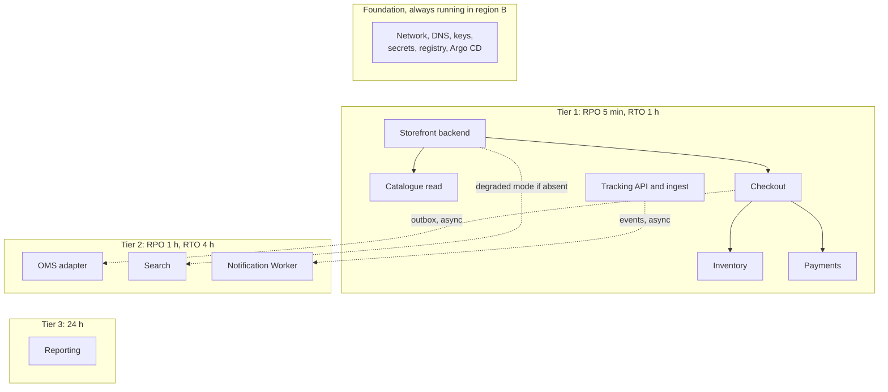
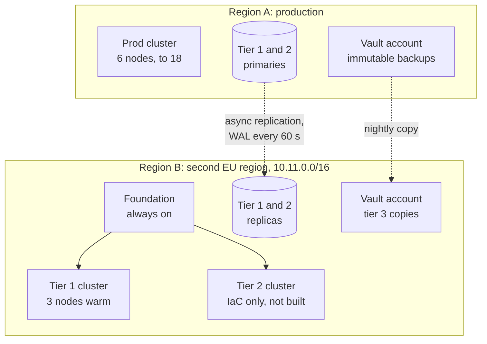
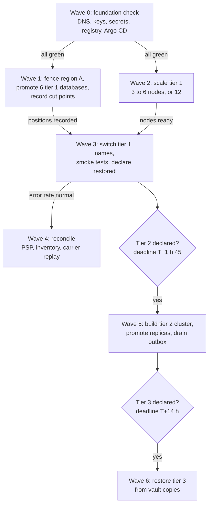
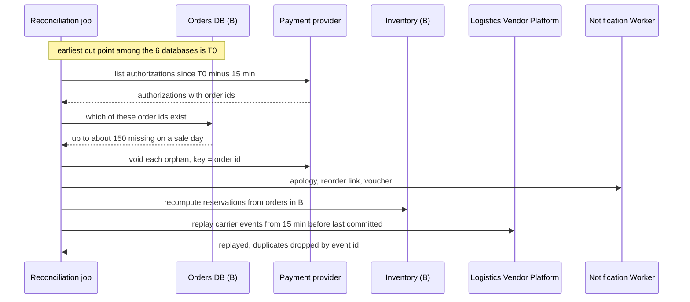

# Exercise: multi-region disaster recovery for a retail platform

> Designing DR for one service is a strategy, a replica, and a runbook. Designing it for forty is a
> different problem: which services must come back together, what each one silently depends on,
> which databases disagree after they are promoted at different moments, and who decides, at what
> hour, that waiting for the old region is no longer worth it.

!!! abstract "Page facts"
    **Level:** Advanced · **Status:** Draft · **Time:** 75-90 minutes (50 minutes to attempt, the
    rest to compare) · **Last verified:** 2026-11-27

## Problem statement

AtlasMart (fictional) is an online retailer: 2,000,000 registered customers, 400,000 daily active
users, 60,000 orders a day, 300,000 orders in transit. Its whole retail platform (catalogue,
search, cart, checkout, payments, order management, tracking, returns, internal tools) runs as 40
services in one EU region across three zones, on one production Kubernetes cluster plus managed
databases. EU customer data must stay in the EU (constraint C-4).

A peer retailer recently lost a weekend of trading to a regional outage (fictional). The board asks
AtlasMart's architects for a plan that recovers the platform from the loss of its region, with
different targets for different services, at a standing cost Finance can see, and with evidence
that it works rather than a document that says it should.

[Disaster recovery strategies](../reliability-and-disaster-recovery/disaster-recovery-strategies.md)
already chose the strategy per tier and proved tier 1 for one service, Order Tracking. This
exercise is the portfolio: classify all 40 services, recover them in the right order and at the
right time, keep cross-service data consistent after the failover, and fail back. Contrast
[Case study 10](../end-to-end-case-studies/cs-10-multi-region-disaster-recovery.md), which designs
one system's consistency across two live regions; here no service runs active-active, and the hard
parts are breadth, ordering, and reconciliation.

## How to use this exercise

1. **Attempt first.** Read the problem statement, requirements, and scale assumptions only.
2. **Time box.** 50 minutes, following the twelve steps of the [design method](design-method.md).
   Produce at least a tier register with reasons, the replication and standby arithmetic, a
   recovery-wave diagram with gates, a reconciliation plan, a failback plan, and a test calendar.
3. **Use the hints only when stuck,** one at a time.
4. **Then compare** with the reference solution and score yourself with the rubric. A different
   tiering with stated reasons is a strong answer; a tiering without dependency evidence is not.

## Requirements

### Functional requirements

1. **FR-1 Tier register.** Every one of the 40 services has a DR tier, an owner team, a strategy,
   and a recorded reason, kept in the same repository as its deployment.
2. **FR-2 Purchasing first.** Browse, cart, checkout, and payment work in region B within the
   tier 1 RTO, as do tracking reads and carrier webhooks.
3. **FR-3 Everything back.** Tier 2 services recover within 4 hours and tier 3 within 24 hours.
4. **FR-4 Reconciliation.** After failover, no order is silently lost, no customer is charged
   without an order, and no tracking event acknowledged to a carrier is lost.
5. **FR-5 Failback.** Return to region A as a planned change, without a second unplanned outage.
6. **FR-6 Evidence.** Each game day records the recovery time and recovery point achieved per tier.

### Non-functional requirements

| ID | Requirement | Target |
|---|---|---|
| NFR-1 | Tier 1 (checkout, payments, tracking, and what they need) | RPO 5 min, RTO 1 h (the brief; tracking's NFR-7) |
| NFR-2 | Tier 2 | RPO 1 h, RTO 4 h |
| NFR-3 | Tier 3 | RPO 24 h, RTO 24 h (restore from backup) |
| NFR-4 | Capacity after failover | Tier 1 carries the normal evening peak at the RTO and the sale-day design peak (210 tracking reads/s, 30 payments/s) within 2 h (assumption) |
| NFR-5 | Residency | Every replica, backup, and log copy stays in EU regions (C-4) |
| NFR-6 | Authority | Regional failover is declared by the incident commander (IC), per tier, from a runbook rehearsed quarterly |
| NFR-7 | Protection | Backups immutable, in vault accounts that production roles cannot alter |
| NFR-8 | Cost visibility | Standing DR cost reported monthly in cost units (CU) per team via the `backup-tier` tag |

### Clarifying questions a good candidate asks

- Are the 40 services product services only? (Here: yes. The platform underneath them, meaning
  cluster, registry, Argo CD, secrets, DNS, key management, workforce sign-in, observability, and
  log archive, is treated as a **foundation** that must already run in region B before any tier
  can recover.)
- Is the region lost completely, or degraded? (Either. A degraded region is the harder case: it may
  come back mid-failover, so fencing and a "committed to B" point are needed.)
- Which external systems are on the purchase and delivery paths, and are they multi-region? (Here:
  the payment service provider (PSP), the Logistics Vendor Platform, the Notification Provider, and
  the Identity Provider are external and assumed to survive; only AtlasMart's endpoints move.)
- What about the Order Management System (OMS), a 12-year-old monolith owned by another team, and
  the Warehouse Management System (WMS) on premises at the distribution centre? (Here: both matter;
  the OMS team owns its runbook, and the WMS reaches the cloud through the hub in region A.)
- Is losing up to 5 minutes of orders acceptable if customers were told "order confirmed"? (Here:
  the RPO is a ceiling, not a licence; every lost order must be found and the customer contacted.)
- Does region B have to carry a sale day immediately? (Here: NFR-4 gives it 2 hours.)

## Scale assumptions

### Stated assumptions

Values from earlier pages are cited; new ones are **exercise assumptions**.

| Id | Assumption | Value |
|---|---|---|
| S1 | Services per tier (assumption) | Tier 1: 10, tier 2: 12, tier 3: 18 |
| S2 | Tier 1 databases (assumption, except tracking) | 6: tracking events 430 GB (fixed), orders 300 GB, payments 100 GB, catalogue 60 GB, customer accounts 40 GB, inventory 20 GB |
| S3 | Tier 2 and tier 3 data (assumption) | Tier 2: 8 databases, 1.6 TB; tier 3: 4 TB, 5% changing per day |
| S4 | Product images and documents in object storage (assumption) | 2 TB, 10 GB new per day |
| S5 | Tier 1 change (write-ahead log) volume per day (assumption) | 6 GB; sale-day peak hour runs at 10× the daily average rate |
| S6 | Tier 2 change volume per day (assumption) | 4 GB |
| S7 | Logs (brief) and share that must survive in region B (assumption) | 300 GB/day; 20% (audit and security) |
| S8 | Usable cross-region bulk copy rate (assumption) | 500 Mbit/s |
| S9 | Restore throughput ([DR strategies](../reliability-and-disaster-recovery/disaster-recovery-strategies.md)) | 200 MB/s |
| S10 | Node size and allocatable CPU (node from the platform; allocatable is an assumption) | 4 vCPU / 16 GiB, 3.5 vCPU allocatable |
| S11 | Tier 1 CPU requests (assumption): minimum replicas, normal evening peak, sale-day peak | 9, 20, 40 vCPU |
| S12 | Tier 2 CPU requests after recovery; tier 3 (assumption) | 24 vCPU; 12 vCPU |
| S13 | Sale days per month (assumption) | 4 |
| S14 | Cost rate (illustrative) | 1 vCPU-hour = 1 CU |

The DR strategies page fixes the rest: region B is a second EU region with prod `10.11.0.0/16`;
tier 1 warm standby is a 3-node cluster; replica lag normally ≤ 5 s, alert above 60 s for
2 minutes; WAL archived every 60 s plus about 10 s upload; the tier 1 runbook's critical path is
40 minutes; tier 2 recovers in 2.5 hours.

### The estimate

- **Customer accounts check (S2):** 2,000,000 customers × 20 KB ≈ 40 GB.
- **Data per tier:** tier 1 = 430 + 300 + 100 + 60 + 40 + 20 = **950 GB**; tier 2 **1.6 TB**;
  tier 3 **4 TB**; objects 2 TB.
- **Tier 1 replication:** 6 GB ÷ 86,400 s ≈ 69 KB/s ≈ **0.56 Mbit/s** on average, about
  **5.6 Mbit/s** in a sale-day peak hour. Steady database replication is the *smallest* flow.
- **Tier 2 log shipping:** 4 GB ÷ 24 = 167 MB an hour ≈ 0.4 Mbit/s.
- **Tier 3 backup copies:** 5% × 4 TB = 200 GB a night; copied in a 4-hour window,
  200,000 MB × 8 ÷ 14,400 s ≈ **111 Mbit/s**.
- **Logs:** 20% × 300 GB = 60 GB a day ≈ 60,000 MB × 8 ÷ 86,400 s ≈ **5.6 Mbit/s** continuously.
- **Objects:** 10 GB a day ≈ 0.9 Mbit/s.
- **Monthly cross-region transfer:** tier 1 180 GB + tier 2 120 GB + tier 3 6,000 GB + logs
  1,800 GB + objects 300 GB ≈ **8.4 TB**, of which 71% is tier 3 backups. The bill is driven by the
  cheapest tier.
- **Seeding and re-seeding:** tier 1 + tier 2 = 2,550 GB at 500 Mbit/s = 2,550 × 8,000 ÷ 500 =
  40,800 s ≈ **11.3 hours** to seed region B the first time. Re-seeding region A with tier 1 only for
  failback: 950 × 8,000 ÷ 500 = 15,200 s ≈ **4.2 hours**.
- **Tier 3 restore:** 4,000,000 MB ÷ 200 MB/s = 20,000 s ≈ **5.6 hours** of pure data restore, if
  nothing else competes for the throughput.
- **Standby capacity:** tier 1 minimum 9 vCPU ÷ 3.5 = 2.6, so **3 nodes** (the DR page's warm
  standby, with 1.5 vCPU spare); normal evening peak 20 ÷ 3.5 → **6 nodes**; sale-day peak
  40 ÷ 3.5 → **12 nodes**. Tier 2: 24 ÷ 3.5 → 7 nodes; tier 3: 12 ÷ 3.5 → 4 nodes.
- **Orders at risk:** an average 60,000 ÷ 86,400 ≈ 0.7 orders/s × 5 s normal lag ≈ **4 orders**; at the
  sale-day payment peak 30/s × 5 s = **150**; at the full RPO ceiling 30 × 300 = **9,000**, which is
  why the lag alert, not the RPO, is the number to manage.

## Hints

??? question "Hint 1: what is a tier, really?"
    A tier is a promise about time, and a promise is only as good as its weakest synchronous
    dependency. List what checkout calls while a customer waits. Is everything on that list in
    tier 1? If not, either move it up, or change the call so checkout can succeed without it. And
    which things are not "services" at all but must exist before any tier can start?

??? question "Hint 2: the clock and the data"
    For each tier, subtract its recovery duration from its RTO: that is the latest moment the IC can
    declare. What is gained by declaring later? Then promote six tier 1 databases with slightly
    different replication lags: what do orders, payments, and inventory disagree about, and which
    external system knows the truth about money?

??? question "Hint 3: the shape of a good answer"
    A tier register driven by dependency evidence (traces), a foundation layer always running in
    region B, per-tier strategies from the DR page, recovery in gated waves (foundation check, tier 1
    data, compute, traffic, reconciliation, then tier 2 and tier 3 on their own decision deadlines),
    reconciliation against the PSP and the carrier replay, failback as a planned switchover after
    re-seeding, and a calendar of drills that measures each tier.

## Reference solution

### The twelve steps, briefly

| Step | Decision |
|---|---|
| 1 Problem | Recover a 40-service platform from regional loss within per-tier targets, at a visible cost, with evidence |
| 2 Requirements | FR-1 to FR-6; tier targets NFR-1 to NFR-3 drive everything; NFR-6 makes failover a human decision |
| 3 Estimate | 950 GB tier 1, 8.4 TB/month cross-region (71% tier 3 copies), 3 → 6 → 12 tier 1 nodes, up to 150 orders at risk on a sale day |
| 4 Boundaries | Tier register by dependency; a **foundation** layer below tier 1; recovery groups that move together |
| 5 Contracts | Checkout → OMS via an outbox (asynchronous), so tier 1 never waits on tier 2; reconciliation interfaces to the PSP and the Logistics Vendor Platform |
| 6 Data | Tier 1: cross-region replica plus 60 s WAL archive per database; tier 2: running small replicas; tier 3: nightly immutable copies |
| 7 Style | No active-active: every tier is single-writer active-passive; recovery as an orchestrated workflow with gates |
| 8 Deployment | Region B: foundation always on, tier 1 warm (3 nodes), tier 2 pilot light, tier 3 backups; same pipeline and repository for both regions |
| 9 Security | Vault accounts, break-glass roles outside region A, two-person rule for promotion and DNS changes |
| 10 Resilience | Decision deadlines per tier, fencing before promotion, reconciliation after, capacity reserved for the evening peak |
| 11 Operations | Tier register checks, drift report, quarterly game days rotating through tiers, recovery evidence dashboard |
| 12 Decisions | ADR-sized choices in the alternatives table; standing DR cost ≈ 49,000 CU a month, driven by database replicas |

### Tier the portfolio by dependency, not by importance

Start from the brief's examples (checkout, payments, tracking in tier 1), then apply one rule: **a
service's tier can be no slower than the slowest tier of any service that calls it synchronously.**
Two consequences surprise most teams:

- **Things get promoted.** Checkout needs product prices, the customer's session, and stock: the
  catalogue *read* API, customer accounts, inventory, and cart are tier 1 even though nobody named
  them. The catalogue *authoring* service stays tier 2: buyers can wait four hours to edit prices.
- **Calls get changed instead.** Checkout used to call the OMS synchronously to create the order. The
  OMS is a large monolith owned by another team, and making it tier 1 would mean a warm standby of a
  12-year-old system. Instead checkout writes the order and an outbox event in its own database, and
  an OMS adapter delivers it asynchronously. With an outage of up to 4 hours at the 30/s sale-day
  peak, the backlog is at most 30 × 14,400 = 432,000 events; at the daily average about
  0.7 × 14,400 ≈ 10,000. Both are small for the event queue.

| Tier | Services (examples; 40 in total, S1) | Strategy in region B | Recovery group |
|---|---|---|---|
| Foundation | Network `10.11.0.0/16`, DNS zones, key management, secrets, registry replica, Argo CD, workforce sign-in federation, observability, log archive copy, break-glass roles | Always running, checked weekly | Before everything |
| 1 (10) | Storefront backend, catalogue read API, cart, customer accounts, inventory reservation, checkout, payments, Tracking API, Webhook Ingestor, Event Processor | Warm standby | Purchasing; tracking |
| 2 (12) | Order history, returns, Notification Worker, catalogue authoring, search, OMS adapter, WMS adapter, fraud review, loyalty, customer service console, promotions admin, preferences | Pilot light | Post-purchase; operations |
| 3 (18) | Reporting, recommendations, marketing tools, review moderation, supplier portal, other internal tools | Backup and restore | Back office |

Search and recommendations stay out of tier 1 by **degraded mode**, not by hope: the storefront
falls back to category browsing and best-seller lists when they are absent, and that fallback is
exercised in every game day. The WMS adapter is tier 2 because the distribution centre keeps
picking from orders already downloaded; it needs pre-built VPN tunnels from the distribution centre
to region B's hub (part of the foundation), because today its only path to the cloud runs through
region A's hub.

**Figure 1 — Tier map with the dependency rule applied.** Solid arrows are synchronous calls; the
dashed arrow is the asynchronous outbox that keeps tier 1 independent of the OMS.

How to read it: no solid arrow points from a faster tier to a slower one. The two dotted arrows are
the design choices that made that true. The register is checked monthly against the tracing
backend's service graph: any new synchronous edge from tier 1 to tier 2 or 3 fails the check.

### Data replication per tier

| Tier | Copy in region B | RPO path and arithmetic | Running in region B |
|---|---|---|---|
| 1 | Asynchronous cross-region replica of each of the 6 databases; WAL archived to region B every 60 s | Lag normally ≤ 5 s; archive bound about 70 s; both inside 300 s (as proved for tracking on the DR page) | Replicas (24 vCPU in total, assumption) |
| 2 | Small running replicas of the 8 databases | Lag of seconds; the 1 h RPO is met with wide margin, and promotion fits the DR page's 30-minute data step | Replicas (16 vCPU in total, assumption) |
| 3 | Nightly immutable backups copied to a region B vault account | 24 h by construction | Nothing |
| Objects | Asynchronous object replication | Minutes | Storage only |
| Logs | Audit and security logs (20%) replicated; application logs not | Seconds to minutes | Storage only |

Tier 2 could save its 16 vCPU of replicas with hourly log shipping alone, but the 900 GB order
history (part of S3, assumption) would then need 900,000 ÷ 200 = 4,500 s = 75 minutes to restore
before log replay, breaking the 2.5-hour tier 2 plan. The replicas are bought for the RTO, not the
RPO. Every tier keeps immutable backups as well, because replication copies corruption faithfully.

**Figure 2 — Region B by tier before a disaster.** What runs, what waits, and what is only data.

How to read it: dotted arrows are data in motion before the event. Only the foundation and the
tier 1 cluster consume compute in region B; the tier 2 cluster is code until someone declares
tier 2.

### Standby capacity and the correlated-demand problem

The 3-node warm standby holds tier 1 at minimum replicas. The runbook's scale-out step takes it to
6 nodes for the evening peak, and 12 for a sale day (NFR-4). The risk is not the arithmetic but the
moment: when a region fails, many customers of the provider fail over to the neighbouring regions
at once, and on-demand capacity there may be scarce. Three choices:

| Choice | Standing cost (CU per month) | Risk |
|---|---|---|
| Rely on on-demand scale-out | 0 | Scale-out may be slow or fail exactly when needed |
| Reserve capacity for 3 more nodes (6 in total) | 3 × 4 × 730 = 8,760 | Evening peak guaranteed; a sale day still depends on on-demand |
| Reserve for 9 more nodes (12 in total) | 9 × 4 × 730 = 26,280 | Sale-day peak guaranteed; triples the standby cost |

**Reference choice:** reserve to 6 nodes, and on the 4 sale days a month (S13) add a scheduled
reservation for 6 more: 6 × 4 vCPU × 24 h × 4 = 2,304 CU. Check how the provider offers capacity
reservations and their terms in its current documentation.

### Recovery orchestration: waves and gates

Recovery is one workflow, started per tier by the IC, whose mechanical steps are automated and
whose gates are checks, not opinions. Waves follow the dependency order of
[recovery sequencing](../reliability-and-disaster-recovery/advanced-resilience-and-failure-containment.md#step-7-recovery-sequencing-and-priorities).

**Figure 3 — Recovery waves for the portfolio.** Each arrow is a gate that must pass before the next
wave starts; tiers 2 and 3 wait for their own declarations.

How to read it: waves 1 and 2 run in parallel, which is where the tier 1 runbook's 40-minute
critical path comes from. Reconciliation starts only after traffic is back, and tier 2 waits for
its own decision: a region that returns at T+1 h saves a tier 2 failover and its failback.

**Decision deadlines.** Each tier's latest declaration time is its RTO minus the work that follows
the declaration:

| Tier | RTO | Work after declaring (assumption from the DR page) | Latest declaration |
|---|---|---|---|
| 1 | 60 min | 40 − 5 (detect) − 15 (decide) = 20 min | T+40 min (target T+20) |
| 2 | 4 h | 2.5 h − 15 min = 2 h 15 min | T+1 h 45 min |
| 3 | 24 h | IaC 2 h + restore 5.6 h + checks and catch-up 2.4 h ≈ 10 h | T+14 h |

The gaps are the value: AtlasMart commits to region B for purchasing within the first half hour,
but keeps the option of not failing over the other 30 services at all.

**Fencing before promotion.** Wave 1 stops region A's tier 1 writers before promoting anything:
scale their deployments to zero if region A's control plane answers, remove region A from the DNS
answers, and rotate the database credentials region A's services use. A region that half-returns
during wave 1 must not accept orders; from the moment of declaration the runbook says "committed
to region B" and region A is rebuilt later, never merged (see
[split-brain prevention](../reliability-and-disaster-recovery/advanced-resilience-and-failure-containment.md#step-5-prevent-split-brain-fencing-quorum-witness)).

### Reconciliation: six databases, six cut points

Each tier 1 database is promoted with whatever its own replica had, so each has its own **cut
point** in time. Orders may stop 3 seconds before the failure and payments 1 second before. No
replication setting fixes this across independent databases; reconciliation does, against external
sources of truth.

**Figure 4 — Reconciliation after tier 1 promotion.** Time runs downward; the cut points are
recorded in wave 1.

How to read it: money is reconciled against the PSP, stock against the surviving orders, and
tracking against the carriers. Each step is idempotent, so the job can run twice safely.

- **Payments versus orders.** An authorization without an order is voided and the customer told; an
  order without a payment record is checked against the PSP by order id and either completed or
  cancelled. Captures happen at dispatch, so a lost dispatch record cannot charge twice: the
  capture call carries the order id as its idempotency key.
- **Inventory.** Reservations are recomputed from the orders that exist in region B. A few units
  may be oversold; a retailer backorders and apologises, which is why AtlasMart can accept an
  asynchronous RPO where [Case study 10](../end-to-end-case-studies/cs-10-multi-region-disaster-recovery.md)
  could not.
- **Tracking.** The carrier replay from the DR page closes the regional queue gap.
- **Tier 2 catch-up.** When tier 2 recovers, the OMS adapter drains the outbox from checkout's
  database; orders placed during the outage reach the OMS in order, deduplicated by order id.

### Failback

1. **Keep region B serving.** Region A returns; nothing moves back while its data is stale.
2. **Rebuild, never merge.** Region A's databases are rebuilt as replicas of region B (tier 1 about
   4.2 hours at S8; tier 2 another 1,600 × 8,000 ÷ 500 = 25,600 s ≈ 7.1 hours; 11.3 hours for both).
   Anything region A held beyond the cut points is evidence for reconciliation, not data.
3. **Switch back in a quiet window,** recovery group by recovery group, dependants together: pause
   writes, wait for zero lag, move DNS, resume. Each switchover is a planned change with a write
   pause of a few minutes and zero data loss.
4. **Or stay.** If region B is built to the same standard, failback is optional; many teams return
   only because foundation services or partner connections are richer in region A. AtlasMart returns
   to region A because the distribution centre's dedicated connection terminates there.

### Testing programme

| Test | Cadence | Scope | Evidence |
|---|---|---|---|
| Automated restore of tier 3 backups into an isolated account | Daily, rotating databases | Tier 3 | Restore duration and integrity per database |
| Tier register and dependency check against the trace service graph | Monthly | All 40 | Zero tier-violating synchronous edges |
| Drift report: versions, secrets, quotas, DNS records, region A versus B | Weekly | Foundation, tiers 1-2 | Diff empty or ticketed |
| Tabletop of the full runbook, including decision deadlines | Quarterly | All tiers | Updated runbook |
| Game day: real tier 1 failover in a low-traffic window, then failback | Twice a year | Tier 1 | Recovery time and point achieved; reconciliation counts |
| Game day: tier 2 build in region B without moving traffic | Twice a year, alternating | Tier 2 | Time to ready per service |
| Ransomware drill: restore from vault copies only | Yearly | Tier 1 sample | Clean restore point found and restored |

### Cost

Standing DR compute per month at 1 vCPU-hour = 1 CU (illustrative):

| Line | Arithmetic | CU per month |
|---|---|---|
| Tier 1 warm cluster (DR page) | 3 nodes × 4 vCPU × 730 h | 8,760 |
| Reserved capacity to 6 nodes | 3 × 4 × 730 | 8,760 |
| Sale-day scheduled reservation | 6 × 4 × 24 × 4 | 2,304 |
| Tier 1 database replicas (assumption, 24 vCPU) | 24 × 730 | 17,520 |
| Tier 2 database replicas (assumption, 16 vCPU) | 16 × 730 | 11,680 |
| **Total** | | **49,024** |

Database replicas are 60% of the standing compute; the warm cluster most people picture is 18%.
Storage (about 950 GB + 1.6 TB of replicas, tier 3 vault copies, 2 TB of objects) and 8.4 TB a month
of transfer are priced with the provider's calculator. Showback by the `backup-tier` tag puts each
line on the owning team's report (NFR-8), which is how a team learns that its tier 1 claim has a
price.

## Alternatives and trade-offs

| Choice | Favor when | Avoid when |
|---|---|---|
| Tiering by dependency (reference) | Services call each other synchronously; tiers must be credible | Never; tiering by importance alone produces tier 1 services that cannot start |
| Decouple a slow-tier dependency with an outbox (reference, OMS) | The dependency is expensive to promote and the caller can confirm later | The caller needs the answer before replying (a price, a stock check) |
| Warm standby for tier 1 (reference) | RTO about an hour; normal peak served by a small footprint | RTO of minutes, or sale-day capacity must be instant: then hot standby |
| Active-active for browse and catalogue reads | Regional outages must be invisible to browsing; reads dominate | The team has not yet run one region well; see case study 10 for the cost |
| Running replicas for tier 2 (reference) | Restore plus replay would exceed the tier's recovery plan | Tier 2 data is small enough to restore in minutes |
| Separate tier 2 cluster built from IaC (reference) | Tier 2 rebuild must not compete with tier 1 for nodes | Cluster build time dominates the tier 2 plan; then scale the tier 1 cluster instead |
| One database cluster for orders, payments, and inventory | A consistent cut point at failover matters more than service ownership | Teams need independent schemas and release cadences |
| Reserve capacity for the sale-day peak all month | Sale days are frequent or unannounced | Sale days are scheduled (S13); schedule the reservation instead |
| Fail back after re-seeding (reference) | Region A has assets region B lacks (here, the private connection) | Regions are symmetric; staying avoids a second risky change |

## Failure modes and how the design handles them

- **A tier violation found during the event.** A tier 1 service turns out to call a tier 3 service.
  Detect: the monthly trace check, before the event. Handle: degraded mode for that call, and the
  register fails the release until fixed.
- **A foundation piece lives only in region A.** The CI system, the identity federation, or the
  runbook wiki. Detect: tabletop asks "where does this step run?". Handle: foundation checklist in
  wave 0; break-glass roles and runbook copies outside region A.
- **Region A half-returns during wave 1.** Detect: health checks flap. Handle: the declaration
  commits to region B; fencing removes region A from DNS and credentials; region A is rebuilt.
- **Capacity scarce in region B.** Detect: scale-out step exceeds its 10 minutes. Handle: reserved
  nodes cover the evening peak; storefront sheds non-purchase routes first.
- **Cut points disagree.** Detect: reconciliation counts. Handle: Figure 4; counts are reported and
  compared with the arithmetic (about 4 orders normally, 150 on a sale day).
- **Restore contention.** Tier 2 promotion, tier 3 restores, and re-seeding compete for throughput.
  Handle: waves are sequential by design; tier 3 restores start only after tier 2 is declared
  restored.
- **The OMS team's runbook is not ready.** Detect: tabletop. Handle: the outbox lets tier 1 run for
  4 hours without the OMS; the OMS's own tier 2 plan is an action for its team, tracked by the
  architecture board.
- **Ransomware that replicated.** Encrypted data reaches every replica. Handle: restore from the
  immutable vault copies to a clean point, into an isolated account first; the replica path is
  useless for this case.
- **Carriers keep posting to region A.** Partners pin addresses or cache DNS. Detect: webhook
  volume in region B below expectations. Handle: region A endpoints fail fast; carrier replay
  closes the gap; partner contacts are in the runbook.

## Evaluation rubric

| Area | Weak answer | Strong answer |
|---|---|---|
| Tiering | Tiers by business importance; no reasons | Tier rule by synchronous dependency; promotes hidden dependencies; decouples the OMS; names the foundation |
| Estimation | No numbers, or only data sizes | Replication bandwidth per tier, seeding and re-seeding time, restore time, nodes per load level, orders at risk |
| Data strategy | "Replicate everything" | Different copy per tier with RPO arithmetic; backups in every tier; residency respected |
| Orchestration | One big runbook or "fail over everything" | Gated waves in dependency order; per-tier declarations with decision deadlines; fencing first |
| Consistency after failover | Not mentioned | Cut points per database; reconciliation against PSP, orders, and carriers; idempotent steps |
| Capacity | Assumes region B has room | Correlated-demand risk; reservation options with cost |
| Failback | "Switch back" | Rebuild, never merge; re-seed arithmetic; planned switchover per recovery group, or a reason to stay |
| Evidence | "We will test it" | A calendar of tests per tier with measured outputs and a trace-based tier check |
| Cost | Ignored, or a single total | CU per line, the surprising driver (replicas, tier 3 transfer), showback by tag |

## Extensions

1. **Active-active browsing.** Serve the storefront and catalogue reads from both regions while
   checkout stays single-writer, as in case study 10. What changes in the tier register, the cost,
   and the DNS design?
2. **Ransomware first.** Assume the attacker held administrator rights in region A for 9 days. Which
   tier 1 data can be recovered to a clean point within 24 hours, and from which copies?
3. **A third EU region.** Add a region C for tier 1 only. Does n ÷ (n − 1) make standby capacity
   cheaper, and what does the extra region cost in operations?
4. **Automatic failover for tracking reads.** Allow tracking reads to shift automatically while
   writes wait for the IC. Which failures make this unsafe?
5. **Cells.** Split checkout into four cells by customer. How do the tier register and the
   recovery waves change when a cell, not a region, is the unit of failure?

## Related topics

- [The architecture design method](design-method.md) — the twelve steps used above.
- [Disaster recovery strategies](../reliability-and-disaster-recovery/disaster-recovery-strategies.md)
  — strategies per tier, tier 1 proof for Order Tracking, backups, runbooks.
- [Advanced resilience and failure containment](../reliability-and-disaster-recovery/advanced-resilience-and-failure-containment.md)
  — split brain, recovery sequencing, degraded modes.
- [High availability design](../reliability-and-disaster-recovery/high-availability-design.md) and
  [Reliability engineering](../reliability-and-disaster-recovery/reliability-engineering.md) — zone
  design and game days.
- [Case study 10: multi-region disaster recovery](../end-to-end-case-studies/cs-10-multi-region-disaster-recovery.md)
  — one system's active-active and single-writer split.
- [Transactions, sagas, and delivery guarantees](../distributed-systems/transactions-sagas-and-delivery-guarantees.md)
  — the outbox and idempotent reconciliation.
- [Cloud cost models and FinOps](../finops-and-sustainability/cloud-cost-models-and-finops.md) —
  showback by tag; [Cloud and enterprise platform exercises](cloud-and-enterprise-platform-exercises.md)
  — the brief this exercise expands.
- **Planned:** NoSQL and multi-region data stores (D06-T02); event-driven architecture and replay
  (D08-T02).

## References

| Source | Type | Checked |
|---|---|---|
| [Disaster recovery options in the cloud](https://docs.aws.amazon.com/whitepapers/latest/disaster-recovery-workloads-on-aws/disaster-recovery-options-in-the-cloud.html) and [Testing disaster recovery](https://docs.aws.amazon.com/whitepapers/latest/disaster-recovery-workloads-on-aws/testing-disaster-recovery.html) — AWS whitepaper *Disaster Recovery of Workloads on AWS* | Whitepaper | 2026-11-27 |
| [Plan for Disaster Recovery (DR)](https://docs.aws.amazon.com/wellarchitected/latest/reliability-pillar/plan-for-disaster-recovery-dr.html) — AWS Well-Architected Framework, Reliability Pillar | Official guidance (DR objectives per workload, testing) | 2026-11-27 |
| [Architecture strategies for disaster recovery](https://learn.microsoft.com/en-us/azure/well-architected/reliability/disaster-recovery) — Microsoft Azure Well-Architected Framework | Official guidance | 2026-11-27 |
| [About recovery plans in Azure Site Recovery](https://learn.microsoft.com/en-us/azure/site-recovery/recovery-plan-overview) — Microsoft | Official documentation (ordered recovery groups, an example of orchestration) | 2026-11-27 |
| [Disaster recovery planning guide](https://docs.cloud.google.com/architecture/dr-scenarios-planning-guide) — Google Cloud Architecture Center | Official guidance | 2026-11-27 |
| [SP 800-34 Rev. 1, Contingency Planning Guide for Federal Information Systems](https://csrc.nist.gov/pubs/sp/800/34/r1/upd1/final) — NIST | Standard guidance (business impact analysis, recovery priorities, testing) | 2026-11-27 |
| [Data Integrity: Principles and Best Practices](https://sre.google/sre-book/data-integrity/) — Google SRE book | Book chapter (restores, not backups) | 2026-11-27 |

## Review notes

- Full exercise for the D29-T04 "Multi-region disaster recovery" brief; H2s follow the URL
  shortener exemplar. Four Mermaid figures (tier map, region B by tier, recovery waves, reconciliation
  sequence); check Figures 1 and 3 at phone width.
- Reused from the DR strategies page (not changed): region B `10.11.0.0/16`, 3-node warm standby,
  lag ≤ 5 s and the 60 s alert, 60 s WAL archive, 15-minute carrier replay, runbook durations
  (40-minute critical path), tier 2 in 2.5 h, tier 3 RPO 24 h, 200 MB/s restore, 1 vCPU-hour = 1 CU.
- New exercise assumptions: S1 split 10/12/18; S2 database sizes other than tracking; S3 tier 2
  1.6 TB and tier 3 4 TB at 5% a day; S4 objects; S5 6 GB/day and the 10× peak hour; S6; S7's 20%;
  S8 500 Mbit/s; S10 3.5 vCPU allocatable; S11-S13; tier 1 and tier 2 replica vCPU (24 and 16); 900 GB
  order history; NFR-4's 2-hour sale-day allowance; tier 3 work of about 10 h. Reviewer: recheck
  0.56 / 5.6 / 111 Mbit/s, 8.4 TB a month (71% tier 3), 11.3 h seeding, 4.2 h and 7.1 h re-seeding,
  5.6 h restore, 3 / 6 / 12 nodes, 4 / 150 / 9,000 orders, decision deadlines, and 49,024 CU.
- No active-active anywhere in the reference: that keeps it distinct from case study 10, which owns
  the active-active and fencing depth; this page owns tiering, orchestration, and reconciliation.
- Azure Site Recovery is cited as one example of ordered recovery groups, not a recommendation; the
  reference stays vendor-neutral, and capacity reservation terms are left to provider documentation.
- AWS `<title>`s checked: "Plan for Disaster Recovery (DR) - Reliability Pillar", "Testing disaster
  recovery - Disaster Recovery of Workloads on AWS: Recovery in the Cloud", and "Disaster recovery
  options in the cloud - Disaster Recovery of Workloads on AWS: Recovery in the Cloud".
