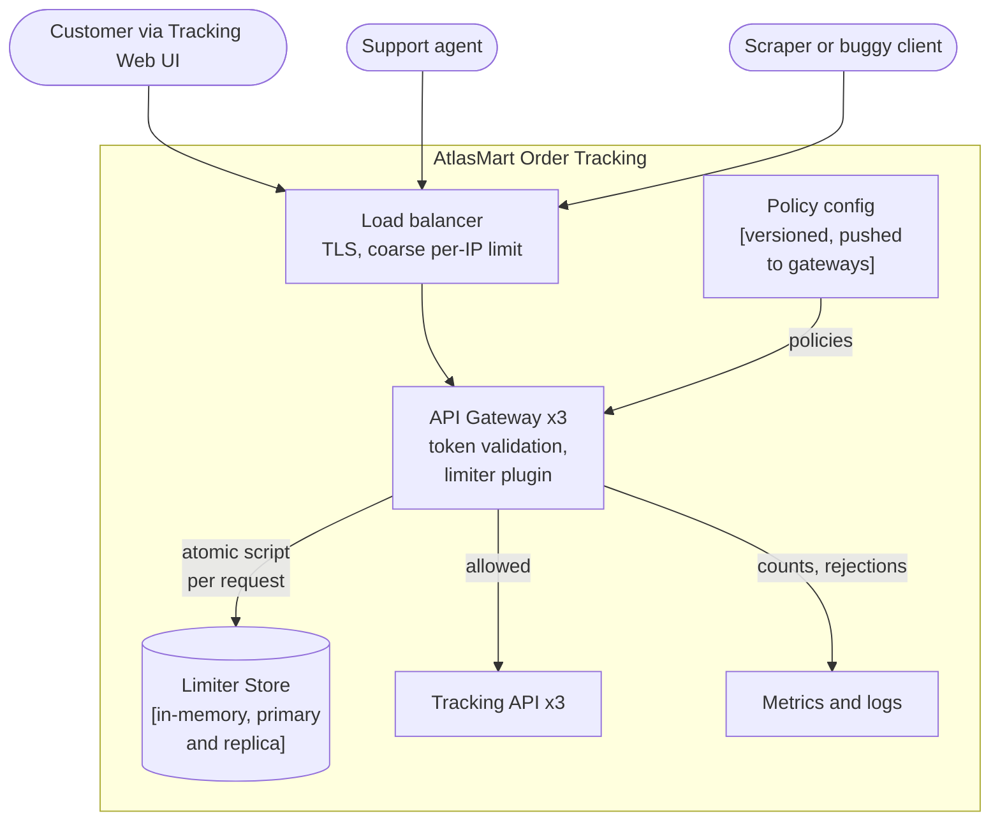
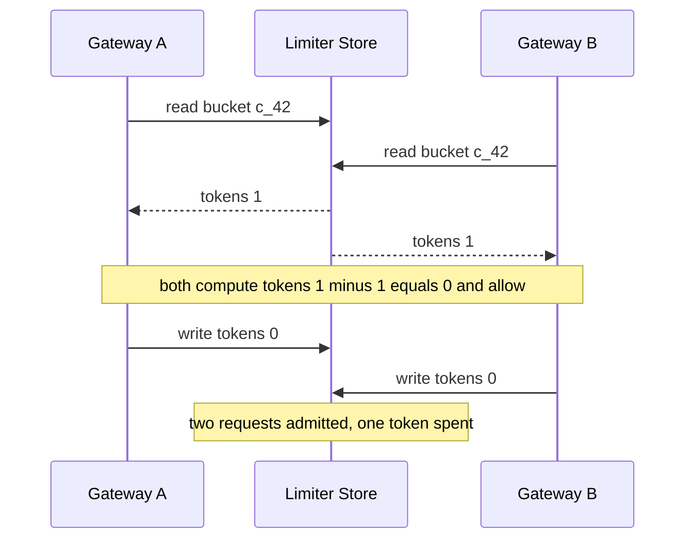
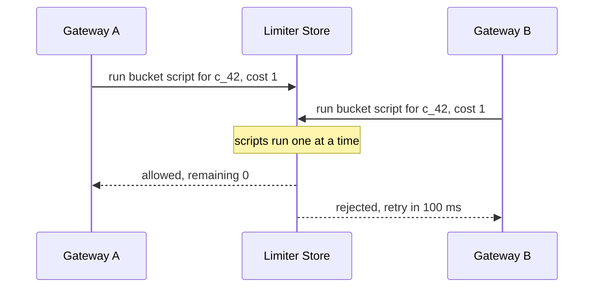
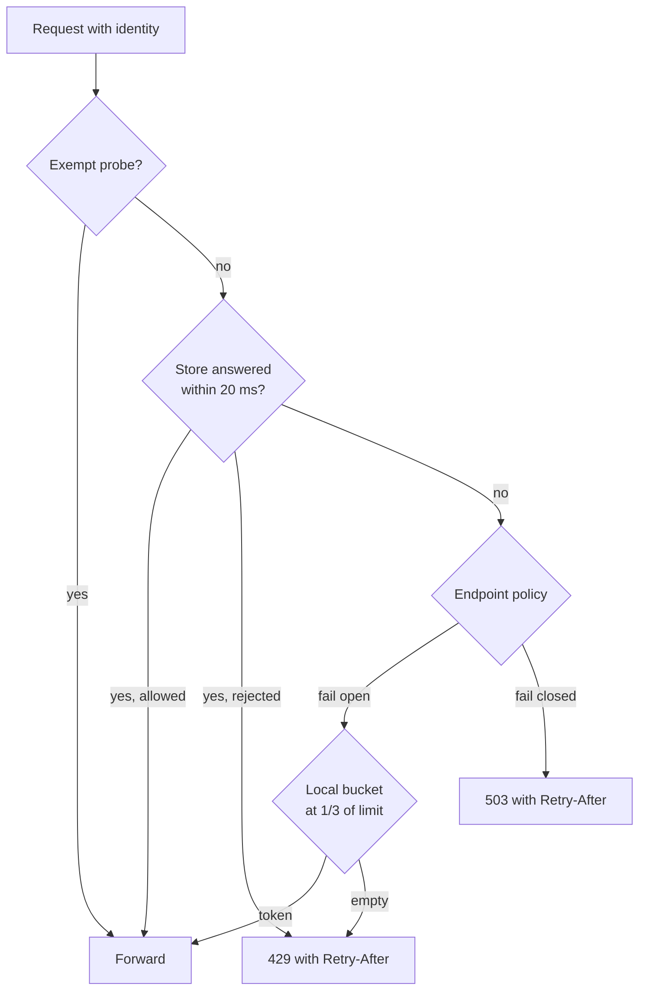

# Exercise: design a rate limiter

> A rate limiter is a small piece of code with a large blast radius: on the request path of every
> call, shared by every instance, and the first thing an attacker meets. Designing one is mostly
> about deciding what to do when it is wrong, slow, or unreachable.

!!! abstract "Page facts"
    **Level:** Intermediate · **Status:** Draft · **Time:** 60-90 minutes (45 minutes to attempt,
    the rest to compare) · **Last verified:** 2026-11-20

## Problem statement

The fictional retailer AtlasMart exposes its order Tracking API to customers (through the Tracking
Web UI) and to support agents. The [API design page](../application-and-api-architecture/api-design-rest-graphql-grpc-and-async-apis.md)
set the limits: **10 requests per second per customer with a burst of 20, and 50 requests per
second per support agent**, enforced at the API gateway. At 400,000 daily active users the whole
system's design peak is 210 tracking reads per second, so a single client approaching that rate is a
scraper or a bug.

Design the rate limiter that enforces these limits across all gateway instances: the algorithm, where
it runs, where its state lives, what the client sees when it is limited, and what happens when the
limiter's own store fails. AtlasMart is fictional; numbers not taken from earlier pages are labelled
as new assumptions.

## How to use this exercise

1. **Attempt first.** Read only the problem statement, requirements, and scale assumptions.
2. **Time box.** Give yourself 45 minutes and follow the twelve steps of the
   [design method](design-method.md), using its checklist. Produce at least: an algorithm choice
   with its burst behaviour, a placement decision, a state store design that is correct under
   concurrency, a store-outage policy per endpoint, and the response a limited client receives.
3. **Use the hints one at a time,** only when stuck.
4. **Then compare** with the reference solution and score yourself with the rubric. A different
   choice with a stated reason is a good answer; an unexamined default is not.

## Requirements

### Functional requirements

1. **FR-1 Enforce.** Every Tracking API request is checked against its caller's policy before it
   reaches the Tracking API; allowed requests pass, others receive `429 Too Many Requests`.
2. **FR-2 Policies.** Customers: 10 requests/s, burst 20. Support agents: 50 requests/s, burst 100
   (the burst is a new assumption). Unauthenticated requests: limited per client IP address.
3. **FR-3 Inform.** Responses tell the client its remaining allowance; `429` responses say when to
   retry.
4. **FR-4 Configure.** Policies change without a redeploy and take effect within 1 minute.
5. **FR-5 Observe.** Operators see allowed and rejected requests per policy and per client.
6. **FR-6 Exempt.** Synthetic monitoring probes (the SLO probes behind NFR-2) are never limited.

### Non-functional requirements

1. **NFR-RL1 Latency.** The limiter adds at most 5 ms at p99 to an allowed request (inside the
   Tracking API's p95 300 ms and p99 800 ms, NFR-3).
2. **NFR-RL2 Accuracy.** A client sending far above its limit is held to within 10% of the
   sustained limit plus one burst, measured over a minute. Brief over-allowance during a store
   failover is acceptable.
3. **NFR-RL3 Availability.** The limiter is never the reason the tracking view is unavailable; it
   must not consume the 43.8-minute monthly budget of NFR-2.
4. **NFR-RL4 Scale.** Decide on at least ten times the design peak of 210 requests/s, because the
   limiter sees attack traffic that the Tracking API never does.
5. **NFR-RL5 Security.** Limits are keyed on authenticated identity (the customer or agent id from
   the validated token), not on headers a client can forge.

### Clarifying questions a good candidate asks

- Is the limit per customer across all their devices, or per device? (Per customer.)
- Should limited requests be rejected or queued? (Rejected: a tracking page that waits is worse
  than one that retries.)
- Are some operations more expensive than others? (Yes: rescheduling a delivery calls the carrier;
  treat it separately.)
- Is there more than one region? (Not today: one region, three zones, constraint C-2; multi-region is
  discussed as an extension.)
- What matters more if the limiter breaks: protection or availability? (Availability for reads;
  see the store-outage policy.)

## Scale assumptions

### Stated assumptions

| Id | Assumption | Value | Source |
|---|---|---|---|
| S1 | Tracking reads per day; average; daily peak; design peak | 1,200,000; 13.9/s; 70/s; 210/s | Existing AtlasMart estimate |
| S2 | Abusive traffic the limiter must reject at the design peak | 2,100 requests/s (10 × 210) | New assumption |
| S3 | Gateway instances | 3, one per zone | New assumption |
| S4 | Limiter state per client key in the store, including overhead | 150 B | New assumption; measure with the store's memory reporting |
| S5 | Limiter call size (request plus reply) | 180 B | New assumption |
| S6 | `429` response size | 300 B | New assumption |
| S7 | In-zone round trip to the limiter store | 1 ms | New assumption; measure |
| S8 | Rejected requests in normal operation; size of one rejection record | 0.5% of requests; 200 B | New assumptions |

### The estimate

- **Rates:** legitimate traffic averages **13.9 requests/s**, peaks at **70/s** daily and
  **210/s** on sale days. Adding the attack scenario (S2), the limiter decides on
  210 + 2,100 = **2,310 requests/s** at its design peak.
- **Read:write ratio at the store:** **1 : 1**. Unlike a cache, every check reads the bucket and
  writes it back, so the store sees one read-modify-write per request, including rejected ones.
- **Store memory (the "cache size"):** a bucket's key expires after it has been idle long enough to
  refill: capacity ÷ rate = 20 ÷ 10 = 2 s, plus a 1 s margin = 3 s. Live keys are bounded by the
  requests in any 3 s: legitimate 210 × 3 = 630, attack 2,100 × 3 = 6,300 (if every attack request
  used a different identity), about **7,000 keys × 150 B ≈ 1 MB**. Even if all 400,000 daily
  users were active at once: 400,000 × 150 B = **60 MB**. One small node is ample.
- **Bandwidth to the store:** 2,310 × 180 B ≈ 416 KB/s ≈ **3.3 Mbit/s**. `429` responses to the
  attacker: 2,100 × 300 B = 630 KB/s ≈ **5 Mbit/s** of egress.
- **Storage over 5 years:** limiter state is ephemeral, so the durable data is policies (kilobytes)
  and rejection records. Normal operation: 0.5% × 1,200,000 = 6,000 rejections a day × 200 B =
  1.2 MB a day, about **2.2 GB over five years**. But one hour of the S2 attack is 2,100 × 3,600 =
  7.56 million rejections × 200 B ≈ **1.5 GB**, almost as much as five normal years: record
  per-client per-minute counts during attacks, not each rejection.
- **Latency and concurrency:** one store round trip per request (S7) adds about 1 ms, well within
  NFR-RL1. By Little's Law, 2,310/s × 0.001 s ≈ **2.3 calls in flight**, so a small connection pool
  per gateway instance is enough.

## Hints

??? question "Hint 1: which algorithm matches the policy?"
    The policy says "10 per second, burst 20". Which algorithms have two parameters, one for the
    sustained rate and one for the burst? What does a fixed one-second window allow at the boundary
    between two seconds?

??? question "Hint 2: where does the state live, and who changes it at the same time?"
    Three gateway instances see one customer's requests. If each keeps its own bucket, what limit
    does each enforce, and what happens when the load balancer is uneven? If they share a store,
    what goes wrong when two instances read the same bucket, both see one token left, and both
    write back zero?

??? question "Hint 3: the shape of a good answer"
    A token bucket per identity in a shared in-memory store, updated by one atomic server-side
    script that refills, decides, and writes in a single step using the store's clock. The gateway
    calls it on every request with a short timeout. If the store is unreachable, read endpoints fall
    back to a local per-instance bucket at a third of the limit (fail open, still bounded), and an
    expensive endpoint fails closed. Limited clients get `429` with `Retry-After` and the remaining
    allowance in headers.

## Reference solution

### The twelve steps, briefly

| Step | Decision |
|---|---|
| 1 Problem | Protect the Tracking API and its dependencies from scrapers and buggy clients without ever limiting normal customers |
| 2 Requirements | FR-1 to FR-6; driving NFRs: added latency (RL1), availability (RL3), identity-based keys (RL5) |
| 3 Estimate | 2,310 decisions/s at the design peak; 1 : 1 read-modify-write; about 1 MB of state; about 1 ms added |
| 4 Boundaries | Limiter is a gateway plugin plus a Limiter Store; policies owned by the API team; the Tracking API keeps its own per-operation limits |
| 5 Contracts | `429` with `Retry-After` (RFC 6585) and `RateLimit-Policy` / `RateLimit` fields from the IETF draft |
| 6 Data | One hash per identity (tokens, last refill time) with a 3 s expiry |
| 7 Style | Synchronous check in the gateway; no separate limiter service to call over the network beyond the store |
| 8 Deployment | Store primary and replica in different zones of the one region; gateways in all three zones |
| 9 Security | Keys from validated tokens; per-IP limits only for unauthenticated requests, using the address seen by AtlasMart's own load balancer |
| 10 Resilience | Short timeout on the store call; per-endpoint fail-open or fail-closed policy with a local fallback bucket |
| 11 Operations | Rejections per policy and client; store latency and error rate; policy changes through review and staged rollout |
| 12 Decisions | ADRs for the algorithm, shared store, and outage policy; cost is one small store node |

### Algorithms compared

| Algorithm | How it works | Burst behaviour | Memory per client | Accuracy |
|---|---|---|---|---|
| Fixed window | Count requests in the current calendar window (for example each second); reject above the limit; reset at the boundary | Up to twice the limit across a boundary: 10 at 0.99 s and 10 at 1.01 s is 20 in 20 ms | One counter and the window id | Coarse at boundaries |
| Sliding log | Keep a timestamp per request; count those inside the last window | None beyond the limit in any window | One entry per request in the window: 10 for 10/s, but up to 1,000 for a 1,000-per-hour quota | Exact |
| Sliding window counter | Weight the previous window's count by how much of it still overlaps the sliding window, add the current count | Close to the limit; assumes the previous window's requests were evenly spread | Two counters | Approximate, usually close |
| Token bucket | Tokens refill at the rate up to a capacity; each request takes one; empty means reject | Up to the capacity at once, then the refill rate | Two numbers: tokens and last refill time | Exact for its two parameters |
| Leaky bucket | Requests enter a bucket that drains at a fixed rate; as a queue it delays them, as a meter it rejects when full | As a queue, none downstream: bursts wait or overflow | Two numbers as a meter; up to the queue capacity of requests as a queue | Exact; the queue form adds latency |

**Reference choice: token bucket.** The policy is stated in exactly its two parameters (rate 10,
capacity 20), it allows the short bursts a page load produces (one tracking view issues a few API
calls), it needs two numbers per client, and its state update is a few arithmetic operations. The
leaky bucket as a queue would make customers wait instead of retry, which FR-1 rules out.

### Where to enforce

| Place | What it is good for | Limits |
|---|---|---|
| Client | Well-behaved clients (the Tracking Web UI, partner integrations) pace themselves and honour `Retry-After` | Never trusted; an attacker ignores it |
| Edge (CDN or load balancer) | Coarse per-IP limits for unauthenticated traffic and floods, before any AtlasMart compute is spent | No identity yet; many users share an IP address behind mobile carriers and offices |
| API gateway | Per-identity limits after token validation; one place for all operations | Needs shared state across gateway instances |
| Service | Per-operation, cost-aware limits (reschedule calls a carrier with its own quota); load shedding when the service itself is saturated | Each service reinvents it unless a library is shared |

**Per-instance or shared store?** With three gateways (S3) and local buckets, each would enforce
10 ÷ 3 ≈ 3.3 requests/s and a burst of about 7. That only works if the load balancer spreads each
customer's requests evenly, which it does not for a customer whose requests reuse one connection.
A customer's six quick refreshes could all land on one gateway and be limited at 7 when the policy
promises 20. A shared store gives one exact bucket per customer at the cost of a network round trip
and a dependency. The reference design uses the shared store and keeps the local bucket as the
fallback for when the store is unreachable.

**Figure 1 — Containers.** C4-style container view of the limiter in front of the Tracking API.



How to read it: every request passes the load balancer and a gateway; the gateway makes one call to
the Limiter Store before forwarding. Only allowed requests reach the Tracking API. The policy
configuration reaches gateways out of band, so a policy change needs no redeploy (FR-4).

### The race a shared store must avoid

The obvious implementation reads the bucket, computes, and writes it back as three separate
commands. Two gateway instances doing that at the same moment for the same customer both see the
last token.

**Figure 2 — The lost update.** Two gateways admit two requests against one remaining token.



How to read it: time runs downward. The reads interleave before either write, so the second write
overwrites the first and one admission is never paid for. Under an attack with many concurrent
requests per identity, the overshoot grows with concurrency.

**The fix: one atomic script in the store.** In-memory stores such as Redis run a server-side Lua
script atomically: no other command runs between its first and last line. The refill, the decision,
and the write therefore happen as one step. The script also takes the time from the store's own
clock, so the three gateways' clock skew cannot add or remove tokens.

```lua
-- Illustrative token bucket script. KEYS[1] = bucket key, ARGV = rate, capacity, cost.
local rate     = tonumber(ARGV[1])
local capacity = tonumber(ARGV[2])
local cost     = tonumber(ARGV[3])
local t        = redis.call('TIME')                       -- store clock: seconds, microseconds
local now      = tonumber(t[1]) + tonumber(t[2]) / 1000000
local b        = redis.call('HMGET', KEYS[1], 'tokens', 'ts')
local tokens   = tonumber(b[1]) or capacity               -- unknown client starts full
local ts       = tonumber(b[2]) or now
tokens = math.min(capacity, tokens + math.max(0, now - ts) * rate)
local allowed, retry_ms = 0, 0
if tokens >= cost then
  tokens, allowed = tokens - cost, 1
else
  retry_ms = math.ceil((cost - tokens) / rate * 1000)
end
redis.call('HSET', KEYS[1], 'tokens', tokens, 'ts', now)
redis.call('PEXPIRE', KEYS[1], math.ceil(capacity / rate * 1000) + 1000)
return {allowed, math.floor(tokens), retry_ms}
```

**Figure 3 — The atomic version.** The same two requests, now serialized by the store.



How to read it: the store queues the second script behind the first, so the second sees the bucket
the first left behind. The `math.max(0, now - ts)` guard keeps a store failover to a replica whose
clock is slightly behind from producing negative refill.

Notes on the script: it touches one key, so it works in a partitioned (clustered) store; the expiry
is the refill time plus a second, which is what bounds memory in the estimate; and the gateway loads
the script once and invokes it by its hash so each call sends only the key and three numbers.

### The same algorithm in Python

The following snippet is an illustrative, single-process version of the same logic, useful for unit
tests of the policy and for the local fallback bucket. It is not distributed and not production code.

```python
import threading
import time


class TokenBucket:
    """Illustrative in-process token bucket: one client, one process, not production code."""

    def __init__(self, rate, capacity, clock=time.monotonic):
        self.rate = rate            # tokens added per second (the sustained limit)
        self.capacity = capacity    # largest burst allowed
        self.tokens = capacity      # a new client starts with a full bucket
        self.clock = clock          # monotonic: immune to wall-clock jumps
        self.updated = clock()
        self.lock = threading.Lock()

    def try_acquire(self, cost=1.0):
        """Return (allowed, seconds_until_retry)."""
        with self.lock:
            now = self.clock()
            elapsed = max(0.0, now - self.updated)
            self.tokens = min(self.capacity, self.tokens + elapsed * self.rate)
            self.updated = now
            if self.tokens >= cost:
                self.tokens -= cost
                return True, 0.0
            return False, (cost - self.tokens) / self.rate


if __name__ == "__main__":
    now = [0.0]                                   # a fake clock makes the demo repeatable
    bucket = TokenBucket(rate=10, capacity=20, clock=lambda: now[0])
    burst = [bucket.try_acquire() for _ in range(25)]
    print("instant burst of 25:", sum(ok for ok, _ in burst), "allowed")
    print("retry after:", round(burst[-1][1], 2), "s")
    now[0] += 1.0
    later = [bucket.try_acquire() for _ in range(25)]
    print("25 more, 1 s later:", sum(ok for ok, _ in later), "allowed")
```

Running it prints that 20 of an instant burst of 25 are allowed (the capacity), that the next
token arrives in 0.1 s (one token at 10 per second), and that 1 second later 10 more are allowed
(the rate). That is exactly the AtlasMart customer policy.

### When the Limiter Store is down: fail open or fail closed

The gateway calls the store with a short timeout (assumption: 20 ms, a fraction of the NFR-3 budget).
On timeout or error it applies the endpoint's outage policy. Failing open means allowing the request
without the shared check; failing closed means rejecting it. Neither is right everywhere.

| Endpoint | Outage policy | Why |
|---|---|---|
| `GET /v1/orders/{orderId}` and `GET /v1/shipments/{id}/events` (tracking reads) | Fail open to a local bucket at a third of the limit (3.3/s, burst 7) | NFR-RL3: the limiter must not take the tracking view down; the local bucket still caps a scraper at three times the policy across three gateways |
| Agent operations | Fail open, local bucket at a third of 50/s | Authenticated staff, audited; blocking agents during an incident hurts customers |
| `PUT /v1/shipments/{id}/delivery-schedule` (reschedule) | Fail closed beyond a local bucket of 1 request/s per gateway, with `503` and `Retry-After` | Each call reaches the carrier, whose quota is shared by all customers; the client retries safely with its idempotency key |
| Unauthenticated requests | Fail closed at the edge per-IP limit | No identity, highest abuse risk |
| Synthetic probes (FR-6) | Exempt in all cases | Limiting probes would corrupt the SLO measurement |

**Figure 4 — Outage decision in the gateway.**



How to read it: the normal path is the top three decisions; the store-outage path only begins at
"no" and always ends in a bounded outcome, never in an unlimited forward.

A store outage is also an alert in its own right: the error budget burned by over-allowance is
small, but a store that is down for hours means the system is protected only by the local buckets.

### Response headers and 429 semantics

RFC 6585 defines `429 Too Many Requests` for a client that has sent too many requests in a given
time, allows a `Retry-After` header, and says `429` responses must not be stored by caches. It
deliberately leaves the counting method and client identification to the server. AtlasMart's
response to a limited customer:

```http
HTTP/1.1 429 Too Many Requests
Content-Type: application/problem+json
Retry-After: 1
RateLimit-Policy: "customer";q=10;w=1
RateLimit: "customer";r=0;t=1

{"type": "https://api.atlasmart.example/problems/rate-limited",
 "title": "Too many requests", "status": 429,
 "detail": "This account may make 10 tracking requests per second."}
```

- `Retry-After` is in seconds and rounded up from the script's `retry_ms`; the Tracking Web UI
  waits that long plus random jitter so that many limited clients do not retry in lockstep.
- `RateLimit-Policy` and `RateLimit` come from the IETF HTTP API working group's Internet-Draft
  *RateLimit header fields for HTTP* (draft 11 when checked, not yet an RFC). In that draft, `q` is
  the quota and `w` the window in seconds for a policy, and `r` the remaining quota and `t` the
  seconds of the effective window. A token bucket maps onto these approximately (a window of 1 s
  with quota 10); the burst is not expressed. The field syntax has changed between drafts, so treat
  it as provisional and check the current draft; many APIs still send older, non-standard
  `X-RateLimit-*` headers.
- Successful responses carry the `RateLimit` field too, so well-behaved clients slow down before
  they are limited.
- The `429` body uses the problem details format, consistent with the rest of the Tracking API.

### Security details

- **Keys from identity, not headers.** The gateway keys buckets on the customer or agent id from the
  validated token (NFR-RL5). For unauthenticated requests it uses the client address as seen by
  AtlasMart's own load balancer, and trusts forwarding headers only from that load balancer.
- **Enumeration costs extra.** The Tracking API returns `404` for orders that are missing or not the
  caller's. A second, stricter bucket on `404` responses (new assumption: 20 per minute per
  customer) makes guessing order identifiers slow and visible without affecting customers who only
  view their own orders.
- **Many identities.** Per-customer limits do not stop an attacker who controls many accounts; the
  edge per-IP limit, account-creation controls (owned by the identity team), and a global alert on
  total rejections cover that case.

### Multi-region

AtlasMart runs in one region today (C-2), so the store is regional. If the Tracking API went
multi-region, the options would be:

1. **Independent regional limits.** Each region enforces the full limit: simplest, but a client
   using two regions gets twice the limit.
2. **Split limits.** Each region enforces the limit divided by the number of regions: never over,
   but a client served by one region gets less than promised.
3. **One global store.** Exact, but every request pays a cross-region round trip and every region
   depends on one store, which breaks the independence multi-region was meant to buy.
4. **Local enforcement with asynchronous sharing.** Each region enforces locally and periodically
   publishes its counts to the others; the overshoot is bounded by the sharing interval.
5. **Home-region routing.** Route each customer to one home region so one store sees all their
   traffic; failover temporarily resets their bucket.

For rate limiting (as opposed to billing quotas), options 4 or 5 are usually right: a few percent of
overshoot for a few seconds is harmless, and regions stay independent.

## Alternatives and trade-offs

| Choice | Favor when | Avoid when |
|---|---|---|
| Token bucket (reference) | The policy has a rate and a burst; short bursts are legitimate | You must guarantee a smooth output rate downstream (use a leaky bucket queue) |
| Sliding window counter | Only atomic increments are available; you want low memory and near-exact limits | You need an explicit burst allowance |
| Sliding log | Low limits where exactness matters (for example 5 password attempts per hour) | High limits or long windows: memory grows with the limit |
| Fixed window | Long-period quotas (per day, per month) where boundary bursts do not matter | Short windows protecting a fragile resource |
| Shared store (reference) | Several gateway instances; promised limits must hold per identity | A single instance, or a limit loose enough that local buckets suffice |
| Local per-instance buckets | No extra dependency; latency matters above all; load balancing is sticky per client | Uneven load balancing makes limits unpredictable |
| Fail open | Availability is the priority and the protected resource can absorb a bounded overshoot | The protected resource is fragile, expensive, or a security control (login attempts) |
| Fail closed | Each request is expensive or abuse-prone | The endpoint is on the critical customer path |

## Failure modes and how the design handles them

- **Limiter Store unreachable.** Detect: gateway store errors and timeouts. Handle: per-endpoint
  outage policy with local buckets (Figure 4); page if it lasts more than a few minutes.
- **Store failover loses recent state.** Replication to the replica is asynchronous, so promoted
  buckets may be slightly stale or missing; missing buckets start full. Handle: accepted; at most
  one extra burst per client, within NFR-RL2's allowance.
- **Slow store.** Detect: limiter latency p99. Handle: the 20 ms timeout turns slowness into the
  outage path rather than into slow tracking pages.
- **Bad policy push** (for example a limit of 0). Detect: rejection rate jumps across all clients.
  Handle: policies are versioned, validated (no limit below a floor), rolled out to one gateway
  first, and rolled back automatically on a rejection spike.
- **Retry storm after rejections.** Clients that ignore `Retry-After` multiply load. Handle: the
  Web UI honours it with jitter; rejections are cheap (one script call, no Tracking API work).
- **Shared IP addresses.** Many legitimate users behind one mobile carrier address hit the per-IP
  limit. Handle: per-IP limits only for unauthenticated traffic and set loosely; identity-based
  limits for everything else.
- **Key explosion.** An attacker rotates identities to fill the store. Handle: the 3 s expiry bounds
  memory to the request rate times 3 s, about 1 MB at the attack assumption.
- **Probes limited.** Detect: SLO probe failures with `429`. Handle: probe identities exempt (FR-6).

## Evaluation rubric

| Area | Weak answer | Strong answer |
|---|---|---|
| Requirements | "Limit to N per second" with no burst, identity, or outage question | Asks per what identity, reject or queue, per-operation cost, and what happens if the limiter fails |
| Estimation | None, or only legitimate traffic | Includes attack traffic; sees the 1 : 1 read-modify-write; derives state size from key expiry |
| Algorithm | Names one algorithm | Compares algorithms with burst behaviour and memory; matches the choice to the policy's parameters |
| Placement | "In the service" or "in the gateway" without reason | Explains client, edge, gateway, and service roles and the per-instance versus shared trade-off |
| Concurrency correctness | Read, compute, write from the gateway | Identifies the lost-update race and fixes it with an atomic script or atomic primitives; uses one clock |
| Failure policy | Fails closed everywhere, or ignores the question | Chooses fail open or closed per endpoint with reasons and a bounded fallback |
| Client contract | Returns `403` or `500` | `429` with `Retry-After`, remaining-allowance headers, jittered client retries |
| Security | Keys on a forgeable header | Keys on authenticated identity; per-IP only for anonymous traffic; enumeration handled |
| Multi-region | Not considered, or a global store by default | Describes options and their overshoot versus coupling trade-off |

## Extensions

1. **Paid partner tiers.** Third-party dashboards pay for tracking data access with monthly quotas
   and per-second limits per tier. Add quotas (long windows) alongside rate limits and decide where
   usage is counted for billing accuracy.
2. **Cost-based limits.** Charge each request a cost (a list of 100 events costs more than one order
   view; a GraphQL query costs by its estimated complexity) and take that many tokens.
3. **Adaptive limits and load shedding.** When the Tracking API is saturated, lower limits for
   low-priority traffic first, keeping capacity for critical operations.
4. **Multi-region active-active.** Implement option 4 from the multi-region section and bound the
   overshoot numerically for a given sharing interval.
5. **Fairness in a multi-tenant platform.** Turn the limiter into a shared platform service for
   many teams' APIs, with per-tenant isolation so one tenant's attack cannot exhaust the store.

## Related topics

- [The architecture design method](design-method.md) — the twelve steps used above.
- [API design](../application-and-api-architecture/api-design-rest-graphql-grpc-and-async-apis.md)
  — where the AtlasMart limits were set, and the problem details format.
- [Distributed systems fundamentals](../distributed-systems/distributed-systems-fundamentals-time-and-coordination.md)
  — clock skew and why one clock decides.
- [Resilience mechanics: timeouts, retries, and backpressure](../distributed-systems/resilience-mechanics-timeouts-retries-and-backpressure.md)
  — the client side of `429` and `Retry-After`.
- [Lab 05: reproduce a race condition and fix it](../labs/lab-05-race-condition.md) — the lost
  update of Figure 2 in runnable form.
- [URL shortener exercise](url-shortener.md) — uses this limiter for creation and `404` responses.
- **Planned:** infrastructure component exercises collection (D29-T02); API gateway and service
  mesh patterns (D03); security architecture (D12).

## References

| Source | Type | Checked |
|---|---|---|
| [RFC 6585: Additional HTTP Status Codes](https://www.rfc-editor.org/rfc/rfc6585), section 4 — IETF | Standard (`429 Too Many Requests`) | 2026-11-20 |
| [RateLimit header fields for HTTP](https://datatracker.ietf.org/doc/draft-ietf-httpapi-ratelimit-headers/) — IETF HTTP API working group | Internet-Draft (draft 11, active, not an RFC; check current status) | 2026-11-20 |
| [Scripting with Lua](https://redis.io/docs/latest/develop/programmability/eval-intro/) — Redis documentation | Official documentation (atomic script execution, effects replication) | 2026-11-20 |
| [Scaling your API with rate limiters](https://stripe.com/blog/rate-limiters) — Stripe engineering blog | Engineering blog (token bucket in a shared store; failing open) | 2026-11-20 |
| [How we built rate limiting capable of scaling to millions of domains](https://blog.cloudflare.com/counting-things-a-lot-of-different-things/) — Cloudflare blog | Engineering blog (sliding window counter approximation) | 2026-11-20 |
| [Site Reliability Engineering: Handling Overload](https://sre.google/sre-book/handling-overload/) — Google | Book chapter (free online; per-client limits and graceful rejection) | 2026-11-20 |

## Review notes

- Exercise page under D29-T02 (the collection page is planned). Limits of 10/s burst 20 per customer
  and 50/s per agent come from the API design page; new assumptions are labelled S2-S8, plus the
  agent burst of 100, the 20 ms store timeout, the 1/s local reschedule allowance, and the
  20-per-minute `404` bucket.
- The Lua script has not been run against a live store in this environment; a reviewer should run it
  against a local Redis (`EVAL` with one key and three arguments) and check refill, rejection, and
  expiry. The Python snippet was run with `python3 -I` and printed 20, 0.1, and 10 as described.
- The `RateLimit` header syntax follows draft-ietf-httpapi-ratelimit-headers-11 as published on the
  datatracker on 2026-11-20 (it expires 24 November 2026); recheck before review.
- The API page linked from the `429` body (`api.atlasmart.example`) uses the reserved `.example`
  domain on purpose.
