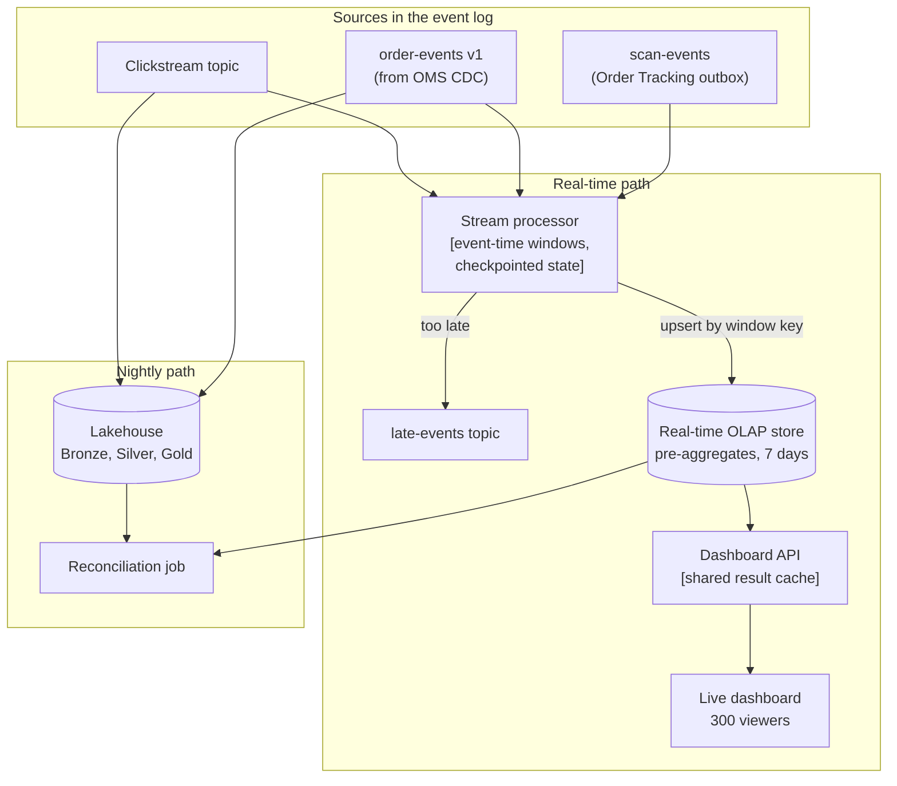
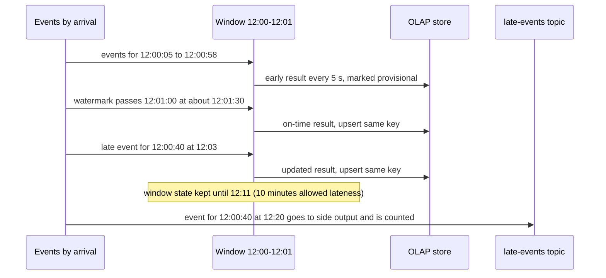
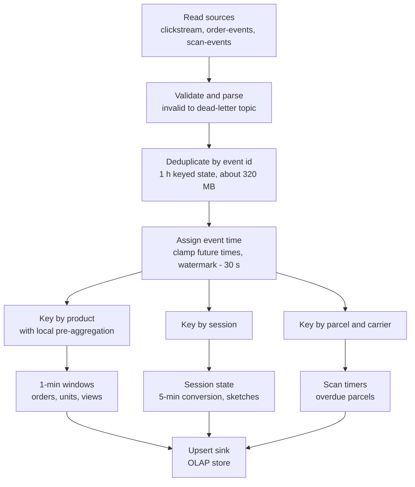
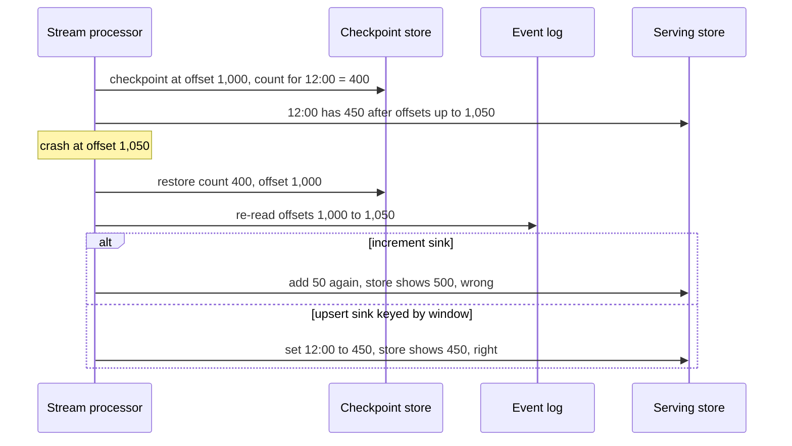
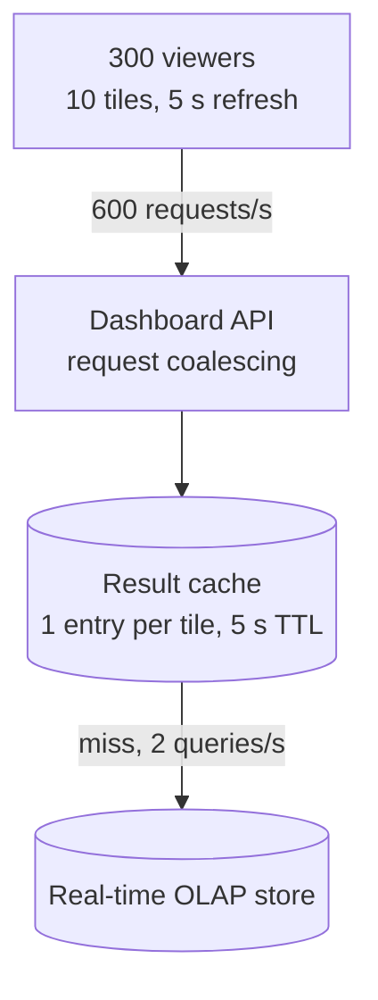

# Exercise: design a sale-day real-time analytics dashboard

> A live dashboard is a promise about time: that the number on the screen describes the last minute
> and not whatever happened to arrive in it. Keeping that promise means deciding when a minute is
> finished, what to do with the events that turn up after it, and how to stop three hundred people
> pressing refresh from doing more work than the whole pipeline behind them.

!!! abstract "Page facts"
    **Level:** Advanced · **Status:** Draft · **Time:** 75-90 minutes (50 minutes to attempt, the
    rest to compare) · **Last verified:** 2026-11-27

## Problem statement

AtlasMart (fictional) is an online retailer: 400,000 daily active users (70% on mobile web),
60,000 orders a day, 300,000 parcels in transit with 12 carriers, all in one EU cloud region (EU
customer data stays in the EU, constraint C-4). Today every analytics number comes from the
lakehouse's nightly batch, so on its twice-yearly sale days the trading team watches the shop
through screenshots of yesterday.

For the next sale day, the trading, merchandising, and logistics teams want one live dashboard:

1. **Orders per minute**, overall and by channel, compared with the same minute of the last sale.
2. **Conversion**: the share of shopping sessions that end in an order, per 5 minutes.
3. **Top products** by units ordered and by product views, over the last 15 and 60 minutes.
4. **Carrier delays**: per carrier, scan events per minute and parcels overdue for their next scan.

Clickstream events already flow into the AtlasMart **event log** (a managed, Kafka-compatible log
with 7-day retention). Order changes arrive there from the OMS through change data capture (see the
[CDC pipeline exercise](cdc-pipeline.md)). Carrier scan events are processed by the Order Tracking
system. Design the pipeline and the serving layer. Every number not listed above is a labelled
assumption.

## How to use this exercise

1. **Attempt first.** Read the problem statement, requirements, and scale assumptions only.
2. **Time box.** 50 minutes, following the twelve steps of the [design method](design-method.md).
   Produce at least an estimate of event and query rates, a container diagram, the windowing and
   lateness policy for each metric, the state sizes, a restart story with no double counting, and a
   plan for dashboard load.
3. **Use the hints only when stuck,** one at a time; each is stronger than the last.
4. **Then compare** with the reference solution and score yourself with the rubric. A different
   choice with a stated reason and an honest trade-off is a strong answer.

## Requirements

### Functional requirements

1. **FR-1 Orders per minute.** Orders placed per minute by channel (mobile web, desktop), with the
   current minute shown as it fills.
2. **FR-2 Conversion.** Sessions with at least one product view that also complete a checkout,
   divided by sessions with at least one product view, per 5-minute window and channel.
3. **FR-3 Top products.** The top 20 products by units ordered and by views over the last 15 and 60
   minutes.
4. **FR-4 Carrier delays.** Per carrier, scans per minute and the number of in-transit parcels with
   no scan for longer than that carrier's expected interval.
5. **FR-5 Provisional flag.** Every tile shows how fresh its data is; numbers are marked
   provisional until the nightly batch confirms them.

### Non-functional requirements

1. **NFR-R1 Freshness (assumption).** Orders per minute within **30 s** at p95 of the order
   committing; conversion and top products within **90 s** of their window closing; carrier delays
   within **2 minutes**.
2. **NFR-R2 Accuracy (assumption).** One hour after a window closes, real-time numbers are within
   **1%** of the nightly Gold figures for the same window.
3. **NFR-R3 Dashboard load (assumption).** **300** concurrent viewers on a sale day, every tile
   answering within 1 s at p95.
4. **NFR-R4 Availability (assumption).** 99.5% during the sale window; if the real-time path fails,
   the dashboard says so and never shows stale numbers as live.
5. **NFR-R5 Privacy.** The serving store holds aggregates only, no customer or session identifiers;
   everything stays in the EU region.
6. **NFR-R6 Cost.** Scale down outside sale days; report the cost in cost units (CU).

### Clarifying questions a good candidate asks

- What exactly is a session and a conversion? (Here: the client's session id, 30 minutes of
  inactivity ends it; the numerator is a `checkout_completed` clickstream event.)
- Which source is authoritative for orders? (Here: OMS order events from CDC for counts and units;
  clickstream only for conversion.)
- How late can events arrive? (Here: mobile browsers buffer when offline; see R7.)
- How many people will watch, and how often do tiles refresh? (Here: 300 viewers, 5-second
  refresh.)
- Must the dashboard support arbitrary filters and drill-down? (Here: channel and carrier only;
  ad hoc analysis stays in the BI tool on Gold.)
- Is this needed every day or only on sale days? (Here: every day at low resolution, sale days at
  full resolution.)

## Scale assumptions

### Stated assumptions

| Id | Assumption | Value |
|---|---|---|
| R1 | Clickstream (Phase 5 AtlasMart assumption): 400,000 DAU × 40 events, 1 KB each | 16,000,000/day ≈ 185/s; 4× peak ≈ 740/s |
| R2 | Sale-day multiplier on top of the daily peak (matching tracking's 210 ÷ 70) | 3 |
| R3 | Orders: daily peak factor (matching tracking's 70 ÷ 13.9); sale-day factor | 5; 3 |
| R4 | Curated order events at the sale-day peak (from the CDC exercise) | 240/s |
| R5 | Scan events (existing AtlasMart fact): average; peak | 5.6/s; 70/s |
| R6 | Products with at least one view or order in a sale-day minute (of a 50,000-product catalogue) | 5,000 |
| R7 | Lateness of clickstream events (to be measured) | 99% within 30 s; 99.9% within 10 minutes |
| R8 | Sessions on a sale day; average session length | 1 per DAU × 3 = 1,200,000; 10 minutes |
| R9 | Stream processing capacity per vCPU for parse, dedupe, and aggregate (illustrative; measure) | 5,000 events/s |
| R10 | Dashboard: viewers; tiles per dashboard; refresh interval | 300; 10; 5 s |
| R11 | Expected interval between scans, per carrier (configurable) | 24 hours |

### The estimate

- **Clickstream at the design peak:** 740/s × 3 = **2,220 events/s**; a sale day carries 16 M × 3 =
  **48 million events, about 48 GB raw**.
- **Orders:** 60,000 ÷ 1,440 minutes ≈ 42/minute average; × 5 ≈ 208/minute daily peak; × 3 ≈
  **625 orders/minute (about 10/s)** at the sale-day peak. Orders are a tiny stream; clickstream is
  the volume.
- **Total input at the design peak:** 2,220 + 240 + 70 ≈ **2,530 events/s** ≈ 2.5 MB/s ≈ **20
  Mbit/s**.
- **Compute:** 2,530 ÷ 5,000 (R9) ≈ 0.5 vCPU. Provision **4 vCPU** (two workers of 2 in different
  zones) for headroom and catch-up: after a one-hour stop, the backlog is 2,530 × 3,600 ≈ 9.1 million
  events; 4 vCPU drain 20,000/s, so 9.1 M ÷ (20,000 − 2,530) ≈ **520 s, about 9 minutes**.
- **Deduplication state:** event ids kept for one hour: 2,220 × 3,600 ≈ 8 million × 40 B ≈
  **320 MB**.
- **Session state:** sessions start at about 1,200,000 ÷ 86,400 × 4 (peak) ≈ 56/s; × 600 s ≈
  **33,000 open sessions** × 200 B ≈ **7 MB**. Exact distinct counting is affordable at this scale.
- **Carrier timers:** 300,000 parcels in transit × 200 B ≈ **60 MB** of keyed state.
- **Pre-aggregated rows:** per minute, per product, per channel: 5,000 × 2 = 10,000 rows/minute ≈
  **14.4 million rows/day**; at 100 B ≈ 1.4 GB/day; 7 days in the serving store ≈ **10 GB** per copy.
- **Naive dashboard load:** 300 viewers × 10 tiles ÷ 5 s = **600 queries/s**. If each top-products
  query over 60 minutes reads 60 × 10,000 = 600,000 rows and a tenth of queries are that kind, that
  is 60 × 600,000 = **36 million rows/s**, far more than the 2,530 events/s that produce them.
- **With a shared result cache:** 10 tiles ÷ 5 s = **2 queries/s**, whatever the number of viewers.

## Hints

??? question "Hint 1: which clock?"
    A mobile browser loses signal at 12:00:40 and sends its buffered events at 12:03. Which minute
    do those events belong to, and when can you say the 12:00 minute is complete? What do you show
    before then, and what do you do with an event that arrives at 12:20?

??? question "Hint 2: where should the work happen?"
    Compare the 2,530 events/s coming in with the 600 queries/s a naive dashboard sends. Which side
    should do the aggregation, and how many times should each number be computed? What happens to
    a count if the job restarts from a checkpoint and writes `count = count + n` again?

??? question "Hint 3: the shape of a good answer"
    A stream processor reads the clickstream, order events, and scan events from the log, assigns
    event time, and uses watermarks with a 30-second bound. It aggregates into 1-minute and 5-minute
    event-time windows with early results every few seconds and updates for late events up to 10
    minutes, writing upserts keyed by window into a real-time OLAP store. Hot products get two-phase
    aggregation. Dashboards read pre-aggregated tables through a shared result cache.

## Reference solution

### The twelve steps, briefly

| Step | Decision |
|---|---|
| 1 Problem | Trading, merchandising, and logistics act within minutes on a sale day; yesterday's numbers are too late |
| 2 Requirements | FR-1 to FR-5; the driving NFRs are freshness (NFR-R1), accuracy against Gold (NFR-R2), and dashboard load (NFR-R3) |
| 3 Estimate | 2,530 events/s in, 600 queries/s naive out; state under 400 MB; 10 GB of aggregates for 7 days |
| 4 Boundaries | Data platform team owns the stream jobs and serving store; Order Tracking publishes scan events; dashboards owned by the analytics team |
| 5 Contracts | Clickstream, `order-events` v1, and a new `scan-events` topic, all with event ids and event times; aggregate tables with a documented grain |
| 6 Data | Keyed stream state (dedupe, sessions, carrier timers); pre-aggregated tables per minute; HyperLogLog sketches for distinct sessions |
| 7 Style | Streaming (kappa-like) for the live view, with the nightly batch as the system of record |
| 8 Deployment | Stream processor and dashboard API on the platform Kubernetes cluster; a managed or self-run real-time OLAP store; all in the EU region |
| 9 Security | Aggregates only in the serving store; dashboard behind single sign-on with role-based access; no identifiers leave the processor |
| 10 Resilience | Checkpoints plus idempotent upserts; replay from the log; a clear "not live" state |
| 11 Operations | SLIs for watermark lag per source, late-event rate, sink lag, and tile freshness; sale-day scaling runbook |
| 12 Decisions | ADRs for event time with bounded lateness, pre-aggregation, the OLAP store, and the result cache; costed in CU |

### Containers

**Figure 1 — Container diagram for the sale-day dashboard.** Cylinders are data stores; the nightly
batch path is shown because it is the reference the live numbers are reconciled against.

How to read it: everything live flows top to bottom through one stream processor into one serving
store and one API. The nightly path is unchanged; the reconciliation job compares yesterday's live
numbers with Gold to prove NFR-R2.

Two source decisions sit behind the figure. **Scan events** today travel through Order Tracking's
managed Event Queue, which distributes work to competing consumers and removes each message once
processed, so analytics cannot simply read it. The Order Tracking team publishes processed scans to
a `scan-events` topic through an outbox in the Tracking Event Store (assumption: they agree to this
small change). **Orders** come from the curated `order-events` topic, never from clickstream, because
client-side events can be blocked or lost.

### Event time, watermarks, and lateness

Every event carries its **event time** (when it happened: the client's timestamp for clickstream,
the commit time for orders, the carrier's scan time for scans) and is assigned to windows by that
time, not by arrival time. Otherwise a mobile burst arriving after a signal loss would inflate
whatever minute it arrived in.

A **watermark** is the processor's running claim that no more events older than time T are expected.
It is generated per source partition as "highest event time seen minus 30 seconds" (bounded
out-of-orderness, from R7's 99%), and the operator's watermark is the minimum across its inputs.

**Figure 2 — Late data around one 1-minute window.** Early results while the window is open, a
result at the watermark, updates for late events, and a side output after allowed lateness.

How to read it: the same key (`metric`, `window_start`, dimensions) is written several times, each
write replacing the last. The tile is right within about 30 seconds of the minute ending for 99% of
events, gets more right for 10 minutes, and anything later is counted on a late-events topic and
left to the nightly batch.

The policy per metric:

| Metric | Window | Watermark bound | Early results | Allowed lateness |
|---|---|---|---|---|
| Orders per minute (FR-1) | 1-minute tumbling, event time = commit time | 30 s | Every 5 s | 10 minutes |
| Conversion (FR-2) | 5-minute tumbling over session activity | 30 s | Every 30 s | 10 minutes |
| Top products (FR-3) | 1-minute tumbling per product, rolled up to 15 and 60 minutes | 30 s | Every 15 s | 10 minutes |
| Scans per carrier (FR-4) | 1-minute tumbling, event time = scan time | 2 minutes (carrier webhooks are batchier) | None | 30 minutes |

**Freshness check against NFR-R1.** For orders: CDC lag up to 10 s, early firing every 5 s, store
ingestion a few seconds (assumption, measure), result cache 5 s: about **25 s** in the worst normal
case, inside 30 s. Conversion and top products: window end plus 30 s watermark plus seconds of
processing and caching, inside 90 s.

**Idle sources.** A partition with no events does not advance its watermark, and because the
operator takes the minimum, one quiet partition stalls every window. Each source marks partitions
idle after 1 minute without events so they stop holding the watermark back.

### The stream job

**Figure 3 — Stream job topology.** One job per metric family shares the parsing stage; state is
checkpointed together with the source offsets.

How to read it: the top four stages run once per event; the three keyed branches hold the state
sized in the estimate (dedupe 320 MB, sessions about 7 MB, carrier timers about 60 MB). Every branch
ends in an upsert keyed by window, never an increment.

Details of each branch:

- **Orders and products.** `OrderPlaced` events are deduplicated by `order_id` (a day of keys is
  180,000 on a sale day) and counted per minute and channel; order lines give units per product.
  Views come from clickstream `product_view` events.
- **Conversion.** Per session, the processor records whether the session viewed a product and
  whether it completed checkout, then contributes to the 5-minute window by channel. Distinct
  sessions are also stored as **HyperLogLog sketches** per minute, so the dashboard can merge any
  range (the last 37 minutes, say) without storing session ids in the serving store (NFR-R5). At
  33,000 open sessions exact counting is cheap inside the processor; the sketch is for flexible,
  privacy-preserving reads.
- **Carrier delays.** Each scan resets a per-parcel timer to the carrier's expected interval (R11).
  When a timer fires, the parcel is counted as overdue for its carrier until its next scan. Timers
  run on event time driven by the scan stream's watermark, so an outage of the scan feed stalls
  them instead of marking every parcel overdue; a per-carrier "feed silent" signal is shown on the
  tile.
- **Clock sanity.** Client clocks are wrong sometimes. Event times more than a minute ahead of the
  server's receive time are clamped to the receive time and counted.

### Pre-aggregation and the serving store

The processor writes **pre-aggregated rows** at a documented grain (minute × product × channel,
minute × channel, 5 minutes × channel, minute × carrier). The dashboard never touches raw events.

For serving, the reference uses a **real-time OLAP store**: a column-oriented database that ingests
continuously, supports upserts or replaces by primary key, and answers aggregation queries over
millions of rows in well under a second. Rolling 15- and 60-minute top-N lists are read from
per-minute rows; a small rolled-up table refreshed each minute avoids rescanning 600,000 rows for
every top-60 query.

| Category | Role here | Open-source examples (check current documentation) |
|---|---|---|
| Stream processor | Event-time windows, watermarks, keyed state, checkpoints | Apache Flink; Apache Spark Structured Streaming (micro-batch by default) |
| Real-time OLAP store | Serve pre-aggregates and ad hoc slices with low latency | Apache Druid; Apache Pinot |
| Incrementally maintained materialized views | Keep SQL aggregates current as events arrive | Streaming databases; some warehouses offer them (check the provider's current documentation) |

At AtlasMart's scale (10,000 rows a minute, 167 upserts per second), a relational table of
aggregates would also work; the OLAP store earns its place through the 60-minute top-N scans and the
extensions, not through raw write rate.

### Restarts without double counting

The processor checkpoints its state and the source offsets together. After a crash it restores the
last checkpoint and re-reads the log from those offsets, so events since the checkpoint are processed
a second time. Whether that double counts depends on the sink.

**Figure 4 — A restart, with an increment sink and with an upsert sink.**

How to read it: the processor's internal state is exactly-once thanks to the checkpoint; the
external effect is exactly-once only if writing the same result twice is harmless. Upserts keyed by
`(metric, window_start, dimensions)` are; increments are not. A transactional sink that commits with
the checkpoint is the other option, at the cost of latency up to the checkpoint interval.

### Hot keys: the viral product

If one product takes 30% of views on the sale peak, that is 0.3 × 2,220 ≈ **666 events/s on one key**,
landing on one parallel task. That fits R9's 5,000/s, but a social-media surge of ten times that
(6,660/s) would not, and every other product hashed to the same task would slow down with it.

- **Two-phase aggregation.** Each task first pre-aggregates locally per product for one second, then
  sends one partial count per product per second to the keyed window. The keyed task then sees at
  most one record per upstream task per second for the hot product, whatever the traffic.
- **Key salting** (product id plus a random suffix 0-7, merged afterwards) is the alternative when
  the framework has no local pre-aggregation.
- The event log is not the hot spot: clickstream is partitioned by session id, not product.

### Dashboard serving and query storms

At 09:00 on sale day, 300 people open the dashboard at once and every tile refreshes every 5 seconds.

**Figure 5 — Dashboard read path.** All viewers share one cached result per tile per refresh period.

How to read it: the API collapses identical concurrent requests into one query and caches its
result for the refresh interval, so load on the store depends on tiles, not viewers. Tiles can also
be pushed to browsers (server-sent events) when the cache refreshes, which removes polling.

Supporting rules: dashboards only query pre-aggregated tables; ad hoc queries go to the BI tool on
Gold; per-user rate limits protect the API; the "last updated" time shown on each tile comes from
the data (the newest window's watermark), not from the query time (FR-5).

### Reconciliation and cost

- **Reconciliation.** Each night, the reconciliation job compares yesterday's live per-hour figures
  with Gold. A difference above 1% (NFR-R2) opens a ticket; the late-events count explains most of
  it.
- **Cost (illustrative node sizes; 1 vCPU-hour = 1 CU).** Sale day: stream processing 4 vCPU × 24 h
  = 96 CU; OLAP store 3 nodes × 4 vCPU × 24 h = 288 CU; dashboard API 2 × 1 vCPU × 24 h = 48 CU;
  total **432 CU/day**. Normal day at reduced size (2 vCPU processing, 3 × 2 vCPU store, 1 vCPU API):
  48 + 144 + 24 = **216 CU/day**. For comparison, the nightly batch is 16 vCPU × 4 h = **64 CU**. The
  live view costs three to seven times the nightly batch per day, a figure to put in front of the
  stakeholders who asked for it every day rather than only on sale days.

## Alternatives and trade-offs

| Choice | Favor when | Avoid when |
|---|---|---|
| Stream processing with event-time windows (reference) | Freshness in seconds; late and out-of-order events are common | Minute-level freshness is enough and the team has no streaming skills |
| Micro-batch every minute on the lakehouse (scheduled or streaming micro-batch into Gold) | One to three minutes of freshness is acceptable; one code base with the nightly jobs; the team runs Spark already | Seconds matter; a commit every minute creates 1,440 small file sets a day per table that need compaction |
| Real-time OLAP store fed with pre-aggregates (reference) | Many viewers, sub-second slices, rolling top-N | Volumes so small that a relational table of aggregates is enough |
| Raw events into the OLAP store, aggregated at query time | Exploratory slicing on many dimensions | Hundreds of viewers repeat the same heavy query; raw identifiers would enter the serving store |
| Incrementally maintained materialized views | The team thinks in SQL; few, stable metrics | Complex session and timer logic (carrier delays) |
| Processing-time windows | Rough operational counters where arrival time is the point | Mobile clients buffer events; numbers must reconcile with batch |
| Lambda-style dual paths with merged views | The live path cannot be trusted alone | Two implementations of each metric will drift; reconcile instead |

## Failure modes and how the design handles them

- **Late data.** Detect: late-event rate per source and the size of updates after the on-time
  result. Handle: watermark bound from measured lateness, 10 minutes of allowed lateness with
  upserts, a counted side output, nightly reconciliation. If the late rate rises (a mobile release
  bug), widen the bound for that source rather than silently losing events.
- **Watermark stall.** One idle partition or a stopped source holds back every window. Detect:
  watermark lag per source. Handle: idleness timeout; tiles show "waiting for source X".
- **Hot key on a viral product.** Detect: per-task throughput skew and backpressure. Handle:
  two-phase aggregation or key salting; autoscaling helps the other keys only after the hot key is
  split.
- **Double counting after restarts.** Detect: reconciliation drift right after restarts. Handle:
  checkpointed state, deduplication by event id and `order_id`, upsert sinks keyed by window;
  never increment sinks.
- **Dashboard query storms.** Detect: store query rate and latency against viewer count. Handle:
  request coalescing, a shared result cache, pre-rolled top-N tables, rate limits, push updates.
- **Upstream lag skews a ratio.** If CDC lags but clickstream does not, orders per minute dips while
  views stay level and merchandisers react to a fake drop. Handle: each tile shows its own source
  freshness; ratios mixing two sources are computed only up to the older source's watermark.
- **Scan feed outage.** All carrier timers would look overdue if driven by wall-clock time. Handle:
  event-time timers plus a per-carrier "feed silent" status.
- **Catch-up after an outage.** A one-hour stop takes about 9 minutes to drain at 4 vCPU; during
  that time tiles show "catching up" with their real data time, never stale numbers as live
  (NFR-R4).
- **Bots and replayed clicks.** Inflated views and conversion. Handle: deduplication, a bot filter
  rule set maintained with the security team, and an extension below.

## Evaluation rubric

| Area | Weak answer | Strong answer |
|---|---|---|
| Requirements | Draws a stream processor first | Defines session and conversion, names the authoritative source for orders, asks about lateness and viewers |
| Estimation | Only events per second | Event rates at the sale peak, state sizes per keyed branch, aggregate row counts, naive versus cached query load |
| Time semantics | Counts by arrival time | Event time, watermarks with a measured bound, early results, allowed lateness, side output |
| Aggregation and serving | Dashboard queries raw events | Pre-aggregates at a documented grain, a serving store chosen for the read pattern, rolled-up top-N |
| Correctness on restart | Claims exactly-once without saying where | Checkpoints plus idempotent upsert or transactional sinks; explains why increments double count |
| Hot keys | Not mentioned | Arithmetic for the viral product; two-phase aggregation or salting |
| Dashboard load | "Add more replicas" | Coalescing, shared cache, push, rate limits, data-driven freshness labels |
| Operations and cost | No cost | Watermark and late-event SLIs, reconciliation, CU per day compared with the nightly batch |
| Trade-offs | One design | Compares minute micro-batch, raw OLAP, materialized views, and processing-time windows with conditions |

## Extensions

1. **Every day, cheaply.** Run the live view on non-sale days at under 100 CU/day. Which metrics
   move to minute micro-batch, and which keep the stream?
2. **Alerting.** Page the trading lead when orders per minute drop 30% below the same minute of the
   last sale for five minutes. How do you avoid paging on a CDC lag?
3. **Bot filtering.** Remove automated traffic from views and conversion without delaying tiles
   beyond NFR-R1.
4. **Revenue.** Add revenue per minute. Which source, which currency handling, and what happens with
   cancellations and refunds that arrive hours later?
5. **Second region.** In a regional failover, where does the stream job restart, from which offsets,
   and what does the dashboard show during the gap?

## Related topics

- [The architecture design method](design-method.md) — the twelve steps used above.
- [Data platform exercises](data-platform-exercises.md) — the collection; the
  [CDC pipeline exercise](cdc-pipeline.md) produces `order-events`, and the
  [data lake exercise](data-lake.md) designs the nightly path.
- [Batch, streaming, ETL, ELT, and pipelines](../data-engineering-and-analytics/batch-streaming-etl-elt-and-pipelines.md)
  — windows, watermarks, and micro-batch.
- [Big data processing engines and table formats](../data-engineering-and-analytics/big-data-processing-engines-and-table-formats.md)
  — stream and batch engines.
- [OLTP vs OLAP, dimensional modeling, and BI](../data-engineering-and-analytics/oltp-vs-olap-dimensional-modeling-and-bi.md)
  — grains, aggregates, and dashboards.
- [Event streaming and log-based architecture](../messaging-and-streaming/event-streaming-and-log-based-architecture.md)
  — partitions, offsets, and replay.
- [Distributed systems fundamentals, time, and coordination](../distributed-systems/distributed-systems-fundamentals-time-and-coordination.md)
  — clocks and why event time is hard.
- [Caching architecture](../databases-and-storage/caching-architecture.md) — request coalescing and
  hot keys.
- [Case study 12](../end-to-end-case-studies/cs-12-data-lakehouse-with-batch-and-streaming-ingestion.md)
  and [Case study 13](../end-to-end-case-studies/cs-13-real-time-fraud-detection-pipeline.md) —
  streaming ingestion and real-time decisions at other companies.

## References

| Source | Type | Checked |
|---|---|---|
| Tyler Akidau et al., [The Dataflow Model](https://www.vldb.org/pvldb/vol8/p1792-Akidau.pdf), PVLDB 8(12), 2015 | Paper (event time, windows, watermarks, triggers, accumulation) | 2026-11-27 |
| Apache Flink documentation: [Timely Stream Processing](https://nightlies.apache.org/flink/flink-docs-stable/docs/concepts/time/) and [Generating Watermarks](https://nightlies.apache.org/flink/flink-docs-stable/docs/dev/datastream/event-time/generating_watermarks/) | Open-source project documentation (watermarks, bounded out-of-orderness, idle sources, lateness) | 2026-11-27 |
| Apache Flink documentation: [Stateful Stream Processing](https://nightlies.apache.org/flink/flink-docs-stable/docs/concepts/stateful-stream-processing/) | Open-source project documentation (checkpoints, exactly-once versus at-least-once state) | 2026-11-27 |
| [Apache Beam Programming Guide](https://beam.apache.org/documentation/programming-guide/) — windowing and triggers sections | Open-source project documentation (allowed lateness, early firings, accumulating panes) | 2026-11-27 |
| [Structured Streaming Programming Guide](https://spark.apache.org/docs/latest/streaming/index.html) — Apache Spark | Open-source project documentation (micro-batch model) | 2026-11-27 |
| [Introduction to Apache Druid](https://druid.apache.org/docs/latest/design/) and [Apache Pinot documentation](https://docs.pinot.apache.org/) | Open-source project documentation (real-time OLAP stores) | 2026-11-27 |
| Philippe Flajolet, Éric Fusy, Olivier Gandouet, and Frédéric Meunier, [HyperLogLog: the analysis of a near-optimal cardinality estimation algorithm](https://algo.inria.fr/flajolet/Publications/FlFuGaMe07.pdf), AofA 2007 | Paper (distinct-count sketches) | 2026-11-27 |
| Tyler Akidau, Slava Chernyak, and Reuven Lax, *Streaming Systems* (O'Reilly) | Book | 2026-11-27 |

## Review notes

- Exercise page under D29-T03 (collection page in this batch). AtlasMart is fictional. R1 and R5
  repeat existing assumptions; R2-R4 and R6-R11 and NFR-R1 to NFR-R6 are new and labelled; every other
  number is arithmetic from them. Reviewers should recheck: 2,220 events/s; 48 million events and
  48 GB on a sale day; 625 orders/minute; 2,530 events/s and 20 Mbit/s; 520 s catch-up; 320 MB, 7 MB,
  and 60 MB of state; 14.4 million rows/day and 10 GB for 7 days; 600 queries/s and 36 million rows/s
  naive; 2 queries/s cached; 666 events/s on a hot key; 432, 216, and 64 CU/day.
- New source decision: Order Tracking publishes processed scans to a `scan-events` topic through an
  outbox. This adds a small change for the Order Tracking team and leaves the existing Event Queue as
  it is; case study and topic writers may want to align with it.
- Apache Flink, Spark Structured Streaming, Druid, and Pinot are named only as category examples;
  their pages were checked for the features attributed to them (watermarks, idle sources, checkpoints,
  micro-batch default, real-time OLAP positioning). No managed product or benchmark is claimed.
- The 30-second watermark bound, 10-minute allowed lateness, per-vCPU capacity, and node sizes are
  illustrative; a real design measures lateness distributions and throughput first.
- The Dataflow Model and HyperLogLog PDFs are primary sources reachable with HTTP 200.
