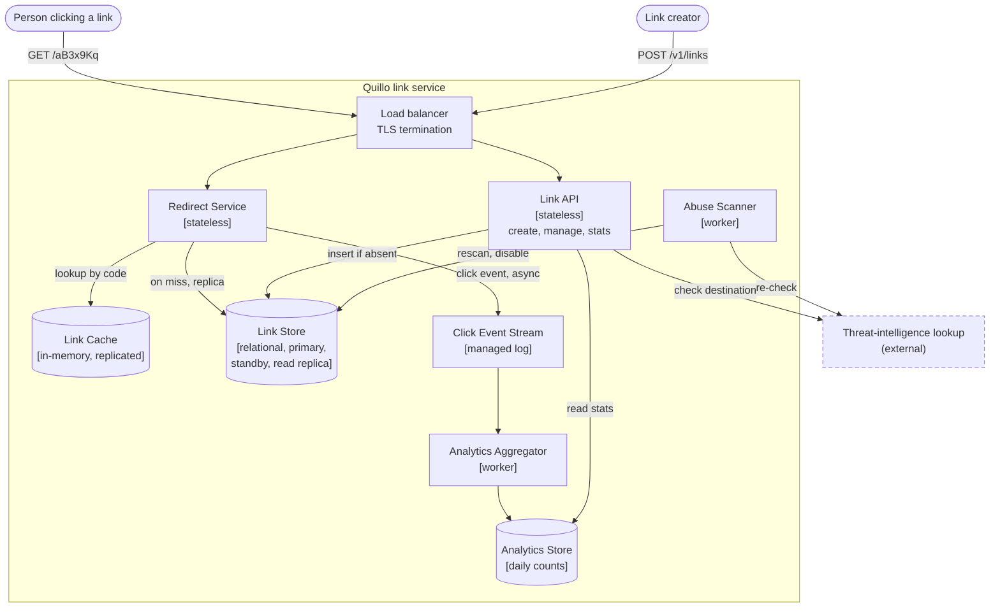
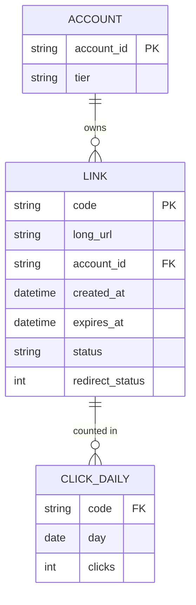
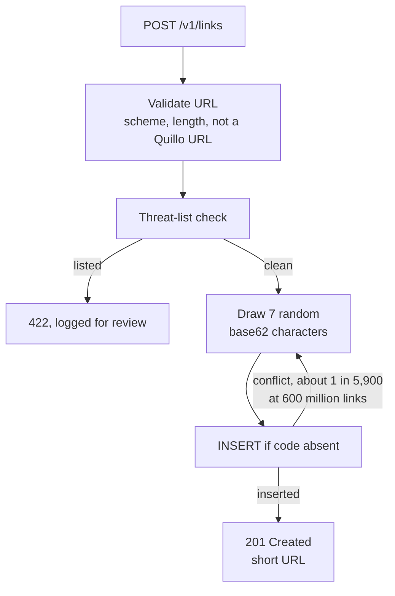
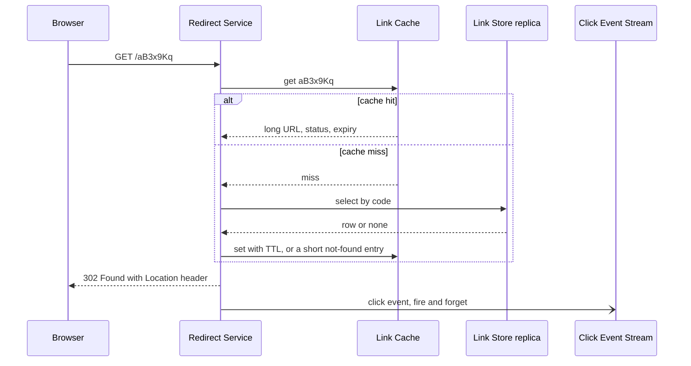

# Exercise: design a URL shortener

> A URL shortener looks like a single table and a redirect. The interesting design is in what that
> hides: generating billions of unguessable codes without collisions, choosing a redirect status code
> that does not destroy your analytics, and stopping the service becoming a delivery system for
> phishing links.

!!! abstract "Page facts"
    **Level:** Intermediate · **Status:** Draft · **Time:** 60-90 minutes (45 minutes to attempt,
    the rest to compare) · **Last verified:** 2026-11-20

## Problem statement

Quillo is a fictional link-management start-up. Its customers (marketing teams, publishers, and
individuals) paste a long URL and receive a short one such as `https://qil.example/aB3x9Kq`, which
they print on posters, put in messages, and share on social media. When anyone opens the short URL,
Quillo redirects them to the long URL and counts the click. Paying customers see click statistics
per day, can choose a custom alias, and can set an expiry date. Quillo's trust and safety team must
be able to disable a link quickly when it is reported for spam or phishing.

Design the service that creates short links, redirects clicks, and records click statistics. All
company details and every number on this page are assumptions for this exercise.

## How to use this exercise

1. **Attempt first.** Read only the problem statement, requirements, and scale assumptions. Close
   the rest of the page.
2. **Time box.** Give yourself 45 minutes and follow the twelve steps of the
   [design method](design-method.md), using its one-page checklist and time budget. Produce at
   least an estimate, a container diagram, an API sketch, a data model, a key-generation choice with
   its collision arithmetic, and a failure-mode list.
3. **Use the hints only when stuck,** one at a time; each is stronger than the last.
4. **Then compare** with the reference solution and score yourself against the evaluation rubric.
   Differences are not automatically mistakes: a different choice with a stated reason and an
   honest trade-off is a strong answer.

## Requirements

### Functional requirements

1. **FR-1 Create.** A signed-in customer submits a long URL (web form or API) and receives a short
   URL with a 7-character code.
2. **FR-2 Redirect.** Anyone opening a short URL is redirected to its long URL.
3. **FR-3 Custom alias.** Paying customers may choose their own code if it is free.
4. **FR-4 Expiry.** A link may carry an expiry time, after which it no longer redirects.
5. **FR-5 Statistics.** The owner sees clicks per link per day, at most 10 minutes behind.
6. **FR-6 Disable.** The owner or the trust and safety team can disable a link; it stops
   redirecting.

### Non-functional requirements

1. **NFR-1 Latency.** Redirects complete within 50 ms at p99, measured at the service (excluding
   the client's network).
2. **NFR-2 Availability.** Redirects are available 99.95% per calendar month (0.05% × 730.5 h ≈
   **21.9 minutes** of allowed downtime). Link creation may be 99.9%.
3. **NFR-3 Scale.** Handle the workload in the scale assumptions below, including campaign peaks,
   at under 70% CPU.
4. **NFR-4 Durability.** A link that has been returned to its creator is never lost and never
   points anywhere other than its long URL (RPO 0 for links). Click statistics may lose up to 0.1%
   of clicks.
5. **NFR-5 Abuse.** Destinations are checked against threat-intelligence lists at creation; a
   disabled link stops redirecting everywhere within 1 minute.
6. **NFR-6 Privacy.** Raw click data (IP address, user agent) is kept at most 90 days; only daily
   aggregates are kept for the life of the link.
7. **NFR-7 Unpredictability.** Knowing some codes must not make it practical to guess others.

### Clarifying questions a good candidate asks

- Can the destination of an existing link be edited? (Here: no; that keeps caching simple and
  stops a trusted link being switched to a malicious one.)
- Must the same long URL always produce the same code? (Here: no; each creation gets its own code
  and its own statistics.)
- How long do links live by default? (Here: until expiry or disabled; plan storage for five years.)
- Do customers need permanent redirects for search-engine reasons? (Here: optional per link, default
  temporary.)
- Is the audience global, and is there a multi-region requirement? (Here: one region at launch;
  multi-region is an extension.)
- Are custom domains per customer required? (Here: no; an extension.)

## Scale assumptions

### Stated assumptions

| Id | Assumption | Value |
|---|---|---|
| A1 | New short links per month | 10,000,000 |
| A2 | Redirects per link created (read:write by count) | 100 |
| A3 | Daily peak factor; campaign event factor on top | 3; 3 |
| A4 | Stored link record including metadata | 500 B |
| A5 | Planning horizon for link storage | 5 years, flat volume |
| A6 | Click event size | 100 B |
| A7 | Redirect response size (status line and headers) | 500 B |
| A8 | Share of redirects that hit links created in the last 30 days | 80% |
| A9 | Cache entry including overhead | 300 B |
| A10 | Measured redirect capacity per instance at 70% CPU, cache hits | 1,000 redirects/s (illustrative; measure) |

### The estimate

- **Writes:** 10,000,000 ÷ 2,592,000 s ≈ **3.9 creates/s** average; × 3 ≈ **12/s** daily peak; × 3
  for bulk imports during campaigns ≈ **35/s** design peak.
- **Reads:** 10,000,000 × 100 = 1,000,000,000 redirects a month ÷ 2,592,000 ≈ **390 redirects/s**
  average; × 3 ≈ **1,200/s** daily peak; × 3 ≈ **3,500/s** design peak.
- **Read:write ratio:** 100 : 1. The redirect path is the design; creation is small.
- **Link storage over 5 years:** 10,000,000 × 60 months = **600 million links** × 500 B = 300 GB raw;
  × 1.3 index overhead ≈ 390 GB per copy; × 3 copies (primary, standby, backups) ≈ **1.2 TB**.
- **Click storage:** 1,000,000,000 clicks a month × 100 B = **100 GB a month** raw. Kept 90 days
  (NFR-6) ≈ **300 GB**. Keeping raw clicks for five years would be 6 TB, five times the link store:
  analytics, not links, is the storage problem.
- **Bandwidth:** 390/s × 500 B ≈ 195 KB/s ≈ **1.6 Mbit/s** average; 3,500/s × 500 B = 1.75 MB/s ≈
  **14 Mbit/s** at the design peak. Monthly egress ≈ 1,000,000,000 × 500 B = **500 GB**.
- **Cache size:** links created in the last 30 days serve 80% of redirects (A8): 10,000,000 × 300 B
  ≈ **3 GB** hot set. Provision about 6 GB per cache replica to hold the hot set plus a long tail.
- **Compute:** A10 is already measured at the 70% CPU target, so 3,500 ÷ 1,000 = 3.5, rounded up
  to 4 instances for load. To survive a zone failure, the two remaining zones must still hold 4, so
  place two per zone: **6 redirect instances** in total.
- **Concurrency:** 3,500/s × 0.01 s (assumed 10 ms service time on a cache hit) ≈ **35 requests in
  flight**, about 6 per instance.
- **Key space:** 62⁷ = 3,521,614,606,208 ≈ **3.5 × 10¹²** codes. 600 million links use about
  0.017% of it.

## Hints

??? question "Hint 1: where does the effort go?"
    Compare the read and write rates. Which path must be fast and highly available, and which can
    be slower and simpler? What is the smallest thing the redirect path needs to know about a link,
    and could it live in memory?

??? question "Hint 2: how do you make codes, and what happens when two are equal?"
    Work out how many 7-character base62 codes exist, then use the birthday bound to estimate how
    soon random codes start colliding at 10 million links a month. Then ask what a unique constraint
    on the code column (an insert that fails if the code exists) buys you, and what a counter would
    give up on NFR-7.

??? question "Hint 3: the shape of a good answer"
    Stateless redirect instances read a code from an in-memory cache in front of a store keyed by
    code; misses go to a read replica. Creation generates a random code from a cryptographically
    secure generator and inserts it only if absent, retrying on the rare conflict. The redirect is
    temporary (302) so every click is seen and a disabled link stops at once. Click events go to a
    stream asynchronously and are aggregated per day. Abuse checks run at creation and again later.

## Reference solution

### The twelve steps, briefly

| Step | Decision |
|---|---|
| 1 Problem | Short, durable, unguessable links with trustworthy click statistics; Quillo's reputation depends on not serving phishing |
| 2 Requirements | FR-1 to FR-6; the driving NFRs are redirect latency and availability (NFR-1, NFR-2), durability (NFR-4), and abuse (NFR-5) |
| 3 Estimate | 3,500 redirects/s and 35 creates/s at the design peak; 1.2 TB of links and 300 GB of raw clicks; 3 GB hot set |
| 4 Boundaries | Redirect Service (hot path) separated from Link API (create, manage, statistics); analytics and abuse scanning are asynchronous workers |
| 5 Contracts | REST API for links; the redirect is a bare `GET /{code}` |
| 6 Data | Relational Link Store keyed by code; in-memory Link Cache; click event stream; daily aggregates |
| 7 Style | Two small stateless services plus event-driven workers; no need for more services |
| 8 Deployment | One region, three zones; 6 redirect instances, 3 Link API instances, a replicated cache, a database primary with synchronous standby and a read replica |
| 9 Security | Account authentication for creation; destination validation and threat checks; random codes; rate limits on creation and on `404` responses |
| 10 Resilience | Redirects survive cache loss (replica reads), database primary loss (cache and replicas), and analytics loss (fire-and-forget events) |
| 11 Operations | SLIs for redirect latency and success; alerts on collision-retry rate, abuse reports, and click-stream lag |
| 12 Decisions | ADRs for code generation, redirect status, and store choice; cost dominated by redirect compute and click storage |

### Containers

**Figure 1 — Container diagram for the Quillo link service.** C4-style container view; cylinders
are data stores, dashed boxes are external.

How to read it: the redirect path is the short chain from the person through the load balancer to
the Redirect Service and the cache; everything else (creation, statistics, scanning) is off that
path. The only synchronous dependency of a cache-hit redirect is the cache.

### API

| Operation | Request | Responses |
|---|---|---|
| Create a link | `POST /v1/links` with `long_url`, optional `alias`, `expires_at`, `redirect` (`temporary` or `permanent`); `Idempotency-Key` header | `201` with code and short URL; `409` alias taken; `422` invalid or listed URL |
| Redirect | `GET /{code}` | `302` (or `301` if chosen) with `Location`; `404` unknown; `410 Gone` expired or disabled |
| Read a link | `GET /v1/links/{code}` (owner only) | `200` metadata; `404` if missing or not the caller's |
| Statistics | `GET /v1/links/{code}/clicks?from=2026-11-01&to=2026-11-20` | `200` with daily counts |
| Disable | `POST /v1/links/{code}/disable` (owner or trust and safety) | `200`; takes effect within NFR-5's minute |

The idempotency key matters because a mobile client that retries a timed-out create would otherwise
get two codes for one intent. See [API design](../application-and-api-architecture/api-design-rest-graphql-grpc-and-async-apis.md)
for the pattern.

### Data model

**Figure 2 — Data model.** The Link Store holds one row per link keyed by code; the Analytics Store
holds daily counts.

How to read it: the redirect path reads only `LINK` by its primary key; `CLICK_DAILY` is written by
the aggregator and read by the statistics endpoint, never on the redirect path. An index on
`account_id` serves "my links" listings.

**Store choice.** The access pattern is a point lookup by key, writes are tens per second, and the
whole table is about 390 GB per copy after five years. A single relational primary with a
synchronous standby (for RPO 0, NFR-4) and a read replica handles that, and the platform team already
operates it. A managed key-value store with conditional writes fits the access pattern equally well
and partitions automatically; it becomes the better choice at the scale of the extensions.

### The key algorithm: generating short codes

Three families of approach, each with a different answer to collisions and guessability:

1. **Hash and truncate.** Hash the long URL (plus the account id and a salt), take the result modulo
   62⁷, and encode it in base62 (digits, lower case, upper case). Deterministic, needs no
   coordination, but truncation makes collisions inevitable, so the insert must be conditional and
   a collision must be retried with a changed input (append a counter and rehash). A close cousin is
   **random and check**: draw 7 random base62 characters from a cryptographically secure generator
   and insert if absent.
2. **Base62 counter with range allocation.** A Key Range Allocator hands each Link API instance a
   block of, say, 100,000 sequence numbers (one transactional increment per block); the instance
   encodes numbers from its block locally. No collisions by construction and no retry, but raw
   counters are sequential and therefore guessable (NFR-7), so the number must be passed through a
   keyed permutation of the code space (for example a small Feistel network) before encoding. Blocks
   held by a crashed instance are simply skipped; 3.5 × 10¹² codes make that harmless.
3. **Pre-generated key pool.** An offline Key Generation Service fills a table of unused random
   codes; Link API instances claim batches and mark them used atomically. Creation never checks for
   collisions, but the pool is a component to run, monitor, and keep topped up.

**Collision arithmetic for random codes.** With N = 62⁷ ≈ 3.52 × 10¹² possible codes and n codes
already issued, the birthday bound says the probability of at least one collision among n random
codes is about 1 − e^(−n²/2N).

- A 50% chance of at least one collision arrives at n ≈ 1.18 × √N ≈ 1.18 × 1.88 × 10⁶ ≈
  **2.2 million links**: about a week of Quillo's volume. Collisions are certain, so handling them
  is not optional.
- At the five-year total of n = 600 million, the expected number of colliding pairs is
  n² ÷ 2N ≈ 3.6 × 10¹⁷ ÷ 7.04 × 10¹² ≈ **51,000**.
- What matters operationally is the per-insert chance that a new code hits an existing one:
  n ÷ N = 6 × 10⁸ ÷ 3.52 × 10¹² ≈ 1.7 × 10⁻⁴, about **1 in 5,900 inserts** at the end of year
  five. One retry in several thousand creates is negligible at 35 creates/s.

**Reference choice: random and check.** Codes are drawn from a cryptographically secure random
generator (unguessable, NFR-7), and the insert succeeds only if the code is absent (a unique primary
key). A conflict, about 1 in 5,900 at worst, triggers a new draw. It needs no allocator and no pool,
and the retry rate is a useful health metric: a sudden rise means a broken random source. Custom
aliases use the same conditional insert and return `409` on conflict.

**Figure 3 — Creating a link.** Validation and abuse checks happen before a code is drawn; the
conditional insert is the collision handler.

How to read it: top to bottom is one create request; the only loop is the collision retry, which is
rare and bounded (give up and return `503` after, say, five draws, because that only happens if the
random source is broken).

### Redirect semantics: 301 or 302

HTTP defines permanent redirects (`301`, `308`) and temporary ones (`302`, `307`); `307` and `308`
additionally forbid the client from changing the method, which does not matter for a `GET` link.
The decision that matters is permanent versus temporary:

| | Permanent (`301`) | Temporary (`302`) |
|---|---|---|
| Browser and proxy caching | Cacheable by default, so repeat clicks may never reach Quillo | Cached only if Quillo sends explicit freshness headers |
| Click statistics | Undercounts repeat clicks from the same browser | Every click is seen |
| Disabling a phishing link | Clients that cached the redirect keep following it | Takes effect on the next click |
| Load on Quillo | Lower | Every click is served |

**Reference choice:** `302` with `Cache-Control: private, no-store` by default, because FR-5
(statistics) and NFR-5 (one-minute takedown) both depend on seeing every click; the estimate already
sizes the service for that load. A customer who wants a permanent redirect can opt in per link, with
the documented consequence that their statistics undercount and takedown is not immediate for
browsers that cached it.

### Read path and caching

The Redirect Service uses cache-aside (see [Caching architecture](../databases-and-storage/caching-architecture.md)):
look up the code in the Link Cache; on a miss, read the read replica and populate the cache with a
TTL no longer than the time remaining until the link expires. Because links are immutable (the
clarifying question settled that), the only invalidations are expiry and disable. Disable writes the
database and deletes the cache entry; a 60-second maximum TTL bounds the damage if the delete is
lost, which satisfies NFR-5. Unknown codes are cached briefly as "not found" so a flood of random
codes cannot reach the database.

**Figure 4 — A redirect.** The client gets its answer before the click is recorded.

How to read it: the arrows above the `302` are the latency budget for NFR-1; the click event after
it is asynchronous, so a slow stream never slows a redirect.

**Hot links.** A campaign link can take most of the 3,500/s design peak on one key. One cache key
on one cache node can handle that, but a small in-process cache in each Redirect Service instance
(a few seconds' TTL, a few thousand entries) removes the hot key from the network entirely.

### Click analytics

Each redirect emits a click event (code, timestamp, coarse country from the IP address, user-agent
class) to a managed log. The Analytics Aggregator counts per code per day and upserts `CLICK_DAILY`
every few minutes, meeting FR-5's 10-minute delay. The IP address is truncated before storage and
raw events expire after 90 days (NFR-6). Losing events during a stream outage is acceptable within
NFR-4's 0.1% allowance; the Redirect Service keeps a small in-memory buffer and drops (and counts)
events when it is full rather than blocking redirects.

### Expiry

`expires_at` is checked on every redirect (cached alongside the URL). A background job marks
expired links `expired` so listings are correct. Expired codes are **never reused**: printed posters
and old messages still carry them, and reissuing one would send old readers to a new destination.
With 3.5 × 10¹² codes there is no shortage to justify reuse.

### Abuse and security

- **Destination validation:** only `http` and `https` schemes; maximum length (2,048 characters,
  an assumption); reject URLs that point back at Quillo (redirect loops); normalize per RFC 3986.
- **Threat checks:** check the destination against threat-intelligence lists at creation, then
  re-check periodically and when a link's click rate spikes, because the content behind a URL can
  change after it was checked. Listed links are disabled or shown behind a warning page.
- **Creation limits:** per-account and per-IP creation rate limits, stricter for new and free
  accounts; API keys only for verified accounts. See the [rate limiter exercise](rate-limiter.md).
- **Enumeration:** with 600 million of 3.5 × 10¹² codes in use, a random guess hits about 1 in
  5,900. An attacker who tries 1,000,000 codes finds about 170 links, so links are not secret:
  customers must not use them for private documents, and a per-IP limit on `404` responses makes
  bulk guessing slow and visible.
- **Reputation:** if Quillo's domain is widely abused, mail and browser filters may block all of
  its links, which is an existential business risk; the trust and safety disable path (FR-6) is
  part of the core design, not an add-on.

### Scaling and deployment

Redirect instances are stateless and scale horizontally on CPU and request rate; the minimum of six
(two per zone) comes from the estimate plus a zone failure. The cache is a primary and replica in
different zones. The Link Store primary and synchronous standby sit in different zones with a read
replica in the third; reads from the replica are fine because links are immutable and a new link is
read through the primary for its first few seconds if needed. Nothing in the estimate approaches a
single-node limit, so there is no sharding at launch; if the store outgrows one node, partition by a
hash of the code, which spreads load evenly because codes are random.

## Alternatives and trade-offs

| Choice | Favor when | Avoid when |
|---|---|---|
| Random and check (reference) | Codes must be unguessable; the store supports conditional inserts | The store cannot do a cheap insert-if-absent |
| Hash and truncate | You want the same input to give the same code (deduplication) | Owners need separate statistics for the same URL; deduplication across accounts leaks that someone else shortened it |
| Counter with range allocation | Very high creation rates where retries or checks must be avoided | Guessability matters and you have no keyed permutation |
| Pre-generated key pool | Creation latency must be minimal and predictable | You do not want another stateful component to operate |
| `302` temporary redirect (reference) | Statistics and fast takedown matter | Load must be minimized and the destination never changes |
| `301` permanent redirect | The customer needs permanent semantics and accepts undercounting | Abuse takedown must be immediate |
| Relational store (reference) | Hundreds of GB, low write rate, existing operational skills | Many TB, multi-region writes, or automatic partitioning is required |
| Managed key-value store | Point lookups at very large scale; global tables | You need ad hoc queries and joins over links |

## Failure modes and how the design handles them

- **Link Cache node fails.** Detect: cache error rate and latency. Handle: the replica is promoted;
  meanwhile misses fall through to the read replica (about 3,500 point lookups per second at the
  peak in the worst case, which the replica must be sized for), and the in-process hot-key cache
  absorbs the most popular links.
- **Link Store primary fails.** Detect: database health check. Handle: the synchronous standby is
  promoted (RPO 0); redirects continue from the cache and the read replica; only creation pauses
  for the failover window.
- **Click Event Stream unavailable.** Detect: publish errors and aggregator lag. Handle: buffer, then
  drop and count; statistics are late or slightly low, redirects are unaffected.
- **Viral link.** Detect: per-code request rate. Handle: in-process cache for hot keys; autoscaling
  of redirect instances.
- **Broken random source or code-space bug.** Detect: collision-retry rate above its expected 1 in
  thousands. Handle: alert, cap retries, return `503` for creates rather than loop.
- **Abuse wave.** Detect: reports, threat-list hits, creation spikes from new accounts. Handle:
  bulk disable by account, tighter creation limits, warning pages.
- **Zone failure.** Handle: four of six redirect instances remain, enough for 3,500/s at the
  assumed per-instance capacity; cache replica and database standby in other zones take over.

## Evaluation rubric

| Area | Weak answer | Strong answer |
|---|---|---|
| Requirements | Starts drawing; no NFRs | Asks about edits, deduplication, expiry, and analytics; states latency, availability, durability |
| Estimation | No numbers, or registered users as load | Derives average and peak rates, 100 : 1 ratio, storage with multipliers, cache size from a hot-set assumption |
| Code generation | "Use a hash" with no collision plan | Compares at least two approaches; does the birthday arithmetic; handles collisions with a conditional insert |
| Redirect semantics | Picks `301` without reason | Explains caching, analytics, and takedown consequences of `301` versus `302` |
| Data and caching | Generic "add a cache" | Cache-aside with TTL bounded by expiry, negative caching, hot-key handling, justified store choice |
| Analytics | Synchronous counter update per click | Asynchronous events, aggregation, privacy limits on raw data |
| Abuse and security | Not mentioned | Destination validation, threat checks at creation and later, enumeration arithmetic, creation limits |
| Failure handling | "It is replicated" | Names what each failure does to redirects, creation, and statistics separately |
| Trade-offs | One option presented as the answer | Alternatives table with when each wins |

## Extensions

1. **Multi-region.** Serve redirects from three regions with codes created anywhere. How do you keep
   codes unique without a cross-region transaction per create? (Hint: partition the code space or
   the counter ranges by region.)
2. **100 times the volume.** At 1,000,000,000 new links a month, five years is 60 billion links and
   the per-insert collision chance with 7 characters rises to 6 × 10¹⁰ ÷ 3.52 × 10¹² ≈ 1.7%. Do you
   move to 8 characters (62⁸ ≈ 2.2 × 10¹⁴, about 0.03%), or to range allocation?
3. **Custom domains.** Customers bring their own domains. Design certificate issuance and renewal,
   routing by host name, and what happens when a customer's DNS is misconfigured.
4. **Real-time statistics.** Clicks visible within 5 seconds on a live dashboard for campaign
   launches.
5. **Editable destinations.** Allow the owner to change a link's destination with a full history,
   without reopening the phishing risk of switching a trusted link.

## Related topics

- [The architecture design method](design-method.md) — the twelve steps used above.
- [Capacity estimation](../performance-and-scalability/capacity-estimation.md) — its lab hint uses
  the same 10 million links a month.
- [Caching architecture](../databases-and-storage/caching-architecture.md) — cache-aside, negative
  caching, hot keys.
- [API design](../application-and-api-architecture/api-design-rest-graphql-grpc-and-async-apis.md) —
  idempotency keys and status codes.
- [Rate limiter exercise](rate-limiter.md) — protects creation and the `404` path.
- [Scaling, partitioning, and replication](../distributed-systems/scaling-partitioning-and-replication.md)
  — partitioning by hashed key when the store outgrows one node.
- **Planned:** application design exercises collection (D29-T01); security architecture (D12).

## References

| Source | Type | Checked |
|---|---|---|
| [RFC 9110: HTTP Semantics](https://www.rfc-editor.org/rfc/rfc9110), sections 15.4.2-15.4.9 — IETF | Standard (redirect status codes and their cacheability) | 2026-11-20 |
| [RFC 9111: HTTP Caching](https://www.rfc-editor.org/rfc/rfc9111) — IETF | Standard (`Cache-Control` and heuristic freshness) | 2026-11-20 |
| [RFC 3986: Uniform Resource Identifier (URI): Generic Syntax](https://www.rfc-editor.org/rfc/rfc3986) — IETF | Standard (URL validation and normalization) | 2026-11-20 |
| [Unvalidated Redirects and Forwards Cheat Sheet](https://cheatsheetseries.owasp.org/cheatsheets/Unvalidated_Redirects_and_Forwards_Cheat_Sheet.html) — OWASP | Security guidance | 2026-11-20 |
| [Ticket Servers: Distributed Unique Primary Keys on the Cheap](https://code.flickr.net/2010/02/08/ticket-servers-distributed-unique-primary-keys-on-the-cheap/) — Flickr engineering blog, 2010 | Engineering blog (counter-based ID allocation) | 2026-11-20 |
| Thomas H. Cormen, Charles E. Leiserson, Ronald L. Rivest, and Clifford Stein, *Introduction to Algorithms* (MIT Press), section 5.4.1 "The birthday paradox" | Book (collision probability) | 2026-11-20 |

## Review notes

- Exercise page under D29-T01 (the collection page is planned). Quillo is fictional; every number is
  a labelled assumption (A1-A10) or arithmetic from one. The 10 million links a month and 100 : 1
  ratio match the hint on the capacity estimation page.
- The per-instance capacity (A10) and the 2,048-character URL limit are illustrative and must be
  measured or chosen in any real design.
- The birthday-bound figures use the standard approximation 1 − e^(−n²/2N) and the 50% point
  n ≈ 1.18√N; a reviewer should recheck the arithmetic (computed: √N ≈ 1,876,597; 50% at about
  2.21 million; 600 million links give about 51,000 expected colliding pairs).
- Threat-intelligence services are described generically; no provider is recommended.
- The *Introduction to Algorithms* section number refers to the third and fourth editions; check
  against the edition at hand.
