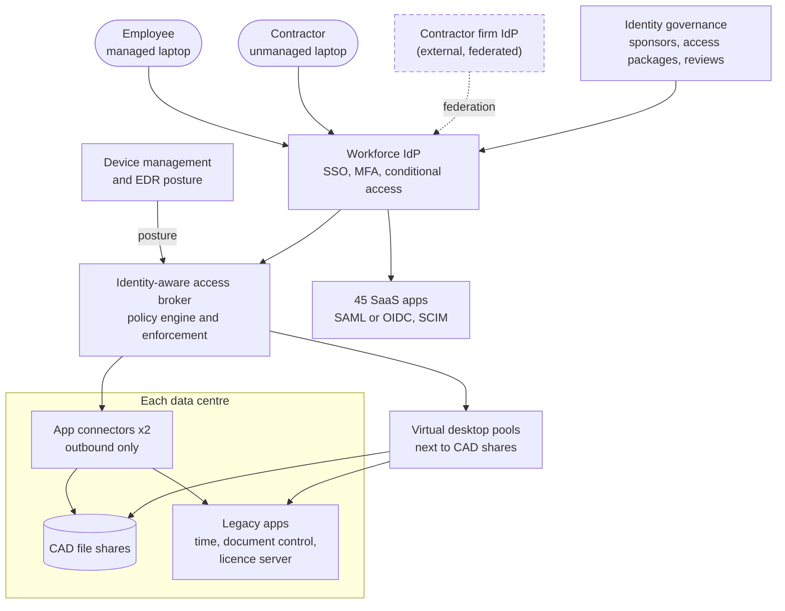
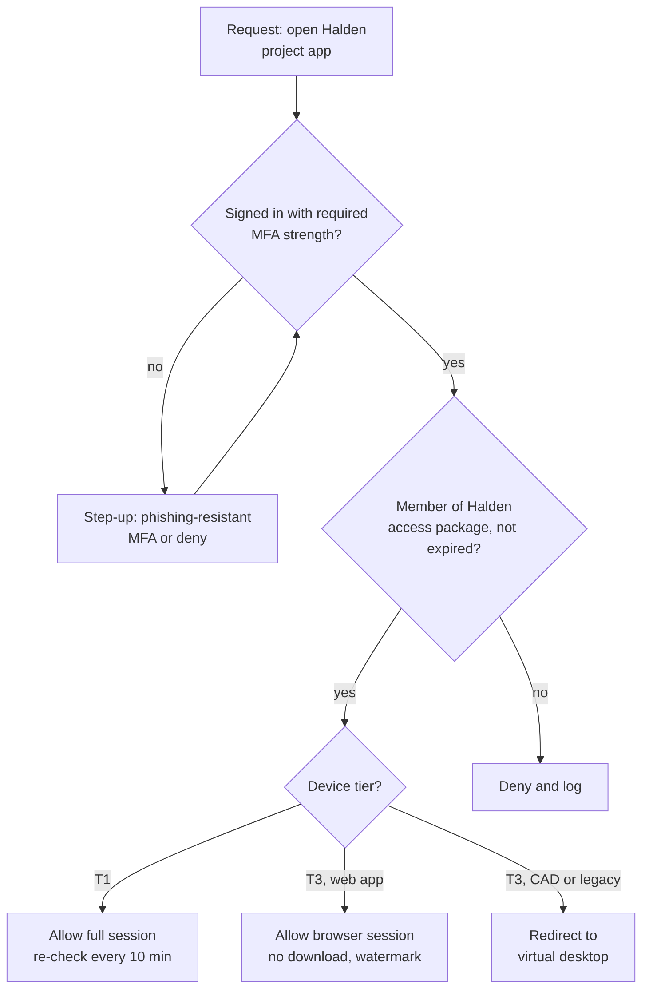
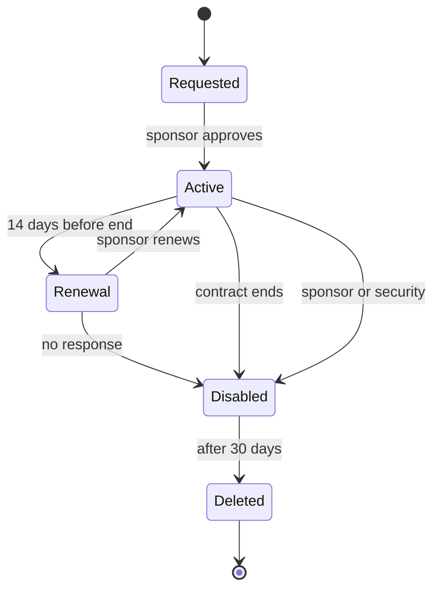
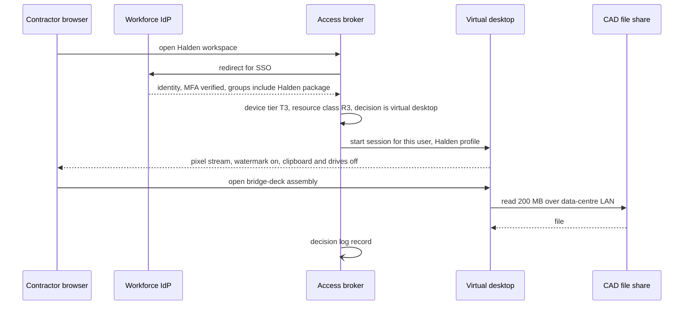

# Exercise: design zero-trust access for an enterprise workforce

> Replacing a VPN is easy to draw: put a broker in front of every application. The design work is
> in what the drawing hides: contractors whose laptops you will never manage, 200 MB drawings that
> cannot sensibly travel to a home broadband line, an old application that only understands Windows
> sign-in, and a leaver whose SaaS sessions outlive their account.

!!! abstract "Page facts"
    **Level:** Advanced · **Status:** Draft · **Time:** 60-90 minutes (45 minutes to attempt, the
    rest to compare) · **Last verified:** 2026-11-21

## Problem statement

Pellora Engineering (pellora.example) is a fictional engineering consultancy that designs bridges,
plant, and building services. Its 1,800 employees work hybrid across 12 offices and home, and about
600 contractors from some 40 partner firms join project teams for a few months at a time, working on
their own, unmanaged laptops. Engineers open large CAD assemblies from file shares in two on-premises
data centres; everyone uses about 45 SaaS applications; and three legacy on-premises applications
(time tracking, document control, and the CAD licence server) cannot be replaced this year.

Today everyone, contractors included, connects through a remote-access VPN that places their device
on the corporate network. An audit found a contractor's VPN account still active four months after
the contract ended, and drawings for a confidential client bid on a contractor's personal laptop.
The managing director wants a design in which access follows the person, the device, and the project
rather than the network, without making engineers wait for their drawings.

Design Pellora's workforce access architecture: identities, device trust, access paths to each kind
of resource, the contractor lifecycle, and the migration away from the VPN. Every company detail and
number on this page is an assumption for this exercise.

## How to use this exercise

1. **Attempt first.** Read only the problem statement, requirements, and scale assumptions.
2. **Time box.** Spend 45 minutes on the twelve steps of the [design method](design-method.md).
   Produce at least an access decision matrix (who, on which device, reaches which resource class,
   how), a container diagram, the contractor lifecycle, the data-path arithmetic for CAD files, and a
   failure-mode list.
3. **Use the hints only when stuck,** one at a time.
4. **Then compare** with the reference solution and score yourself against the rubric. A different
   choice with a stated reason and an honest trade-off is a strong answer.

The application-level counterpart is [case study 15](../end-to-end-case-studies/cs-15-zero-trust-application-architecture.md),
which redesigns one application's internals. This exercise is about the whole workforce reaching
many applications it does not own, so its hard parts are devices, lifecycle, and data paths.

## Requirements

### Functional requirements

1. **FR-1 Single identity.** Every employee and contractor signs in through one workforce identity
   provider (directly or federated) to every application.
2. **FR-2 Per-application access.** Users reach internal and legacy applications one application at a
   time, never the network.
3. **FR-3 Device-aware decisions.** What a user can do depends on the device: full access from a
   managed laptop, less from a personal or contractor device.
4. **FR-4 CAD work.** Engineers, including contractors, open, edit, and save CAD assemblies; files for
   confidential projects never land on unmanaged devices.
5. **FR-5 Project-scoped access.** Access to project data follows project membership, granted by a
   project lead and removed when the person leaves the project.
6. **FR-6 Contractor lifecycle.** Each contractor has a Pellora sponsor and an end date; access ends
   automatically on that date unless the sponsor renews it.
7. **FR-7 Legacy applications.** Time tracking (Windows-integrated sign-in), document control (a
   thick client over a custom TCP protocol), and the CAD licence server keep working.
8. **FR-8 Administration.** IT administrators use just-in-time elevation; break-glass access exists
   if the identity provider fails.

### Non-functional requirements

1. **NFR-1 Revocation.** A leaver or ended contractor loses access to all broker-fronted applications
   and session-revocation-capable SaaS within 15 minutes; any SaaS without that capability is listed
   with its residual session lifetime.
2. **NFR-2 Authentication strength.** 100% of employee sign-ins use phishing-resistant MFA by the end
   of migration; 100% of contractor sign-ins use MFA enforced or verified by Pellora.
3. **NFR-3 No network-level access** for any unmanaged device; the VPN is decommissioned within
   12 months.
4. **NFR-4 CAD experience.** Opening a 200 MB assembly takes at most 30 seconds at p95 for remote
   users, measured from open to first render.
5. **NFR-5 Availability.** The access path (identity provider, broker, connectors) is available 99.9%
   per month (≈ 43.8 minutes); existing work continues through a 1-hour identity outage.
6. **NFR-6 Evidence.** Every access decision to internal and legacy applications is logged with user,
   device trust level, resource, and decision, retained 1 year; contractor access is reviewed by
   sponsors every quarter.
7. **NFR-7 Data protection.** Confidential project data cannot be downloaded, synced, printed, or
   copied to the clipboard from unmanaged devices.

### Clarifying questions a good candidate asks

- Do contractor firms have their own identity providers, and can Pellora trust their MFA? (Here: 25
  of 40 firms have an OIDC or SAML identity provider; the rest do not.)
- Will contractors accept an agent or a browser extension on their laptops? (Here: no software
  installation can be required on contractor devices.)
- Are personal devices allowed for employees? (Here: phones for email and chat; laptops are always
  managed.)
- Where must CAD data stay? (Here: the client contracts allow Pellora's data centres and one named
  cloud region; data residency beyond that depends on contracts, so ask counsel.)
- Which SaaS apps support standard provisioning (SCIM) and session revocation? (Here: 30 of 45 support
  SCIM; fewer support pushed session revocation.)
- Is there a budget for virtual desktops with graphics acceleration? (Here: yes, if sized from numbers.)

## Scale assumptions

### Stated assumptions

| Id | Assumption | Value |
|---|---|---|
| P-A1 | Employees; contractors at any time | 1,800; 600 |
| P-A2 | Offices; share of staff remote on a typical day | 12; 60% |
| P-A3 | Peak share of the workforce signed in at once | 70% |
| P-A4 | Application launches per person per day; share in the busiest hour | 15; 25% |
| P-A5 | Engineers (of whom contractors) | 1,200 (400) |
| P-A6 | CAD assemblies opened per engineer per day; average assembly size | 6; 200 MB |
| P-A7 | Share of daily opens in the 2-hour morning peak | 50% |
| P-A8 | Typical remote downlink for a home worker | 50 Mbit/s (illustrative) |
| P-A9 | Contractor engineers working at once; employee engineers choosing a virtual desktop | 50%; 10% |
| P-A10 | Average contract length; employee attrition | 4 months; 15% a year |
| P-A11 | Decision log record | 1 KB |

### The estimate

- **Concurrency:** (1,800 + 600) × 70% = **1,680 signed-in users** at the peak.
- **Sign-in and launch rate:** 2,400 × 15 = 36,000 application launches/day; 25% in the busiest hour
  = 9,000 ÷ 3,600 s = **2.5 launches/s**. Identity load is small; identity *availability* is what
  matters.
- **CAD data volume:** 1,200 × 6 × 200 MB = **1.44 TB/day** opened. If files travel to devices, the
  60% remote share is 864 GB/day over home broadband and the internet edge.
- **Morning peak bandwidth:** 50% of 1.44 TB in 2 hours = 720 GB ÷ 7,200 s = 100 MB/s ≈
  **800 Mbit/s** leaving the data centres, of which 60% (≈ 480 Mbit/s) goes to remote users.
- **Open time at home:** 200 MB × 8 = 1,600 Mbit ÷ 50 Mbit/s = **32 s** before protocol overhead,
  already over NFR-4's 30 s. Moving whole files to remote devices fails the requirement on arithmetic
  alone; the design must move pixels or cache data close to the user.
- **Virtual desktops:** 400 contractor engineers × 50% = 200, plus 800 employee engineers × 10% =
  80, so **280 concurrent graphics-capable desktops**; plan about 320 for headroom and a failed host.
  A desktop stream is a few Mbit/s rather than a 200 MB file (measure with the chosen protocol).
- **Lifecycle churn:** 600 contractors ÷ 4 months = **150 contractor starts and 150 ends a month**,
  about 7 of each per working day (150 ÷ 21). Employees: 1,800 × 15% = 270 leavers a year, about 1
  per working day. Contractors dominate the lifecycle, which is why the audit finding happened.
- **Decision logs:** 36,000 launches plus re-evaluation every 10 minutes for 1,680 users over an
  8-hour day (1,680 × 8 × 6 = 80,640) ≈ 117,000 records/day × 1 KB ≈ **117 MB/day**, about 43 GB a
  year: small next to the CAD data.

## Hints

??? question "Hint 1: classify before you connect"
    List the user types (employee, contractor, administrator), the device trust levels you can
    actually know (managed, registered personal, unmanaged), and four or five resource classes
    (general SaaS, project SaaS and internal web apps, CAD data, legacy thick clients, admin
    consoles). The design is a matrix of those three things, with an access method in each cell.

??? question "Hint 2: what does the CAD arithmetic tell you?"
    If 200 MB at 50 Mbit/s already takes 32 s, no access broker makes file transfer to home fast
    enough. Where should the computation happen for contractors whose devices you cannot trust,
    and for employees whose devices you can?

??? question "Hint 3: the shape of a good answer"
    One identity provider with conditional access; contractors federated from their firm or issued
    a sponsored guest identity with an end date; an identity-aware broker with connectors in each
    data centre for private apps; managed laptops get full per-app access; unmanaged devices get
    browser access with session controls and virtual desktops next to the CAD data; legacy apps
    published through the broker (Kerberos delegation, per-app TCP) or only inside virtual desktops;
    SCIM and session revocation for leavers; phased migration with the VPN shrinking group by group.

## Reference solution

### The twelve steps, briefly

| Step | Decision |
|---|---|
| 1 Problem | Access follows person, device, and project; contractors are the largest risk and the largest churn |
| 2 Requirements | FR-1 to FR-8; driving NFRs are revocation (NFR-1), no network access for unmanaged devices (NFR-3), CAD experience (NFR-4), and data protection (NFR-7) |
| 3 Estimate | 1,680 concurrent users; 2.5 launches/s; 800 Mbit/s CAD peak; 32 s per file at home; 280-320 virtual desktops; 7 contractor starts and ends a day |
| 4 Boundaries | Identity plane (IdP, governance), device plane (management, posture), access plane (broker, connectors, browser session controls), workspace plane (virtual desktops), resources |
| 5 Contracts | SAML or OIDC to SaaS; SCIM for provisioning; posture signals into the policy engine; session-revocation events where supported |
| 6 Data | CAD data stays in the data centres and the approved cloud region; access logs and identity governance records |
| 7 Style | Broker-based ZTNA (resource portal and device agent variants) plus enclave-style virtual desktops, per NIST SP 800-207 deployment models |
| 8 Deployment | Broker points of presence in two regions; two connectors per data centre; desktop pools next to each CAD share |
| 9 Security | Phishing-resistant MFA, device trust tiers, sponsored contractor identities, JIT administration, break-glass |
| 10 Resilience | Redundant connectors and broker; fail-static sessions during identity outages; desktop pool spread across hosts |
| 11 Operations | Decision logs to the SIEM; lifecycle dashboards; quarterly sponsor reviews; staged migration with gates |
| 12 Decisions | ADR-style choices on contractor identity, CAD access path, and legacy publishing; cost dominated by desktops and licences |

### Containers

**Figure 1 — Pellora workforce access, container view.** Dashed boxes are external; every path to a
private resource goes through the broker or a virtual desktop.

How to read it: the identity provider authenticates everyone and federates to SaaS directly; the
broker decides access to private resources using identity and posture; connectors in each data
centre dial out to the broker, so no inbound port is open; virtual desktops sit beside the CAD
shares so drawings never cross the internet.

### The access decision matrix

The core artifact. Device trust tiers: **T1 managed** (Pellora device management enrolled, EDR
healthy, disk encrypted, patched within policy), **T2 registered personal** (employee phone with app
protection), **T3 unmanaged** (any contractor device, or any device that fails T1 checks).

| Resource class | Employee on T1 | Employee on T2 | Contractor on T3 | Administrator |
|---|---|---|---|---|
| R1 General SaaS (mail, chat, HR) | Full | Mobile apps with app protection | Limited set, browser, no downloads | Same as user, plus JIT admin roles |
| R2 Project SaaS and internal web apps | Full, via broker | View in browser | Browser via broker, no download, watermark | JIT, T1 only |
| R3 CAD data | Broker per-app access from office; virtual desktop or cached sync from home | None | Virtual desktop only, no clipboard, print, or drive mapping | Not a separate path |
| R4 Legacy apps | Through broker (per-app TCP or Kerberos delegation) | None | Only inside a virtual desktop | JIT, T1 only |
| R5 Admin consoles | None without elevation | None | Never | JIT, phishing-resistant MFA, T1, session recorded |

Every cell is also scoped by project membership (FR-5): a contractor on project Halden reaches
Halden's share and Halden's SaaS workspace, nothing else.

**Figure 2 — How the broker decides one request.** The same request gets different outcomes on
different devices.

How to read it: identity strength first, then entitlement, then device; the device decides the
*form* of access rather than just yes or no. The re-check interval (10 minutes, an assumption) and
pushed events from device management end sessions when posture changes.

### Contractor identity and lifecycle

Two paths, chosen per firm:

- **Federated (25 firms):** the firm's identity provider authenticates its people; Pellora trusts it
  only after checking the firm enforces MFA, and still requires Pellora-verified MFA for R2-R4 if the
  firm's MFA claim cannot be verified. Pellora creates a linked guest account so governance, groups,
  and logs have a local object.
- **Pellora-issued (15 firms):** a guest identity with MFA registered at onboarding, verified by the
  sponsor.

Either way the contractor receives **access packages**: bundles of group memberships for one project
with a sponsor, an end date no later than the contract end, and a maximum of 90 days before renewal.

**Figure 3 — Contractor lifecycle.** Access ends on a date unless a person decides otherwise.

How to read it: the only way to stay active is a positive renewal by a named sponsor; silence
disables. Disabling the identity triggers SCIM deprovisioning to SaaS, revokes broker sessions, and
signs out virtual desktops, which is how NFR-1 is met for broker-fronted resources. Sponsor
departure re-assigns their contractors to the project lead, or they are disabled.

### CAD data path

The arithmetic decides it: 32 seconds per file at home fails NFR-4 before overhead.

- **Contractors (T3):** graphics-capable virtual desktops in pools beside each CAD share. Files move
  over the data-centre LAN; only screen pixels reach the contractor. Clipboard, printing, drive
  mapping, and file transfer are disabled; screens carry a user watermark. The CAD licence server
  is reachable only from the desktop pool and managed laptops.
- **Employees in an office (T1):** per-application broker access to the share over the office link,
  as today but without the network-level tunnel.
- **Employees at home (T1):** a virtual desktop (10% chose one, P-A9) or a managed file-sync client
  with a local encrypted cache for their active projects, so only changed blocks cross the internet
  after the first sync.

**Figure 4 — A contractor opens a confidential assembly.** The drawing never leaves the data centre.

How to read it: the broker's decision is "which workspace", not "which network". The 200 MB read
happens between two machines in the same data centre; the contractor's laptop holds a picture.

### Legacy applications

| Application | Problem | Publishing method |
|---|---|---|
| Time tracking (web, Windows-integrated sign-in) | Expects Kerberos tickets from domain-joined machines | Broker authenticates the user with OIDC, then obtains a Kerberos ticket on the user's behalf (constrained delegation) to call the backend |
| Document control (thick client, custom TCP) | No web front end, no modern authentication | Per-application TCP access through the broker for T1 devices; contractors use it only inside a virtual desktop |
| CAD licence server (licence protocol over TCP) | Must be reachable by every CAD session | Reachable only from the desktop pools and through per-app access for T1 laptops; never from T3 |

### Provider equivalents

Small and vendor-neutral by intent; names checked against each linked page on 2026-11-21.

| Capability | AWS | Azure | Google Cloud |
|---|---|---|---|
| Identity-aware access to private applications | [AWS Verified Access](https://docs.aws.amazon.com/verified-access/latest/ug/what-is-verified-access.html) | [Microsoft Entra Private Access](https://learn.microsoft.com/en-us/entra/global-secure-access/concept-private-access) | [Identity-Aware Proxy](https://cloud.google.com/iap/docs/concepts-overview) |
| Managed virtual desktops | [Amazon WorkSpaces](https://docs.aws.amazon.com/workspaces/latest/adminguide/amazon-workspaces.html) | [Azure Virtual Desktop](https://learn.microsoft.com/en-us/azure/virtual-desktop/overview) | Check the provider's current documentation |

Independent ZTNA and desktop vendors offer the same capabilities; capabilities, limits, and prices
change, so check each provider's current documentation.

### Migration

1. **Visibility (months 0-2):** inventory applications, VPN usage by group, contractor accounts
   without sponsors (disable them now), and SaaS apps lacking SCIM.
2. **Identity (months 1-4):** phishing-resistant MFA for administrators, then all employees;
   contractor sponsors and end dates on every existing account.
3. **SaaS conditional access (months 3-6):** device tier and MFA strength enforced at the IdP.
4. **Broker and desktops (months 4-9):** internal web apps behind the broker; desktop pools beside
   the CAD shares; contractors moved off the VPN first (largest risk, smallest device estate to change).
5. **Employees off the VPN (months 8-12):** office by office; legacy apps published; the VPN kept for
   a small break-glass administrator group, then decommissioned (NFR-3).

## Alternatives and trade-offs

| Choice | Favor when | Avoid when |
|---|---|---|
| Virtual desktops for unmanaged devices (reference) | Data must not reach the device; large files; contractors cannot install agents | Graphics-heavy work with no budget for accelerated desktops; poor user links (streams need steady bandwidth) |
| Browser isolation and session controls only | Work is web-based; no thick clients | CAD and legacy thick clients dominate |
| Issue managed laptops to contractors | Long contracts, high-sensitivity clients | 150 starts a month across 40 firms; shipping and retrieving devices is slow |
| Agent-based ZTNA on every device | Devices are managed and posture must be continuous | Contractors refuse agents (clarifying answer) |
| Federated contractor identities (reference, where possible) | Firm's IdP enforces MFA and disables leavers promptly | Firm's IdP is weak or its leaver process is unknown |
| Pellora-issued guest identities | Firm has no IdP; Pellora wants full control | Large numbers from one firm with a good IdP (duplicated lifecycle) |
| Hardened VPN with per-group segments | Short-lived bridge while the broker rolls out | As the end state: devices still join a network segment |

## Failure modes and how the design handles them

- **Workforce identity provider outage.** Detect: sign-in failures, health checks. Handle: existing
  broker and SaaS sessions continue (fail static) for up to 1 hour (NFR-5); new sign-ins wait; a
  sealed break-glass administrator account, outside SSO, alerting on use, lets IT operate the broker.
- **Broker point of presence or connector fails.** Detect: synthetic probes per application. Handle:
  two broker regions, two connectors per data centre; desktop sessions already open continue.
- **Contractor firm's identity provider compromised.** Detect: unusual sign-ins from that tenant,
  impossible travel. Handle: suspend that federation in one step (guest accounts disabled), require
  Pellora-verified MFA for R2-R4 regardless of the firm's claim.
- **Desktop pool exhausted on a deadline day.** Detect: pool utilization above 85%. Handle: headroom
  of about 40 desktops (320 versus 280); burst capacity in the approved cloud region where contracts
  allow.
- **Posture false negative locks employees out** (EDR agent crash marks laptops non-compliant). Detect:
  sudden drop in T1 devices. Handle: managed laptops degrade to the T3 path (browser and desktop)
  instead of a hard deny; fix the agent.
- **SaaS app keeps sessions after deprovisioning.** Detect: lifecycle tests per app. Handle: prefer
  apps with SCIM and session revocation; for the rest, short session lifetimes configured in the app
  and the residual list reported (NFR-1).
- **Exfiltration from a virtual desktop by photographing the screen.** Not preventable technically;
  watermarks make leaks attributable, contracts and access reviews deter.

## Evaluation rubric

| Area | Weak answer | Strong answer |
|---|---|---|
| Requirements | "Replace the VPN with ZTNA" | Asks about contractor IdPs, agents on contractor devices, data residency, SCIM support |
| Estimation | No numbers | Shows 32 s per file at home, 800 Mbit/s peak, 280-320 desktops, 7 contractor starts and ends a day |
| Device trust | Managed or blocked | Tiers with a different *form* of access per tier, not just allow or deny |
| Contractor lifecycle | Manual tickets | Sponsors, end dates, access packages, silence disables, federation with conditions |
| Data path | Broker tunnels SMB to every device | Moves pixels to unmanaged devices; caches or desktops for remote employees; justified by arithmetic |
| Legacy apps | Ignored, or "keep the VPN" | A publishing method per protocol, with contractors confined to desktops |
| Revocation | "Disable the account" | SCIM, broker session revocation, SaaS residual sessions listed honestly |
| Resilience | Not considered | Identity outage behaviour, break-glass, redundant connectors, desktop headroom |
| Migration | Big bang | Phased, contractors first, VPN shrinking with gates |

## Extensions

1. **Client-site work.** Engineers work at a client's site on the client's network, which blocks
   unknown outbound traffic. How do they reach Pellora resources, and what changes in device trust?
2. **Acquisition.** Pellora buys a 300-person firm with its own identity provider and file servers.
   Design day-1 access and the 6-month integration.
3. **Continuous evaluation.** Adopt the OpenID Shared Signals approach so device and session events
   flow between the identity provider, the broker, and major SaaS apps. What becomes faster, and what
   new dependency appears?
4. **Maturity targets.** Score today's and the target design against the five pillars of CISA's Zero
   Trust Maturity Model and choose which pillar to advance first.
5. **Ten times the contractors.** 6,000 contractors on a framework contract. What breaks first:
   sponsors, desktop capacity, or federation trust?

## Related topics

- [The architecture design method](design-method.md) — the twelve steps used above.
- [Case study 15: Zero-trust application architecture](../end-to-end-case-studies/cs-15-zero-trust-application-architecture.md)
  — one application's internals rather than the whole workforce.
- [Security principles and threat modeling](../security-architecture/security-principles-and-threat-modeling.md)
  — Zero Trust tenets and logical components.
- [Identity and access management](../security-architecture/identity-and-access-management.md) —
  federation, lifecycle, JIT, break-glass.
- [Network security architecture](../security-architecture/network-security-architecture.md) — VPN
  versus ZTNA, NAC, endpoint protection.
- [Data security and privacy](../security-architecture/data-security-and-privacy.md) — classification
  and DLP.
- [Hybrid connectivity and VPNs](../networking/hybrid-connectivity-and-vpns.md) — what the VPN does
  today.
- [Cloud and enterprise platform exercises](cloud-and-enterprise-platform-exercises.md) — the D29-T04
  collection this exercise belongs to.
- **Planned:** enterprise architecture and modernization (D18).

## References

| Source | Type | Checked |
|---|---|---|
| [NIST SP 800-207: Zero Trust Architecture](https://csrc.nist.gov/pubs/sp/800/207/final) — NIST, August 2020 | Standard (tenets, deployment models, contractor and satellite-site use cases) | 2026-11-21 |
| [Zero Trust Maturity Model, version 2.0](https://www.cisa.gov/zero-trust-maturity-model) — CISA, April 2023 | Government guidance (pillars and maturity stages) | 2026-11-21 |
| [NIST SP 1800-35: Implementing a Zero Trust Architecture](https://csrc.nist.gov/pubs/sp/1800/35/final) — NIST NCCoE, June 2025 | Practice guide (example implementations with commercial products) | 2026-11-21 |
| [NIST SP 800-46 Rev. 2: Guide to Enterprise Telework, Remote Access, and BYOD Security](https://csrc.nist.gov/pubs/sp/800/46/r2/final) — NIST | Standard (remote access methods, unmanaged devices) | 2026-11-21 |
| [NIST SP 800-63B-4: Authentication and Authenticator Management](https://pages.nist.gov/800-63-4/sp800-63b.html) — NIST | Standard (phishing-resistant authenticators) | 2026-11-21 |
| [RFC 7644: System for Cross-domain Identity Management (SCIM) Protocol](https://www.rfc-editor.org/rfc/rfc7644) — IETF | Standard (provisioning and deprovisioning) | 2026-11-21 |
| Rory Ward and Betsy Beyer, ["BeyondCorp: A New Approach to Enterprise Security"](https://research.google/pubs/beyondcorp-a-new-approach-to-enterprise-security/), ;login:, 2014 | Paper (device inventory and access tiers in practice) | 2026-11-21 |

## Review notes

- Exercise page under D29-T04 (inventory item "zero-trust enterprise"), linked from the
  collection page. Pellora is fictional; every number is a labelled assumption (P-A1 to P-A11) or arithmetic
  from one, plus inline assumptions: 25 of 40 firms federated, 30 of 45 SaaS with SCIM, 10-minute
  re-check, 90-day access packages, 14-day renewal notice, 30-day deletion, 1-hour fail-static window.
- Arithmetic to recheck: 1,680 concurrent; 2.5 launches/s; 1.44 TB/day; 800 Mbit/s peak (480 remote);
  32 s per 200 MB at 50 Mbit/s; 280 desktops (200 + 80); 150 contractor starts a month ≈ 7 per working
  day; 117,000 decision records ≈ 117 MB/day (assumes 8 busy hours at peak concurrency, an upper bound).
- Provider names in the equivalence table were checked against the page titles on 2026-11-21. No
  Google Cloud first-party managed desktop product was verified, so that cell says to check the
  documentation. Desktop stream bandwidth is described only qualitatively; measure it.
- NIST SP 800-207's use cases (enterprise with contracted services or nonemployee access; satellite
  facilities) and deployment models were checked against its table of contents. CISA ZTMM v2.0 (April
  2023) is the current version on CISA's site, which marks the page as archived.
- Data residency and client contract obligations are flagged as "ask counsel"; no law is said to apply.
- Mermaid: Figure 1 has 13 nodes and one subgraph; Figure 3 is a `stateDiagram-v2` with short labels.
