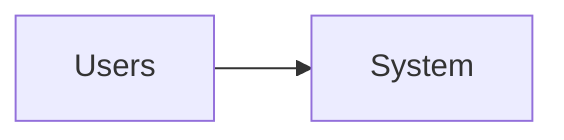

# Case study NN: Name

!!! abstract "Case facts"
    **Level:** Intermediate · **Time:** 60-90 minutes · **Status:** Outline · **Last verified:** 2026-01-01

## Business context and outcome

Fictionalized company, what they sell, what is at stake, and the measurable outcome the
architecture must deliver.

## Stakeholders and users

Who cares, what each group needs, and who decides.

## Functional requirements

Numbered, testable statements.

## Non-functional requirements (measurable targets)

| Attribute | Target | How measured |
|---|---|---|
| Availability | 99.9% monthly | ... |

## Workload assumptions and capacity estimates

Users, requests per second (average and peak), data volumes, growth, with the arithmetic shown.

## Constraints and assumptions

Budget, team, compliance, existing systems, timeline.

## Architecture options considered

| Option | Summary | Strengths | Weaknesses |
|---|---|---|---|
| A | | | |
| B | | | |

## Chosen architecture and rationale

**Figure 1 — System context.** (C4 level 1)

**Figure 2 — Containers.** (C4 level 2)

Progressive diagrams: context → containers → key components → deployment.

## Request and data flow walkthrough

Sequence diagrams for the main happy path and at least one failure path.

## Data model and storage decisions

ER diagram, consistency needs, replication, indexes, caching.

## API and integration contracts

Key endpoints/events with versioning and idempotency notes.

## Security and trust boundaries

Identity, authorization, encryption, secrets, network boundaries.

## Reliability, failover, and disaster recovery

RTO/RPO targets, failure scenarios, what happens when each component fails.

## Scaling and performance strategy

Where the bottlenecks are and how the design handles 10x.

## Observability and operations

Logs, metrics, traces, alerts, runbooks, on-call.

## Deployment and release strategy

Environments, pipeline, deployment pattern, rollback.

## Cost model

Assumptions, main cost drivers, rough order of magnitude, what changes the number most.

## Risks and mitigations

| Risk | Likelihood | Impact | Mitigation |
|---|---|---|---|

## Architecture Decision Records

Links to ADRs written for this case.

## Alternative designs and why they were rejected

At least one plausible alternative and the conditions under which it would be the better choice.

## Questions for the learner

1. ...

## References

| Source | Type | Checked |
|---|---|---|
