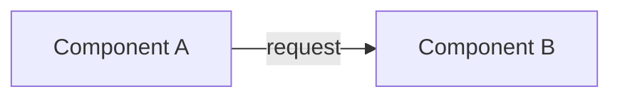

# Topic name

> One-sentence explanation of the topic.

!!! abstract "Page facts"
    **Level:** Beginner · **Status:** Outline · **Time:** 30-45 minutes · **Last verified:** 2026-01-01
    <!-- Keep in sync with the front matter. -->

## Learning objectives

After this page you should be able to:

- Explain ...
- Decide when to ...
- Design or evaluate ...

## Prerequisites

- [Prerequisite page](../section/page.md) — why it matters here.

## The problem this solves

What was hard, slow, risky, or impossible before this concept or technology existed?

## What it is

A precise definition. Define terms before relying on them. Expand acronyms on first use.

## Mental model

An analogy or picture that makes the idea click, followed by **where the analogy breaks**.

## Key terms

| Term | Meaning in this page |
|---|---|
| Term | Short definition consistent with the glossary |

## How it works

Step-by-step mechanism or lifecycle. Numbered steps for procedures.

## Visual walkthrough

**Figure 1 — Caption describing what the diagram shows.**

Legend: rectangles are services; arrows show the direction of requests.
How to read it: start at A ...

## Worked example

Concrete inputs → processing → outputs, with numbers and units where relevant. Keep the example
internally consistent with any scale stated elsewhere on the page.

## Real-world architecture example

Where this appears in an actual application or enterprise system (fictionalized company details).

## Design choices and trade-offs

| Choose this when... | Avoid it when... | Alternatives |
|---|---|---|
| | | |

State the workload assumptions behind each recommendation.

## Failure modes and anti-patterns

What goes wrong, how to detect it, how to prevent it.

## Security considerations

Trust boundaries, identity, data protection, misuse risks.

## Performance, reliability, and cost

Operational characteristics, scaling limits, bottlenecks, cost drivers.

## Implementation walkthrough (optional)

Minimal, runnable illustration where appropriate.

## Hands-on lab

A small exercise completable locally with free tools. Link to the full lab page if one exists.

## Knowledge check

1. Question that tests understanding, not trivia.
2. ...

??? success "Answers"
    1. ...

## Architecture discussion questions

1. Question that requires explanation and trade-off analysis.

## Summary

Three to five sentences a reader could repeat to a colleague.

## Related topics

- **Before this:** ...
- **After this:** ...
- **Adjacent:** ...

## References

| Source | Type | Checked |
|---|---|---|
| [Title](https://example.com) — Organization/Author | Standard / Official docs / Paper / Book / Blog | 2026-01-01 |

## Review notes

<!-- Omitted sections and why; open questions for reviewers; what changed in the last review. -->
